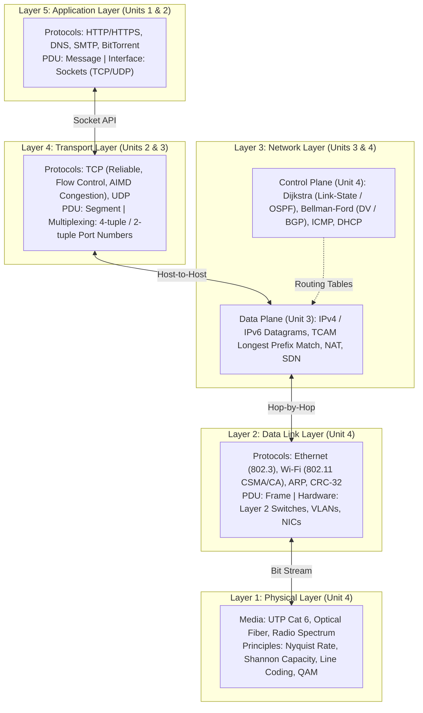

# Computer Networks: Coursework Curriculum and Topic Index

Welcome to the comprehensive study vault for **Computer Networks**.

This vault contains exhaustive, highly structured, and intuitive coursework notes synthesizing lecture decks from PES University and foundational principles from James F. Kurose and Keith W. Ross (*Computer Networking: A Top-Down Approach*, 8th Edition).

Following the top-down methodology, our study begins with the applications humans interact with every day (the Web, DNS, Email, Sockets), peels back transport-layer reliability and congestion dynamics, explores the global packet-forwarding core and routing algorithms, and descends into link-layer framing, switches, physical modulation, and wireless Wi-Fi.

---

## The 5-Layer Internet Protocol Architecture

The diagram below maps the four units of this curriculum across the five layers of the Internet protocol stack:

---

## Complete Table of Contents

### [Unit 1: Foundations, Network Architecture, and Application Protocols](Unit%201/Introduction.md)
*The architecture of the Internet: nuts-and-bolts vs. service views, access networks, store-and-forward packet switching vs. circuit switching, the ISP transit hierarchy, the four sources of delay, 5-layer encapsulation, hardware classification, and core web protocols (HTTP/HTTPS).*

- [**L01 - Introduction to Computer Networks and the Internet**](Unit%201/L01%20-%20Introduction%20to%20Computer%20Networks%20and%20the%20Internet.md) — Autonomous devices, nuts-and-bolts vs. service views of the Internet, formal anatomy of protocols, RFC standards, and the edge-core-access taxonomy.
- [**L02 - The Network Edge - Access Networks and Physical Media**](Unit%201/L02%20-%20The%20Network%20Edge%20-%20Access%20Networks%20and%20Physical%20Media.md) — End systems, residential access (DSL, Cable HFC, FTTH), enterprise Ethernet, wireless access (Wi-Fi, 4G/5G), transmission delay ($L/R$), and guided vs. unguided physical media.
- [**L03 - The Network Core - Packet Switching vs Circuit Switching**](Unit%201/L03%20-%20The%20Network%20Core%20-%20Packet%20Switching%20vs%20Circuit%20Switching.md) — Store-and-forward packet switching, queueing delays, forwarding vs. routing, circuit switching (FDM vs. TDM), and the statistical multiplexing advantage.
- [**L04 - Network Core Structure and ISP Interconnection**](Unit%201/L04%20-%20Network%20Core%20Structure%20and%20ISP%20Interconnection.md) — Scaling limits of full meshes ($O(N^2)$), multi-tier ISP hierarchy (Tier-1 transit, Regional ISPs, Access ISPs), Peering agreements, Internet Exchange Points (IXPs), and private Content Provider Networks (Google, Meta).
- [**L05 - Delay, Loss, and Throughput in Packet Networks**](Unit%201/L05%20-%20Delay,%20Loss,%20and%20Throughput%20in%20Packet%20Networks.md) — The four sources of nodal delay ($d_{\text{proc}}, d_{\text{queue}}, d_{\text{trans}}, d_{\text{prop}}$), the car-caravan analogy, Traffic Intensity ($La/R$), traceroute mechanics, buffer drops, and bottleneck throughput.
- [**L06 - Protocol Layering and the Internet Stack**](Unit%201/L06%20-%20Protocol%20Layering%20and%20the%20Internet%20Stack.md) — Modularity and layering advantages, the 5-layer Internet stack vs. the 7-layer OSI model, Protocol Data Units (PDUs), and step-by-step encapsulation and decapsulation.
- [**L07 - Network Hardware Devices**](Unit%201/L07%20-%20Network%20Hardware%20Devices.md) — Complete Layer 1 through Layer 7 hardware progression: repeaters, hubs, modems, bridges, Layer 2 switches, NICs, Layer 3 routers, NAT gateways, and firewalls; collision domains vs. broadcast domains.
- [**L08 - End-to-End Delay and Throughput Numerical Problems**](Unit%201/L08%20-%20End-to-End%20Delay%20and%20Throughput%20Numerical%20Problems.md) — Step-by-step mathematical solutions for multi-hop packet switching delay, queueing dynamics, binomial probability of statistical multiplexing, and shared bottleneck links.
- [**L09 - Application Layer Principles**](Unit%201/L09%20-%20Application%20Layer%20Principles.md) — Client-Server vs. Peer-to-Peer architectures, communicating processes, socket programming abstractions, transport service criteria (loss, throughput, timing, security), and the TCP vs. UDP service contract.
- [**L10 - The Web and HTTP**](Unit%201/L10%20-%20The%20Web%20and%20HTTP.md) — Hypertext Transfer Protocol, web pages and objects, HTTP statelessness, Non-Persistent ($2\text{ RTT} + d_{\text{trans}}$) vs. Persistent HTTP/1.1, request/response syntax, and status code families.
- [**L11 - HTTPS, Cookies, and Web Caching**](Unit%201/L11%20-%20HTTPS,%20Cookies,%20and%20Web%20Caching.md) — Transport Layer Security (TLS handshake), state tracking over stateless protocols using Cookies, Web Proxy Caches, and the Conditional GET protocol (`If-Modified-Since`).

---

### [Unit 2: Application Infrastructure, Sockets, and Transport-Layer Reliability](Unit%202/Introduction.md)
*Application infrastructure and the boundary of reliable transport: hierarchical DNS resolution, P2P swarms, Python socket programming, transport multiplexing/demultiplexing, UDP minimalism, and the algorithmic synthesis of Reliable Data Transfer (rdt 1.0 to rdt 3.0).*

- [**L01 - Domain Name System (DNS)**](Unit%202/L01%20-%20Domain%20Name%20System%20%28DNS%29.md)) — Distributed hierarchical naming architecture: Root, TLD, and Authoritative servers; iterative vs. recursive resolution queries; local DNS resolvers and TTL caching; Resource Records (`A`, `NS`, `CNAME`, `MX`); and DNS message wire format.
- [**L02 - Peer-to-Peer Applications and BitTorrent**](Unit%202/L02%20-%20Peer-to-Peer%20Applications%20and%20BitTorrent.md) — Client-server scalability bottlenecks vs. P2P distribution, mathematical models of file distribution time ($D_{\text{cs}}$ vs. $D_{\text{p2p}}$), BitTorrent swarms, trackers, rarest-first chunk selection, and tit-for-tat optimistic unchoking.
- [**L03 - Socket Programming with UDP and TCP**](Unit%202/L03%20-%20Socket%20Programming%20with%20UDP%20and%20TCP.md) — The OS transport socket API: Python implementation of connectionless UDP (`SOCK_DGRAM`, `sendto`, `recvfrom`) and connection-oriented TCP (`SOCK_STREAM`, welcoming socket, `bind`, `listen`, `accept`, `connect`, `send`, `recv`).
- [**L04 - Electronic Mail, FTP, and Other Application Protocols**](Unit%202/L04%20-%20Electronic%20Mail,%20FTP,%20and%20Other%20Application%20Protocols.md) — Application protocol architectures: Email (user agents, mail servers, SMTP push protocol, POP3/IMAP pull), FTP out-of-band control/data channels (ports 20 & 21), DHCP overview, SNMP, and Telnet vs. SSH.
- [**L05 - Transport Layer Services and Principles**](Unit%202/L05%20-%20Transport%20Layer%20Services%20and%20Principles.md) — Scope and boundaries of Layer 4: logical process-to-process communication vs. host-to-host delivery, the Ann and Bill household analogy, sender actions (segmentation) vs. receiver actions (reassembly, demux).
- [**L06 - Multiplexing and Demultiplexing**](Unit%202/L06%20-%20Multiplexing%20and%20Demultiplexing.md) — Directing segments to sockets: transport header port fields, connectionless UDP demultiplexing via 2-tuples `(Dest IP, Dest Port)`, connection-oriented TCP demultiplexing via 4-tuples `(Src IP, Src Port, Dest IP, Dest Port)`, and multi-threaded server sockets.
- [**L07 - Connectionless Transport - UDP and Internet Checksum**](Unit%202/L07%20-%20Connectionless%20Transport%20-%20UDP%20and%20Internet%20Checksum.md) — Philosophy of minimalist transport: why UDP exists (no setup RTT, no congestion throttling, small 8-byte header), 16-bit 1's complement Internet Checksum algorithm, overflow wraparound, and error-detection limits.
- [**L08 - Principles of Reliable Data Transfer - rdt 1.0 to rdt 2.2**](Unit%202/L08%20-%20Principles%20of%20Reliable%20Data%20Transfer%20-%20rdt%201.0%20to%20rdt%202.2.md) — Finite State Machine (FSM) synthesis: `rdt 1.0` (perfect channel), `rdt 2.0` (bit errors, stop-and-wait ARQ, ACKs/NAKs), fatal flaw of corrupted feedback, `rdt 2.1` (alternating 1-bit sequence numbers 0 and 1), and `rdt 2.2` (NAK-free duplicate ACKs).
- [**L09 - Principles of Reliable Data Transfer - rdt 3.0 and Pipelining**](Unit%202/L09%20-%20Principles%20of%20Reliable%20Data%20Transfer%20-%20rdt%203.0%20and%20Pipelining.md) — Conquering packet loss: `rdt 3.0` (alternating-bit protocol, countdown timers, retransmission scenarios), stop-and-wait utilization collapse ($U \approx 0.027\%$), pipelining sliding windows, Go-Back-N (GBN), and Selective Repeat (SR).

---

### [Unit 3: Transport Congestion Control, the Network Data Plane, and IP](Unit%203/Introduction.md)
*Controlling network collapse and forwarding packets at line rate: TCP AIMD congestion control, router hardware architecture (ports, fabrics, TCAM), IPv4 datagram formats, fragmentation, CIDR subnetting, NAT, and Software-Defined Networking (SDN).*

- [**L01 - TCP Congestion Control and Flow Control**](Unit%203/L01%20-%20TCP%20Congestion%20Control%20and%20Flow%20Control.md) — Causes and costs of congestion, end-to-end vs. network-assisted congestion control, Additive Increase Multiplicative Decrease (AIMD), Slow Start, Congestion Avoidance, Fast Retransmit / Fast Recovery, TCP Tahoe vs. Reno FSM, and receive window (`rwnd`) flow control.
- [**L02 - Network Layer Overview - Data Plane vs Control Plane**](Unit%203/L02%20-%20Network%20Layer%20Overview%20-%20Data%20Plane%20vs%20Control%20Plane.md) — Forwarding (nanosecond data plane hardware) vs. routing (millisecond control plane software), per-router traditional control plane vs. logically centralized Software-Defined Networking (SDN) controller.
- [**L03 - Router Architecture and Input Output Ports**](Unit%203/L03%20-%20Router%20Architecture%20and%20Input%20Output%20Ports.md) — High-level router anatomy: input port pipeline (physical termination, link decapsulation, lookup engine), Ternary Content-Addressable Memory (TCAM), Longest Prefix Match (LPM), and Head-of-Line (HOL) blocking.
- [**L04 - Switching Fabrics and Queuing**](Unit%203/L04%20-%20Switching%20Fabrics%20and%20Queuing.md) — Switching fabric architectures (memory, shared bus, crossbar network), scaling to $N \times R$, output port buffering, buffer sizing rule-of-thumb ($RTT \times C / \sqrt{N}$), and scheduling disciplines (FIFO, Priority, Round Robin, Weighted Fair Queuing).
- [**L05 - IPv4 Datagram Format and Protocol Fields**](Unit%203/L05%20-%20IPv4%20Datagram%20Format%20and%20Protocol%20Fields.md) — Dissection of the 20-byte IPv4 header: Version, IHL, Type of Service / DSCP, Total Length, Identification, DF and MF flags, Fragment Offset, TTL hop-limit counter, Protocol field, and Header Checksum.
- [**L06 - IPv4 Fragmentation and Reassembly**](Unit%203/L06%20-%20IPv4%20Fragmentation%20and%20Reassembly.md) — Maximum Transmission Unit (MTU) boundaries, router-side fragmentation, destination host reassembly, 8-byte fragment offset arithmetic, and detailed numerical fragmentation traces.
- [**L07 - IPv4 Addressing, Subnetting, and CIDR**](Unit%203/L07%20-%20IPv4%20Addressing,%20Subnetting,%20and%20CIDR.md) — 32-bit dotted-decimal notation, host and router interfaces, demise of classful addressing (Classes A, B, C), Classless Inter-Domain Routing (CIDR `/x`), subnet masks, route aggregation, and step-by-step subnet calculation problems.
- [**L08 - Network Address Translation (NAT)**](Unit%203/L08%20-%20Network%20Address%20Translation%20%28NAT%29.md)) — RFC 1918 private IPv4 spaces, NAPT translation tables mapping private sockets to public IP and port tuples, NAT traversal, firewall benefits, and architectural trade-offs with the end-to-end principle.
- [**L09 - Generalized Forwarding and Software Defined Networking (SDN)**](Unit%203/L09%20-%20Generalized%20Forwarding%20and%20Software%20Defined%20Networking%20%28SDN%29.md)) — Match-plus-action forwarding paradigm, OpenFlow flow tables, multi-field header matching, and unifying routers, switches, NATs, and firewalls into programmable middleboxes.

---

### [Unit 4: Control Plane, Link Layer, LANs, and Physical/Wireless](Unit%204/Introduction.md)
*Global path calculation, link framing, hardware switching, multi-layer synthesis, physical signal modulation, and wireless Wi-Fi: Dijkstra, Bellman-Ford, ICMP, IPv6, ARP, CRC, MAC protocols, Ethernet switches, VLANs, A Day in the Life, Shannon limits, and 802.11.*

- [**L01 - ICMP and DHCP in the Network Layer**](Unit%204/L01%20-%20ICMP%20and%20DHCP%20in%20the%20Network%20Layer.md) — Network diagnostics and host auto-configuration: ICMP Type/Code architecture, `ping` Echo Request/Reply, `traceroute` TTL expiration mechanics, and DHCP review in Layer 3 host bootstrapping.
- [**L02 - IPv6 Architecture and Transition Strategies**](Unit%204/L02%20-%20IPv6%20Architecture%20and%20Transition%20Strategies.md) — The 128-bit address space, colon-hexadecimal notation and zero-compression rules, fixed 40-byte base header, next-header chaining, and transition strategies: Dual Stack and IPv6-in-IPv4 Tunneling.
- [**L03 - Routing Algorithms - Link-State and Dijkstra**](Unit%204/L03%20-%20Routing%20Algorithms%20-%20Link-State%20and%20Dijkstra.md) — Global vs. decentralized routing, graph abstraction $G=(V,E)$, Link-State flooding, Dijkstra's Shortest Path Algorithm: step-by-step table derivation ($N', D(v), p(v)$), computational complexity, and oscillation hazards under load.
- [**L04 - Routing Algorithms - Distance-Vector and Hierarchical Routing**](Unit%204/L04%20-%20Routing%20Algorithms%20-%20Distance-Vector%20and%20Hierarchical%20Routing.md) — Bellman-Ford equation ($D_x(y) = \min_v \{ c(x,v) + D_v(y) \}$), iterative asynchronous vector updates, Count-to-Infinity problem and Poisoned Reverse heuristic, Link-State vs. Distance-Vector comparison, and Autonomous Systems (OSPF intra-AS vs. BGP inter-AS).
- [**L05 - Link Layer Overview, Framing, and ARP**](Unit%204/L05%20-%20Link%20Layer%20Overview,%20Framing,%20and%20ARP.md) — Node-to-node frame delivery across single links, Network Interface Cards (NICs), 48-bit flat MAC addresses, Address Resolution Protocol (ARP, RFC 826): translating IP to MAC on local subnets, broadcast requests, unicast replies, and cross-subnet routing MAC rewrites.
- [**L06 - Error Detection and Correction Techniques (Parity, Checksum, CRC)**](Unit%204/L06%20-%20Error%20Detection%20and%20Correction%20Techniques%20%28Parity,%20Checksum,%20CRC%29.md)) — Protecting bit integrity across noisy links: single-bit parity vs. two-dimensional parity (error correction), mathematical mechanics of Cyclic Redundancy Checks (CRC): polynomial division in Galois Field Modulo-2 arithmetic, generator polynomials, and hardware shift registers.
- [**L07 - Multiple Access Protocols (Channel Partitioning, Random Access, Taking Turns)**](Unit%204/L07%20-%20Multiple%20Access%20Protocols%20%28Channel%20Partitioning,%20Random%20Access,%20Taking%20Turns%29.md)) — Broadcast channels and collision domains; Channel Partitioning (TDMA, FDMA, CDMA orthogonal chip codes); Random Access (Pure ALOHA, Slotted ALOHA, CSMA, CSMA/CD with minimum frame size $t_{\text{trans}} \ge 2 t_{\text{prop}}$ and binary exponential backoff); Taking-Turns (Polling, Token Passing).
- [**L08 - Switched Local Area Networks, Ethernet, and VLANs**](Unit%204/L08%20-%20Switched%20Local%20Area%20Networks,%20Ethernet,%20and%20VLANs.md) — Evolution from coaxial bus to full-duplex switched star, IEEE 802.3 Ethernet frame structure, switch self-learning and frame filtering/flooding, Spanning Tree Protocol (STP), Layer 2 vs. Layer 3 comparison, port-based VLAN isolation, and IEEE 802.1Q 4-byte frame tagging.
- [**L09 - Synthesis - A Day in the Life of a Web Page Request**](Unit%204/L09%20-%20Synthesis%20-%20A%20Day%20in%20the%20Life%20of%20a%20Web%20Page%20Request.md) — Grand end-to-end multi-layer synthesis: DHCP bootstrap $\to$ ARP gateway resolution $\to$ DNS query routing $\to$ TCP three-way handshake $\to$ HTTP GET request $\to$ web server response streaming and DOM rendering.
- [**L10 - Physical Layer Fundamentals, Modulation, and Bandwidth Limits**](Unit%204/L10%20-%20Physical%20Layer%20Fundamentals,%20Modulation,%20and%20Bandwidth%20Limits.md) — Guided media (twisted pair differential signaling, coaxial, single-mode and multi-mode fiber total internal reflection), physical impairments (attenuation in dB, dispersion, thermal noise), **Nyquist Theorem** ($C = 2B \log_2 M$), **Shannon Channel Capacity** ($C = B \log_2(1 + \text{SNR})$), worked numerical problems, Manchester line encoding, and modulation (ASK, FSK, PSK, QAM).
- [**L11 - Wireless LANs, 802.11 Wi-Fi, and Mobility**](Unit%204/L11%20-%20Wireless%20LANs,%20802.11%20Wi-Fi,%20and%20Mobility.md) — Path loss ($1/d^2$), multipath fading, BSS/AP architecture, active vs. passive scanning, why CSMA/CD fails in wireless (self-interference, **Hidden Terminal Problem**, Exposed Terminal Problem), CSMA/CA protocol with DIFS/SIFS and link ACKs, RTS/CTS channel reservation with NAV timers, 802.11 four-address frame format, and seamless subnet mobility handoff.

---

## Cross-Layer Conceptual Map

No layer of the Internet functions in isolation. Concepts learned in earlier units are directly leveraged by protocols in lower layers:

| Higher-Layer Protocol / Concept | Lower-Layer Interaction | Connecting Mechanism |
| :--- | :--- | :--- |
| **HTTP / Web Browsing** ([Unit 1 L10](Unit%201/L10%20-%20The%20Web%20and%20HTTP.md)) | **TCP 3-Way Handshake** ([Unit 2 L08](Unit%202/L08%20-%20Principles%20of%20Reliable%20Data%20Transfer%20-%20rdt%201.0%20to%20rdt%202.2.md)) & **Sockets** ([Unit 2 L03](Unit%202/L03%20-%20Socket%20Programming%20with%20UDP%20and%20TCP.md)) | Opening reliable stream sockets to destination IP and Port 80/443. |
| **DNS Resolution** ([Unit 2 L01](Unit%202/L01%20-%20Domain%20Name%20System%20%28DNS%29.md))) | **UDP Transport** ([Unit 2 L07](Unit%202/L07%20-%20Connectionless%20Transport%20-%20UDP%20and%20Internet%20Checksum.md)) & **IP Routing** ([Unit 4 L03](Unit%204/L03%20-%20Routing%20Algorithms%20-%20Link-State%20and%20Dijkstra.md)) | Resolving human-readable names to routable IP addresses over port 53. |
| **TCP Congestion Control** ([Unit 3 L01](Unit%203/L01%20-%20TCP%20Congestion%20Control%20and%20Flow%20Control.md)) | **Router Output Buffers** ([Unit 3 L04](Unit%203/L04%20-%20Switching%20Fabrics%20and%20Queuing.md)) | Queueing delays and drop events at bottleneck links drive AIMD window adjustments. |
| **IPv4 Subnetting & CIDR** ([Unit 3 L07](Unit%203/L07%20-%20IPv4%20Addressing,%20Subnetting,%20and%20CIDR.md)) | **ARP Resolution** ([Unit 4 L05](Unit%204/L05%20-%20Link%20Layer%20Overview,%20Framing,%20and%20ARP.md)) & **Switched LANs** ([Unit 4 L08](Unit%204/L08%20-%20Switched%20Local%20Area%20Networks,%20Ethernet,%20and%20VLANs.md)) | Comparing subnet masks to decide whether to ARP for target host or default gateway. |
| **Data Plane Forwarding** ([Unit 3 L02, L03](Unit%203/L02%20-%20Network%20Layer%20Overview%20-%20Data%20Plane%20vs%20Control%20Plane.md)) | **Control Plane Algorithms** ([Unit 4 L03, L04](Unit%204/L03%20-%20Routing%20Algorithms%20-%20Link-State%20and%20Dijkstra.md)) | Routing algorithms (Dijkstra/Bellman-Ford) compute paths loaded into hardware TCAM tables. |
| **Ethernet CSMA/CD** ([Unit 4 L07](Unit%204/L07%20-%20Multiple%20Access%20Protocols%20%28Channel%20Partitioning,%20Random%20Access,%20Taking%20Turns%29.md))) | **Wi-Fi CSMA/CA** ([Unit 4 L11](Unit%204/L11%20-%20Wireless%20LANs,%20802.11%20Wi-Fi,%20and%20Mobility.md)) | Contrasting wired collision detection against wireless collision avoidance and RTS/CTS. |
| **End-to-End Synthesis** ([Unit 4 L09](Unit%204/L09%20-%20Synthesis%20-%20A%20Day%20in%20the%20Life%20of%20a%20Web%20Page%20Request.md)) | **All Layers (Application to Physical)** | Complete trace uniting DHCP, ARP, DNS, TCP, HTTP, Ethernet, and Routing. |
