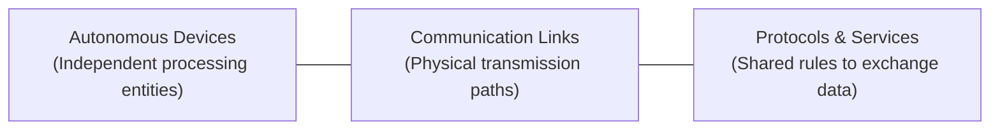
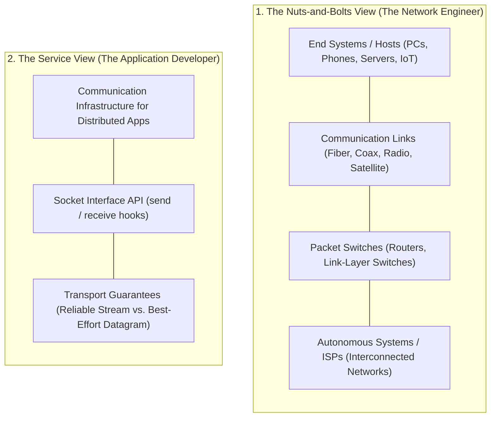
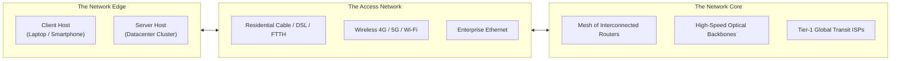
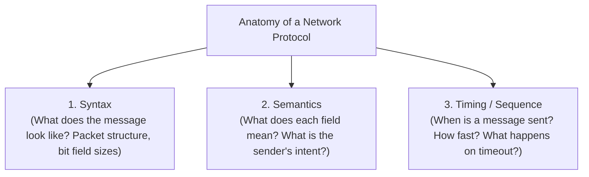

[CN Index](../README.md) / [Unit 1: Foundations & Web](Introduction.md)

---

When we use the Internet today, it feels like an ambient utility—like electricity or water. You open a browser on your laptop, tap a URL, and within a few hundred milliseconds, a high-definition web page arrives from a server located three thousand miles away.

From the outside, it looks simple. But beneath that single click lies one of the most complex distributed systems ever engineered by humanity:
- Millions of distinct applications sending wildly different kinds of data.
- Billions of heterogeneous computing devices, from multi-million-dollar datacenter clusters down to five-dollar temperature sensors.
- Hundreds of thousands of independently administered networks that somehow agree to route each other's traffic across optical fibers, copper wires, and radio waves.

How do all of these disparate physical parts cooperate to deliver information reliably and instantaneously?

In this opening lecture, we lay the conceptual foundation of computer networking: we define what a **Computer Network** actually is, contrast the **Nuts-and-Bolts View** against the **Service View** of the Internet, examine the **Three Structural Elements (Edge, Access, and Core)**, and formally dissect the anatomy of a **Network Protocol**.

---

## What Is a Computer Network?

Let us begin with a precise definition:

> A **Computer Network** is a collection of autonomous computing devices interconnected by communication links so that they can exchange data and share resources.

Three words in this definition carry all the structural weight:



1. **Autonomous Devices:** The devices on the network are not merely dumb hardware peripherals or internal motherboard buses. Each device has its own processor, memory, and operating system, capable of generating, interpreting, or routing data in its own right.
2. **Interconnected by Links:** Two computers sitting on the same desk are just two computers. They become a network only when a physical medium (copper wire, optical fiber, or wireless radio frequency) creates a transmission path between them.
3. **Sharing Resources:** The motivation behind networking is resource sharing. "Resource" does not just mean a file or a printer; it encompasses compute cycles (cloud computing), databases, streaming media, real-time sensor measurements, and access to the wider Internet itself. Networks transform isolated silicon boxes into a collaborative system.

---

## Two Perspectives on the Internet

To understand the Internet, you have to look at it from two different vantage points. Both are completely accurate, but they answer from different seats in the room:



### 1. The Nuts-and-Bolts View
This is the view from the network engineer's seat. It tells you what you could physically point at in a server room or draw on an engineering schematic:
- **Hosts (End Systems):** The billions of computing devices connected to the network. We call them *end systems* because they sit at the edge of the Internet where applications originate and terminate.
- **Communication Links:** The physical pathways that carry raw data. Links transmit data at different **Transmission Rates** (measured in bits per second, or **bps**).
- **Packet Switches:** Specialized hardware devices that take an incoming chunk of data on one link and forward it onto another link toward its destination. The two predominant switch types are **Routers** (which operate in the network core) and **Link-Layer Switches** (which operate in local access networks).
- **Networks of Networks:** The Internet is not a single giant corporate LAN. It is a loose confederation of hundreds of thousands of independent networks (universities, telecommunications providers, cloud corporations) interconnected at shared exchange points.

> [!NOTE]
> Pay attention to the spelling: a lowercase **internet** simply means any arbitrary group of interconnected networks. The capitalized **Internet** refers exclusively to the global, publicly accessible system of interconnected computer networks using the TCP/IP protocol suite.

### 2. The Service View
This is the view from the application programmer's seat. From here, the physical wires, router queues, and fiber amplifiers are completely invisible.

To an application developer, the Internet is an **infrastructure that provides communication services to distributed applications**.
- A distributed application consists of multiple software processes running on separate hosts that exchange messages with each other (such as a web browser interacting with a web server, or a multiplayer game client syncing with a match server).
- The operating system exposes this infrastructure through a programming interface known as the **Socket Interface (API)**. The socket API defines how an application process commands the operating system to send bytes across the network, specifying the destination and desired transport behavior.

---

## The Three Structural Pillars: Edge, Access, and Core

When analyzing how data travels from a sender to a receiver, the entire global Internet decomposes into three distinct structural zones:



Let us look closely at where the boundaries lie:

### 1. The Network Edge
The edge is where computing happens. It consists exclusively of **Hosts (End Systems)** running user applications.
- **Clients:** Devices that initiate requests for information (e.g., your laptop, mobile phone, smart TV).
- **Servers:** Devices that wait for incoming requests and respond with data (e.g., web servers, database clusters). Today, most servers do not sit under someone's desk; they are concentrated by the millions inside massive, warehouse-scale **Datacenters**.

Crucially, **the core of the network does not execute applications**. Routers in the middle of the ocean do not run web servers or parse JSON payloads; they simply move packets.

### 2. The Access Network
The access network answers a single physical question: **How does an end system reach its first router?**
- It is the "first-mile" (or "last-mile") infrastructure.
- Examples include home fiber-optic cables (FTTH), hybrid fiber-coax cable systems, cellular towers (4G/5G), and university campus Wi-Fi networks.

### 3. The Network Core
The network core is the high-speed global mesh of interconnected routers and optical fiber trunks that moves data between access networks across continents. It operates using **Store-and-Forward Packet Switching**, routing data dynamically around physical failures.

---

## What Is a Protocol?

You can connect two computers with a multi-gigabit optical fiber cable, but if they do not agree on the rules of communication, not a single meaningful byte will ever be exchanged.

A fiber link transmits pulses of light; an electrical wire carries fluctuating voltages. Neither tells the receiving machine what the bits represent, whose name is on the packet, or what action should follow.

That is the role of a **Protocol**.



### The Formal Definition
> A **Network Protocol** defines the **format** and the **order** of messages exchanged between two or more communicating entities, as well as the **actions taken** on the transmission and/or receipt of a message or other event.

Every protocol in existence is built upon three foundational pillars:
1. **Syntax:** The structure or format of the data. How many bits are dedicated to the source address? How many bits denote the packet length? Where does the payload begin?
2. **Semantics:** The meaning of each section of bits. Does a control value of `0x01` mean "start connection," "terminate connection," or "data acknowledge"?
3. **Timing and Ordering:** Which party speaks first? How rapidly can data be transmitted without overwhelming the receiver? How long should a sender wait before assuming a message was lost and retransmitting?

---

## Human vs. Network Protocol Traces

To see why protocols must specify both ordering and action, consider the intuitive parallel between human conversational etiquette and a machine network exchange:

```mermaid
sequenceDiagram
    autonumber
    rect rgb(240, 248, 255)
    Note over Alice,Bob: Human Social Protocol
    Alice->>Bob: "Hi" (Greeting)
    Bob-->>Alice: "Hi" (Acknowledge presence)
    Alice->>Bob: "Do you have the time?" (Request)
    Bob-->>Alice: "It is 2:00 PM." (Response with data)
    end

    rect rgb(255, 245, 238)
    Note over Client,Server: Computer Network Protocol (TCP / HTTP)
    Client->>Server: TCP SYN (Connection Request)
    Server-->>Client: TCP SYN-ACK (Connection Granted)
    Client->>Server: TCP ACK + HTTP GET /index.html (Data Request)
    Server-->>Client: HTTP 200 OK + &lt;HTML File&gt; (Data Response)
    end
```

Notice the identical conversational dynamics:
- **Initiation:** One party initiates contact.
- **Verification:** The other party responds to verify that the channel is open and ready.
- **Request:** The actual request for data is transmitted only *after* the mutual connection is established.
- **Response:** The data is returned.

Now consider what happens when a rule is violated:
- In human conversation: If Alice asks Bob for the time, but Bob is wearing headphones and never responds, Alice waits a few seconds, assumes Bob didn't hear, and repeats the question.
- In network protocols: If a client sends an HTTP GET request, but the server drops it, a timer expires on the client, which triggers an automated **Retransmission**.

Without strict, unambiguous rules governing every failure mode, timeout, and message format, coordinated communication between machines is mathematically impossible.

---

## Standards and RFCs: Why the Internet Works

Why can an iPhone manufactured in California seamlessly fetch a web page from a server running Linux in Frankfurt, routing through hardware manufactured by Cisco, Juniper, and Huawei along the way?

Because Internet protocols are governed by **Open Standards**.

The primary standards organization for the Internet is the **Internet Engineering Task Force (IETF)**:
- IETF standards documents are called **RFCs (Request for Comments)**.
- While the name "Request for Comments" sounds informal, RFCs are the definitive architectural specifications of the Internet. Protocols like IP, TCP, HTTP, and DNS are formally standardized in RFCs.
- Other critical bodies standardize the lower physical and link layers, such as the **IEEE** (standardizing IEEE 802.3 Ethernet and IEEE 802.11 Wi-Fi) and the **W3C** (standardizing web markup and APIs).

Open standards ensure that network hardware and software vendors compete on performance and reliability rather than proprietary lock-in.

---

## Key Takeaways

- A **Computer Network** is an interconnected collection of autonomous devices communicating over links to share data and hardware/software resources.
- The Internet can be understood through two lenses: the **Nuts-and-Bolts View** (physical end systems, communication links, packet switches, and interconnected ISPs) and the **Service View** (an infrastructure exposing a socket API to support distributed applications).
- Network architecture splits into three zones: the **Network Edge** (hosts and servers executing applications), the **Access Network** (first-hop infrastructure connecting hosts to routers), and the **Network Core** (the high-speed routing mesh moving packets globally).
- A **Network Protocol** governs communication by defining three elements: **Syntax** (message structure), **Semantics** (meaning of fields), and **Timing/Ordering** (sequence of messages and timeout actions).
- Human conversation and network protocols share the same sequence: an initial greeting/handshake, a request, and a response.
- The Internet's global interoperability rests on open standards maintained by the **IETF** as **RFCs (Request for Comments)**.

---

Now that we understand the broad architectural map of the Internet and the definition of a protocol, we must zoom in directly onto the **Network Edge**. How do physical devices in homes, universities, and corporate offices physically inject their bits into the network? In the next lecture, we dissect [**The Network Edge**](L02%20-%20The%20Network%20Edge%20-%20Access%20Networks%20and%20Physical%20Media.md), exploring **Access Networks** (DSL, Cable HFC, Fiber to the Home, and Wireless 4G/5G/Wi-Fi) alongside the physics of **Guided and Unguided Transmission Media**.
