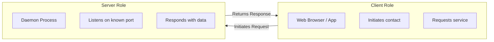
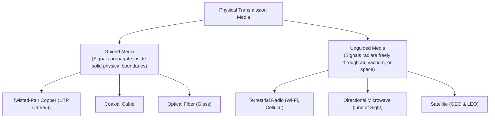
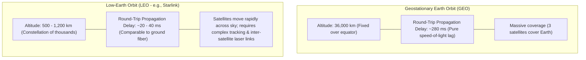

[CN Index](../README.md) / [Unit 1: Foundations & Web](Introduction.md)

---

In the previous lecture, we established the three structural zones of the Internet: the **Network Edge**, the **Access Network**, and the **Network Core**.

Now we zoom in directly onto the boundary where users and applications reside: the edge and the access link.

Before a video stream can cross continents or a database query can reach a cloud cluster, the data must first cross the physical "first mile" (or "last mile"):
- How does a smartphone, laptop, or datacenter server physically inject bits into the network?
- Why do residential cable modems slow down when everyone in the neighborhood streams video at 8:00 PM, while dedicated fiber or DSL does not?
- What are the physical trade-offs between copper wires, glass fibers, and wireless radio waves?

In this lecture, we examine **The Network Edge**: the roles of **Clients, Servers, and Datacenters**, residential and enterprise **Access Network Architectures (DSL, Cable HFC, FTTH, Ethernet, Wi-Fi, and Cellular)**, the fundamental formula for **Transmission Delay ($L/R$)**, and the physics of **Guided vs. Unguided Transmission Media**.

---

## The Network Edge: End Systems, Clients, and Servers

The **Network Edge** is where computation takes place. It consists entirely of **Hosts**, also known as **End Systems**.

We call them "end systems" because they sit at the absolute endpoints of the communication path:
- Application code runs *only* on end systems.
- A router inside the network core inspects packet headers to decide which link to forward them on, but it never parses the HTML payload, executes JavaScript, or decodes video frames.
- All application logic, state, and user interaction are confined strictly to the edge.



### The Architectural Separation of Roles: Client vs. Server
Notice something fundamental: **"Client" and "Server" are software roles played by processes, not permanent hardware definitions.**
- **Client Process:** The entity that initiates communication. It requests an action or resource from a server.
- **Server Process:** The entity that waits passively at a well-known service endpoint (IP address and port) for incoming requests, processes them, and returns responses.

A desktop computer is a client when fetching an email, but if that same computer runs an open SSH server or a local web server, it is simultaneously acting as a server.

### The Role of Datacenters
Historically, a server was a single dedicated workstation sitting in a computer lab. 

Today, consumer web services handle hundreds of millions of concurrent queries. A single physical box would fail instantly under CPU exhaustion, memory limits, or power outages. Modern Internet servers are concentrated by the thousands inside warehouse-scale **Datacenters**:
- Servers are racked in dense clusters interconnected by high-speed internal fabrics (100 Gbps to 400 Gbps).
- Load balancers distribute incoming requests across redundant worker nodes.
- Virtual machines and containers allow elastic scaling, ensuring that if a physical server catches fire, another instantly takes over without dropping the user's TCP connection.

---

## Access Networks: The First-Mile Infrastructure

An **Access Network** is the physical and link-layer infrastructure that connects an end system to its **Edge Router** (the very first router on the path toward the rest of the Internet).


Different environments use radically different access technologies based on legacy wiring, installation cost, mobility requirements, and bandwidth demand:

---

## 1. Digital Subscriber Line (DSL)

When broadband Internet emerged in the late 1990s, telecommunications companies realized that digging up streets to lay new cables to every home would cost hundreds of billions of dollars.

Instead, they repurposed the existing **Twisted-Pair Copper Telephone Wires** that already connected every household to the local telephone company's **Central Office (CO)**. This technology is **Digital Subscriber Line (DSL)**.

```mermaid
flowchart LR
    subgraph HOME["Customer Premises"]
        PHONE["Analog Telephone"]
        PC["Home PC"]
        SPLIT["Splitter / Filter"]
        MODEM["DSL Modem"]
        PHONE --- SPLIT
        PC --- MODEM
        MODEM --- SPLIT
    end

    subgraph CO["Telephone Central Office"]
        DSLAM["DSLAM (DSL Access Multiplexer)"]
        TEL_NET["Telephone Switching Network"]
        ISP_ROUTER["ISP Edge Router"]
    end

    SPLIT <==|"Dedicated Local Loop (Copper)"|=> DSLAM
    DSLAM --> TEL_NET
    DSLAM --> ISP_ROUTER
```

### How DSL Works via Frequency-Division Multiplexing (FDM)
Human voice telephone calls require only a tiny frequency band: **$0\text{ Hz}$ to $4\text{ kHz}$**. 

The copper wire, however, can carry frequencies up to $1\text{ MHz}$ over short distances. DSL uses **Frequency-Division Multiplexing (FDM)** to carve the single wire into three distinct, non-overlapping frequency bands:
1. **$0\text{ kHz}$ to $4\text{ kHz}$:** Traditional analog voice telephone service.
2. **$4\text{ kHz}$ to $50\text{ kHz}$:** Upstream data channel (transmitting from home to Internet).
3. **$50\text{ kHz}$ to $1\text{ MHz}$:** Downstream data channel (transmitting from Internet to home).

Because the voice and data bands are completely separated in frequency:
- You can talk on the landline telephone and download a file over the Internet simultaneously on the same physical wire.
- A **Splitter** at the home separates the analog voice frequencies (routing them to the phone) from the high-frequency data signals (routing them to the DSL modem).
- At the Central Office, the **DSLAM (DSL Access Multiplexer)** strips off the high-frequency digital signals from hundreds of subscriber lines, aggregates them, and routes them to the ISP's edge router.

### Critical DSL Properties
- **Dedicated Physical Line:** The copper wire running from your house to the Central Office is your private local loop. Your neighbors' web browsing activity does not consume your physical line bandwidth.
- **Asymmetric Bandwidth (ADSL):** Notice that the downstream frequency allocation ($50\text{ kHz} - 1\text{ MHz}$) is vastly wider than the upstream allocation ($4\text{ kHz} - 50\text{ kHz}$). Residential users download far more data (video, web pages) than they upload (clicks, search queries).
- **Distance Limitation:** Copper lines suffer from severe high-frequency electrical attenuation. If your house is farther than 3 to 5 kilometers (roughly 10,000 feet) from the Central Office, achievable DSL speeds drop precipitously.

---

## 2. Cable Internet (Hybrid Fiber-Coax - HFC)

Just as telephone companies repurposed voice wiring for DSL, television companies repurposed their **Cable Television (CATV)** infrastructure to deliver broadband Internet.

Instead of running copper all the way, modern cable systems use **Hybrid Fiber-Coax (HFC)**:

```mermaid
flowchart LR
    subgraph HEADEND["Cable Headend"]
        CMTS["CMTS (Cable Modem Termination System)"]
        FIBER_TX["Optical Transmitters"]
        CMTS --- FIBER_TX
    end

    subgraph NEIGHBORHOOD["Neighborhood Distribution"]
        NODE["Fiber Optical Node"]
        AMP1["Bidirectional RF Amplifiers"]
        NODE --- AMP1
    end

    subgraph HOMES["Subscriber Homes"]
        H1["Home 1 (Cable Modem)"]
        H2["Home 2 (Cable Modem)"]
        H3["Home 3 (Cable Modem)"]
    end

    FIBER_TX ==|"Optical Fiber Trunk"|==> NODE
    AMP1 --- H1
    AMP1 --- H2
    AMP1 --- H3
```

### The Architecture of HFC
1. **Fiber Trunks:** High-speed optical fiber carries optical signals from the provider's central **Cable Headend** out to neighborhood junction boxes called **Fiber Optical Nodes**.
2. **Coaxial Distribution:** From the neighborhood optical node, traditional flexible **Coaxial Cables** branch out to deliver the signal directly into 500 to 2,000 individual homes.
3. **The CMTS:** At the cable headend, the **Cable Modem Termination System (CMTS)** converts digital network packets into radio frequency (RF) signals transmitted downstream, and demodulates upstream signals arriving from home cable modems.

### The Defining Distinction: Shared vs. Dedicated Medium
Look at the profound architectural difference between DSL and Cable:

$$\text{DSL is a }\mathbf{Dedicated}\text{ local loop; Cable is a }\mathbf{Shared}\text{ broadcast medium.}$$

In a cable neighborhood:
- All homes connected to the same coaxial segment **share the exact same physical wire and frequency channels**.
- Every downstream packet broadcast by the CMTS travels down the coaxial line past every single home on the street. (Encryption at the link layer prevents your neighbors from reading your packets).
- **The Contention Problem:** Because total channel capacity is shared, if 50 of your neighbors start downloading massive 4K video streams at 8:00 PM, the aggregate bandwidth of the shared coax pipe saturates, and every individual user's throughput drops. Under DSL, your line rate to the CO remains physically constant regardless of neighborhood traffic.

---

## 3. Fiber to the Home (FTTH)

While DSL and Cable push legacy copper to its physical limits, the gold standard of modern fixed broadband is **Fiber to the Home (FTTH)**:

$$\text{Pure optical fiber running all the way from the central office into the living room.}$$

```mermaid
flowchart LR
    CO["Central Office: OLT (Optical Line Terminal)"] ==|"Optical Fiber"|==> SPLIT["Passive Optical Splitter"]
    SPLIT -->|"Fiber"| ONT1["Home 1: ONT (Optical Network Terminal)"]
    SPLIT -->|"Fiber"| ONT2["Home 2: ONT"]
    SPLIT -->|"Fiber"| ONT3["Home 3: ONT"]
```

- **OLT (Optical Line Terminal):** Located at the provider's central office; converts IP packets into laser pulses.
- **Passive Optical Network (PON):** An unpowered, passive optical glass splitter divides one upstream fiber into 32 or 64 individual home fiber strands, eliminating the need for neighborhood electrical amplifiers.
- **ONT (Optical Network Terminal):** Installed inside the home; converts incoming optical light pulses into standard Ethernet electrical signals.
- **Advantages:** Multi-gigabit symmetrical speeds (e.g., 1 Gbps up and 1 Gbps down), near-zero attenuation over tens of kilometers, and complete immunity to electrical noise.

---

## 4. Enterprise Access: Ethernet

In universities, corporate headquarters, and datacenters, end systems connect via **Ethernet**:
- End systems connect via **Unshielded Twisted Pair (UTP) copper cables** (Cat 5e, Cat 6) or optical fiber directly to a departmental **Ethernet Switch**.
- Transmission speeds are standard at **100 Mbps, 1 Gbps, 10 Gbps**, and up to **100 Gbps** in datacenter spines.
- Enterprise networks are strictly hierarchical: desktop switches feed building aggregation switches, which connect to the campus core router, which peers with enterprise ISPs.

---

## 5. Wireless Access Networks: Wi-Fi vs. Cellular

When users require physical mobility, the access link transitions from a physical cable to unguided radio waves. Modern wireless access splits into two distinct domains:

```mermaid
flowchart TD
    subgraph WIFI["Wireless LAN (Wi-Fi - IEEE 802.11)"]
        AP["Wireless Access Point (Base Station)"]
        W_RANGE["Range: 10 - 50 meters (Indoor)"]
        W_SPEC["Spectrum: Unlicensed (2.4 GHz, 5 GHz, 6 GHz)"]
        W_USER["Managed by: Homeowner / University"]
        AP --- W_RANGE --- W_SPEC --- W_USER
    end

    subgraph CELL["Wide-Area Cellular (4G LTE / 5G)"]
        TOWER["Cellular Base Station (Cell Tower)"]
        C_RANGE["Range: 1 - 10 kilometers (Outdoor)"]
        C_SPEC["Spectrum: Licensed (Billion-dollar spectrum auctions)"]
        C_USER["Managed by: Mobile Telecom Operators (AT&T, Jio, Vodafone)"]
        TOWER --- C_RANGE --- C_SPEC --- C_USER
    end
```



| Dimension | Wireless LAN (Wi-Fi) | Wide-Area Cellular (4G / 5G) |
| :--- | :--- | :--- |
| **Standard** | IEEE 802.11 (b/g/n/ac/ax/be) | 3GPP (4G LTE, 5G NR) |
| **Coverage Radius** | Tens of meters (Indoor / Localized) | Several kilometers per cell tower |
| **Spectrum Regulation** | **Unlicensed band** (Anyone can operate a 2.4 GHz or 5 GHz router) | **Licensed band** (Strictly owned by mobile network operators) |
| **User Mobility** | Low; designed for stationary or walking speeds within a building | High; seamless cellular handoffs at highway speeds (120 km/h) |
| **Deployment Model** | Private home routers, campus APs | Massive telecom cell tower infrastructure |

---

## How a Host Injects Bits: Transmission Delay ($L/R$)

Now, let us examine the exact mathematical mechanics of how an end system sends data onto an access link.

An application process generates an arbitrary stream of data (such as a 2 Megabyte image file). The host operating system does not transmit this entire 2 MB file as one continuous, unbroken electrical waveform.

Instead, the host fragments the message into smaller, standardized chunks called **Packets**:
- Suppose a packet has a length of **$L$ bits**.
- The access link has a transmission capacity (bandwidth) of **$R$ bits per second (bps)**.

```mermaid
sequenceDiagram
    autonumber
    participant Host as Sending Host
    participant Link as Physical Access Link (Rate R bps)
    participant Switch as First Switch / Router

    Note over Host: Packet of length L bits ready
    Host->>Link: Pushes bit 1 onto wire...
    Host->>Link: Pushes bit 2...
    Host->>Link: Pushes bit L onto wire...
    Note over Host,Link: Elapsed Time = L / R seconds
    Link-->>Switch: Packet fully serialized onto link
```

### The Transmission Delay Formula
The time required for the sender to physically push (serialize) all $L$ bits of a packet out of the network adapter and onto the transmission medium is the **Transmission Delay** (also called the **Serialization Delay**):

$$\mathbf{d_{\text{trans}} = \frac{L}{R}}$$

$$\text{Where: } L = \text{Packet length in bits}, \quad R = \text{Link transmission rate in bits/second (bps)}$$

#### Concrete Numerical Example
Suppose a host transmits a packet of size $L = 1,500\text{ bytes}$ over a residential link operating at $R = 10\text{ Mbps}$:
1. Convert bytes to bits:
   $$L = 1,500 \text{ bytes} \times 8 \text{ bits/byte} = 12,000 \text{ bits}$$
2. Convert Mbps to bps:
   $$R = 10\text{ Mbps} = 10 \times 10^6 \text{ bps} = 10,000,000 \text{ bps}$$
3. Compute transmission delay:
   $$d_{\text{trans}} = \frac{12,000\text{ bits}}{10,000,000\text{ bps}} = 0.0012 \text{ seconds} = \mathbf{1.2 \text{ ms}}$$

> [!IMPORTANT]
> Never confuse **Transmission Delay** ($L/R$) with **Propagation Delay** ($d/s$):
> - Transmission delay is the time the network card takes to *serialize and squeeze the bits out of the machine onto the wire*. It depends purely on packet size $L$ and link speed $R$.
> - Propagation delay is the time it takes for a single physical photon or electron to travel across the length of the cable at the speed of light. It depends purely on distance $d$ and propagation speed $s$. We analyze propagation delay deeply in Lecture 5.

---

## Physical Transmission Media: Guided vs. Unguided

Every communication link carries signals across a physical medium. We categorize all physical media into two fundamental classes:



---

## 1. Guided Media

### A. Twisted-Pair Copper Wire
- **Construction:** Two insulated copper wires, each about 1 mm thick, twisted together in a regular helical pattern.
- **Why are the wires twisted?** When two parallel wires carry electrical current, external electromagnetic noise from nearby power lines or electric motors induces an interfering current in the closest wire. By twisting the wires, each wire alternates being closer to the noise source. The induced interference cancels itself out mathematically at the receiver (**differential signaling**), drastically reducing **crosstalk**.
- **Unshielded Twisted Pair (UTP):** The most ubiquitous cable in local area networks (Ethernet).
  - *Cat 5e:* Supports up to 1 Gbps up to 100 meters.
  - *Cat 6 / 6a:* Tighter twists and internal plastic separators, supporting 10 Gbps up to 100 meters.

### B. Coaxial Cable
- **Construction:** A central solid copper conductor surrounded by a flexible plastic insulating layer, encased in a woven metallic shielding braid, all wrapped in a protective outer jacket.
- **Performance:** The concentric shielding geometry confines the electromagnetic field tightly inside the dielectric. This provides far superior shielding against high-frequency interference compared to twisted pair, allowing coax to carry hundreds of broadband frequency channels simultaneously.

### C. Optical Fiber
- **Construction:** A microscopically thin, flexible strand of ultra-pure silica glass (silicon dioxide), roughly 8 to 50 microns in diameter (thinner than a human hair), encased in a glass cladding layer with a lower refractive index.
- **Physics of Total Internal Reflection:** Pulses of light (photons) emitted by a semiconductor laser or LED enter the glass core. Because the core has a higher index of refraction than the outer cladding, light striking the boundary at an angle greater than the critical angle undergoes **Total Internal Reflection**, bouncing down the core with near-zero leakage.
- **The Three Superpowers of Fiber:**
  1. **Enormous Bandwidth:** A single fiber pair easily sustains 100 Gbps to several Terabits per second using Wavelength-Division Multiplexing (WDM).
  2. **Ultra-Low Attenuation:** Light travels 50 to 100 kilometers through pure silica before requiring an optical repeater or optical amplifier.
  3. **Total Electromagnetic Immunity:** Light is immune to electrical noise, power line surges, radio frequency interference, and lightning strikes.

---

## 2. Unguided Media (Wireless Radio)

Unguided media transmit electromagnetic waves through the atmosphere or outer space without a physical conduit:

### The Physical Hazards of Wireless Transmission
Unlike a signal confined inside a shielded coaxial cable or glass core, wireless signals propagate through a volatile, chaotic physical environment:
- **Path Loss (Attenuation):** Electromagnetic radiation disperses outward according to the inverse-square law; signal strength plunges rapidly over distance.
- **Multipath Fading:** Radio waves bounce off buildings, walls, terrain, and vehicles. Multiple reflected copies of the same wave arrive at the receiver antenna slightly out of phase, destructively interfering and canceling each other out.
- **Obstruction (Shadowing):** High-frequency radio waves cannot penetrate solid brick walls, dense foliage, or steel structures.
- **Interference:** Unlicensed frequency bands (such as 2.4 GHz) are shared simultaneously by Wi-Fi routers, Bluetooth headsets, cordless phones, and microwave ovens.

### Terrestrial Microwave Links
- Uses highly directional parabolic dish antennas mounted on high towers or mountain peaks.
- Operates on strict **Line-of-Sight** paths. Used to bridge networks across rivers, rough terrain, or between skyscrapers where digging trenches for fiber is prohibitively expensive.

### Satellite Links
A communication satellite acts as a microwave relay station orbiting thousands of kilometers above the Earth:



Notice the critical physical insight of satellite networking:
$$\text{Increasing link bandwidth } R \text{ reduces transmission delay } \frac{L}{R}, \text{ but cannot overcome speed-of-light propagation delay } \frac{d}{s}.$$
Even if a GEO satellite link operates at 1 Gbps, sending a packet up 36,000 km and back down 36,000 km incurs an irreducible **280 ms speed-of-light physical delay**. This makes GEO satellites ill-suited for real-time multiplayer gaming or financial trading, driving the modern transition to low-orbit LEO mega-constellations.

---

## Key Takeaways

- The **Network Edge** consists of hosts (end systems) executing client and server application processes. The core network never runs applications.
- **DSL (Digital Subscriber Line)** runs over dedicated twisted-pair telephone copper, using FDM to separate voice ($0-4\text{ kHz}$), upstream data ($4-50\text{ kHz}$), and downstream data ($50\text{ kHz}-1\text{ MHz}$). It is dedicated and distance-sensitive.
- **Cable Internet (HFC)** uses optical fiber trunks to neighborhood optical nodes, followed by shared coaxial cable into homes. Because the coaxial segment is a **shared broadcast medium**, neighborhood users compete for aggregate channel capacity.
- **FTTH (Fiber to the Home)** runs pure optical fiber directly to the premises using passive optical splitters (PON), delivering symmetrical multi-gigabit throughput.
- **Wi-Fi** provides indoor, local-area wireless access over unlicensed spectrum ($2.4\text{ GHz}, 5\text{ GHz}$); **Cellular (4G/5G)** provides wide-area mobile access over licensed spectrum managed by telecom operators.
- **Transmission Delay** is the time required to push all $L$ bits of a packet onto a link with transmission rate $R$:
  $$d_{\text{trans}} = \frac{L}{R}$$
- **Guided Media** (twisted pair, coaxial cable, optical fiber) confine signals in physical conduits. Optical fiber dominates backbone networks due to massive bandwidth, ultra-low attenuation, and total immunity to electromagnetic interference.
- **Unguided Media** (wireless radio, microwave, satellite) suffer from path loss, multipath fading, and interference. GEO satellites incur a 280 ms speed-of-light propagation delay due to their 36,000 km orbital altitude.

---

We now understand how end systems at the network edge push their packets across first-hop access links. But once a packet leaves the home or campus router, it enters a vast, continent-spanning labyrinth of interconnected switches: the **Network Core**. How does the network core forward billions of packets without reserving dedicated physical circuits for every user? In the next lecture, we dissect [**The Network Core**](L03%20-%20The%20Network%20Core%20-%20Packet%20Switching%20vs%20Circuit%20Switching.md), analyzing **Store-and-Forward Packet Switching**, queueing dynamics, and the deep structural battle between **Packet Switching vs. Circuit Switching**.
