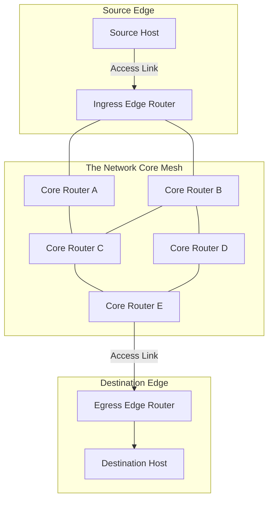
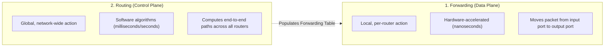
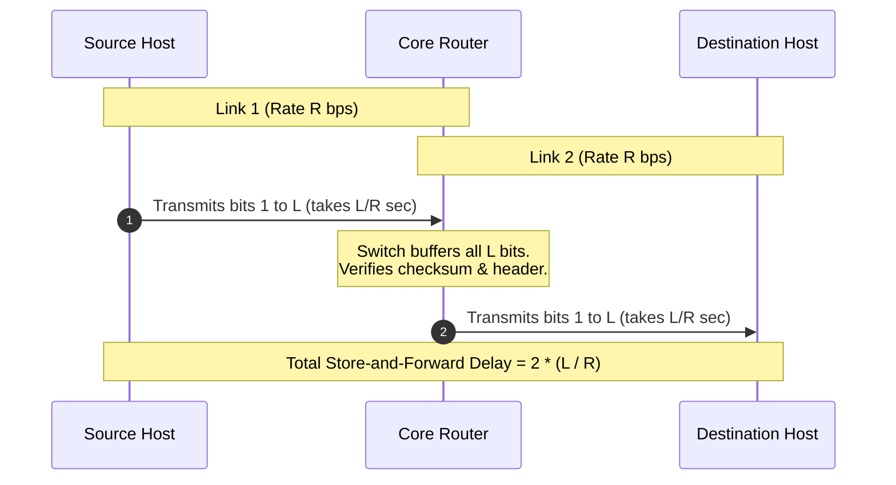
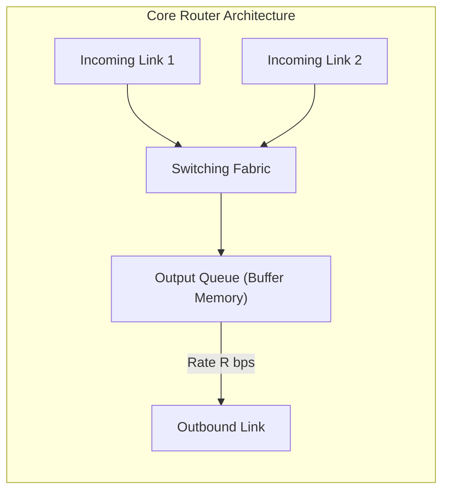
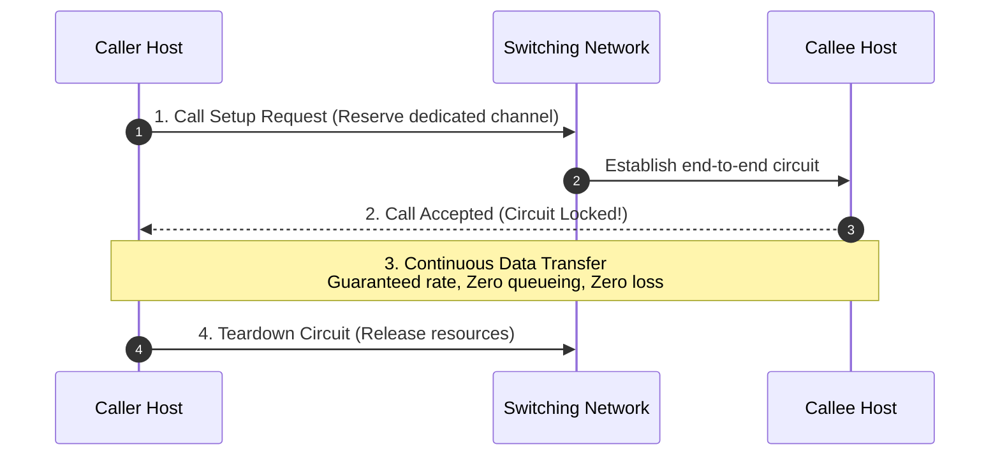
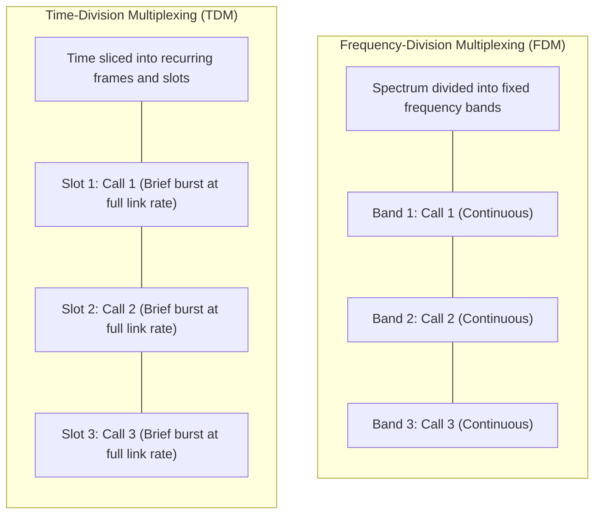
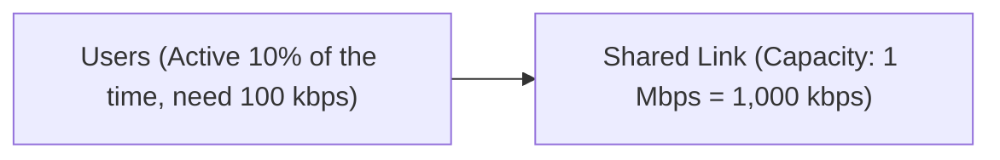

[CN Index](../README.md) / [Unit 1: Foundations & Web](Introduction.md)

---

In the previous lecture, we examined the network edge and saw how end systems serialize packets onto first-hop access links at transmission rate $R$.

Now we cross the boundary into the heart of the Internet: **The Network Core**.

The network core is a global mesh of interconnected packet switches and communication links. When an access router injects a packet into this mesh, how does the core transport it across dozens of intermediate hops to reach a destination halfway around the world?

Historically, there are two diametrically opposed philosophies for moving data through a network:
1. **Circuit Switching:** The classical telephone model, where dedicated physical resources are reserved end-to-end for the entire duration of a call.
2. **Packet Switching:** The Internet model, where data is chopped into discrete packets that share communication links dynamically on demand.

Why did the architects of the Internet abandon circuit switching? How does **Store-and-Forward** transmission work, and why does sharing links create **Queueing Delay** and **Packet Loss**?

In this lecture, we dissect the inner mechanics of the network core: **Store-and-Forward Pipelining**, the fundamental distinction between **Routing and Forwarding**, **Circuit Switching via FDM and TDM**, and the mathematical proof of the **Statistical Multiplexing Advantage**.

---

## The Network Core: A Mesh of Switches

The network core is not a single supercomputer or a centralized switchboard. It is an expansive, decentralized **mesh of interconnected routers**.

Notice the topology: there is rarely just one single path between a source and a destination. A packet can take multiple alternative routes through the core. To navigate this mesh, routers execute two distinct operations at every step:

### The Two Core Functions: Forwarding vs. Routing
Students frequently confuse these two terms. They operate at completely different timescales and spatial scopes:

- **Routing (The Control Plane):** The network-wide process that plans the entire journey. Routing algorithms (like OSPF, BGP) execute in software to evaluate link states and construct **Forwarding Tables** inside each router.
- **Forwarding (The Data Plane):** The local hardware action taken when a packet actually hits a physical interface. The router reads the destination address in the packet header, looks it up in its forwarding table, and transfers the packet across the internal switching fabric to the appropriate outbound interface port.

$$\text{Analogy: }\mathbf{Routing}\text{ is planning your cross-country driving route using a map; }\mathbf{Forwarding}\text{ is taking the correct highway interchange exit ramp.}$$

---

## Store-and-Forward Packet Switching

The foundational operational rule of the Internet is **Store-and-Forward Packet Switching**:

> A packet switch must receive the **entire packet** (all $L$ bits) and verify its integrity before it can begin transmitting the first bit of that packet onto the outbound link.

Let us see why this rule exists and how it affects end-to-end transmission time.

### Store-and-Forward Delay Across Multiple Hops
Suppose a packet has length $L$ bits. It travels across a path consisting of $N$ identical links, each with transmission capacity $R$ bits per second.

Let us trace the timeline (ignoring propagation, processing, and queueing for now):
1. **Hop 1 (Source $\to$ Router 1):** The source takes $\frac{L}{R}$ seconds to push all $L$ bits onto the wire.
2. **Store-and-Forward Pause:** Router 1 cannot transmit bit 1 onto Link 2 while bit 500 is still arriving on Link 1! Why? Because the error-detecting checksum is at the end of the packet, and the destination header must be verified. Router 1 buffers the entire packet.
3. **Hop 2 (Router 1 $\to$ Router 2):** Once all $L$ bits have been stored, Router 1 serializes the packet onto Link 2, taking an additional $\frac{L}{R}$ seconds.

For a path with $N$ successive links of transmission rate $R$, the total serialization delay for a single packet is:

$$d_{\text{end-to-end}} = N \times \frac{L}{R}$$

#### Concrete Numerical Example
Let $L = 10\text{ Kbits} = 10,000\text{ bits}$, and $R = 100\text{ Mbps} = 100 \times 10^6\text{ bps}$.
- Transmission delay per link:
  $$\frac{L}{R} = \frac{10,000}{100,000,000} = 0.0001 \text{ seconds} = 0.1\text{ ms}$$
- Across a path of $N = 3$ links (traversing 2 intermediate routers):
  $$d_{\text{end-to-end}} = 3 \times 0.1\text{ ms} = \mathbf{0.3 \text{ ms}}$$

---

## Store-and-Forward Pipelining

Now look at what happens when a source transmits **multiple packets** (e.g., $P$ packets) across $N$ links.

Because routers operate independently, **links can transmit packets concurrently in a pipeline**:

```mermaid
gantt
    title Packet Pipelining Across 3 Links (L/R = 1 time unit)
    dateFormat X
    axisFormat %s

    section Link 1
    Packet 1 :0, 1
    Packet 2 :1, 2
    Packet 3 :2, 3

    section Link 2
    Packet 1 :1, 2
    Packet 2 :2, 3
    Packet 3 :3, 4

    section Link 3
    Packet 1 :2, 3
    Packet 2 :3, 4
    Packet 3 :4, 5
```

Notice the concurrency:
- While Link 2 is transmitting Packet 1, Link 1 is simultaneously transmitting Packet 2!
- The first packet takes $N \times \frac{L}{R}$ time units to emerge from the pipeline at the destination.
- After that, **one additional packet emerges every $\frac{L}{R}$ seconds**!

For $P$ packets traveling over $N$ links of rate $R$, the total time to deliver all packets is:

$$T_{\text{total}} = (N + P - 1) \times \frac{L}{R}$$

This pipelining effect is why the Internet breaks massive multi-gigabyte files into small 1,500-byte packets: it allows all intermediate links along the path to work in parallel.

---

## Queueing Delay and Packet Loss

In packet switching, multiple sources send packets across shared links whenever they have data. 

What happens when multiple incoming packets arrive at a router simultaneously, all destined for the same outbound link?

Every outbound port on a router maintains a finite memory buffer called an **Output Queue**:
1. If the rate at which packets arrive at the output port exceeds the link's transmission capacity $R$, arriving packets cannot be transmitted immediately.
2. The router places them into the queue. The time a packet spends sitting in line waiting for earlier packets to be transmitted is the **Queueing Delay**.
3. **Buffer Overflow and Packet Loss:** Because router memory is finite, if congestion persists, the queue fills to $100\%$ capacity. When a new packet arrives at a full buffer, the router has nowhere to put it. 
   $$\text{The router drops the packet onto the floor. This is }\mathbf{Packet\text{ Loss}}.$$

The dropped packet is obliterated. The network layer does not repair this; it is left to transport protocols at the edge (like TCP) to detect the missing packet and retransmit it.

---

## Circuit Switching: The Alternative Paradigm

To understand why packet switching is an engineering triumph, we must contrast it with the alternative that dominated telecommunications for a century: **Circuit Switching**.

Derived from the traditional analog telephone network, circuit switching is based on **End-to-End Resource Reservation**:

### The Three Phases of Circuit Switching
1. **Call Setup Phase:** Before any user data can be sent, signaling messages travel across the network, carving out and reserving a dedicated slice of transmission capacity on every switch and link along the path. If any link is fully booked, the call is **blocked** (the classic telephone "busy signal").
2. **Data Transfer Phase:** Data flows continuously across the dedicated circuit. Because bandwidth is reserved exclusively for this session:
   - There is **zero queueing delay**.
   - There is **zero packet loss** due to congestion.
   - Transmission throughput is completely guaranteed.
3. **Circuit Teardown Phase:** When the call ends, explicit signaling releases the reserved channels back to the network pool.

---

## Multiplexing in Circuit Switching: FDM vs. TDM

How does a single high-capacity physical trunk line carry multiple concurrent circuit-switched calls? 

Circuit switches use two classical multiplexing techniques:

### 1. Frequency-Division Multiplexing (FDM)
- The link's total electromagnetic frequency spectrum is divided into fixed, narrow frequency bands (like radio stations on an FM dial).
- Each call is assigned its own dedicated frequency band for the duration of the connection.
- Each call transmits continuously, but at a fraction of the total link bandwidth.

### 2. Time-Division Multiplexing (TDM)
- Time is partitioned into fixed-duration **Frames**, and each frame is subdivided into a fixed number of **Time Slots**.
- When a call is established, the network assigns it one specific time slot in every recurring frame.
- The call transmits periodically at the full speed of the link, but only during its designated recurring slice of time.

### The Fatal Flaw of Circuit Switching: The Idle Channel Waste
Circuit switching works brilliantly for telephone calls where people speak continuously.

However, **computer data is inherently bursty**:
- A user clicks a link, downloads a page in 100 milliseconds, and then spends 30 seconds silently reading the text.
- Under circuit switching, the user's reserved frequency band or time slot sits **completely idle** during those 30 seconds.
- **That reserved capacity cannot be borrowed by any other user!** It is wasted. If 100 users are browsing the web, circuit switching locks up 100 channels even though 95 of them are doing nothing, causing artificial blocking for new users.

---

## The Winner: The Statistical Multiplexing Advantage

Packet switching abandons rigid reservation entirely in favor of **Statistical Multiplexing**:

> Resources are allocated dynamically on demand, packet by packet. If a user has no packets to send, their link capacity is immediately and automatically consumed by someone who does.

To see why statistical multiplexing revolutionized global networking, let us walk through the **Canonical University Examination Proof**:

### The Setup
- **Shared Link Capacity:** $1\text{ Mbps} = 1,000\text{ kbps}$.
- **User Bandwidth Demand:** Each user requires $100\text{ kbps}$ when actively transmitting.
- **User Activity Profile:** Users are bursty; each user is active only **$10\%$ of the time** ($p = 0.1$), and sits idle $90\%$ of the time.

### Under Circuit Switching
Circuit switching must dedicate $100\text{ kbps}$ permanently to each user:
$$\text{Max Users Supported} = \frac{1,000\text{ kbps}}{100\text{ kbps/user}} = \mathbf{10 \text{ Users}}$$
Even if all 10 users are idle, an 11th user is strictly rejected with a busy signal.

### Under Packet Switching
Suppose we admit **$N = 35$ users** onto this exact same $1\text{ Mbps}$ link!

Can a $1\text{ Mbps}$ link safely handle 35 users who each need $100\text{ kbps}$?
- If all 35 users transmitted at the exact same moment, they would demand $3,500\text{ kbps}$, causing severe queueing congestion.
- But each user transmits only $10\%$ of the time!
- Congestion occurs **only if more than 10 users are actively transmitting at the exact same instant**.

Because users act independently, the number of simultaneously active users follows the **Binomial Distribution**:

$$\text{Probability that exactly } k \text{ users are active out of } N \text{ users:}$$
$$P(X = k) = \binom{N}{k} p^k (1 - p)^{N - k}$$

Where $N = 35$ and $p = 0.1$. The probability that **more than 10 users are active simultaneously** is:

$$P(X > 10) = \sum_{k=11}^{35} \binom{35}{k} (0.1)^k (0.9)^{35 - k}$$

When evaluated mathematically:
$$P(X > 10) \approx \mathbf{0.0004} \quad (\text{less than } 0.04\%!)$$

Look at what this probability proves:
- **$99.96\%$ of the time**, 10 or fewer users are active. The aggregate demand is less than or equal to $1\text{ Mbps}$, meaning packets experience **zero queueing delay**!
- Less than **$0.04\%$ of the time** (roughly 1 second out of every 40 minutes), more than 10 users transmit at once, and packets briefly wait in the router's buffer.
- Packet switching supports **$3.5\times$ more users** on the exact same physical wire with near-zero noticeable degradation!

This massive economic and engineering efficiency is why packet switching conquered the world.

---

## Packet Switching vs. Circuit Switching: Comprehensive Comparison

| Architectural Property | Packet Switching | Circuit Switching |
| :--- | :--- | :--- |
| **Resource Allocation** | **On-demand (Dynamic)**; shared packet-by-packet | **Pre-allocated (Static)**; reserved for session duration |
| **Call Setup Phase** | **None**; packets can be sent instantly | **Mandatory**; signaling establishes end-to-end path |
| **Bandwidth Guarantee** | Best-effort; bandwidth varies with congestion | Guaranteed, constant transmission rate |
| **Handling of Bursty Traffic** | **Optimal**; idle users consume zero capacity | **Poor**; idle channel capacity is wasted |
| **Queueing Delay & Loss** | Possible; packets wait in buffers and drop on overflow | **Zero queueing delay; zero loss** once call is connected |
| **State Storage in Routers** | Minimal; routers store only forwarding tables | Heavy; switches maintain per-call circuit state tables |
| **Primary Real-World Usage** | The Internet, Ethernet, 4G/5G data networks | Traditional PSTN landline telephone systems |

---

## Key Takeaways

- The network core is a mesh of packet switches executing two core functions: **Routing** (network-wide control plane path calculation) and **Forwarding** (local data plane hardware switching from input to output port).
- **Store-and-Forward** requires a switch to buffer the entire $L$-bit packet before transmitting it onto the next link, yielding an end-to-end serialization delay of $N \times (L/R)$ across $N$ links.
- When multiple packets are sent, store-and-forward links **pipeline** transmission, delivering one packet every $L/R$ seconds after the initial fill.
- Packet switching shares links dynamically. If arrival rate exceeds link capacity, packets wait in memory buffers (**Queueing Delay**); if the buffer fills completely, arriving packets are dropped (**Packet Loss**).
- **Circuit Switching** reserves dedicated end-to-end capacity using **FDM** (frequency bands) or **TDM** (time slots). It guarantees throughput and eliminates queueing, but wastes resources when traffic is bursty.
- **Statistical Multiplexing** allows packet switching to accommodate significantly more users than circuit switching (e.g., 35 bursty users vs. 10 static users on a 1 Mbps link, with less than 0.04% probability of congestion).

---

We have now seen how packet switching moves data across individual links and routers. But who actually owns these routers? The Internet is not a single company's private network. How do thousands of competitive commercial Internet Service Providers (ISPs), universities, and tech giants interconnect to form a single global mesh without running trillions of individual cables? In the next lecture, we analyze [**Network Core Structure and ISP Interconnection**](L04%20-%20Network%20Core%20Structure%20and%20ISP%20Interconnection.md), tracing the multi-tier provider hierarchy, peering vs. transit economics, and the rise of private **Content Provider Networks**.
