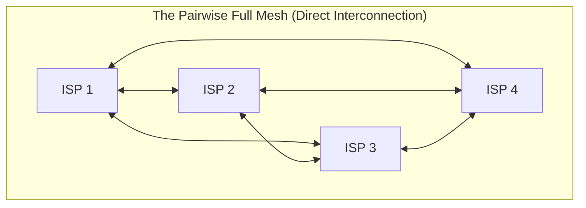
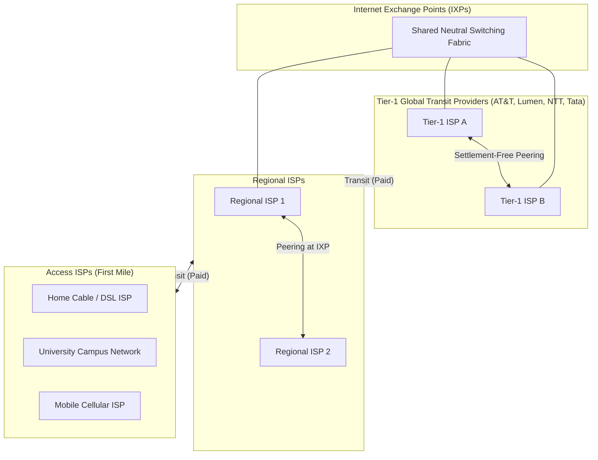
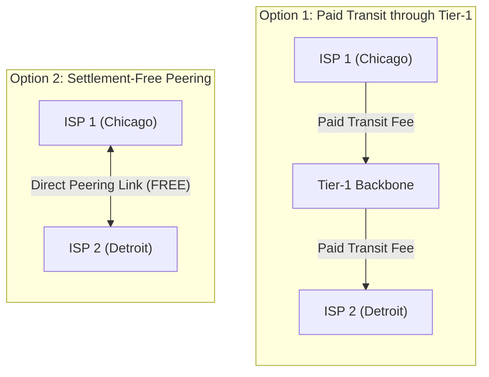
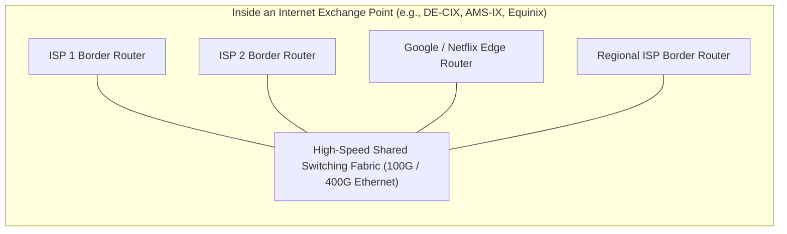
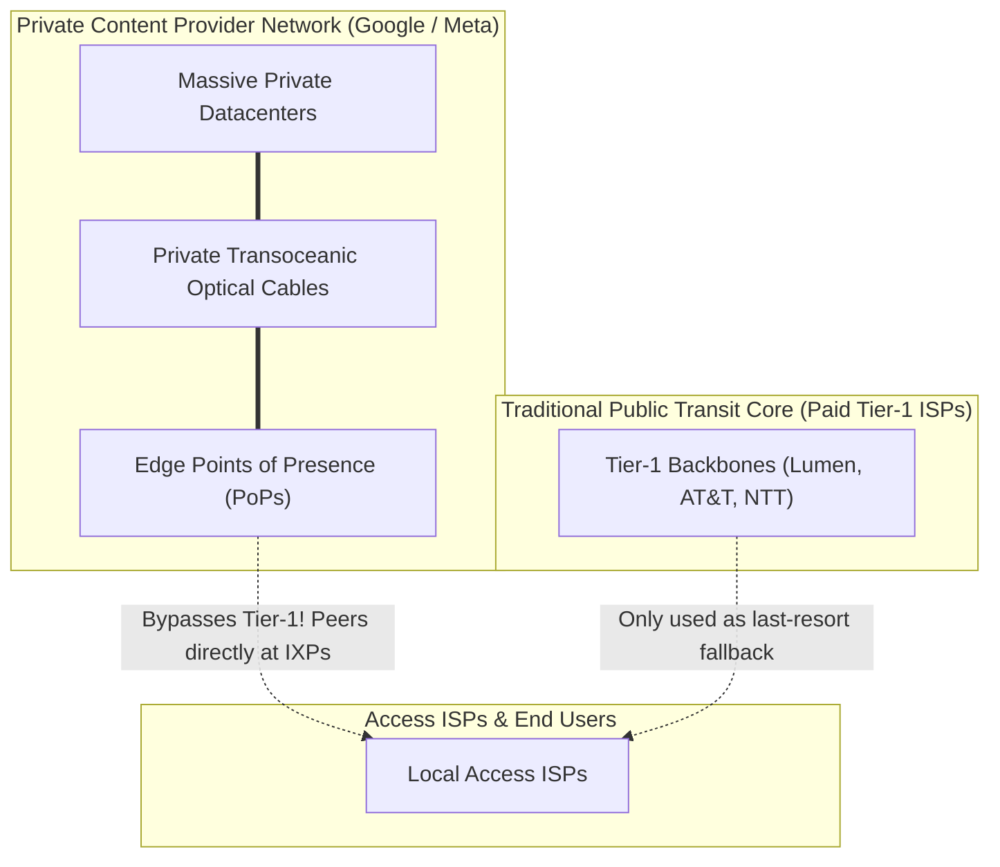

[CN Index](../README.md) / [Unit 1: Foundations & Web](Introduction.md)

---

In the previous lecture, we established how store-and-forward packet switching moves individual packets across links and routers inside the network core.

Now we confront a broader architectural and economic question:

Who owns and connects the routers of the network core?

The Internet is not owned by a single company, a single government, or a single telecommunications monopoly. It consists of hundreds of thousands of independent networks called **Autonomous Systems (ASes)** or **Internet Service Providers (ISPs)**:
- A university in India operates its own campus network.
- A residential broadband provider in Germany connects millions of home fiber links.
- A cloud provider in Virginia hosts millions of web applications.

When a student in India opens a website hosted in Virginia, how do these completely separate, commercially competitive networks coordinate to carry the packet? Why can't every ISP simply run a direct fiber cable to every other ISP on Earth?

In this lecture, we examine **Network Core Structure and ISP Interconnection**: the mathematical catastrophe of the **Pairwise Full-Mesh ($O(N^2)$)**, the emergence of the **Hierarchical Multi-Tier ISP Architecture (Tier-1, Regional, and Access ISPs)**, the critical distinction between **Transit and Settlement-Free Peering**, the physical role of **Internet Exchange Points (IXPs)**, and how modern **Content Provider Networks (Google, Meta, Netflix)** have fundamentally re-engineered the core of the Internet.

---

## The Pairwise Interconnection Problem: $O(N^2)$ Scaling Failure

Suppose there are millions of local **Access ISPs** worldwide, each connecting a localized cluster of homes, businesses, and universities.

To ensure that any user on Access ISP $A$ can send a packet to any user on Access ISP $B$, the most naive solution is to connect every access ISP directly to every other access ISP:

### The Quadratic Explosion
For $N$ independent access networks, each network would need to maintain a direct physical and commercial connection to the other $N - 1$ networks.

Because each bidirectional link connects two networks, the total number of distinct pairwise interconnections required is:

$$\mathbf{\text{Total Interconnections} = \frac{N(N - 1)}{2} = O(N^2)}$$

Let us look at what this quadratic equation means in reality:
- For $N = 10\text{ networks}$: $\frac{10 \times 9}{2} = \mathbf{45 \text{ connections}}$.
- For $N = 1,000\text{ networks}$: $\frac{1,000 \times 999}{2} = \mathbf{499,500 \text{ connections}}$.
- For $N = 100,000\text{ networks}$ (the scale of the modern Internet):
  $$\frac{100,000 \times 99,999}{2} \approx \mathbf{5,000,000,000 \text{ (5 Billion Connections!)}}$$

Notice why a full mesh collapses:
1. **Physical Impossibility:** No router chassis can house 100,000 physical fiber line cards to plug into every other provider on Earth.
2. **Economic and Administrative Nightmare:** Every single connection requires a separate legal contract, bilateral billing accounting, capacity negotiation, and 24/7 technical monitoring.
3. **Marginal Cost of Growth:** When a new ISP joins, it cannot simply plug in one cable. It must establish $N$ brand-new relationships with every existing ISP!

Direct pairwise interconnection is completely non-scalable. The solution is **Aggregation through a Multi-Tier Hierarchy**.

---

## Evolution of the Multi-Tier ISP Hierarchy

To avoid $O(N^2)$ direct connections, the Internet evolved through a series of logical architectural steps:

Let us trace how each architectural tier operates:

---

### 1. Transit and the Tier-1 Global Transit Backbones

Instead of connecting to thousands of individual networks, a local access ISP connects to a **Transit ISP**:

> **Transit** is a commercial customer-provider relationship where a smaller network pays a larger backbone provider for **full reachability to the entire global Internet**.

The providers at the very pinnacle of the global hierarchy are known as **Tier-1 ISPs** (e.g., Lumen/CenturyLink, AT&T, NTT, Tata Communications, Telia/Arelion):
- **Universal Reachability without Paying:** A Tier-1 ISP is defined by a unique architectural property: **it does not buy transit from anyone**. 
- It operates its own transoceanic fiber-optic submarine cables and continent-spanning terrestrial backbones.
- Because no single Tier-1 owns the entire world, all Tier-1 backbones **peer directly with each other**, creating a shared, completely interconnected global core.

---

### 2. Peering: Bypassing the Upstream Toll

Suppose Regional ISP 1 (serving customers in Chicago) and Regional ISP 2 (serving customers in Detroit) both pay a Tier-1 provider for global transit.

Every time a user in Chicago sends an email to a user in Detroit:
- The packet travels up to the Tier-1 provider in New York.
- Both regional ISPs are billed per gigabyte by the Tier-1 provider for carrying that traffic!

To save money, the two regional ISPs establish a **Peering Agreement**:

> **Peering** is a business and technical relationship where two independent networks agree to **exchange traffic between their respective customers directly, free of charge** (often called **Settlement-Free Peering**).

### The Golden Rule of Peering: No Transit for Third Parties!
Notice an essential commercial constraint of peering:
$$\text{If ISP A and ISP B peer, ISP A carries traffic }\mathbf{only}\text{ destined for ISP B or ISP B's direct customers.}$$
ISP A will *never* carry traffic between ISP B and the rest of the world for free! Peering is strictly for mutual customer traffic exchange.

---

### 3. Internet Exchange Points (IXPs)

If hundreds of regional ISPs, universities, and enterprise networks want to peer with each other, they face the pairwise connection problem all over again: running physical fiber between every pair of peering partners is expensive.

The solution is the **Internet Exchange Point (IXP)**:

> An **IXP** is a neutral, physical datacenter facility equipped with high-speed switching fabrics where hundreds of distinct networks, ISPs, and content providers run their fiber into a shared room and peer with each other over direct local switch ports.

- Instead of digging 50 separate trenches across a city to connect to 50 peers, a network runs **one single high-capacity fiber cable** into the local IXP and plugs into the central switch fabric.
- Once connected, it can negotiate software-level BGP peering sessions with any other network present in the building via virtual cross-connects.
- Famous global IXPs (like AMS-IX in Amsterdam, DE-CIX in Frankfurt, and LINX in London) exchange tens of Terabits of traffic every second.

---

## The Modern Paradigm Shift: Content Provider Networks

Over the past decade, the traditional telecommunications hierarchy has been disrupted by **Content Provider Networks** (e.g., Google, Meta, Microsoft, Amazon, Netflix, Apple):

### Why Content Giants Bypassed the Internet Core
Today, a tiny handful of tech corporations originate over **$70\%$ of all global Internet traffic** (YouTube, Netflix, Instagram, Cloud services).

If Google relied entirely on traditional Tier-1 ISPs to carry its video traffic:
1. **Astronomical Transit Bills:** Google would pay billions of dollars every year in transit fees to traditional telecom providers.
2. **Unpredictable Quality of Service:** Packets routing through third-party Tier-1 networks might experience high queueing delays, packet loss, or unoptimized routing.

To take total control over performance and cost, content providers built **their own private global networks**:
- Google owns and operates tens of thousands of kilometers of private terrestrial and transoceanic undersea fiber-optic cables spanning continents.
- They deploy thousands of **Points of Presence (PoPs)** and caching servers directly inside regional ISPs and IXPs worldwide.
- **Bypassing the Core:** When a user requests a YouTube video, the packet does *not* travel across the public Tier-1 Internet backbone. Google's private network carries the video across continents on Google's private dark fiber, dropping the packet directly into the user's local access ISP at a nearby IXP!

---

## Summary of the Internet Interconnection Taxonomy

Let us consolidate the five layers that form the modern global network structure:

| Structural Tier | Entity / Organization | Economic & Routing Role | Real-World Examples |
| :--- | :--- | :--- | :--- |
| **Tier-1 ISPs** | Global Backbone Transit Providers | Form the global backbone; peer with all other Tier-1s settlement-free; sell transit to lower tiers | Lumen, AT&T, NTT, Tata Communications, Telia/Arelion |
| **Regional ISPs** | National / Regional Networks | Cover specific countries/states; buy transit from Tier-1s; peer with regional competitors | State-wide or national telcos |
| **Access ISPs** | Residential / Enterprise Providers | Provide first-mile access to homes, universities, and offices; buy transit from Regional ISPs | Comcast, Spectrum, Jio, Airtel, Vodafone |
| **IXPs** | Internet Exchange Points | Neutral physical facilities with shared switching fabrics enabling direct multi-party peering | DE-CIX, AMS-IX, LINX, Equinix, NIXI |
| **Content Networks** | Hyperscale Tech Giants | Private global overlay backbones; connect private datacenters directly to access ISPs at IXPs | Google, Meta, Microsoft, Amazon, Netflix |

---

## Key Takeaways

- A naive pairwise full-mesh connection between $N$ access ISPs requires $\frac{N(N-1)}{2} = O(N^2)$ connections, which collapses under physical, financial, and administrative scaling limits.
- The Internet scales using a **Hierarchical Provider Model**: Access ISPs aggregate into Regional ISPs, which aggregate into global **Tier-1 Transit ISPs**.
- **Tier-1 ISPs** have no upstream transit providers; they peer with each other to guarantee universal global reachability.
- **Transit** is a paid customer-provider relationship granting full reachability to the wider Internet.
- **Peering** is a settlement-free agreement between two networks to exchange traffic directly between their respective customers, avoiding expensive upstream transit tolls.
- **Internet Exchange Points (IXPs)** are neutral physical switching datacenters that allow hundreds of ISPs and networks to peer with each other through a single shared switch fabric.
- **Content Provider Networks** (Google, Meta, Netflix) have transformed the Internet core by deploying private transoceanic fiber backbones and edge caches, bypassing traditional Tier-1 transit backbones to peer directly with access networks at IXPs.

---

We now know how data crosses first-hop access links and how the global network of ISPs routes packets through the core. But as packets traverse these hops, routers, and queues, they experience physical friction: delays, buffers, and losses. When a user complains that a network is "slow," what physical and mathematical factors are actually at fault? In the next lecture, we dissect [**Delay, Loss, and Throughput in Packet Networks**](L05%20-%20Delay,%20Loss,%20and%20Throughput%20in%20Packet%20Networks.md), breaking down the **Four Sources of Nodal Delay**, tracing the famous **Caravan Analogy**, evaluating **Traffic Intensity**, and identifying **Bottleneck Links**.
