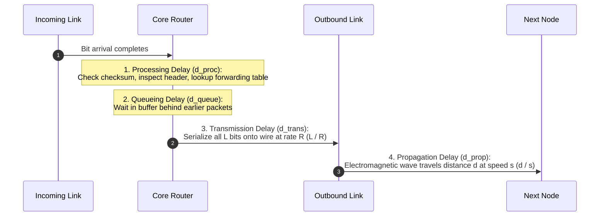
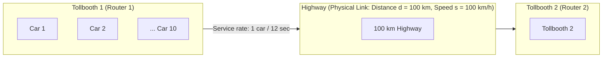
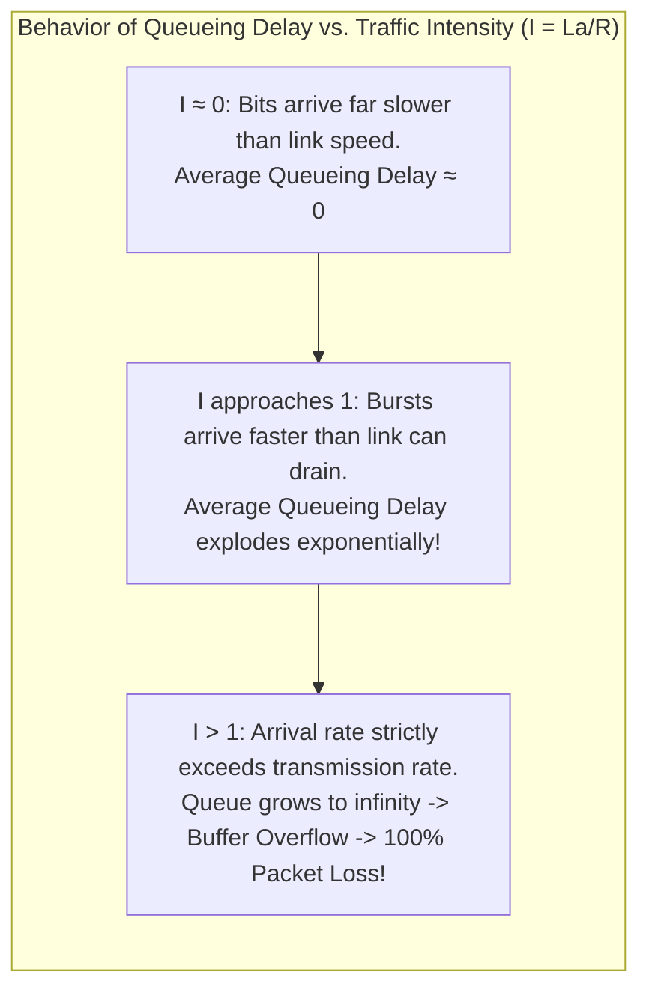
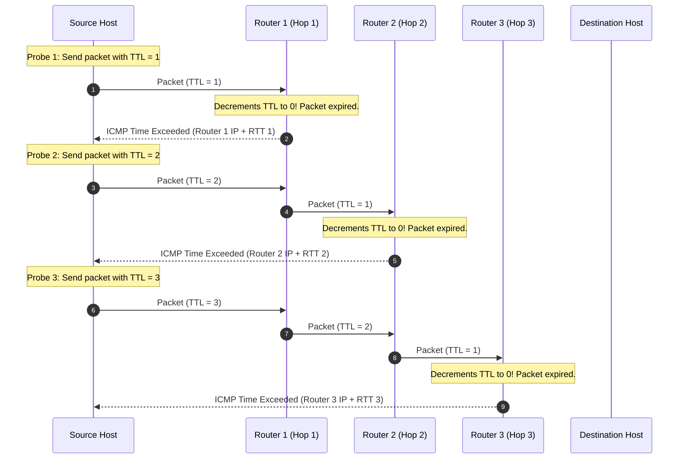
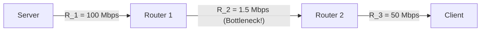
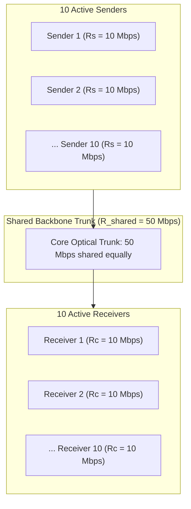

[CN Index](../README.md) / [Unit 1: Foundations & Web](Introduction.md)

---

In everyday conversation, when a network feels unresponsive, people say: *"The Internet is slow."*

To a network engineer, the word "slow" is completely meaningless.

Does "slow" mean it takes 300 milliseconds for a packet to reach a gaming server halfway across the world? Does it mean video frames are dropping because a router buffer overflowed? Or does it mean a 10 GB file is crawling at 2 Megabits per second despite having a 100 Mbps fiber line?

Each of these problems stems from an entirely different physical phenomenon:
- The first is **Delay** (measured in seconds or milliseconds).
- The second is **Packet Loss** (measured as a drop rate or probability).
- The third is **Throughput** (measured in bits per second).

To diagnose, design, and optimize computer networks, we must stop using the vague word "speed" and mathematically dissect these three distinct metrics.

In this lecture, we examine **Delay, Loss, and Throughput**: we break down the **Four Sources of Nodal Delay**, contrast **Transmission Delay vs. Propagation Delay** through the famous **Caravan Analogy**, analyze **Traffic Intensity ($La/R$)**, explore how **Traceroute** measures real Internet hops, and calculate **Bottleneck Throughput** across shared core links.

---

## The Four Sources of Nodal Delay

When a packet travels from a source to a destination across a chain of routers, it experiences a sequence of delays at **every single intermediate node**.

The total delay experienced by a packet at a single router—the **Nodal Delay** ($d_{\text{nodal}}$)—is the sum of four distinct, sequential physical delays:

$$\mathbf{d_{\text{nodal}} = d_{\text{proc}} + d_{\text{queue}} + d_{\text{trans}} + d_{\text{prop}}}$$



Let us dissect each of the four components:

---

### 1. Nodal Processing Delay ($d_{\text{proc}}$)
- **What it is:** The time required for the router to inspect the packet's header and determine where to direct it.
- **Actions taken:**
  - Validates the hardware checksum to verify that bits were not corrupted during transmission.
  - Inspects the IP destination address in the header.
  - Queries the routing forwarding table to select the correct outbound interface port.
- **Duration:** Typically **microseconds or nanoseconds**. In modern routers, forwarding table lookups are executed in specialized, highly parallel hardware engines called **TCAM (Ternary Content-Addressable Memory)**.

---

### 2. Queueing Delay ($d_{\text{queue}}$)
- **What it is:** The time the packet spends sitting in the outbound interface's buffer memory waiting for the transmission link to become free.
- **Nature of Queueing:** Unlike the other three delays, **queueing delay is highly dynamic and stochastic**.
  - If the router is idle when the packet arrives, $d_{\text{queue}} = 0$.
  - If a sudden burst of packets arrives just ahead of our packet, our packet must wait in line for all preceding packets to be serialized.
- **Duration:** Ranges from **zero to tens or hundreds of milliseconds**, depending on network congestion.

---

### 3. Transmission Delay ($d_{\text{trans}}$)
- **What it is:** The time required to physically push (serialize) all $L$ bits of the packet out of the router's interface onto the transmission medium.
- **Governing Formula:**
  $$\mathbf{d_{\text{trans}} = \frac{L}{R}}$$
  $$\text{Where: } L = \text{Packet length (bits)}, \quad R = \text{Transmission rate of link (bps)}$$
- **Physical Meaning:** It is the time elapsed between the transmission of the packet's very first bit and the release of its very last bit onto the wire.
- **Duration:** Typically **microseconds to milliseconds** (e.g., a 12,000-bit packet on a 10 Mbps link takes $1.2\text{ ms}$; on a 10 Gbps link, it takes $1.2\ \mu\text{s}$).

---

### 4. Propagation Delay ($d_{\text{prop}}$)
- **What it is:** The time required for a single physical electromagnetic pulse (a bit) to travel from the beginning of the physical wire to the receiver at the other end.
- **Governing Formula:**
  $$\mathbf{d_{\text{prop}} = \frac{d}{s}}$$
  $$\text{Where: } d = \text{Physical distance of link (meters)}, \quad s = \text{Propagation speed of medium (m/s)}$$
- **Speed in Media ($s$):**
  - In copper wire or optical fiber, electromagnetic waves travel at roughly **$2 \times 10^8\text{ m/s}$** to **$2.5 \times 10^8\text{ m/s}$** (roughly $\frac{2}{3}$ the speed of light in a vacuum).
  - In air or vacuum (satellite/radio), $s \approx 3 \times 10^8\text{ m/s}$.
- **Duration:** Depends strictly on geographic distance. A 10-meter LAN cable has $d_{\text{prop}} \approx 50\text{ nanoseconds}$; a transoceanic fiber cable crossing 6,000 km from New York to London has $d_{\text{prop}} = \frac{6 \times 10^6\text{ m}}{2 \times 10^8\text{ m/s}} = \mathbf{30 \text{ ms}}$.

---

## Transmission vs. Propagation: The Critical Distinction

Students frequently confuse transmission delay and propagation delay. The difference is night and day:

$$\mathbf{d_{\text{trans}} = \frac{L}{R}} \quad \text{vs.} \quad \mathbf{d_{\text{prop}} = \frac{d}{s}}$$

| Dimension | Transmission Delay ($d_{\text{trans}}$) | Propagation Delay ($d_{\text{prop}}$) |
| :--- | :--- | :--- |
| **Formula** | $L / R$ | $d / s$ |
| **Dependent on** | Packet size $L$ and Link rate $R$ | Distance $d$ and Speed of light in medium $s$ |
| **Independent of**| Physical distance of the cable | Packet length and link transmission rate |
| **Physical Analogy**| How long it takes a cashier to push items through a scanner | How long it takes a delivery truck to drive across the city |

$$\text{Buying a faster 1 Gbps link reduces } \mathbf{d_{\text{trans}}}\text{, but does }\mathbf{NOT}\text{ reduce } \mathbf{d_{\text{prop}}}\text{ by a single microsecond!}$$

No amount of bandwidth can make light travel faster than the laws of physics permit.

---

## The Caravan Analogy

To make this distinction unforgettable, Kurose and Ross introduce the classical **Caravan Analogy**:



### The Setup
- A caravan of **10 cars** is traveling together on a highway. (Think of the caravan as a **10-bit packet**, where each car represents **1 bit**).
- The cars arrive at **Tollbooth 1**. The tollbooth takes **12 seconds to service each car** (The tollbooth is the **transmission rate $R$**).
- Between Tollbooth 1 and Tollbooth 2 lies a highway of distance **$d = 100\text{ km}$**.
- The cars drive on the highway at a speed of **$s = 100\text{ km/h}$** (The speed of the cars is the **propagation speed $s$**).
- The tollbooth operates on a **store-and-forward** rule: Tollbooth 2 will not service the caravan until all 10 cars have arrived and assembled at its gate.

### Step-by-Step Questions and Analysis

#### 1. What is the transmission time of the caravan at Tollbooth 1?
The time required for Tollbooth 1 to push all 10 cars onto the highway is:
$$\text{Transmission Delay } d_{\text{trans}} = 10 \text{ cars} \times 12 \text{ seconds/car} = 120 \text{ seconds} = \mathbf{2 \text{ minutes}}$$

#### 2. What is the propagation time of a car between tollbooths?
The time it takes for a single car to drive 100 km at 100 km/h is:
$$\text{Propagation Delay } d_{\text{prop}} = \frac{100 \text{ km}}{100 \text{ km/h}} = 1 \text{ hour} = \mathbf{60 \text{ minutes}}$$

#### 3. When does Tollbooth 2 begin servicing the caravan?
Let us trace the timeline:
- At time $t = 0$, car 1 begins service at Tollbooth 1.
- At time $t = 12\text{ seconds}$, car 1 clears Tollbooth 1 and starts driving onto the highway.
- At time $t = 2\text{ minutes}$ ($120\text{ s}$), car 10 (the last car) clears Tollbooth 1. The entire caravan is now on the highway.
- Car 10 drives for 60 minutes across the highway.
- Car 10 arrives at Tollbooth 2 at time:
  $$T = 2\text{ minutes} + 60\text{ minutes} = \mathbf{62 \text{ minutes}}$$
At $t = 62\text{ minutes}$, all 10 cars have assembled at Tollbooth 2, and Tollbooth 2 begins servicing car 1!

#### 4. The Mind-Bending Variation: Bits in Flight
Now change the numbers:
- Suppose cars drive at **$1,000\text{ km/h}$** (faster propagation).
- Suppose the tollbooth takes **1 minute per car** (slower transmission; total transmission time = 10 minutes).
- Car 1 leaves Tollbooth 1 at $t = 1\text{ minute}$.
- Car 1 drives 100 km at 1,000 km/h:
  $$d_{\text{prop}} = \frac{100\text{ km}}{1,000\text{ km/h}} = 0.1 \text{ hours} = 6 \text{ minutes}$$
- Car 1 reaches Tollbooth 2 at:
  $$t = 1\text{ min} + 6\text{ min} = \mathbf{7 \text{ minutes!}}$$

Look at what this means: **Car 1 arrives at Tollbooth 2 at $t = 7\text{ minutes}$, but the last three cars (cars 8, 9, and 10) have not even left Tollbooth 1 yet!**

In a real network, when a long fiber link has high bandwidth, **the front bits of a packet can arrive at Router 2 while the tail bits of the exact same packet are still being transmitted out of Router 1!**

---

## Traffic Intensity and Queueing Delay Dynamics

Queueing delay ($d_{\text{queue}}$) is the most volatile component of network latency. How do we predict whether queueing delay will be negligible or catastrophic?

We use a dimensionless metric called **Traffic Intensity ($I$)**:

$$\mathbf{I = \frac{L \cdot a}{R}}$$

$$\text{Where: } L = \text{Packet length (bits)}, \quad a = \text{Average packet arrival rate (packets/sec)}, \quad R = \text{Link transmission rate (bps)}$$

Notice what the numerator represents:
- $a$ is the number of packets arriving per second.
- $L$ is the number of bits in each packet.
- Therefore, **$L \cdot a$ is the average rate at which bits are arriving at the queue (bps)**.
- $R$ is the rate at which the link can transmit bits out of the queue (bps).



### The Hockey-Stick Latency Curve
When you plot average queueing delay against traffic intensity $I$, the curve behaves like an exponential "hockey stick":

```
Average
Queueing
Delay
  ^
  |                                        | (Explodes to infinity)
  |                                       /
  |                                      /
  |                                     /
  |                                   /
  |                                 /
  |_______________________________/
  0                              1.0  ---> Traffic Intensity (La/R)
```

1. **When $I \le 0.5$:** Queueing delay is virtually zero. Occasional micro-bursts are absorbed instantly by the buffer.
2. **When $I \to 0.9$:** Queueing delay skyrockets. Even modest variations in inter-arrival times cause long queues to accumulate that take seconds to drain.
3. **When $I > 1.0$:** Bits arrive faster than the link can physically emit them. Queueing delay becomes mathematically infinite; the buffer fills completely, and **Packet Loss** becomes $100\%$ for all subsequent arriving packets.

$$\text{Golden Engineering Rule: Never design a network link to operate with sustained traffic intensity } I \ge 0.8.$$

---

## Measuring Real Internet Paths: How Traceroute Works

How do network engineers diagnose where delay and loss are occurring along a 15-hop path across the world?

They use the standard Unix utility **Traceroute** (or `tracert` on Windows):



### The Traceroute Algorithm
Traceroute exploits a mandatory header field present in every IP packet: the **TTL (Time to Live)**:
1. The sender emits three probe packets with **$\text{TTL} = 1$**.
2. When the first router (Hop 1) receives the packet, it decrements the TTL by 1. Because $\text{TTL} = 0$, the router is forbidden from forwarding the packet. It discards the packet and sends an **ICMP "Time Exceeded" error message** back to the sender.
3. The sender extracts the IP address of Hop 1 from the return packet and records the Round-Trip Time (RTT).
4. The sender emits three packets with **$\text{TTL} = 2$**. Router 1 decrements TTL to 1 and forwards it. Router 2 decrements TTL to 0, drops it, and returns an ICMP message, revealing Hop 2.
5. This process repeats incrementing TTL by 1 until the packet finally reaches the destination host.

### Interpreting Traceroute Output and Anomalies
A typical traceroute output displays:
```text
1  192.168.1.1 (192.168.1.1)  1.120 ms  1.054 ms  1.201 ms
2  10.240.0.1 (10.240.0.1)  4.312 ms  4.110 ms  4.205 ms
3  * * *
4  142.250.224.1 (google-gw.net)  22.140 ms  21.902 ms  22.415 ms
```

- **Three RTT Times:** Traceroute sends 3 probes per hop to measure variance in queueing delay.
- **The Asterisk Anomaly (`* * *`):** When asterisks appear, it does *not* mean the router is broken. Many modern enterprise firewalls and core routers deliberately drop ICMP packets or prioritize forwarding customer data over generating diagnostic replies.
- **The Decreasing RTT Anomaly:** Occasionally, Hop 7 reports an RTT of 45 ms, while Hop 8 reports 40 ms! How can a farther hop take less time? Because Internet routing is **Asymmetric**: outbound packets and return packets often travel across completely different physical paths and different queues.

---

## Throughput: Instantaneous, Average, and Bottleneck Links

While delay measures time per packet, **Throughput** measures the rate at which useful data bits are successfully delivered end-to-end:
- **Instantaneous Throughput:** The rate (in bps) at a specific instant in time.
- **Average Throughput:** $\frac{\text{Total Bytes Delivered}}{\text{Total Elapsed Transfer Time}}$ (in bps).

### The Bottleneck Link Principle
Suppose data travels from a server to a client across a path of $N$ links in series, where link $i$ has transmission rate $R_i$:



What is the maximum end-to-end throughput the client can achieve?
The throughput can never exceed the capacity of the narrowest pipe along the path:

$$\mathbf{\text{Throughput} = \min(R_1, R_2, \dots, R_N)}$$

The link that enforces this minimum capacity ceiling is the **Bottleneck Link**.

In the diagram above:
$$\text{Throughput} = \min(100\text{ Mbps}, \; 1.5\text{ Mbps}, \; 50\text{ Mbps}) = \mathbf{1.5 \text{ Mbps}}$$
Upgrading the server link from 100 Mbps to 10 Gbps will have **zero effect on throughput**, because the 1.5 Mbps link continues to throttle the stream.

---

### Throughput Under Shared Core Backbones

In reality, links inside the network core are rarely dedicated to a single flow. A massive backbone trunk carries thousands of concurrent connections simultaneously:



Suppose:
- 10 active sender-receiver pairs share a core link of capacity $R_{\text{shared}} = 50\text{ Mbps}$.
- Each sender access link has capacity $R_s = 10\text{ Mbps}$.
- Each receiver access link has capacity $R_c = 10\text{ Mbps}$.
- The core link divides its bandwidth equally among all $F = 10$ flows:
  $$\text{Capacity per flow on core link} = \frac{R_{\text{shared}}}{F} = \frac{50\text{ Mbps}}{10} = 5\text{ Mbps}$$

What is the end-to-end throughput for each flow?
$$R_{\text{flow}} = \min\left(R_s, \; R_c, \; \frac{R_{\text{shared}}}{F}\right) = \min(10\text{ Mbps}, \; 10\text{ Mbps}, \; 5\text{ Mbps}) = \mathbf{5 \text{ Mbps}}$$

Even though every user has a 10 Mbps access connection, the core trunk acts as the bottleneck link, constraining each user to 5 Mbps.

---

## Key Takeaways

- Total nodal delay consists of four additive physical terms:
  $$d_{\text{nodal}} = d_{\text{proc}} + d_{\text{queue}} + d_{\text{trans}} + d_{\text{prop}}$$
- **Transmission Delay** ($L/R$) is the time the network card takes to serialize all $L$ bits onto the wire at link rate $R$.
- **Propagation Delay** ($d/s$) is the time a bit takes to travel distance $d$ across the medium at propagation speed $s$ ($\approx 2 \times 10^8\text{ m/s}$).
- The **Caravan Analogy** proves that transmission delay and propagation delay are completely independent: bits at the front of a packet can arrive at the next node while tail bits are still being transmitted by the sender.
- **Traffic Intensity** ($I = La/R$) governs queueing delay: as $I \to 1$, delay explodes exponentially; when $I > 1$, buffers overflow and packets drop.
- **Traceroute** maps end-to-end Internet hops by systematically incrementing the IP TTL field from 1 upward and recording ICMP "Time Exceeded" replies.
- End-to-end throughput is bounded by the **Bottleneck Link**:
  $$\text{Throughput} = \min(R_1, R_2, \dots, R_N)$$

---

We now understand the physics of delay, queueing dynamics, and capacity bottlenecks across the network core. But this reveals an engineering dilemma: how can software developers, hardware vendors, and operating systems build applications, manage routing, handle packet loss, and modulate laser voltages without having to rewrite the entire system whenever a new physical cable or application appears? In the next lecture, we analyze [**Protocol Layering and the Internet Stack**](L06%20-%20Protocol%20Layering%20and%20the%20Internet%20Stack.md), contrasting the **5-Layer Internet Model** with the **7-Layer OSI Reference Model** and tracing the lifecycle of **Encapsulation and Decapsulation**.
