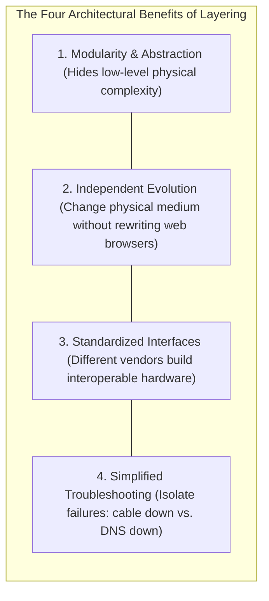
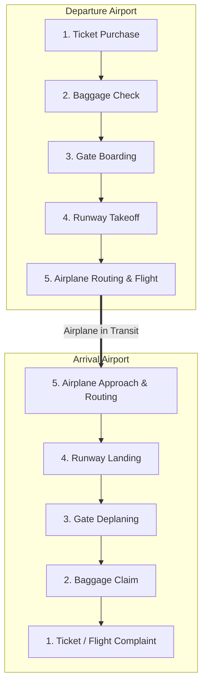
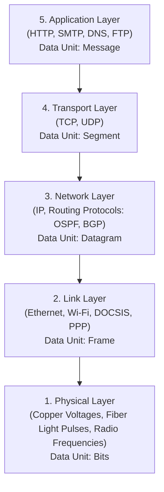
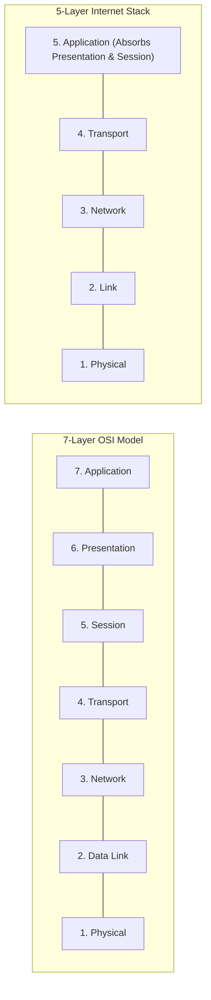
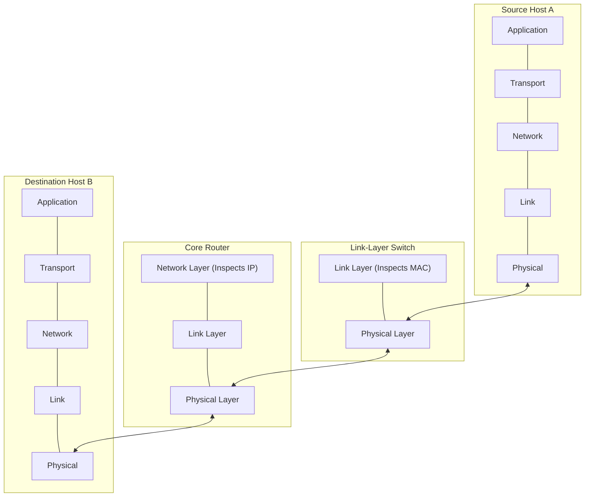
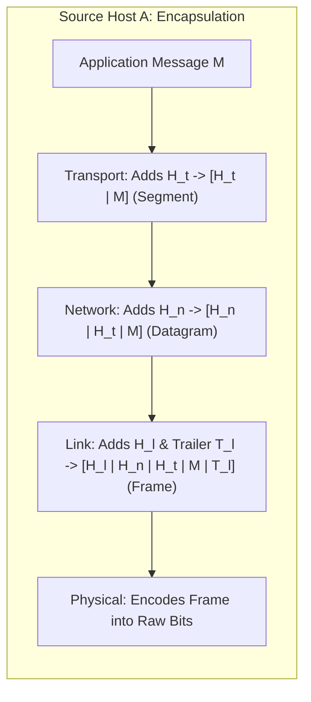
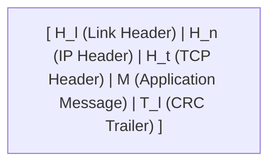
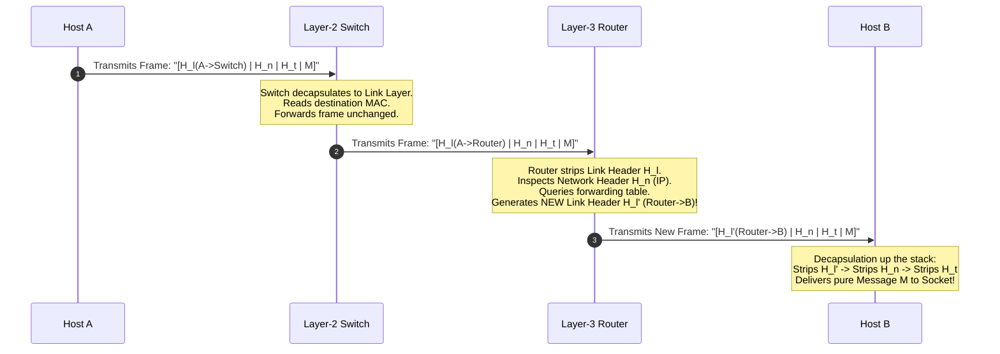

[CN Index](../README.md) / [Unit 1: Foundations & Web](Introduction.md)

---

In the previous lectures, we saw that the Internet consists of a staggering array of components: billions of application processes, operating system kernels, device drivers, routing tables, optical fiber lasers, copper twisted pairs, wireless radios, and satellite links.

Imagine if you had to write a web browser without any architectural abstractions:
- Your browser would have to contain custom code to modulate Wi-Fi radio frequencies.
- If you plugged in an Ethernet cable, you would have to rewrite the application from scratch to generate electrical copper pulses.
- Your application would have to personally calculate routing paths across the ocean and manage queueing buffers on core routers.

Such a monolithic design would collapse under its own weight. No global system could ever evolve if every application had to understand the physics of every cable.

How do network architects tame this staggering complexity?

The universal engineering answer is **Layering**.

In this lecture, we explore the conceptual foundations of **Protocol Layering**: why systems require modular abstraction boundaries, the **Air-Travel Analogy**, the **5-Layer Internet Protocol Stack vs. the 7-Layer OSI Reference Model**, the distinction between **End Systems, Routers, and Switches**, the formal names of **Protocol Data Units (PDUs)**, and the exact step-by-step lifecycle of **Encapsulation and Decapsulation**.

---

## Why Networks Need Layers

Layering is the network equivalent of structured programming and object-oriented design:

> In a layered architecture, a system is partitioned into a vertical stack of modular layers. Each layer is responsible for providing a specific **service** to the layer immediately above it, by utilizing the services provided by the layer immediately below it.

### The Power of the Stable Abstraction Boundary
Notice what layering accomplishes:
- When telecommunications engineers invented Gigabit Wi-Fi, **zero changes were required in the code of YouTube, Netflix, or the Linux TCP stack**.
- Because the Link and Physical layers implement a standardized service interface to the Network Layer (IP), the underlying physical transmission medium can change from optical fiber, to copper coaxial cable, to 5G radio, to satellite laser without the upper layers knowing or caring.

---

## The Air-Travel Analogy

To understand how distinct layers collaborate without interfering with one another, consider how a commercial airline system operates:

Notice the horizontal, peer-to-peer symmetry:
- **Ticketing** at the departure city speaks logically to **Ticketing** at the arrival city.
- **Baggage handling** attaches a barcode tag to your luggage at departure, and the baggage crew at arrival reads the tag to route the bag to the claim carousel.
- The **pilots** do not know what is inside your suitcase, and the **baggage handlers** do not know the aerodynamics of the jet engine. Each layer performs its designated subservice and hands the payload up or down the stack.

---

## The 5-Layer Internet Protocol Stack

The Internet runs on a pragmatic, 5-layer architecture known as the **Internet Protocol Stack** (or the **TCP/IP Model**):

Let us dissect the precise scope, responsibility, and protocols of all five layers:

### 1. Application Layer
- **Scope:** Distributed applications running on end systems.
- **Responsibility:** Defines the protocols through which software processes exchange application-specific messages.
- **Key Protocols:** **HTTP** (Web), **SMTP** (Email), **DNS** (Domain Name Translation), **SSH** (Secure Shell), **FTP** (File Transfer).
- **Protocol Data Unit (PDU):** **Message**.

### 2. Transport Layer
- **Scope:** **Process-to-Process** logical communication between application endpoints.
- **Responsibility:** Multiplexes and demultiplexes data streams for different applications on the same host using **Port Numbers**.
  - **TCP (Transmission Control Protocol):** Provides a reliable, connection-oriented byte stream with in-order delivery, flow control, and network congestion control.
  - **UDP (User Datagram Protocol):** Provides a lightweight, connectionless, unreliable "best-effort" service with zero connection overhead.
- **Protocol Data Unit (PDU):** **Segment** (or UDP Datagram).

### 3. Network Layer
- **Scope:** **Host-to-Host** communication across disparate networks.
- **Responsibility:** Responsible for routing packets from the source host across multiple intermediate networks to the destination host. It defines the global logical addressing scheme (**IPv4 / IPv6**) and executes routing algorithms to populate forwarding tables.
- **Key Protocols:** **IP (Internet Protocol)**, routing protocols (BGP, OSPF), error reporting (**ICMP**).
- **Protocol Data Unit (PDU):** **Datagram** (or Packet).

### 4. Link Layer
- **Scope:** **Node-to-Node (Hop-to-Hop)** communication over a single physical link.
- **Responsibility:** Moves entire frames between adjacent nodes that share a common physical channel. Handles local physical addressing (**MAC addresses**) and channel access control.
- **Key Protocols:** **Ethernet (IEEE 802.3)**, **Wi-Fi (IEEE 802.11)**, **DOCSIS** (Cable), **PPP**.
- **Protocol Data Unit (PDU):** **Frame**.

### 5. Physical Layer
- **Scope:** Moving individual bits across a transmission medium.
- **Responsibility:** Defines the mechanical, electrical, and optical signaling standards: voltage levels, bit durations, radio modulation schemes, and connector pinouts.
- **Protocol Data Unit (PDU):** **Bits**.

---

## The 7-Layer OSI Reference Model

In the 1980s, the International Organization for Standardization (ISO) proposed the **OSI (Open Systems Interconnection) 7-Layer Reference Model**.

The OSI model subdivides the system into seven layers by inserting two additional layers between the Application and Transport layers:

### The Two "Missing" Layers
1. **Presentation Layer (Layer 6):**
   - Responsible for data interpretation, character set translation (e.g., ASCII vs. EBCDIC), data compression, and cryptographic encryption.
2. **Session Layer (Layer 5):**
   - Responsible for establishing, maintaining, and synchronizing communication sessions between applications, including checkpointing and recovery of interrupted streams.

### Why Did the Internet Win Over OSI?
Students frequently ask: *"If the 7-layer OSI model is so detailed, why does the real Internet use the 5-layer model?"*

The Internet architecture follows the **End-to-End Principle**:
- Functions that can only be properly implemented at the application endpoints should not be forced into the lower operating system or network stack.
- If an application needs encryption, compression, or checkpointing, **the application developer implements it directly inside the Application Layer itself** (or uses an application library like OpenSSL / TLS)!
- Forcing every simple program to pass through mandatory, rigid Session and Presentation layers in the OS kernel caused unnecessary performance overhead.

---

## Intermediate Nodes vs. End Hosts

A crucial architectural principle of the Internet is that **not every device implements all layers of the stack**:

Look at where each network device lives in the stack:
- **End Systems (Hosts):** Implement **all 5 layers**. They originate and decode application messages.
- **Routers:** Implement the **bottom 3 layers** (Physical, Link, Network). A router inspects the IP header to make forwarding decisions, but it does *not* read transport ports or parse application payloads.
- **Link-Layer Switches:** Implement the **bottom 2 layers** (Physical, Link). A switch inspects link-layer MAC addresses to filter and forward frames within a single local network. It has no awareness of IP addresses or routing tables.

---

## Encapsulation and Decapsulation in Action

To understand how data actually moves across the Internet, let us follow the complete lifecycle of a single packet as it travels from Host A, through a switch and a router, to Host B:

### 1. Encapsulation at the Sender (Host A)
1. **Application Layer:** User code creates an application **Message $M$** (e.g., an HTTP GET request).
2. **Transport Layer:** The OS prepends a **Transport Header ($H_t$)** containing source and destination port numbers (e.g., Port 443). The resulting unit is a **Segment**.
3. **Network Layer:** The OS prepends a **Network Header ($H_n$)** containing source and destination IP addresses. The resulting unit is a **Datagram**.
4. **Link Layer:** The network adapter prepends a **Link Header ($H_l$)** containing local source and next-hop destination MAC addresses, and appends a **Link Trailer ($T_l$)** containing an error-checking Cyclic Redundancy Check (CRC). The resulting unit is a **Frame**.
5. **Physical Layer:** The hardware serializes the frame into electrical, optical, or radio **Bits**.

---

### 2. Processing at Intermediate Nodes

Notice what happens at the router:
- The router receives the raw bits and decapsulates the Link Layer frame.
- It discards the old Link Header ($H_l$) because that header was only valid for the single hop between Host A and the router!
- It inspects the IP header ($H_n$), determines the next hop, and **encapsulates the IP datagram into a brand-new Link Layer frame ($H_l'$)** with new MAC addresses suitable for the next physical link.
- The IP header ($H_n$) and TCP segment ($H_t \mid M$) remain completely untouched throughout the journey.

### 3. Decapsulation at the Receiver (Host B)
When the bits arrive at Host B, the entire encapsulation pipeline runs in reverse:
1. Physical layer reconstructs the frame bits.
2. Link layer verifies the CRC trailer ($T_l$). If corrupt, the frame is dropped; if valid, it strips $H_l$ and hands the **IP Datagram** upward.
3. Network layer inspects $H_n$. It verifies that the destination IP matches Host B, strips $H_n$, and hands the **TCP Segment** upward.
4. Transport layer inspects $H_t$. It reads the destination port number, strips $H_t$, and delivers the original, pure **Message $M$** directly into the listening application process's socket buffer!

---

## Protocol Data Units (PDUs): Master Terminology

In networking examinations and RFC standards, using the word "packet" indiscriminately loses marks. You must use the layer-specific PDU name:

| Layer Number | Layer Name | Protocol Data Unit (PDU) | Primary Addressing / Identifier |
| :--- | :--- | :--- | :--- |
| **Layer 5** | Application | **Message** | URL / Email Address / Process Name |
| **Layer 4** | Transport | **Segment** (TCP) / Datagram (UDP) | **Port Number** (16 bits) |
| **Layer 3** | Network | **Datagram** (or Packet) | **IP Address** (32 bits IPv4 / 128 bits IPv6) |
| **Layer 2** | Link | **Frame** | **MAC Address** (48 bits / IEEE 802) |
| **Layer 1** | Physical | **Bits** | Voltages / Frequencies / Light Pulses |

---

## Key Takeaways

- **Protocol Layering** modularizes complex systems: each layer provides a service to the layer above while hiding the implementation details below.
- The **5-Layer Internet Protocol Stack** consists of: **Application** (user apps), **Transport** (process-to-process), **Network** (host-to-host routing), **Link** (hop-to-hop data frames), and **Physical** (transmitting raw bits).
- The **7-Layer OSI Reference Model** adds the **Presentation** (formatting, compression, encryption) and **Session** (checkpointing, synchronization) layers. The Internet incorporates these functions directly into the Application layer.
- **End hosts** implement all 5 layers; **Routers** implement the bottom 3 layers (Network, Link, Physical); **Switches** implement the bottom 2 layers (Link, Physical).
- The official names of Protocol Data Units (PDUs) are: Application **Message** $\to$ Transport **Segment** $\to$ Network **Datagram** $\to$ Link **Frame** $\to$ Physical **Bits**.
- **Encapsulation** wraps data with headers ($H_t, H_n, H_l$) as it travels down the sender's stack; **Decapsulation** strips headers as the packet climbs the receiver's stack.
- Link-layer headers are hop-specific and rewritten at every router, while Network and Transport headers travel end-to-end unchanged.

---

We now know how software protocols encapsulate data across layers. But how are these layers mapped into physical hardware boxes? When you walk into a server room and see repeaters, hubs, modems, bridges, switches, routers, gateways, and firewalls, which box operates at which layer? In the next lecture, we dissect [**Network Hardware Devices**](L07%20-%20Network%20Hardware%20Devices.md), analyzing device responsibilities, MAC learning tables, and the critical distinction between **Collision Domains vs. Broadcast Domains**.
