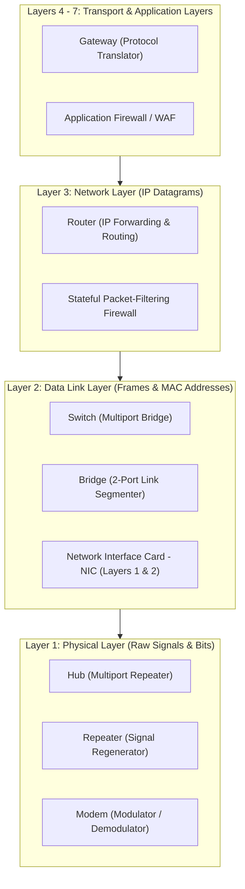
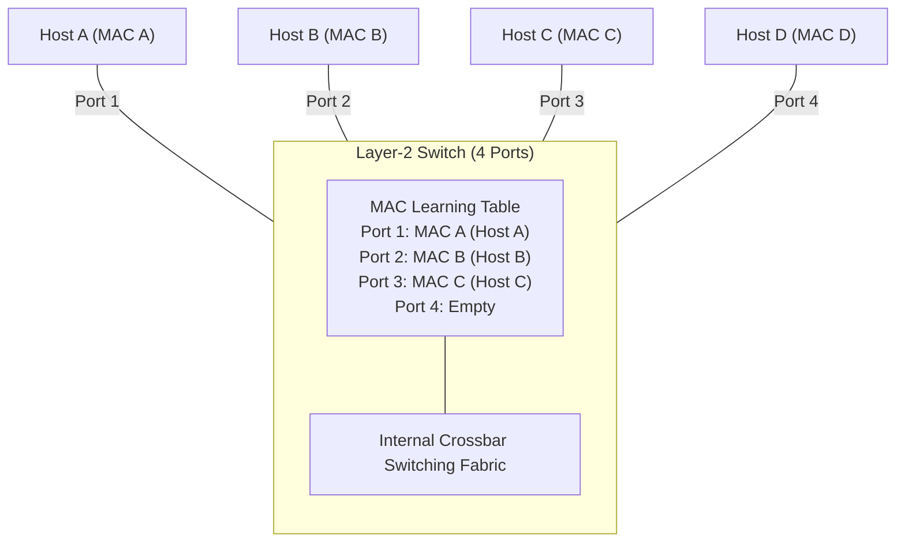
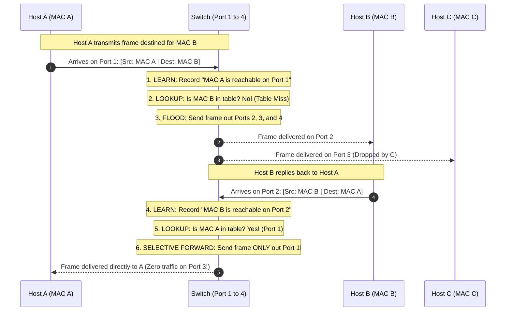
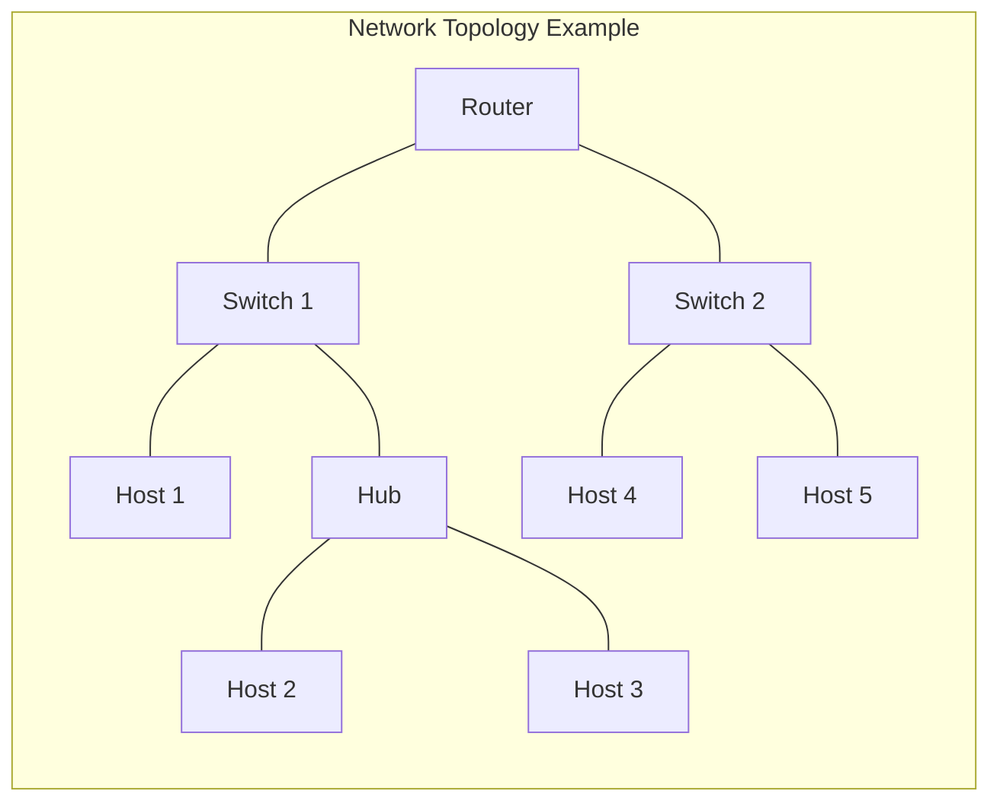

[CN Index](../README.md) / [Unit 1: Foundations & Web](Introduction.md)

---

In the previous lecture, we established the five layers of the Internet protocol stack: Application, Transport, Network, Link, and Physical.

When you walk into a server room or inspect an office networking closet, however, you do not see abstract protocol layers. You see physical metal chassis, glowing LED ports, and tangled bundles of fiber and copper cables labeled:
**Repeaters, Hubs, Modems, Bridges, Switches, Routers, Gateways, and Firewalls.**

Students frequently struggle with network hardware because they attempt to memorize disconnected definitions for nine different boxes.

To truly understand network hardware, you do not need nine separate definitions. You only need to ask **three diagnostic questions** about every device:
1. *At what highest layer of the protocol stack does this device make its forwarding decision?*
2. *What specific header information does it inspect? (A raw voltage waveform? A 48-bit MAC address? A 32-bit IP prefix? A transport port number?)*
3. *What action does it take on the traffic? (Blindly regenerate? Selectively forward? Route between subnets? Block?)*

In this lecture, we examine **Network Hardware Devices**: tracing the architectural progression from **Layer 1 through Layer 7**, unpacking the **Self-Learning Algorithm of a Switch**, contrasting **Hubs vs. Switches**, contrasting **Switches vs. Routers**, and mastering the fundamental boundary between **Collision Domains and Broadcast Domains**.

---

## The Network Hardware Hierarchy

Every piece of network hardware lives at a specific ceiling in the protocol stack:



---

## 1. Layer 1 Devices: Physical Layer

Layer 1 devices have zero awareness of bits, bytes, packets, or addresses. They operate purely on electrical voltages, light pulses, and radio waves:

### A. Repeater
- **Highest Layer:** Layer 1 (Physical).
- **The Problem It Solves:** As electrical signals travel down copper cables or light pulses travel through fiber, physical resistance and dispersion cause the waveform to attenuate (weaken) and distort over distance.
- **How It Works:** A repeater receives a weakened signal, cleans up the analog distortion, retimes the clock, and **regenerates a fresh, amplified physical signal** onto the next cable segment.
- **What It Cannot Do:** A repeater does not inspect MAC addresses or IP headers. It cannot filter packets or make routing decisions.

### B. Hub (Multiport Repeater)
- **Highest Layer:** Layer 1 (Physical).
- **How It Works:** A hub is simply a **repeater with multiple physical ports** (e.g., 8, 16, or 24 ports).
  $$\text{When an electrical signal arrives on Port 1, the hub }\mathbf{blindly\text{ repeats}}\text{ it onto every other port!}$$
- **The Shared Medium Disaster:**
  - If Host A sends a frame to Host B, the hub blasts the electrical signal out to Hosts B, C, D, and E simultaneously.
  - If Host C attempts to transmit at the exact same moment, the electrical signals collide on the shared wire, corrupting both transmissions.
  - A hub creates a single, shared **Collision Domain** and forces all connected devices to operate in **Half-Duplex** mode.
- **Modern Status:** Completely obsolete. Modern local area networks use switches.

### C. Modem (Modulator-Demodulator)
- **Highest Layer:** Layer 1 (Physical).
- **How It Works:** Bridges the gap between digital computer buses and analog transmission media (such as analog telephone lines or cable TV lines).
  - **Modulation:** Converts discrete digital square-wave bits (`0`s and `1`s) from the computer into continuous analog waveforms (varying frequency, amplitude, or phase).
  - **Demodulation:** Reverses the process, converting received analog waveforms back into digital bits.

---

## 2. Layer 2 Devices: Data Link Layer

Layer 2 devices inspect the **Link-Layer Frame Header** and make forwarding decisions based on hardware **MAC Addresses**:

### A. Network Interface Card (NIC)
- **Highest Layer:** Layers 1 and 2.
- Installed directly inside every host. Houses the physical transceiver (PHY) and the link-layer controller (MAC).
- Contains a globally unique **48-bit MAC address** permanently burned into hardware firmware by the manufacturer (IEEE Organizationally Unique Identifier + vendor serial number).

### B. Bridge
- **Highest Layer:** Layer 2 (Data Link).
- Connects two separate physical network segments.
- Inspects the destination MAC address of arriving frames. If the destination host resides on the same segment as the sender, the bridge drops the frame (filtering). If the destination is on the other segment, it forwards the frame across.
- **Advantage:** Separates one large collision domain into two smaller, isolated collision domains.

---

### C. The Switch: The Multiport Learning Bridge

A **Switch** is the beating heart of modern local area networks. It is conceptually a high-speed, hardware-accelerated **multiport bridge**.

Unlike a hub, **a switch never broadcasts frames indiscriminately once it has learned the network layout**:



### The Switch Self-Learning Algorithm
How does a switch know which host is plugged into which physical port?
A switch does not require manual configuration by a network administrator; it is completely **plug-and-play** and builds its **MAC Address Table (Forwarding Database)** automatically:



1. **Learning from the Source MAC:** Every time a frame arrives on Port $X$, the switch inspects the **Source MAC address**. It records an entry in its table:
   $$\text{MAC Address Table Entry} = \langle \text{Source MAC}, \; \text{Port } X, \; \text{Timestamp} \rangle$$
2. **Forwarding Based on the Destination MAC:**
   - **Case 1: Destination MAC is in the Table (Unicast Filtering):** The switch checks the destination MAC. If it finds a matching entry pointing to Port $Y$, **it forwards the frame exclusively out of Port $Y$**. No other port sees the frame!
   - **Case 2: Destination MAC is NOT in the Table (Unknown Unicast):** If the switch has never seen the destination MAC before, it **Floods** the frame out of every port except the port it arrived on.
   - **Case 3: Broadcast Address:** If the frame has a broadcast destination (`FF:FF:FF:FF:FF:FF`), it floods the frame out of all ports.

### The Defining Superpower of a Switch
Because a switch forwards frames selectively:
- Host A can transmit to Host B through Port 1 and Port 2 at the exact same moment Host C transmits to Host D through Port 3 and Port 4!
- **Every single port on a switch is its own isolated Collision Domain.**
- Ports operate in **Full-Duplex** mode at full dedicated link bandwidth (e.g., 1 Gbps up and 1 Gbps down simultaneously).

---

## 3. Layer 3 Devices: Routers

While a switch connects devices *within* a single local network, a **Router** interconnects *different, distinct IP networks*:

```mermaid
flowchart LR
    subgraph NET_A["Network A (Subnet 192.168.1.0/24)"]
        H1["Host A1"] --- SW1["Switch 1"]
        H2["Host A2"] --- SW1
    end

    subgraph ROUTER_BOX["Layer-3 Router"]
        R["IP Routing Engine & Forwarding Tables"]
    end

    subgraph NET_B["Network B (Subnet 10.0.0.0/8)"]
        SW2["Switch 2"] --- H3["Host B1"]
        SW2 --- H4["Host B2"]
    end

    SW1 <==|"Interface eth0: 192.168.1.1"|==> ROUTER_BOX
    ROUTER_BOX <==|"Interface eth1: 10.0.0.1"|==> SW2
```

- **Highest Layer:** Layer 3 (Network Layer).
- **Core Function:** Forwards **IP Datagrams** between different IP subnets based on destination IP address prefixes.
- **Decapsulation and Header Rewriting:** As we proved in Lecture 6, a router strips the incoming link-layer frame header ($H_l$), inspects the IP header, decrements the TTL, recalculates the IP checksum, and encapsulates the datagram into a **brand-new link-layer frame** with a new next-hop MAC address.
- **Separates Broadcast Domains:** A router **never forwards link-layer broadcast frames** across its interfaces. An ARP broadcast storm generated inside Network A stops dead at the router interface, protecting Network B from broadcast pollution.

---

## 4. Higher-Layer Devices: Gateways and Firewalls

### A. Gateway (Protocol Converter)
- **Highest Layer:** Layers 4 through 7.
- A gateway translates between **fundamentally incompatible protocol stacks**.
- *Example:* A **VoIP Gateway** connects modern packet-switched SIP/RTP voice networks to legacy circuit-switched Public Switched Telephone Networks (PSTN), converting compressed IP audio packets into continuous TDM 64 kbps electrical waveforms.

### B. Firewall
- **Highest Layer:** Layers 3, 4, or 7.
- Enforces organizational security policy by inspecting traffic and permitting or blocking packets based on pre-configured rules:
  1. **Packet-Filtering Firewall (Layers 3 & 4):** Inspects source/destination IP addresses, protocol numbers (TCP/UDP), port numbers (e.g., allow Port 443, block Port 23 Telnet), and TCP SYN/ACK flags.
  2. **Stateful Inspection Firewall (Layer 4):** Tracks active TCP connection states, permitting incoming packets only if they belong to an existing session initiated by an internal host.
  3. **Application Firewall / WAF (Layer 7):** Inspects application payloads (e.g., scanning HTTP request bodies for SQL injection or cross-site scripting attacks).

---

## Collision Domains vs. Broadcast Domains

The single most heavily examined conceptual distinction in network hardware is the boundary between a **Collision Domain** and a **Broadcast Domain**:



Let us formally define both domains:

### 1. Collision Domain
> A **Collision Domain** is a physical network segment where simultaneous transmissions from two or more devices will collide with each other, corrupting the electrical/radio waveforms on the wire.

- **Hubs:** A hub does not isolate collisions. **An entire hub and all devices plugged into it form ONE single collision domain.**
- **Switches:** A switch breaks up collision domains. **Every individual port on a switch is its own separate collision domain.**
- **Routers:** Every port on a router is also an independent collision domain.

### 2. Broadcast Domain
> A **Broadcast Domain** is a logical segment of a network where, if a host transmits a link-layer broadcast frame (e.g., destination MAC `FF:FF:FF:FF:FF:FF`), **every other device in that domain will receive a physical copy of the frame**.

- **Hubs:** Do not break up broadcast domains.
- **Switches:** By default, a switch does **NOT** separate broadcast domains! If Host 1 broadcasts an ARP request, the switch floods it out of all ports. The entire switched LAN forms **ONE single broadcast domain** (unless divided into virtual LANs / VLANs).
- **Routers:** **Routers strictly break up broadcast domains!** A router drops link-layer broadcasts at its interface and never forwards them across networks.

---

### Master Counting Exercise

Let us count the exact number of Collision Domains and Broadcast Domains in the topology diagram above:

1. **Counting Collision Domains:**
   - Switch 1 to Router: 1 collision domain.
   - Switch 1 to Host 1: 1 collision domain.
   - Switch 1 to Hub: 1 collision domain.
   - Inside the Hub (connecting Host 2 and Host 3): shares that same 1 collision domain with the switch link!
   - Switch 2 to Router: 1 collision domain.
   - Switch 2 to Host 4: 1 collision domain.
   - Switch 2 to Host 5: 1 collision domain.
   $$\mathbf{\text{Total Collision Domains} = 6}$$

2. **Counting Broadcast Domains:**
   - Look at the Router: The router has two interfaces (Left to Switch 1, Right to Switch 2).
   - Everything connected to the left of the router (Switch 1, Host 1, Hub, Host 2, Host 3) forms **Broadcast Domain 1**.
   - Everything connected to the right of the router (Switch 2, Host 4, Host 5) forms **Broadcast Domain 2**.
   $$\mathbf{\text{Total Broadcast Domains} = 2}$$

$$\text{Universal Rule: }\mathbf{Switches\text{ separate Collision Domains; Routers separate Broadcast Domains.}}$$

---

## Hardware Master Comparison Matrix

| Hardware Device | Primary Layer | Addresses Inspected | Forwards Across Ports By | Collision Domains | Broadcast Domains |
| :--- | :--- | :--- | :--- | :--- | :--- |
| **Repeater** | Layer 1 | None | Blind analog/digital regeneration | Extends same domain | Extends same domain |
| **Hub** | Layer 1 | None | Blind electrical repetition to all ports | **1 shared domain** | 1 shared domain |
| **Bridge** | Layer 2 | Destination MAC | Selective forwarding based on MAC table | **Separates into 2** | 1 shared domain |
| **Switch** | Layer 2 | Destination MAC | Selective forwarding via self-learned MAC table | **1 per port** | 1 shared domain (per VLAN) |
| **Router** | Layer 3 | Destination IP | Forwarding table lookup based on IP prefix | **1 per port** | **Separates into multiple** |
| **Gateway** | Layers 4–7 | Higher-layer headers | Protocol translation across disparate stacks | Dependent on interface | Separates |
| **Firewall** | Layers 3, 4, 7 | IP, Ports, Payloads | Permitted or blocked based on security rules | Dependent on interface | Separates (if routed) |

---

## Key Takeaways

- Network hardware is categorized by the highest protocol layer at which it makes decisions: **Layer 1** (Repeater, Hub), **Layer 2** (Bridge, Switch, NIC), **Layer 3** (Router), and **Layers 4–7** (Gateway, Firewall).
- A **Hub** is a multiport repeater: it blindly repeats bits to all ports, creating a single shared collision domain running in half-duplex.
- A **Switch** is a multiport bridge: it self-learns source MAC addresses to populate its forwarding table, filtering unicast traffic so frames reach only the intended destination port.
- Every single port on a switch forms an independent **Collision Domain**, operating at full-duplex with dedicated link capacity.
- A **Router** operates at Layer 3, stripping link headers, evaluating IP addresses against routing tables, rewriting new link headers, and forwarding datagrams across subnets.
- A **Collision Domain** is a segment where simultaneous transmissions collide; a **Broadcast Domain** is a segment reached by link-layer broadcast frames.
- **Switches separate Collision Domains; Routers separate Broadcast Domains.**

---

We have now explored the full theoretical architecture of the network edge, the network core, protocol layering, and physical hardware devices. But in university coursework and engineering practice, theory must be proven through mathematics. How do you calculate the exact end-to-end delay across three asymmetric links? How do you calculate queueing delay under Poisson arrivals? In the next lecture, we tackle [**End-to-End Delay and Throughput Numerical Problems**](L08%20-%20End-to-End%20Delay%20and%20Throughput%20Numerical%20Problems.md), solving the complete suite of canonical examination calculations step-by-step.
