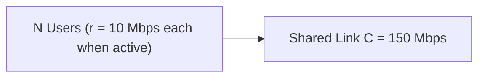
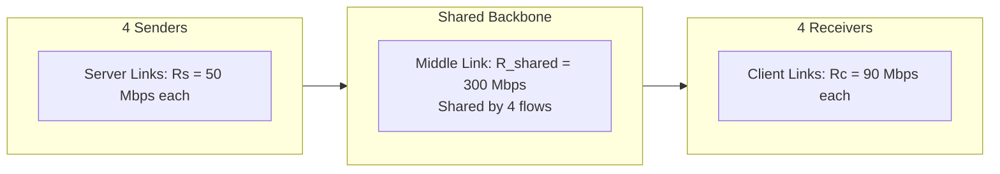

[CN Index](../README.md) / [Unit 1: Foundations & Web](Introduction.md)

---

In the preceding lectures of Unit 1, we established the theoretical principles of computer networking: store-and-forward transmission, the four sources of nodal delay, traffic intensity, statistical multiplexing, and bottleneck throughput.

However, in university examinations and real-world system design, conceptual understanding is tested through **mathematical calculation**.

Network engineering calculations are deceptively easy to get wrong:
- Confusing Megabits per second ($10^6\text{ bps}$) with Megabytes ($8 \times 10^6\text{ bits}$).
- Adding propagation delay when only transmission delay was asked for.
- Failing to recognize store-and-forward pauses at intermediate routers.
- Blindly plugging numbers into queueing formulas without verifying whether traffic intensity $I < 1$.

In this lecture, we work through the complete suite of canonical numerical problem sets from the university curriculum. For every problem, we establish the physical narrative, write out the explicit governing formula, track units step-by-step, and highlight common examination traps.

---

## Problem Set 1: Multi-Hop Store-and-Forward End-to-End Delay

### Problem 1.1: Symmetric and Asymmetric Link Traversal
**Scenario:** A packet of length $L = 8,000\text{ bits}$ is transmitted from a source host to a destination server across **three store-and-forward links** connected by two intermediate routers.
- **Link 1:** Transmission rate $R_1 = 100\text{ Mbps}$, length $d_1 = 3\text{ km}$.
- **Link 2:** Transmission rate $R_2 = 1,000\text{ Mbps}$ ($1\text{ Gbps}$), length $d_2 = 500\text{ km}$.
- **Link 3:** Transmission rate $R_3 = 10\text{ Mbps}$, length $d_3 = 8\text{ km}$.
- **Propagation speed in medium:** $s = 3 \times 10^8\text{ m/s}$ across all links.
- **Assumptions:** Processing delays ($d_{\text{proc}}$) and queueing delays ($d_{\text{queue}}$) at both routers are assumed to be negligible ($0$).

#### Step-by-Step Mathematical Solution

The total end-to-end delay is the sum of the transmission delay on each of the 3 links plus the propagation delay across each of the 3 links:

$$d_{\text{end-to-end}} = \sum_{i=1}^{3} d_{\text{trans}, i} + \sum_{i=1}^{3} d_{\text{prop}, i} = \left(\frac{L}{R_1} + \frac{L}{R_2} + \frac{L}{R_3}\right) + \left(\frac{d_1}{s} + \frac{d_2}{s} + \frac{d_3}{s}\right)$$

**Step 1: Compute Transmission Delays ($d_{\text{trans}} = L/R$)**
- **Link 1:**
  $$d_{\text{trans}, 1} = \frac{8,000\text{ bits}}{100 \times 10^6\text{ bps}} = 0.000080\text{ s} = \mathbf{0.080 \text{ ms}} = 80\ \mu\text{s}$$
- **Link 2:**
  $$d_{\text{trans}, 2} = \frac{8,000\text{ bits}}{1,000 \times 10^6\text{ bps}} = 0.000008\text{ s} = \mathbf{0.008 \text{ ms}} = 8\ \mu\text{s}$$
- **Link 3:**
  $$d_{\text{trans}, 3} = \frac{8,000\text{ bits}}{10 \times 10^6\text{ bps}} = 0.000800\text{ s} = \mathbf{0.800 \text{ ms}} = 800\ \mu\text{s}$$
- **Total Transmission Delay:**
  $$d_{\text{trans, total}} = 0.080 + 0.008 + 0.800 = \mathbf{0.888 \text{ ms}}$$

**Step 2: Compute Propagation Delays ($d_{\text{prop}} = d/s$)**
- **Link 1 ($3\text{ km} = 3,000\text{ m}$):**
  $$d_{\text{prop}, 1} = \frac{3 \times 10^3\text{ m}}{3 \times 10^8\text{ m/s}} = 0.000010\text{ s} = \mathbf{0.010 \text{ ms}} = 10\ \mu\text{s}$$
- **Link 2 ($500\text{ km} = 500,000\text{ m}$):**
  $$d_{\text{prop}, 2} = \frac{500 \times 10^3\text{ m}}{3 \times 10^8\text{ m/s}} = \frac{5 \times 10^5}{3 \times 10^8} \approx 0.001667\text{ s} = \mathbf{1.667 \text{ ms}}$$
- **Link 3 ($8\text{ km} = 8,000\text{ m}$):**
  $$d_{\text{prop}, 3} = \frac{8 \times 10^3\text{ m}}{3 \times 10^8\text{ m/s}} = 0.0000267\text{ s} \approx \mathbf{0.027 \text{ ms}} = 26.7\ \mu\text{s}$$
- **Total Propagation Delay:**
  $$d_{\text{prop, total}} = 0.010 + 1.667 + 0.027 = \mathbf{1.704 \text{ ms}}$$

**Step 3: Total End-to-End Nodal Delay**
$$d_{\text{end-to-end}} = 0.888\text{ ms (Trans)} + 1.704\text{ ms (Prop)} = \mathbf{2.592 \text{ ms}}$$

---

### Problem 1.2: Path Dominated by a Long Distance / Low Bandwidth Link
**Scenario:** A packet of length $L = 12,000\text{ bits}$ crosses three store-and-forward links where one link is an extreme bottleneck:
- **Link 1:** $R_1 = 100\text{ Mbps}$, $d_1 = 3\text{ km}$.
- **Link 2:** $R_2 = 1\text{ Mbps}$, $d_2 = 5,000\text{ km}$ (Transcontinental trunk).
- **Link 3:** $R_3 = 10\text{ Mbps}$, $d_3 = 1\text{ km}$.
- **Speed:** $s = 3 \times 10^8\text{ m/s}$.

#### Analytical Solution
Before calculating, notice that Link 2 is both the slowest link ($1\text{ Mbps}$) and the longest link ($5,000\text{ km}$). It will completely dominate both sums:

1. **Transmission Delays:**
   - Link 1: $\frac{12,000}{100 \times 10^6} = 0.12\text{ ms}$
   - Link 2: $\frac{12,000}{1 \times 10^6} = \mathbf{12.00 \text{ ms}}$ (Dominates!)
   - Link 3: $\frac{12,000}{10 \times 10^6} = 1.20\text{ ms}$
   $$\sum d_{\text{trans}} = 0.12 + 12.00 + 1.20 = \mathbf{13.32 \text{ ms}}$$

2. **Propagation Delays:**
   - Link 1: $\frac{3 \times 10^3}{3 \times 10^8} = 0.01\text{ ms}$
   - Link 2: $\frac{5,000 \times 10^3}{3 \times 10^8} = \frac{5 \times 10^6}{3 \times 10^8} = \mathbf{16.67 \text{ ms}}$ (Dominates!)
   - Link 3: $\frac{1 \times 10^3}{3 \times 10^8} = 0.0033\text{ ms}$
   $$\sum d_{\text{prop}} = 0.01 + 16.67 + 0.0033 = \mathbf{16.68 \text{ ms}}$$

3. **Total End-to-End Delay:**
   $$d_{\text{end-to-end}} = 13.32\text{ ms} + 16.68\text{ ms} = \mathbf{30.00 \text{ ms}}$$

Notice that Link 2 accounts for over **$95\%$** of the entire end-to-end delay!

---

## Problem Set 2: Packet Switching vs. Circuit Switching Capacity

### Problem 2.1: 150 Mbps Trunk Under Bursty Traffic
**Scenario:**
- Link Capacity: $C = 150\text{ Mbps}$.
- Each user requires a transmission rate of $r = 10\text{ Mbps}$ while actively transmitting.
- A packet-switched user is active only **$30\%$ of the time** ($p = 0.3$).

#### Questions and Calculations

**Question 1: What is the maximum number of users supported under Circuit Switching ($N_{\text{cs}}$)?**
Under circuit switching, each admitted user is guaranteed a dedicated 10 Mbps slice for the duration of the call:
$$N_{\text{cs}} = \left\lfloor \frac{C}{r} \right\rfloor = \frac{150\text{ Mbps}}{10\text{ Mbps/user}} = \mathbf{15 \text{ Users}}$$

**Question 2: What fraction of the link capacity does one active user consume?**
$$\text{Fraction} = \frac{r}{C} = \frac{10\text{ Mbps}}{150\text{ Mbps}} = \frac{1}{15} \approx \mathbf{6.67\%}$$

**Question 3: What is the average bandwidth demand generated by one packet-switched user?**
Since a user is active only $30\%$ of the time:
$$\text{Average Offered Load} = p \times r = 0.30 \times 10\text{ Mbps} = \mathbf{3 \text{ Mbps}}$$

**Question 4: If 35 packet-switched users share this link, what is the aggregate average load?**
$$\text{Aggregate Average Load} = 35 \text{ users} \times 3\text{ Mbps/user} = \mathbf{105 \text{ Mbps}}$$
Since $105\text{ Mbps} < 150\text{ Mbps}$, the link operates smoothly on average.

---

### Problem 2.2: 200 Mbps Trunk
**Scenario:**
- Link Capacity: $C = 200\text{ Mbps}$.
- Each user requires $r = 25\text{ Mbps}$ while active.
- Packet-switched users are active **$20\%$ of the time** ($p = 0.2$).

#### Questions and Calculations
1. **Maximum circuit-switched users:**
   $$N_{\text{cs}} = \frac{200\text{ Mbps}}{25\text{ Mbps}} = \mathbf{8 \text{ Users}}$$
2. **Can 15 users be supported under Circuit Switching?**
   **No.** Circuit switching strictly caps admissions at 8 users. Any 9th user will receive a busy signal.
3. **Can 15 users be supported under Packet Switching?**
   **Yes.** Under packet switching:
   $$\text{Average load per user} = 0.20 \times 25\text{ Mbps} = 5\text{ Mbps}$$
   $$\text{Total average load for 15 users} = 15 \times 5\text{ Mbps} = \mathbf{75 \text{ Mbps}}$$
   Because $75\text{ Mbps} \ll 200\text{ Mbps}$, the link easily accommodates 15 users with virtually zero queueing delay!

---

## Problem Set 3: Queueing Delay and Traffic Intensity

### Problem 3.1: M/M/1 Queueing Model
**Scenario:** A router outbound interface has:
- Link transmission rate: $R = 1,900,000\text{ bps}$ ($1.9\text{ Mbps}$).
- Fixed packet length: $L = 4,700\text{ bits}$.
- Average packet arrival rate: $a\text{ packets/second}$.
- The queueing delay is estimated using the standard single-server queueing formula (for traffic intensity $I < 1$):
  $$d_{\text{queue}} = \frac{I \cdot L}{R(1 - I)} = \frac{a L^2}{R(R - aL)}$$

#### Preliminary Calculations
Before answering questions, establish the link's maximum physical service capacity:
1. **Time to service one packet:**
   $$\frac{L}{R} = \frac{4,700\text{ bits}}{1,900,000\text{ bps}} = 0.0024737\text{ s} \approx \mathbf{2.474 \text{ ms}}$$
2. **Maximum packets the link can physically transmit per second ($\mu$):**
   $$\mu = \frac{R}{L} = \frac{1,900,000}{4,700} \approx \mathbf{404.26 \text{ packets/sec}}$$

> [!CAUTION]
> If any problem or student working asserts that this link completed 500 packets in one second, it is mathematically impossible: the transmitter can never exceed 404.26 packets/second!

#### Evaluating Queueing Delay Under Varying Arrival Rates

**Case A: Light Load ($a = 35\text{ packets/sec}$)**
1. Compute traffic intensity $I$:
   $$I = \frac{L \cdot a}{R} = \frac{4,700 \times 35}{1,900,000} = \frac{164,500}{1,900,000} \approx \mathbf{0.0866}$$
2. Compute queueing delay:
   $$d_{\text{queue}} = \frac{0.0866 \times 4,700}{1,900,000 \times (1 - 0.0866)} = \frac{407.02}{1,900,000 \times 0.9134} \approx 0.0002345\text{ s} = \mathbf{0.23 \text{ ms}}$$

**Case B: Moderate Load ($a = 77\text{ packets/sec}$)**
1. Compute traffic intensity $I$:
   $$I = \frac{4,700 \times 77}{1,900,000} = \frac{361,900}{1,900,000} \approx \mathbf{0.1905}$$
2. Compute queueing delay:
   $$d_{\text{queue}} = \frac{0.1905 \times 4,700}{1,900,000 \times (1 - 0.1905)} = \frac{895.35}{1,900,000 \times 0.8095} \approx 0.000582\text{ s} = \mathbf{0.58 \text{ ms}}$$

Notice that as traffic intensity increases from $0.086$ to $0.190$, queueing delay more than doubles.

---

### Problem 3.2: Batch Arrival and Buffer Overflow
**Scenario:**
- Link rate $R = 1,800,000\text{ bps}$.
- Packet size $L = 7,300\text{ bits}$.
- A sudden burst of **$1,762\text{ packets}$** arrives simultaneously at time $t = 0$.
- The router buffer has a finite capacity of **$956\text{ packets}$**.

#### Questions and Calculations
1. **How many packets can the link finish transmitting in 1 second?**
   $$\text{Packets finished} = \left\lfloor \frac{R \times 1\text{ s}}{L} \right\rfloor = \left\lfloor \frac{1,800,000}{7,300} \right\rfloor = \lfloor 246.58 \rfloor = \mathbf{246 \text{ Packets}}$$

2. **How many packets remain incomplete after 1 second?**
   $$1,762 - 246 = \mathbf{1,516 \text{ Packets}}$$

3. **How many packets are dropped due to buffer overflow?**
   - The buffer can hold at most 956 packets.
   - If all 1,762 packets arrive in one instantaneous batch at $t = 0$:
     $$\text{Packets Dropped} = 1,762 - 956 = \mathbf{806 \text{ Packets}}$$

---

## Problem Set 4: Throughput and Bottleneck Analysis

### Problem 4.1: Four Concurrent Flows Sharing a Core Link
**Scenario:** Four independent client-server flows share a common middle backbone link:
- Middle link capacity: $R_{\text{shared}} = 300\text{ Mbps}$.
- Server-side access link rates: $R_s = 50\text{ Mbps}$ for each server.
- Client-side access link rates: $R_c = 90\text{ Mbps}$ for each client.
- The shared link divides its capacity equally among all 4 active flows.

#### Calculations
1. **What is each flow's share of the middle link?**
   $$\text{Fair Share} = \frac{R_{\text{shared}}}{4} = \frac{300\text{ Mbps}}{4} = \mathbf{75 \text{ Mbps}}$$

2. **What is the achievable end-to-end throughput ($T$) for each flow?**
   $$T = \min\left(R_s, \; \frac{R_{\text{shared}}}{4}, \; R_c\right) = \min(50\text{ Mbps}, \; 75\text{ Mbps}, \; 90\text{ Mbps}) = \mathbf{50 \text{ Mbps}}$$

3. **Which link is the Bottleneck Link?**
   The **Server Access Link ($R_s = 50\text{ Mbps}$)** is the bottleneck link because it imposes the lowest throughput limit along the path.

4. **What is the utilization of the middle link?**
   - Each of the 4 flows transmits at its maximum throughput of $50\text{ Mbps}$.
   - Aggregate traffic entering the middle link:
     $$\text{Total Traffic} = 4 \times 50\text{ Mbps} = 200\text{ Mbps}$$
   - Middle link utilization:
     $$\text{Utilization} = \frac{200\text{ Mbps}}{300\text{ Mbps}} = \frac{2}{3} \approx \mathbf{66.67\%}$$

---

### Problem 4.2: Moving the Bottleneck Link
**Scenario:** The network administrator changes the client access links in Problem 4.1 from $90\text{ Mbps}$ down to **$60\text{ Mbps}$**. All other values remain unchanged ($R_s = 50\text{ Mbps}$, $R_{\text{shared}} = 300\text{ Mbps}$).

#### Analytical Questions
1. **Did the end-to-end throughput change?**
   $$T = \min(R_s, \; R_{\text{share}}, \; R_c) = \min(50\text{ Mbps}, \; 75\text{ Mbps}, \; 60\text{ Mbps}) = \mathbf{50 \text{ Mbps}}$$
   **Throughput did not change!** It remains $50\text{ Mbps}$ because $50\text{ Mbps}$ is still smaller than $60\text{ Mbps}$. The server access link remains the bottleneck.

2. **Did the client link utilization change?**
   **Yes!** 
   - Previously: $\text{Utilization} = \frac{50}{90} \approx 55.56\%$.
   - Now: $\text{Utilization} = \frac{50}{60} \approx \mathbf{83.33\%}$.
   The client link is closer to becoming a bottleneck, but does not yet constrain the flow.

---

## Key Takeaways

- End-to-end store-and-forward delay across $N$ links is:
  $$d_{\text{end-to-end}} = \sum_{i=1}^{N} \frac{L}{R_i} + \sum_{i=1}^{N} \frac{d_i}{s}$$
- Always perform unit conversions before calculating ($1\text{ Mbps} = 10^6\text{ bps}$, $1\text{ km} = 10^3\text{ m}$, $1\text{ byte} = 8\text{ bits}$).
- Under circuit switching, maximum users is $\lfloor C / r \rfloor$. Under packet switching, bursty users generate an average load of $p \times r$, allowing the link to support vastly more users via statistical multiplexing.
- In queueing models, link service rate in packets/sec is $R/L$. Never report throughput exceeding this physical limit.
- Traffic intensity $I = La/R$ must remain below 1.0 for queues to be stable.
- End-to-end throughput is dictated by the **minimum capacity along the path**:
  $$T = \min(R_{\text{source}}, \; R_{\text{shared}}/F, \; R_{\text{destination}})$$
- Upgrading a link that is *not* the bottleneck link changes link utilization, but leaves end-to-end throughput completely unchanged.

---

Now that we have mastered the physical, operational, and mathematical foundations of the network core, access links, and delay dynamics, we ascend to the top of the protocol stack: **The Application Layer**. How do distributed processes running across the network establish communication? In the next lecture, we examine [**Application Layer Principles**](L09%20-%20Application%20Layer%20Principles.md), analyzing the **Client-Server vs. Peer-to-Peer (P2P)** paradigms, the **Socket Abstraction**, addressing via IP and Ports, and the core transport contracts of **TCP vs. UDP**.
