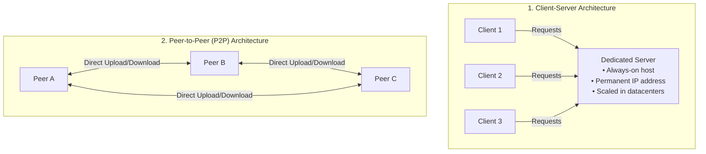
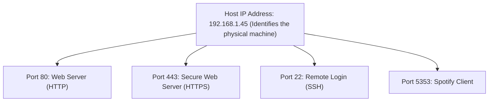
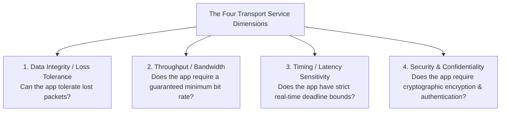
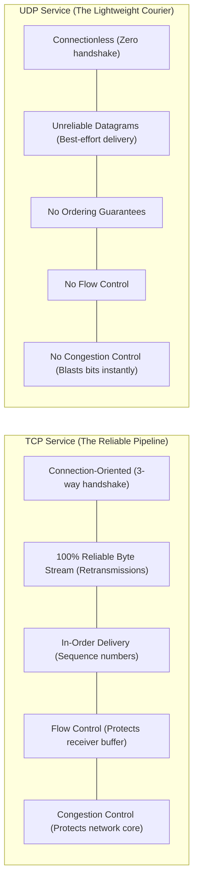

[CN Index](../README.md) / [Unit 1: Foundations & Web](Introduction.md)

---

In the earlier lectures of Unit 1, we traversed the network from the bottom up: we examined physical transmission media, first-hop access links, packet switches in the core, delay mechanics, and protocol layering.

Now we arrive at the absolute pinnacle of the stack: **The Application Layer**.

The application layer is the sole reason computer networks exist in the first place. Nobody buys optical fiber or deploys satellite constellations just to watch bits bounce between routers; we build networks so that software applications running on different machines can cooperate.

Notice a radical design choice of the Internet:
$$\text{Application programs execute }\mathbf{only}\text{ on end systems (hosts), never inside core routers.}$$

Because core switches do not run application code, software developers can invent a revolutionary new application (like the World Wide Web in 1989, BitTorrent in 2001, or Zoom in 2011), compile it, deploy it on two laptops, and run it across the globe without asking permission from a single telecommunications company or rewriting a single line of router firmware!

In this lecture, we examine **Application Layer Principles**: the **Client-Server vs. Peer-to-Peer (P2P)** paradigms, the mechanics of **Communicating Processes**, the **Socket Abstraction** (the doorway between user space and the kernel), process addressing via **IP Addresses and Port Numbers**, the four transport requirements of applications, and the core service contracts of **TCP vs. UDP**.

---

## Network Application Architectures

When designing a network application, the software architect must make an overarching structural decision: where will the application programs execute, and how will they interact?

Historically, nearly all network applications follow one of two paradigms:



---

### 1. The Client-Server Paradigm

In the **Client-Server Architecture**, there is an asymmetric division of labor between two distinct types of hosts:

#### The Server
- An **always-on host** that waits passively for incoming requests.
- Possesses a **permanent, well-known IP address** (or a stable domain name like `www.google.com`).
- To prevent single-point failures and handle millions of concurrent connections, modern servers are clustered into warehouse-scale **Datacenters**.

#### The Clients
- End-user devices (smartphones, laptops, desktop PCs) that initiate communication with the server.
- May be **intermittently connected** (frequently switching between online and offline).
- Often assigned **dynamic IP addresses** by residential ISPs or mobile cellular networks.
- **Clients do NOT communicate directly with each other!** In a client-server web app, your browser never contacts another user's browser directly; all requests flow through the centralized server.
- *Examples:* The Web (HTTP), Email (SMTP/IMAP), File Transfer Protocol (FTP), Streaming (Netflix, YouTube).

---

### 2. The Peer-to-Peer (P2P) Paradigm

In a **Peer-to-Peer (P2P)** architecture, the central server is either completely eliminated or reduced to a minimal coordinating directory.

Instead of funneling all requests through a central bottleneck:
- Arbitrary pairs of intermittently connected hosts, called **Peers**, communicate directly with each other.
- Peers reside on the edges of the network (e.g., home computers, office desktops).
- *Examples:* **BitTorrent** file distribution, early **Skype** VoIP, Bitcoin blockchain consensus.

#### The Magic of P2P: Self-Scalability
Why did P2P revolutionize file distribution? Because of an architectural property known as **Self-Scalability**:
- In a client-server system, as 10,000 new clients arrive to download a 5 GB operating system image, each client adds new download demand to the server. The server's upload link quickly saturates, and download speeds collapse.
- In a P2P system, each new peer that joins certainly adds download demand, **but that peer simultaneously contributes its own upload bandwidth to the swarm**!
- As a peer downloads chunks of a file, it immediately begins uploading those chunks to other peers. The aggregate service capacity of the system grows organically with demand.

#### The Engineering Challenges of P2P
- **High Churn:** Peers are controlled by arbitrary end users who close laptops, disconnect from Wi-Fi, and change IP addresses unpredictably.
- **Asymmetric Residential Links:** As we proved in Lecture 2, residential DSL and Cable links are heavily asymmetric (upload bandwidth is vastly slower than download bandwidth).
- **ISP Resistance:** P2P traffic creates massive upstream load on residential access networks, which were originally engineered primarily for downstream consumption.

---

## Communicating Processes and the Socket Abstraction

At the operating system level, computer hardware does not communicate with other computer hardware directly.

$$\mathbf{Processes}\text{ communicate with other }\mathbf{Processes}.$$

A **Process** is simply an active program executing within an operating system:
- When two processes execute on the **same physical host**, they communicate using Operating System **Inter-Process Communication (IPC)** mechanisms: shared memory, message queues, or Unix pipes (Unit 2 OS).
- When two processes execute on **different hosts**, they communicate by exchanging **Messages** across the computer network.

In any communicating pair:
- The process that initiates the connection is the **Client Process**.
- The process that waits to be contacted is the **Server Process**.

---

### The Socket: The Doorway to the Network

How does an application process running in user space physically hand its messages to the operating system's networking stack?

Through a programming abstraction called a **Socket**:

```mermaid
flowchart TD
    subgraph USER_SPACE["User Space (Application Developer Controlled)"]
        APP["Application Process (e.g., Web Browser)"]
    end

    subgraph SOCKET_BOUNDARY["The Socket Boundary (The Doorway)"]
        SOCK["Socket API"]
    end

    subgraph KERNEL_SPACE["Kernel Space (Operating System Controlled)"]
        TRANS["Transport Layer (TCP / UDP Engine)"]
        NET["Network Layer (IP Routing Engine)"]
        NIC["Physical Network Interface Card"]
        TRANS --- NET --- NIC
    end

    APP <==>"[Socket API: send(), recv()]" SOCK
    SOCK <==> TRANS
```

### The Doorway Analogy
Think of an application process as a person living inside a house, and the network as the outside street:
- The **Socket** is the front door of the house.
- When the process wants to send a message to a friend across the city, it writes the message on a piece of paper, opens its front door, and shoves the message out into the street.
- The process relies on the transport infrastructure on the other side of the door to carry the message across town to the friend's front door.
- When an incoming message arrives, it is shoved through the doorway into the process's internal receiving buffer.

### The Boundary of Control
Notice the strict division of control across the socket:
- **On the Application Side of the Socket:** The application developer has **100% total control**. You choose the programming language, message format, protocol syntax, buffer structures, and when to send data.
- **On the Transport Side of the Socket:** The operating system kernel has **total control**. The application developer has zero control over low-level packet timings, window calculations, or retransmission logic, except for:
  1. Choosing the transport protocol (**TCP vs. UDP**).
  2. Setting a few high-level parameters (e.g., maximum buffer size).

---

## Addressing Processes: IP Addresses and Port Numbers

Suppose a packet arrives at your laptop over Wi-Fi. 

Your laptop's network adapter inspects the packet's destination IP address and verifies that it matches your machine's 32-bit IPv4 address:
$$192.168.1.45$$

Now the operating system faces a critical question: **Which specific program on your laptop should receive this packet?**

At any given moment, your laptop is running dozens of independent network programs simultaneously:
- A Chrome browser with 15 open tabs.
- A Spotify music stream.
- A Discord voice chat client.
- A background cloud backup service.

$$\text{An IP address identifies the }\mathbf{Host}\text{; it does }\mathbf{NOT}\text{ identify the process!}$$

To deliver a packet to the correct application, the transport layer requires a two-part hierarchical identifier:
$$\mathbf{\text{Complete Process Address} = \langle \text{Host IP Address}, \; \text{Port Number} \rangle}$$



### Port Numbers
A **Port Number** is a 16-bit integer, spanning values from **$0$ to $65,535$**:
- **Well-Known Ports ($0$ to $1,023$):** Reserved by the Internet Assigned Numbers Authority (IANA) for standard, ubiquitous server services:
  - **Port 80:** Hypertext Transfer Protocol (HTTP)
  - **Port 443:** HTTP Secure (HTTPS / TLS)
  - **Port 22:** Secure Shell (SSH)
  - **Port 25:** Simple Mail Transfer Protocol (SMTP)
  - **Port 53:** Domain Name System (DNS)
  - **Port 21:** File Transfer Protocol (FTP)
- **Ephemeral (Dynamic) Ports ($49,152$ to $65,535$):** Short-lived port numbers automatically assigned by the operating system kernel to client applications when they initiate an outbound connection.

When your browser connects to a web server, the destination port is strictly `80` or `443`, while your browser's source port is a randomly assigned ephemeral integer (e.g., `52,410`). When the web server replies, it sends the response to port `52,410`, allowing your operating system to route the incoming bytes directly into the correct browser tab!

---

## What Does an Application-Layer Protocol Define?

An **Application-Layer Protocol** establishes the shared rules of communication between distributed processes. It formally specifies four things:

1. **Types of Messages Exchanged:** Is this a `REQUEST` message asking for an object, or a `RESPONSE` message returning data?
2. **Message Syntax:** The exact structural format of the message. Which byte ranges represent headers? How are field names delimited (e.g., ASCII carriage-return/line-feed `\r\n`)? Where does the header end and the body payload begin?
3. **Message Semantics:** The precise operational meaning of each field. What does the string `GET` mean? What does status code `404` convey?
4. **Rules for Action and Timing:** When is a process permitted to transmit? How should a server respond if a requested file does not exist?

### Open Protocols vs. Proprietary Protocols
- **Open Protocols:** Defined in public RFCs and standardized by the IETF (e.g., HTTP, SMTP, DNS, BitTorrent). Anyone can write a client or server that interoperates seamlessly with software written by other vendors.
- **Proprietary Protocols:** Kept secret by commercial corporations (e.g., Zoom video streaming, Skype protocols). Independent developers cannot write third-party clients without reverse-engineering the packet formats.

---

## What Transport Services Does an Application Need?

Not all network applications have the same requirements. A bank transfer requires fundamentally different guarantees from an online multiplayer first-person shooter.

When an application selects a transport service, it evaluates four primary performance dimensions:



### 1. Data Integrity (Loss Tolerance)
- **100% Reliable (Loss-Intolerant):** Applications where losing a single byte corrupts the entire transaction. Financial transactions, file downloads, web pages, text messaging, and email cannot tolerate dropped packets.
- **Loss-Tolerant:** Applications where occasional dropped packets cause minor, imperceptible glitches rather than catastrophic failure. Real-time audio calls, streaming video, and multiplayer gaming can easily drop $1\%$ of packets without ruining the user experience.

### 2. Throughput (Bandwidth Sensitivity)
- **Bandwidth-Sensitive:** Applications that require a guaranteed minimum throughput to function. A 4K video stream requires a steady 25 Mbps. If available bandwidth drops below that threshold, the video player stutters and freezes.
- **Elastic Applications:** Applications that can gracefully expand or contract their transmission rate to consume whatever bandwidth is currently available. Email, file downloads, and web browsing are elastic: if the link operates at 100 Mbps, the download finishes in 1 second; if it drops to 1 Mbps, it finishes in 100 seconds without crashing.

### 3. Timing (Latency Sensitivity)
- **Delay-Sensitive (Real-Time):** Applications that require tight, bounded end-to-end latency (typically $< 150\text{ ms}$). In interactive voice calls (VoIP) or multiplayer gaming, receiving an audio packet 2 seconds late is completely useless; the conversation has already moved on.
- **Delay-Tolerant:** Applications where data arriving a few seconds or minutes later does not diminish its value (e.g., email delivery, file backups).

### 4. Security
Applications often require transport encryption (confidentiality), message integrity verification (tamper prevention), and cryptographic authentication (verifying that the server is genuine).

---

## Internet Transport Services: TCP vs. UDP

To satisfy these diverse application requirements, the Internet architecture provides two primary transport-layer protocols: **TCP** and **UDP**.



### 1. TCP (Transmission Control Protocol)
- **Connection-Oriented:** Before data can flow, a client and server execute a **Three-Way Handshake** (`SYN`, `SYN-ACK`, `ACK`), establishing internal state buffers in both operating system kernels.
- **Reliable Data Transfer:** Uses acknowledgments (ACKs) and automated timeout retransmissions. If a router drops a packet, TCP detects the loss and retransmits it until every single byte arrives intact.
- **In-Order Delivery:** Sequences packets so that bytes are delivered to the receiving socket in the exact order they were sent.
- **Flow Control:** Ensures the sender does not transmit data faster than the receiving application process can read from its socket buffer.
- **Congestion Control:** Throttles the sender's transmission rate when intermediate routers in the network core experience queueing congestion.

### 2. UDP (User Datagram Protocol)
- **Connectionless:** Zero handshake. A process simply pushes a packet out of the socket, and it immediately hits the wire.
- **Unreliable "Best-Effort":** If an intermediate router queue overflows and drops the packet, UDP does *not* detect it and does *not* retransmit it. Packets may arrive out of order or vanish entirely.
- **Zero Flow / Congestion Control:** UDP does not throttle the sender. A video or voice application can blast bits onto the link at whatever constant bit rate it desires.

---

### What Neither TCP Nor UDP Provides: The Timing and Throughput Void

Notice something astonishing about the Internet's transport layer:

$$\mathbf{Neither\text{ TCP nor UDP provides any Timing Guarantees or Minimum Throughput Guarantees!}}$$

- Neither protocol can promise: *"This packet will arrive at the destination in less than 50 milliseconds."*
- Neither protocol can promise: *"This connection will be guaranteed at least 5 Megabits per second."*

Because the Internet operates on **Best-Effort Packet Switching**, physical queueing delays in core routers are unpredictable. 

How, then, do modern real-time voice and video applications (like Zoom, FaceTime, and YouTube) work so reliably?
They achieve performance through **Clever Application-Layer Engineering**: client-side jitter buffers, adaptive bitrate streaming (DASH / HLS), and deploying edge cache servers close to users.

---

## Mapping Popular Applications to Transport Protocols

| Application | Application-Layer Protocol | Underlying Transport Protocol | Reason for Transport Choice |
| :--- | :--- | :--- | :--- |
| **Electronic Mail** | SMTP (RFC 5321) | **TCP** (Port 25) | Requires 100% reliable, loss-free text delivery |
| **Web Browsing** | HTTP 1.1 / HTTP/2 (RFC 9110) | **TCP** (Port 80 / 443) | HTML, CSS, and JS cannot tolerate missing bytes |
| **Modern Web (HTTP/3)**| HTTP/3 (RFC 9114) | **QUIC over UDP** (Port 443) | Eliminates TCP head-of-line blocking in user space |
| **Remote Terminal** | SSH (RFC 4251) | **TCP** (Port 22) | Keystrokes must arrive reliably and in strict order |
| **Streaming Stored Video**| DASH / HLS | **TCP** (Port 80 / 443) | Large client-side buffers easily absorb TCP retransmission delays |
| **Domain Name System** | DNS (RFC 1035) | **UDP** (Port 53) *(TCP for zone transfers)* | Single request/response fits in one packet; fast query lookup |
| **Internet Telephony** | SIP, RTP, proprietary | **UDP** or TCP | Low latency is critical; retransmissions arrive too late |
| **Network Management** | SNMP (RFC 1157) | **UDP** (Port 161) | Lightweight; avoids adding congestion overhead during outages |

---

## Key Takeaways

- Application-layer protocols execute exclusively on **end systems (hosts)**, allowing rapid application deployment without altering core network switches or routers.
- The **Client-Server Architecture** relies on always-on servers with fixed IP addresses in datacenters, with clients initiating communication.
- The **Peer-to-Peer (P2P) Architecture** connects arbitrary peers directly; it is **self-scalable** because peers contribute upload capacity as they download.
- Processes communicate across networks by exchanging **Messages** pushed through **Sockets**. The socket is the application-controlled doorway to the OS-controlled transport layer.
- An application process is identified by a two-part address: the **Host IP Address** (identifies the machine) and the **Port Number** (16-bit integer identifying the specific process/socket).
- Application requirements span four dimensions: **Data Integrity** (loss tolerance), **Throughput** (bandwidth sensitivity vs. elasticity), **Timing** (delay sensitivity), and **Security**.
- **TCP** provides a connection-oriented, 100% reliable, in-order byte stream with flow and congestion control.
- **UDP** provides an ultra-lightweight, connectionless, unreliable datagram service with zero handshake and no flow/congestion control.
- **Neither TCP nor UDP provides timing delay bounds or minimum throughput guarantees.**

---

Now that we understand the foundational architecture of network applications, process addressing, and transport service models, we examine the most ubiquitous and transformative application protocol on Earth: **The Hypertext Transfer Protocol (HTTP)**. In the next lecture, we dissect [**The Web and HTTP**](L10%20-%20The%20Web%20and%20HTTP.md), analyzing web pages and objects, the **Statelessness Principle**, **Non-Persistent vs. Persistent HTTP** (including RTT latency derivations), request and response message formats, status codes, and packet traces.
