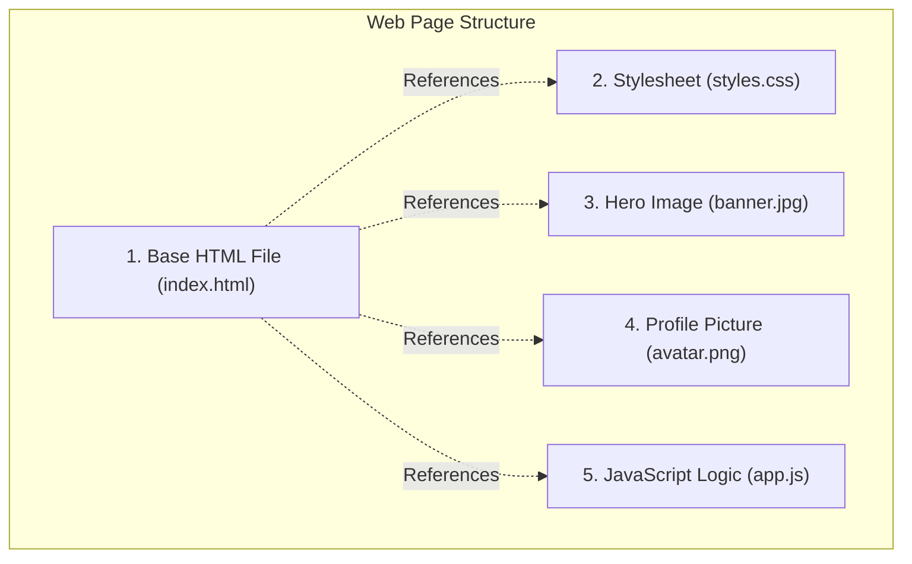
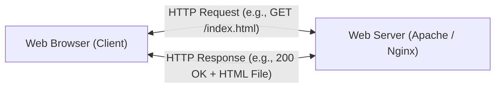
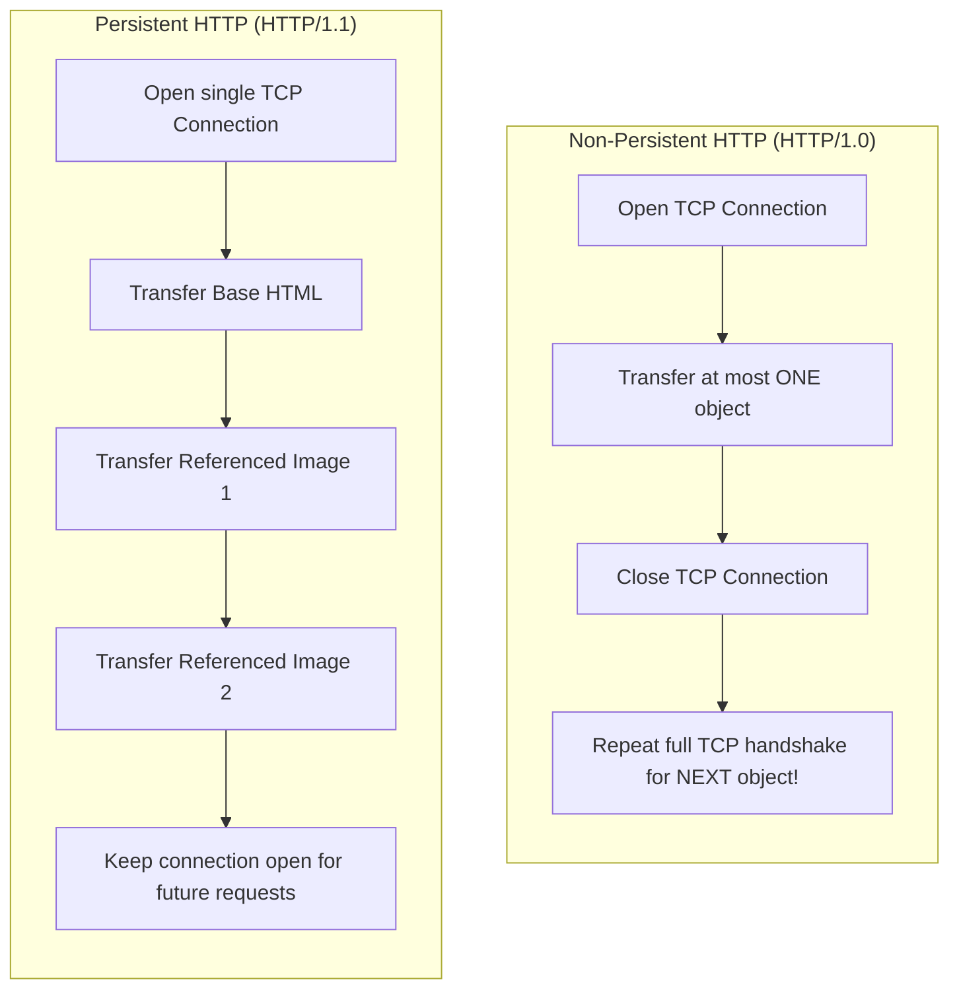
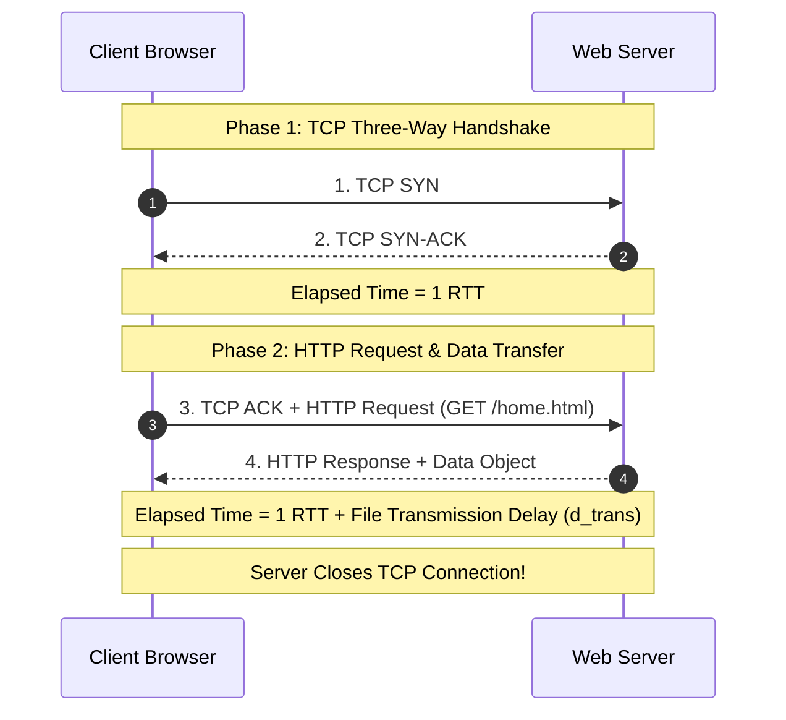
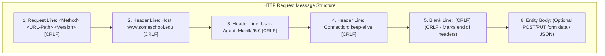
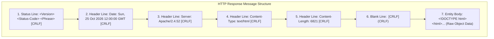
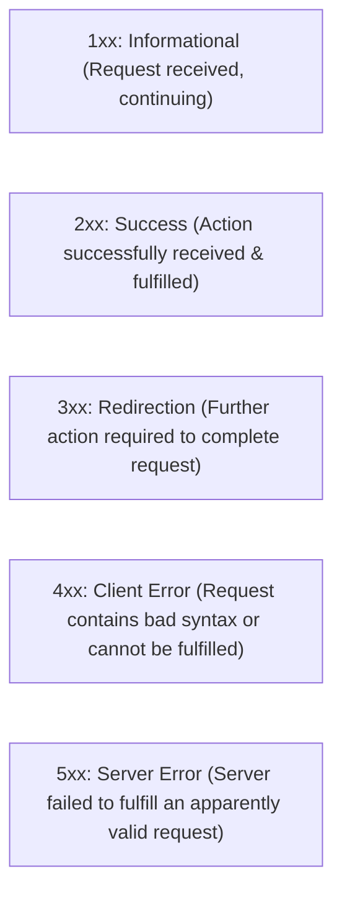

[CN Index](../README.md) / [Unit 1: Foundations & Web](Introduction.md)

---

In the previous lecture, we established the foundational principles of the application layer: process-to-process communication, the socket abstraction, port numbers, and the core transport contracts of TCP and UDP.

Now we examine the protocol that powers the global information age: **The Hypertext Transfer Protocol (HTTP)**.

When you enter a URL into a web browser, what actually crosses the wire? 
- Why does a single web page trigger dozens of separate network requests?
- Why did early web browsers take seconds to load a simple page with images, and how did **Persistent Connections** solve this?
- What does it mean that HTTP is **Stateless**, and how is that simplicity preserved in its human-readable ASCII request and response headers?

In this lecture, we dissect **The Web and HTTP**: web pages, objects, and URLs, the architectural **Statelessness Principle**, the mathematical latency derivation of **Non-Persistent HTTP ($2\text{ RTT}$) vs. Persistent HTTP**, the exact byte-level syntax of **HTTP Request and Response Messages**, and the taxonomy of **HTTP Status Codes ($1xx$ through $5xx$)**.

---

## Web Pages, Objects, and URLs

To understand how HTTP communicates, we must distinguish between what a human sees on a computer screen and what the network actually transports.

To a user, a website looks like a single, seamless visual document.

To the network, **a Web page is a collection of distinct Objects**:

> An **Object** is simply a standalone file—such as a base HTML file, a JPEG image, a GIF animation, a CSS stylesheet, a JavaScript file, or an MP4 video clip—that is addressable by a single **Uniform Resource Locator (URL)**.



### The Object Counting Rule
A web page almost always consists of:
$$\mathbf{\text{Total Objects} = 1 \text{ Base HTML Object} + N \text{ Referenced Objects}}$$

If a university homepage contains a base HTML document that links to 5 JPEG images and 2 external CSS files, the browser must fetch **8 separate objects** across the network!

### Anatomy of a URL
Each object is located by its URL:
$$\text{URL} = \underbrace{\text{https}}_{\text{Scheme}} :// \underbrace{\text{www.someschool.edu}}_{\text{Host Name}} \underbrace{\text{/departments/cs/pic.gif}}_{\text{Path Name}}$$

1. **Protocol Scheme (`https`):** Specifies the application protocol to use.
2. **Host Name (`www.someschool.edu`):** Identifies the destination server holding the resource. DNS translates this name into an IP address.
3. **Path Name (`/departments/cs/pic.gif`):** Identifies the specific file path inside the server's web directory hierarchy.

---

## HTTP Overview: The Client-Server Model

The **Hypertext Transfer Protocol (HTTP)** is the Web's application-layer protocol:
- It defines the syntax and semantics of how web browsers request web pages from servers, and how web servers transfer objects back to browsers.
- **Client (Web Browser):** The program that initiates the conversation. It requests, receives, and renders web objects (e.g., Chrome, Firefox, Safari).
- **Server (Web Server):** The program that stores web objects and responds to client requests (e.g., Apache, Nginx, Microsoft IIS).



### HTTP Transport: The TCP Connection
HTTP does not transport bits across physical wires itself. It relies on the underlying transport layer:
1. The client initiates a reliable **TCP connection** to the server at destination **Port 80** (or **Port 443** for HTTPS).
2. The server accepts the TCP connection.
3. The browser and server exchange HTTP request and response messages through their respective socket interfaces.
4. Because TCP provides an error-free, in-order byte stream, HTTP never has to worry about lost packets, corrupted bytes, or retransmissions.

---

## The Statelessness Principle

One of the most consequential architectural decisions in computing history is:

$$\mathbf{HTTP\text{ is a Stateless Protocol.}}$$

> An HTTP server maintains **no information whatsoever about past client requests**.

If a client requests `index.html`, and two seconds later requests `index.html` a second time, **the server does not remember that it just spoke to this client**. It treats the second request as an entirely new transaction from an unknown stranger, generating and transmitting the file all over again.

### Why Did the Designers Make HTTP Stateless?
1. **Simplicity:** A server does not need to allocate kernel memory to track historical client states, session timers, or inactive users.
2. **Crash Resilience:** If a stateful server crashes mid-session, all client sessions break and must be painstakingly recovered. A stateless server can reboot instantly; any incoming request can be satisfied immediately.
3. **Horizontal Scalability:** In modern web clusters, an incoming HTTP request can be routed by a load balancer to Server A, and the very next click from the same user can be routed to Server B without either server needing to coordinate session memory!

*(In Lecture 11, we explore how **Cookies** layer state on top of stateless HTTP without modifying the server's stateless core).*

---

## Non-Persistent vs. Persistent HTTP Connections

Over the evolution of the Web, the way HTTP utilizes underlying TCP connections transformed completely:



---

### 1. Non-Persistent HTTP (HTTP/1.0)

In early HTTP/1.0, **each TCP connection was used to fetch exactly one single object**, and then closed immediately.

#### Step-by-Step Execution Trace
Suppose a user requests `www.school.edu/home.html`, which contains references to **3 JPEG images**:
1. Client initiates TCP connection to `www.school.edu` (Port 80).
2. Server accepts connection.
3. Client sends HTTP request for `home.html`.
4. Server retrieves `home.html`, transmits it across the TCP connection, and **closes the TCP connection**.
5. Client browser parses `home.html` and discovers 3 JPEG image references.
6. The browser must now repeat steps 1–4 **three separate times**, opening and closing **three new, independent TCP connections** to fetch the images!

---

### The Mathematical Response Time Derivation ($2\text{ RTT}$)

To measure HTTP performance, we use **Round-Trip Time (RTT)**:

> **RTT** is the time required for a small packet to travel from the client to the server and back again.

Let us calculate the total time required to retrieve a base HTML file over a Non-Persistent HTTP connection:



$$\mathbf{\text{Response Time for One Object} = 2 \times \text{RTT} + d_{\text{trans}}}$$

Where:
- **First RTT:** Spent establishing the TCP connection (SYN $\to$ SYN-ACK).
- **Second RTT:** Spent sending the HTTP request and waiting for the first bytes of the HTTP response to arrive.
- **$d_{\text{trans}}$:** Time for the server to transmit all bits of the file ($L/R$).

#### The Cost of Non-Persistent HTTP
If a web page contains 1 base HTML file and $N$ referenced images:
$$\text{Sequential Non-Persistent Total Delay} = 2\text{ RTT} + (N \times 2\text{ RTT}) = \mathbf{2(N + 1)\text{ RTT} + \sum d_{\text{trans}}}$$

For a page with 10 images, the user must wait **22 round trips**!
Furthermore, non-persistent HTTP places massive strain on servers:
- Operating system kernels must allocate and tear down socket control blocks for every single image.
- Every new TCP connection must suffer through TCP's **Slow Start** congestion control phase, capping transfer speeds on small files.

---

### 2. Persistent HTTP (HTTP/1.1)

To eliminate this massive overhead, **HTTP/1.1 introduced Persistent Connections**:

> Under Persistent HTTP, the server **leaves the TCP connection open** after sending a response. Subsequent requests and responses between the same client and server are transmitted across the **exact same established connection**.

#### The Latency Win
- The initial base HTML file still requires $2\text{ RTT}$ (1 RTT for TCP setup + 1 RTT for HTTP request).
- But for all referenced objects, **the TCP connection is already open**! 
- **Persistent without Pipelining:** The client sends a request for the next image as soon as the previous image arrives, requiring only **$1\text{ RTT}$ per referenced object** (saving 50% of round-trip latency).
- **Persistent with Pipelining:** The client sends requests for *all* referenced images back-to-back in an unbroken batch as soon as it parses the HTML. All referenced images arrive in as little as **$1\text{ RTT}$ total**!

---

## HTTP Request Message Format

HTTP messages are not encoded in opaque binary; they are formatted in clean, human-readable **ASCII text**:



### Concrete Example of an HTTP Request
```http
GET /somedir/page.html HTTP/1.1\r\n
Host: www.someschool.edu\r\n
User-Agent: Mozilla/5.0 (Windows NT 10.0; Win64; x64)\r\n
Accept: text/html,application/xhtml+xml\r\n
Accept-Language: en-US,en;q=0.9\r\n
Connection: keep-alive\r\n
\r\n
```

### Dissecting the Request Fields
1. **The Request Line:**
   - **Method:** The operation requested (`GET`, `POST`, `HEAD`, `PUT`, `DELETE`).
   - **URL Path:** The resource path (`/somedir/page.html`).
   - **HTTP Version:** The protocol version (`HTTP/1.1`).
2. **The Header Lines:**
   - `Host: www.someschool.edu`: **Mandatory in HTTP/1.1.** Allows a single physical server with one IP address to host hundreds of different websites (**Virtual Hosting**).
   - `User-Agent`: Identifies the client browser and operating system version.
   - `Accept-Language`: Specifies the user's preferred natural language.
   - `Connection: keep-alive`: Requests that the server maintain the TCP connection open.
3. **The Blank Line (`\r\n`):**
   - **The single most critical delimiter in HTTP.** It consists of an empty carriage return and line feed. It unambiguously signals to the server that the header block is finished and the entity body begins.

---

### HTTP Methods Summary

| Method | Direction | Purpose | Carries Entity Body? |
| :--- | :--- | :--- | :--- |
| **`GET`** | Client $\to$ Server | Retrieves the object identified by the URL path. | **No** (Query params in URL) |
| **`POST`** | Client $\to$ Server | Submits data (form input, user credentials, JSON) to be processed. | **Yes** (Data in body) |
| **`HEAD`** | Client $\to$ Server | Asks for the exact headers that a `GET` would return, but **omits the entity body**. (Used by caches to check if an object was modified). | **No** |
| **`PUT`** | Client $\to$ Server | Uploads a complete file, storing it at the exact URL path specified. | **Yes** (File bytes in body) |
| **`DELETE`**| Client $\to$ Server | Requests the server to permanently delete the resource at the URL path. | Rarely |

---

## HTTP Response Message Format

When the server processes a request, it returns an **HTTP Response Message**:



### Concrete Example of an HTTP Response
```http
HTTP/1.1 200 OK\r\n
Date: Sun, 25 Oct 2026 12:00:00 GMT\r\n
Server: Apache/2.4.52 (Ubuntu)\r\n
Last-Modified: Wed, 21 Oct 2026 08:30:00 GMT\r\n
ETag: "6821-5d9c-12345678"\r\n
Content-Length: 6821\r\n
Content-Type: text/html; charset=UTF-8\r\n
Connection: keep-alive\r\n
\r\n
<!DOCTYPE html>
<html>
<head><title>Department Home</title></head>
<body><h1>Welcome to Computer Science</h1></body>
</html>
```

### Dissecting Key Response Headers
- `Status Line`: Contains protocol version, a 3-digit numeric status code, and a human-readable phrase (`HTTP/1.1 200 OK`).
- `Date`: Timestamp when the server generated the response.
- `Server`: Software banner identifying the web server application.
- `Last-Modified`: Crucial timestamp indicating when the file was last updated on disk (used for web caching).
- `Content-Length`: The exact length of the entity body in bytes (enables the browser to know when an object finishes downloading over a persistent connection).
- `Content-Type`: The MIME type indicating how the browser should render the body (`text/html`, `image/jpeg`, `application/json`).

---

## The HTTP Status Code Families

Every HTTP response returns a **3-digit integer Status Code**. 

You do not need to memorize hundreds of individual codes; the **first digit** immediately reveals the category of the outcome:



### Critical Status Codes to Know
- **`200 OK`:** The request succeeded. The requested object is enclosed in the response entity body.
- **`301 Moved Permanently`:** The requested resource has moved permanently to a new URL. The server includes a `Location:` header pointing to the new URL; the browser automatically redirects.
- **`304 Not Modified`:** The client sent a Conditional GET asking if the file changed since a cached date. The server confirms the file has not changed! The entity body is empty, saving bandwidth.
- **`400 Bad Request`:** A generic error indicating the server could not parse the request syntax.
- **`403 Forbidden`:** The server understood the request, but refuses to authorize access (insufficient permissions).
- **`404 Not Found`:** The server is functioning perfectly, but the requested path does not exist on disk. *(Note: 404 does NOT mean the server is down!)*
- **`500 Internal Server Error`:** The server crashed or threw an unhandled exception while executing backend code.
- **`503 Service Unavailable`:** The server is temporarily overloaded or down for maintenance.

---

## Key Takeaways

- A web page consists of objects (HTML, images, stylesheets) addressable by URLs ($\text{URL} = \text{Scheme} + \text{Host Name} + \text{Path Name}$).
- **Total page objects** equals 1 base HTML file plus $N$ referenced objects ($N + 1$ objects total).
- **HTTP is a Stateless Protocol:** The server retains zero memory of past client requests, maximizing scalability and crash resilience.
- **Non-Persistent HTTP (HTTP/1.0)** opens and closes a new TCP connection for every single object, incurring **$2\text{ RTT} + d_{\text{trans}}$** per object ($2(N+1)\text{ RTT}$ total).
- **Persistent HTTP (HTTP/1.1)** maintains the TCP connection open, allowing subsequent objects to be retrieved across the same connection in $1\text{ RTT}$ (or $1\text{ RTT}$ total for all objects with pipelining).
- HTTP messages are formatted in human-readable ASCII. A **blank line (`\r\n`)** strictly delimits the header block from the optional entity body.
- **Status codes** are grouped into five families: $1xx$ (Info), $2xx$ (Success), $3xx$ (Redirection), $4xx$ (Client Error), and $5xx$ (Server Error).

---

We now understand how HTTP exchanges text and multimedia objects over TCP sockets. But this reveals two profound limitations:
1. If HTTP is completely stateless, how do modern e-commerce websites remember what is inside your shopping cart as you navigate across dozens of different pages?
2. If every user in a 50,000-student university requests the exact same 500 MB video file from a server across the ocean, why should the access link choke downloading 50,000 redundant copies?

In the final lecture of Unit 1, we analyze [**HTTPS, Cookies, and Web Caching**](L11%20-%20HTTPS,%20Cookies,%20and%20Web%20Caching.md), exploring the **TLS Handshake**, state tracking via **Cookies**, and network optimization through **Web Proxy Caches** and the **Conditional GET Protocol**.
