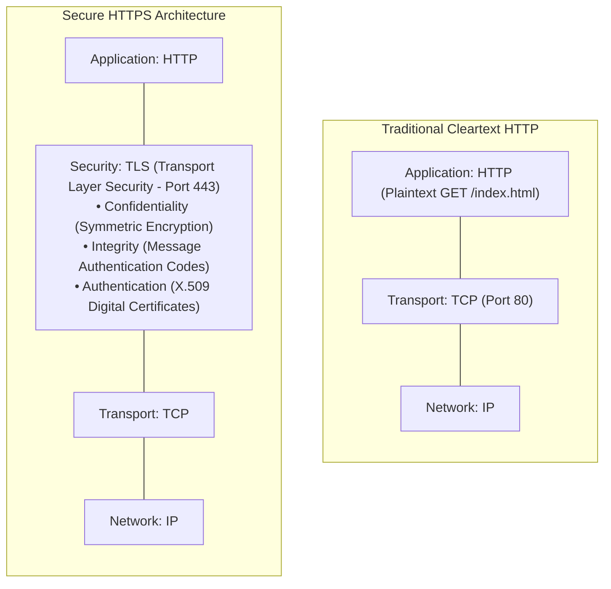
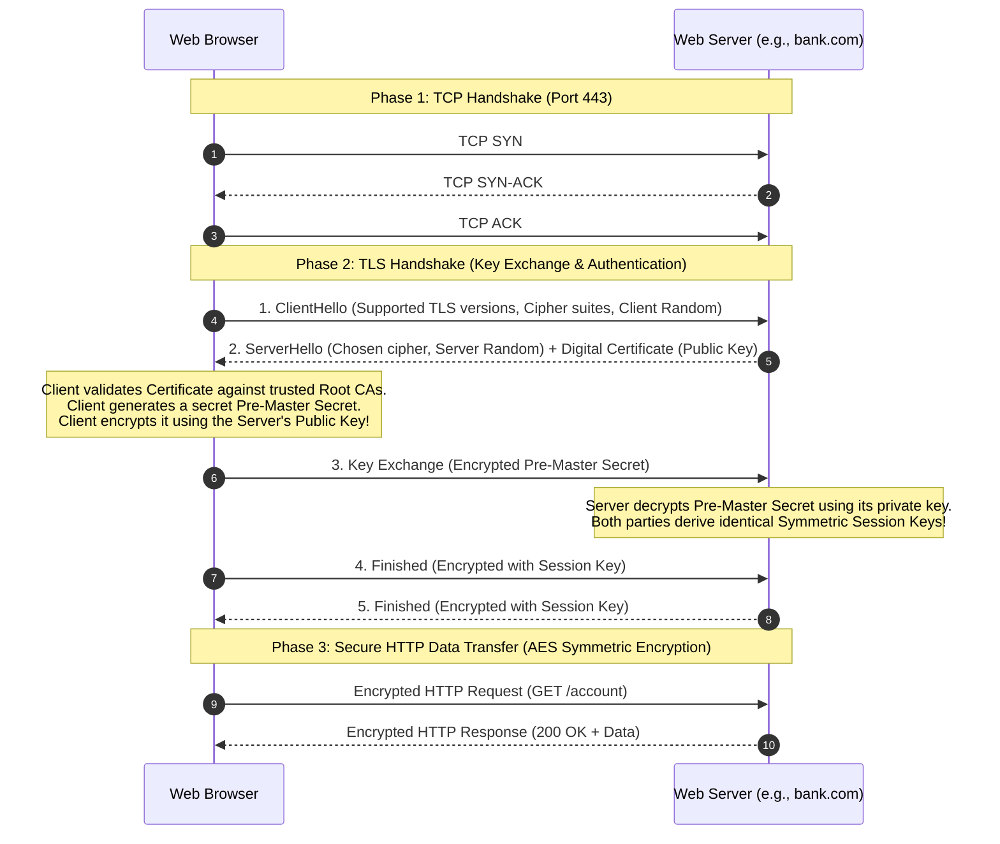
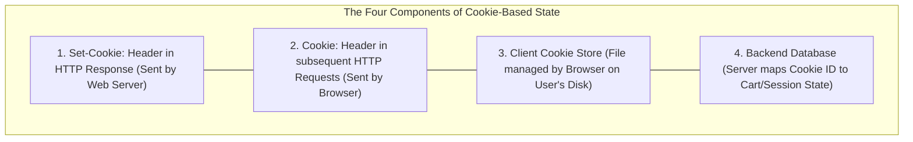
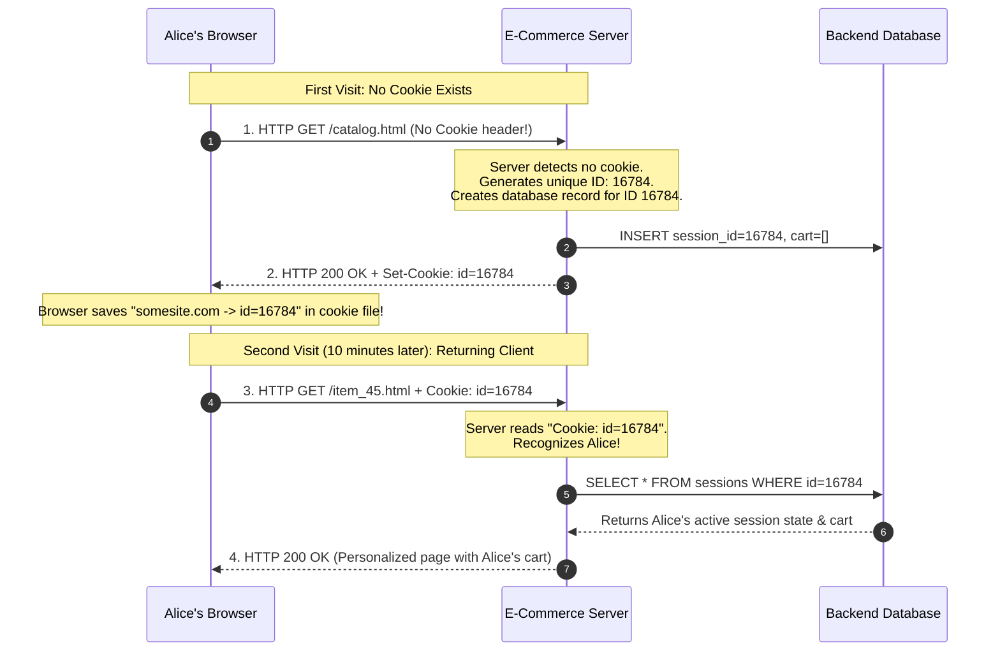
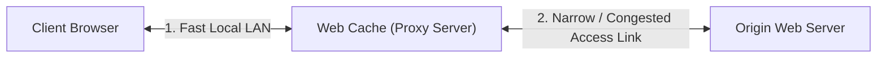
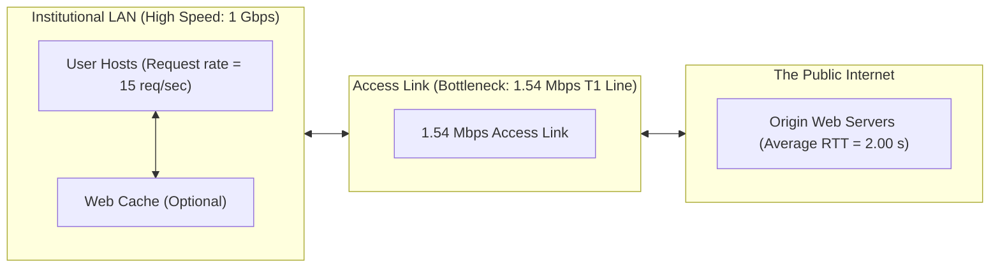
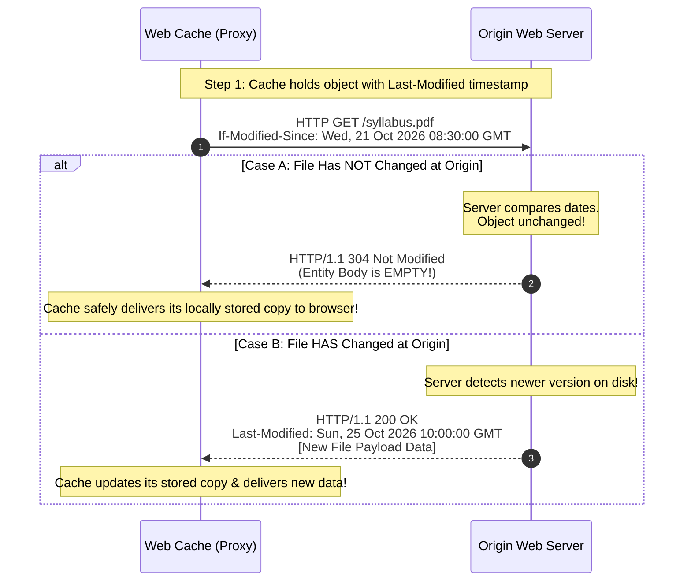

[CN Index](../README.md) / [Unit 1: Foundations & Web](Introduction.md)

---

In the previous lecture, we established the core mechanics of the Hypertext Transfer Protocol: client-server request-response cycles, ASCII message formats, and the fundamental **Statelessness Principle**.

While statelessness makes web servers exceptionally simple and scalable, it introduces two severe real-world dilemmas:
1. **The State Problem:** If an HTTP server forgets who you are the millisecond a connection closes, how can an e-commerce website remember what is inside your shopping cart as you browse from page to page? How does a web portal keep you logged in without asking for your password on every single click?
2. **The Redundant Traffic Problem:** If 10,000 students on a university campus all download the same 100 Megabyte course syllabus from an origin web server in London, why should the university's expensive access link choke downloading 10,000 identical copies across the Atlantic Ocean?
3. **The Eavesdropping Problem:** If HTTP messages travel across public Wi-Fi networks in cleartext ASCII, anyone sitting in the same coffee shop with a packet sniffer can read passwords, session tokens, and credit card numbers.

How did the Internet solve these three critical challenges?

In this final lecture of Unit 1, we examine **HTTPS, Cookies, and Web Caching**: the cryptographic foundation of **HTTPS and the TLS Handshake**, the four components of **Cookie-Based State Tracking**, the performance mathematics of **Web Proxy Caches**, and the cache-validation mechanics of the **Conditional GET Protocol**.

---

## HTTPS: Securing the Web

Traditional HTTP transmits all headers, URLs, cookies, and payloads as unencrypted cleartext ASCII. 

On a shared public network (like an airport Wi-Fi hotspot or an intermediate ISP router), any attacker running software like Wireshark can execute a passive packet-sniffing attack to read confidential user data (**Breach of Confidentiality**), or execute an active Man-in-the-Middle attack to inject malicious ads or malware into the HTML stream (**Breach of Integrity**).

To secure the Web, the industry standard is **HTTPS (HTTP Secure)**:

$$\mathbf{\text{HTTPS} = \text{HTTP carried over an authenticated, encrypted TLS Connection.}}$$



### The Three Security Guarantees of HTTPS
1. **Confidentiality (Encryption):** An eavesdropper observing network packets sees only pseudorandom ciphertext. They cannot read passwords, credit card numbers, or browsing paths.
2. **Data Integrity:** Every packet includes a cryptographic hash (Message Authentication Code). If an attacker tampers with a single bit in transit, the receiver detects the alteration and drops the packet.
3. **Server Authentication:** When your browser connects to `bank.com`, how do you know you are not speaking to an attacker impersonating the bank? The server presents an **X.509 Digital Certificate** digitally signed by a trusted third-party **Certificate Authority (CA)** (e.g., Let's Encrypt, DigiCert). The browser verifies the cryptographic signature to confirm the server's genuine identity.

---

### The TLS Handshake: Bridging Asymmetric and Symmetric Cryptography

Why doesn't HTTPS use public-key (asymmetric) cryptography for the entire conversation?
- **Asymmetric encryption (RSA, ECC)** is computationally expensive and slow; running it on every 1,500-byte packet would melt web server CPUs.
- **Symmetric encryption (AES)** is blindingly fast (often accelerated by hardware CPU instructions), but requires both parties to share a secret key beforehand.

To achieve the best of both worlds, HTTPS uses **Asymmetric Cryptography during the Handshake to safely exchange a temporary Symmetric Session Key**, and then uses **Symmetric Cryptography for all subsequent bulk data transfer**:



1. **TCP Handshake:** Browser and server establish a standard TCP connection on Port 443 (1 RTT).
2. **Hello & Certificate:** The server sends its digital certificate containing its **Public Key**. The browser verifies that the certificate is valid, not expired, and issued for the exact domain requested.
3. **Secret Exchange:** The browser generates a random 48-byte secret (the *Pre-Master Secret*), encrypts it with the server's public key, and sends it to the server.
4. **Key Derivation:** Because only the genuine server possesses the matching **Private Key**, only the genuine server can decrypt it. Both browser and server now calculate the exact same **Symmetric Session Key**.
5. **Bulk Transfer:** From this point forward, all HTTP requests and responses are encrypted using high-speed symmetric AES encryption.

---

## Cookies: State Over a Stateless Protocol

As we established in Lecture 10, HTTP is completely stateless. 

Yet when you shop on Amazon, you can add an item to your cart, navigate through ten different department pages over thirty minutes, and proceed to checkout with all items intact.

How does the Web maintain session continuity over a stateless protocol?

The solution, standardized in RFC 6265, is **The Cookie**.



---

### The Cookie Interaction Timeline

Let us trace what happens when user Alice visits an e-commerce site for the very first time:



1. **Initial Visit:** Alice sends an ordinary HTTP request without any cookie.
2. **Identification & Header Injection:** The web server generates a unique identification number (e.g., `id=16784`) and inserts a special header into the response:
   ```http
   HTTP/1.1 200 OK
   Set-Cookie: session_id=16784; Path=/; Secure; HttpOnly
   ```
3. **Client Storage:** The browser receives the response, extracts `session_id=16784`, and writes it to an internal cookie database on Alice's local hard drive, keyed to the server's domain.
4. **Subsequent Visits:** Every single time Alice clicks a link or requests an object from `somesite.com` in the future, the browser automatically extracts the stored cookie and appends it to the outgoing request header:
   ```http
   GET /checkout.html HTTP/1.1
   Host: somesite.com
   Cookie: session_id=16784
   ```
5. **Backend Recognition:** The server reads `Cookie: session_id=16784`, queries its database, and instantly retrieves Alice's shopping cart, account preferences, and login state.

### Cookie Security Attributes
Because cookies often carry sensitive session tokens, servers protect them using three critical flags:
- **`Secure`:** Instructs the browser to transmit the cookie **only over encrypted HTTPS connections**, preventing cleartext sniffing.
- **`HttpOnly`:** Forbids client-side JavaScript (e.g., `document.cookie`) from reading the cookie, completely neutralizing **Cross-Site Scripting (XSS)** token theft.
- **`SameSite=Strict`:** Forbids the browser from sending the cookie on cross-site requests, mitigating **Cross-Site Request Forgery (CSRF)** attacks.

---

## Web Caching (Proxy Servers)

Now consider the performance dilemma: millions of users repeatedly download the exact same web pages, logos, video segments, and stylesheet files every day.

To eliminate redundant wide-area transfers, networks deploy **Web Caches** (also called **Proxy Servers**):

> A **Web Cache** is a network intermediary that satisfies HTTP requests on behalf of an origin web server. It stores copies of recently requested objects in local high-speed storage.



### The Dual Role of a Cache
Notice an elegant architectural property of a web cache:
- **Toward the Client Browser:** The cache behaves like a **Server** (it accepts HTTP requests and returns HTTP responses).
- **Toward the Origin Server:** The cache behaves like a **Client** (on a cache miss, it generates an upstream HTTP request and receives the origin response).

### The Hit vs. Miss Workflow
1. The user configures their browser to send all HTTP requests to the local institutional web cache.
2. The browser sends an HTTP request to the cache.
3. **Cache Hit:** If the requested object is already stored in the cache and is fresh, **the cache returns the object immediately over the fast local LAN**. The request never touches the Internet!
4. **Cache Miss:** If the cache does not have the object, it opens a connection to the origin server across the Internet, downloads the object, saves a local copy in its storage, and forwards the response to the client browser.

---

## The Canonical Caching Numerical Problem: Access Link Bottleneck

To see why web caching is so economically vital, let us walk through the **Famous Kurose-Ross Access Link Calculation**:



### The Parameters
- **Average Object Size ($L$):** $100,000\text{ bits}$ ($100\text{ Kbits} \approx 12.5\text{ KB}$).
- **Average Request Rate from Browsers ($a$):** $15\text{ requests/second}$.
- **Average Round-Trip Time from Router to Origin Servers:** $2.00\text{ seconds}$.
- **Institutional Access Link Capacity ($R$):** $1.54\text{ Mbps} = 1,540,000\text{ bps}$ (a standard T1 line).
- **Internal LAN Speed:** $1\text{ Gbps}$ (LAN transmission and propagation delay is $\approx 10\ \mu\text{s}$, effectively $0$).

---

### Scenario 1: Without a Web Cache

Let us evaluate the system performance when no cache is installed:

**Step 1: Compute Arrival Rate of Bits onto the Access Link**
$$\text{Traffic Arrival Rate} = L \cdot a = 100,000 \text{ bits/req} \times 15 \text{ req/sec} = 1,500,000 \text{ bps} = \mathbf{1.50 \text{ Mbps}}$$

**Step 2: Compute Traffic Intensity on the Access Link ($I = La/R$)**
$$I = \frac{1.50\text{ Mbps}}{1.54\text{ Mbps}} \approx \mathbf{0.974 \approx 0.97}$$

Look at that traffic intensity: **$I = 0.97$**!
As we proved in Lecture 5, as traffic intensity approaches 1.0, **queueing delay explodes exponentially into minutes**!
Packets wait in long queues at the access router. The average response time to fetch a simple web page becomes **tens of seconds or minutes**, and packets frequently drop due to buffer overflow. The access link is completely choked.

---

### Scenario 2: Upgrading the Physical Access Link

To fix the choking link, the university could upgrade its physical access link to **$100\text{ Mbps}$**:
$$I_{\text{new}} = \frac{1.50\text{ Mbps}}{100\text{ Mbps}} = 0.015$$
- Traffic intensity drops to near zero, and queueing delay vanishes.
- Average response time drops to $\approx 2.00\text{ seconds}$ (the speed-of-light Internet RTT).
- **The Fatal Flaw:** Upgrading physical enterprise links requires paying telecommunications providers **tens of thousands of dollars every year in recurring commercial ISP fees**.

---

### Scenario 3: Installing an Inexpensive Web Cache

Instead of paying for a faster physical line, the institution installs an inexpensive local **Web Cache** inside the LAN.

Suppose empirical user traffic yields a **Cache Hit Rate of $40\%$ ($h = 0.40$)**:
- **$40\%$ of all requests** are satisfied directly from the local cache over the 1 Gbps LAN. Delay is roughly **$10\ \mu\text{s} \approx 0\text{ seconds}$**.
- Only the remaining **$60\%$ of requests ($1 - h = 0.60$)** cross the access link to origin servers!

**Step 1: Compute the New Arrival Rate on the Access Link ($a'$)**
$$a' = 0.60 \times 15\text{ req/sec} = \mathbf{9 \text{ req/sec}}$$
$$\text{New Traffic Rate} = 9 \text{ req/sec} \times 100,000 \text{ bits} = 900,000 \text{ bps} = \mathbf{0.90 \text{ Mbps}}$$

**Step 2: Compute the New Traffic Intensity on the Access Link ($I'$)**
$$I' = \frac{0.90\text{ Mbps}}{1.54\text{ Mbps}} \approx \mathbf{0.584 \approx 0.58}$$

Look at the dramatic difference:
- Traffic intensity plummeted from **$0.97$ down to $0.58$**!
- At $I = 0.58$, the queueing delay on the access link drops from minutes down to **a few milliseconds** ($\approx 10\text{ ms}$).

**Step 3: Compute the Overall Average End-to-End Response Time**
$$\text{Average Delay} = (0.40 \times \text{Delay}_{\text{cache}}) + (0.60 \times \text{Delay}_{\text{origin}})$$
$$\text{Average Delay} \approx (0.40 \times 0\text{ s}) + (0.60 \times 2.01\text{ s}) \approx \mathbf{1.2 \text{ seconds!}}$$

Look at what web caching achieved:
$$\text{Average response time fell from }\mathbf{minutes}\text{ down to }\mathbf{1.2\text{ seconds}}\text{, at a tiny fraction of the cost of upgrading the link!}$$

---

## The Cache Consistency Dilemma: The Conditional GET Protocol

While web caching delivers miraculous performance, it introduces a dangerous consistency problem:

What if the origin web server updates the file *after* the cache stores a local copy?

If the cache blindly serves its stored copy forever, users will see stale, outdated information. If the cache discards its copy and re-downloads the file on every request, the caching benefit is destroyed!

HTTP solves this dilemma with an ingenious validation protocol: **The Conditional GET**.



### The Conditional Request Header
When a client or cache has an object stored locally, it does not send an unconditional `GET`. It appends the validator timestamp it received when it first downloaded the file:

```http
GET /syllabus.pdf HTTP/1.1
Host: www.someschool.edu
If-Modified-Since: Wed, 21 Oct 2026 08:30:00 GMT
```

### The Two Possible Server Responses

#### Case A: The Object Has NOT Changed (HTTP 304 Not Modified)
If the file on the origin server has not been touched since that date:
1. The server returns:
   ```http
   HTTP/1.1 304 Not Modified
   Date: Sun, 25 Oct 2026 12:00:00 GMT
   \r\n
   ```
2. **Crucially: The Entity Body is Completely EMPTY!**
3. The server does *not* retransmit the 50 MB file. The entire 304 response is roughly 150 bytes of ASCII headers.
4. The cache receives the 304 confirmation, refreshes its expiration timer, and serves its locally stored copy to the user. Zero access link bandwidth is wasted!

#### Case B: The Object HAS Changed (HTTP 200 OK)
If an instructor edited the syllabus on Saturday:
1. The server detects that the file's modification timestamp is newer than the `If-Modified-Since` date.
2. It returns a standard `HTTP/1.1 200 OK` response containing the updated file data in the entity body.
3. The cache overwrites its stale local copy with the fresh version and serves it to the client.

> [!NOTE]
> Modern web servers also use **Entity Tags (ETags)** instead of timestamps. The server returns `ETag: "6821-5d9c"` in the response, and the cache validates using `If-None-Match: "6821-5d9c"`. If the cryptographic hash matches, the server returns `304 Not Modified`.

---

## Key Takeaways

- **HTTPS (HTTP Secure)** runs HTTP over an authenticated, encrypted **TLS** connection (Port 443), guaranteeing **Confidentiality**, **Data Integrity**, and **Server Authentication**.
- The **TLS Handshake** uses asymmetric (public-key) cryptography and digital certificates to authenticate the server and securely exchange a pre-master secret, which both parties use to derive an identical **Symmetric Session Key** for high-speed AES data encryption.
- **Cookies** maintain state across stateless HTTP through four components: the `Set-Cookie:` response header, the `Cookie:` request header, the client-side cookie file, and the server-side backend database.
- **Web Caches (Proxy Servers)** act as both client and server, caching representations locally to dramatically reduce user latency and slash traffic on institutional bottleneck access links.
- In queueing calculations, a modest **40% cache hit rate** can reduce access link traffic intensity from near-collapse ($I = 0.97$) down to stable conditions ($I = 0.58$), reducing average user response time from minutes to 1.2 seconds.
- The **Conditional GET** protocol validates cache freshness by sending `If-Modified-Since: <date>`. If the file is unchanged, the origin server returns **`304 Not Modified` with an empty entity body**, saving bandwidth.

---

This concludes our comprehensive study of **Unit 1: Computer Networks and the Internet**:
1. We traced the Internet from the **Nuts-and-Bolts** and **Service** perspectives, exploring autonomous devices and the formal anatomy of **Protocols**.
2. We analyzed the **Network Edge**, dissecting residential access (**DSL, Cable HFC, FTTH**), enterprise Ethernet, wireless (**Wi-Fi vs. Cellular**), transmission delay ($L/R$), and **Guided vs. Unguided Media**.
3. We unpacked the **Network Core**, contrasting **Store-and-Forward Packet Switching** against **Circuit Switching (FDM/TDM)**, and proved the mathematical superiority of **Statistical Multiplexing**.
4. We explored the global **ISP Hierarchy**, proving why full meshes fail ($O(N^2)$), tracing **Transit vs. Peering**, and examining the rise of private **Content Provider Networks**.
5. We mastered the **Four Sources of Nodal Delay**, the **Caravan Analogy**, **Traffic Intensity ($La/R$)**, **Traceroute**, and **Bottleneck Links**.
6. We analyzed **Protocol Layering**, contrasting the **5-Layer Internet Stack** against the **7-Layer OSI Model**, and traced **Encapsulation and Decapsulation**.
7. We categorized **Network Hardware Devices** from Layer 1 to Layer 7, unpacking switch **MAC Self-Learning** and mastering **Collision vs. Broadcast Domains**.
8. We solved the complete suite of canonical **Numerical Problems** for delay, throughput, and queueing models.
9. We climbed to the **Application Layer**, analyzing **Client-Server vs. P2P**, the **Socket Interface**, process addressing via IP and Ports, and **TCP vs. UDP**.
10. We dissected the **Web and HTTP**, exploring statelessness, **Non-Persistent ($2\text{ RTT}$) vs. Persistent HTTP**, request/response syntax, and status code families.
11. Finally, we examined **HTTPS and TLS Handshakes**, **Cookie State Tracking**, and the performance mathematics of **Web Caching and Conditional GET**.

In [**Unit 2: Application Infrastructure, Sockets, and Transport-Layer Reliability**](../Unit%202/Introduction.md), we continue our top-down journey through the Application and Transport layers: exploring the distributed hierarchical architecture of the **Domain Name System (DNS)**, the mechanics of **P2P File Distribution with BitTorrent**, real-world **Socket Programming in Python/C**, and the deep algorithmic principles of **Reliable Data Transfer (rdt 1.0 through rdt 3.0)**.
