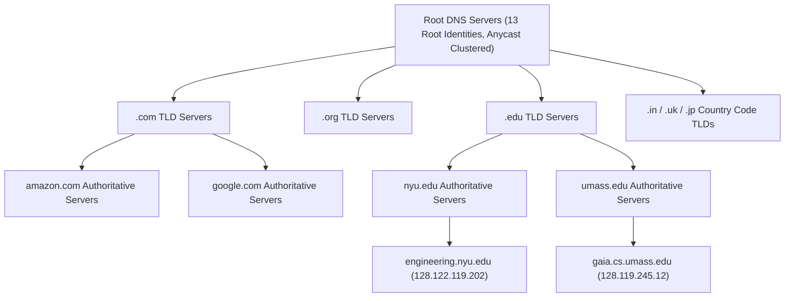
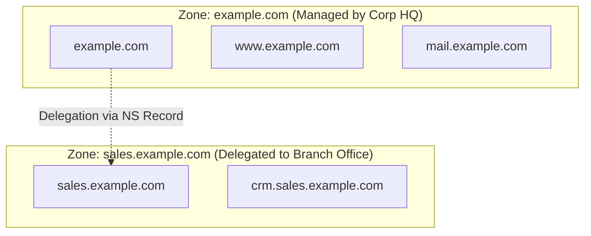
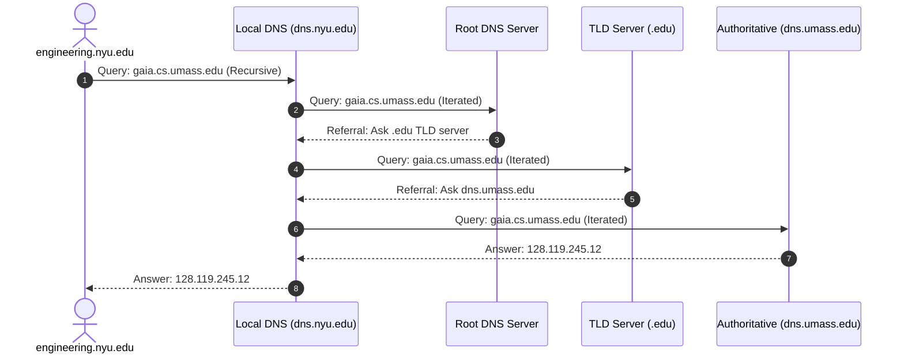
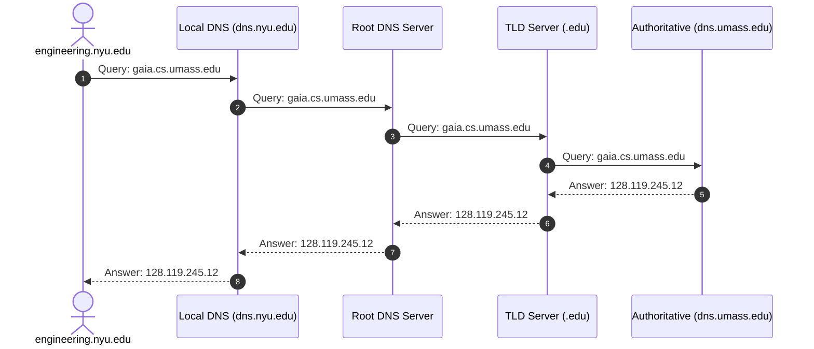
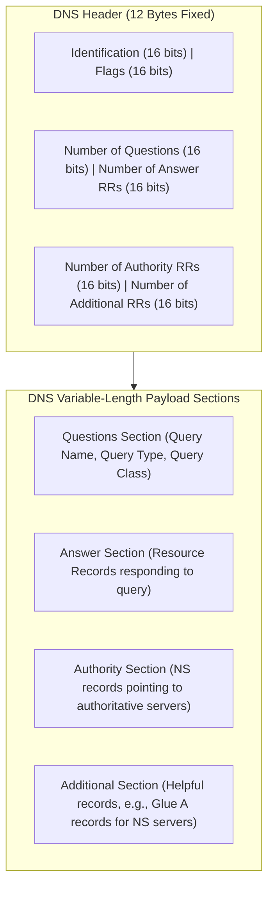

[CN Index](../README.md) / [Unit 2: Sockets & Transport](Introduction.md)

# Lecture 01: Domain Name System (DNS)

When you type `http://www.google.com` into your browser, your computer does not actually know how to send an IP datagram to `www.google.com`. 

Routers in the Internet core do not understand words, company names, or domain labels. They understand fixed-length binary IP addresses—32 bits in IPv4, 128 bits in IPv6—because fixed-width numerical addresses can be indexed, masked, and forwarded through routing tables at hardware line rate. Humans, on the other hand, cannot memorize strings of numbers like `142.250.190.46` for every website they visit. 

So the Internet requires a translation engine: a mechanism to map human-friendly hostnames to router-friendly IP addresses.

Now here's the thing — where does that translation engine live? In many early telecommunication systems, naming was baked directly into the switching fabric. But the Internet's foundational end-to-end design principle dictates that the core should remain simple, dumb, and focused entirely on packet forwarding. Therefore, the **Domain Name System (DNS)** is implemented entirely at the application layer. It runs on hosts and servers at the network edge, exchanging messages via UDP (and occasionally TCP) across port 53.

---

## Why DNS Cannot Be Centralized

Imagine designing DNS as a single, giant, centralized database server located in Kansas that stores every hostname-to-IP mapping on Earth. Whenever any machine in Tokyo, London, or Mumbai needs an IP address, it sends a query to Kansas.

The moment we propose that, we hit four catastrophic failure modes:

1. **Single Point of Failure**: If the central database crashes, catches fire, or experiences a severed fiber link, the entire global Internet ceases to function. Without name resolution, ordinary users cannot reach web servers, mail servers, or cloud APIs.
2. **Traffic Concentration**: Billions of connected devices generate hundreds of millions of queries per second. A single server (or even a single centralized cluster) would be crushed by query floods, queueing delays, and packet drops.
3. **Distant Latency**: A user in Melbourne querying a server in Kansas pays the speed-of-light propagation delay halfway around the globe for every single click, adding hundreds of milliseconds before a TCP connection can even begin.
4. **Maintenance and Scalability Nightmare**: Hundreds of thousands of new domains, hostnames, and IP changes happen every day. A single central administrator would have to manually validate, update, and manage records for every company and university on Earth.

To solve this, DNS is designed as a **distributed, hierarchical database** paired with an aggressive **caching** architecture. No single machine knows all names; instead, authority is partitioned across millions of servers globally.

---

## The Distributed Hierarchical Architecture

DNS partitions its namespace into an inverted tree. When a resolver needs to find an address, it traverses this hierarchy from the top down.



The hierarchy consists of three primary tiers:

### 1. Root Name Servers
At the apex of the tree sit the Root Name Servers. They do not know the IP address of `www.amazon.com`. Instead, they know the identity and IP addresses of the Top-Level Domain (TLD) servers responsible for `.com`, `.org`, `.net`, `.edu`, and every country code.

Historically, the root tier was specified as 13 logical server identities (`[a-m].root-servers.net`), constrained by the maximum 512-byte payload of unfragmented UDP DNS packets. Today, each of those 13 logical root identities is actually an enormous globally distributed cluster of hundreds of physical servers using **IP Anycast** routing, providing redundancy and sub-millisecond local access.

### 2. Top-Level Domain (TLD) Servers
Below the root are the TLD servers. These servers are responsible for generic top-level domains (gTLDs like `.com`, `.org`, `.net`, `.edu`, `.gov`) and country-code top-level domains (ccTLDs like `.uk`, `.in`, `.de`, `.jp`). 

Organizations such as Verisign manage `.com` and `.net`; Educause manages `.edu`. A TLD server does not know the final host IP; it knows the Authoritative DNS servers for all domains registered under its suffix.

### 3. Authoritative Name Servers
Every organization that hosts publicly accessible systems on the Internet must provide publicly accessible DNS records that map its hostnames to IP addresses. An organization's Authoritative DNS server holds these official mappings. An organization can host its own authoritative server or pay a cloud registrar/service provider (such as Cloudflare, AWS Route 53, or GoDaddy) to host it.

### The Local DNS Name Server (Default Resolver)
Notice someone missing from the strict 3-tier tree: your **Local DNS Server** (also called a default name server or recursive resolver).

A local DNS server does not strictly belong to the naming hierarchy. Instead, each ISP, residential router, university campus, or enterprise runs a local resolver (or points hosts to public resolvers like Google's `8.8.8.8` or Cloudflare's `1.1.1.1`). When a host issues a DNS query, the query travels directly to its local DNS server, which acts as a proxy, doing the legwork of querying the hierarchy on the host's behalf.

---

## DNS Domain versus DNS Zone

It is easy to conflate a "domain" and a "zone", but in DNS engineering they represent two completely different concepts:

- A **Domain** is a purely naming concept. It refers to an entire subtree of the DNS namespace. For example, `example.com` encompasses `example.com`, `sales.example.com`, `eng.example.com`, and every possible child node underneath it.
- A **Zone** is an administrative boundary. It represents the specific segment of the namespace that a single administrative authority directly controls and maintains within its configuration files (zone files).



If the administrators at `example.com` decide to hand full control of the sales department's infrastructure to a regional office, they **delegate** `sales.example.com`. At that moment, `sales.example.com` becomes its own separate zone with its own authoritative name server, even though it remains part of the overall `example.com` domain.

---

## Resolution Mechanics: Iterated versus Recursive Queries

When an application on host `engineering.nyu.edu` wants to resolve the hostname `gaia.cs.umass.edu`, how do the servers communicate?

There are two fundamental query resolution models: **Iterated** and **Recursive**.

### Iterated Resolution
In an iterated query, whenever a server is asked a question for which it does not have an authoritative answer, it replies to the requester with a **referral**: *"I do not know the IP address for that host, but you should ask this next server."* The requester is responsible for following the chain.



Notice the pattern:
1. The client host asks its Local DNS server recursively (*"Get me the answer, do not make me do the work"*).
2. The Local DNS server queries the Root server using an iterated request.
3. The Root returns a referral pointing to the `.edu` TLD servers.
4. The Local DNS server asks the `.edu` TLD server.
5. The TLD server returns a referral pointing to the authoritative server `dns.umass.edu`.
6. The Local DNS server queries `dns.umass.edu`.
7. `dns.umass.edu` responds with the authoritative IP address `128.119.245.12`.
8. The Local DNS server returns the IP address to the waiting client host.

### Recursive Resolution
In pure recursive resolution, every server that receives a query assumes the burden of contacting the next server itself, passing the query down the chain and passing the final answer back up.



Why does the production Internet reject pure recursive queries at the upper tiers? Look at the Root server in the recursive diagram. If root servers handled recursive queries, they would have to hold open sockets, maintain connection state, track timers, and buffer responses for billions of concurrent requests. Root and TLD servers would instantly exhaust memory. 

Therefore, **in the real Internet, upper-tier servers (Root and TLD) strictly insist on iterated queries**, while the host-to-local-resolver hop is typically recursive.

---

## DNS Caching and Record Updates

If every single lookup required walking the Root and TLD servers, the system would still experience massive delays. This is where **caching** transforms the architecture.

Whenever a local DNS server receives a DNS response, it caches the mapping in its local memory. If another host on the same campus requests `gaia.cs.umass.edu` a few minutes later, the local resolver answers immediately from cache, generating zero traffic to the global hierarchy.

Furthermore, local resolvers cache TLD server addresses. Once a local resolver learns the IP addresses of the `.com` or `.edu` TLD servers, it can bypass the Root name servers entirely for subsequent `.com` queries!

To prevent stale data from lingering indefinitely, every DNS record carries a **Time-To-Live (TTL)**. The TTL is an integer count of seconds set by the authoritative administrator. The local resolver decrements the TTL every second; once the counter reaches zero, the record is discarded from cache.

When host IPs change dynamically (such as in cloud auto-scaling), short TTLs (e.g., 60 seconds) ensure rapid propagation, at the cost of higher query traffic. For stable services, long TTLs (e.g., 86,400 seconds / 24 hours) maximize cache hits. RFC 2136 specifies Dynamic DNS (DDNS) protocols allowing hosts to securely notify authoritative servers of IP changes.

---

## DNS Resource Records (RRs)

The distributed database stores information in the form of **Resource Records (RRs)**. A resource record is a 4-tuple:

$$\text{(Name, Value, Type, TTL)}$$

The meaning of `Name` and `Value` depends completely on the `Type` field:

| Type | Name | Value | Meaning & Purpose |
| :--- | :--- | :--- | :--- |
| **`A`** | Hostname (e.g., `relay1.bar.foo.com`) | IPv4 Address (e.g., `145.37.93.126`) | Standard forward mapping from hostname to 32-bit IPv4 address. |
| **`AAAA`** | Hostname (e.g., `ipv6.foo.com`) | IPv6 Address (e.g., `2001:db8::1`) | Standard forward mapping to 128-bit IPv6 address. |
| **`NS`** | Domain (e.g., `foo.com`) | Hostname of Authoritative DNS Server (e.g., `dns.foo.com`) | Delegation record; specifies which server knows about the domain. |
| **`CNAME`** | Alias Hostname (e.g., `foo.com`) | Canonical / Real Hostname (e.g., `servereast.backup.foo.com`) | Host aliasing; lets public names point to internal or cloud hostnames. |
| **`MX`** | Domain (e.g., `foo.com`) | Hostname of Mail Server (e.g., `mail.foo.com`) | Mail exchanger record; directs incoming email to the designated mail server. |
| **`PTR`** | Reversed IP string (e.g., `46.190.250.142.in-addr.arpa`) | Hostname (e.g., `dns.google`) | Reverse DNS lookup (mapping IP address back to hostname). |

Notice an important structural rule with `NS` records: an `NS` record only gives a *hostname* (e.g., `dns.foo.com`), not an IP address! 

If a TLD server tells a resolver *"Go ask dns.foo.com"*, how can the resolver contact `dns.foo.com` if `dns.foo.com` is located inside `foo.com`? The resolver would be trapped in an infinite circular lookup. 

To break this chicken-and-egg deadlock, the parent zone provides a **Glue Record**: an accompanying `A` record that provides the IP address of the authoritative name server alongside the `NS` delegation record.

---

## DNS Wire Message Format

DNS queries and responses share the exact same wire format. This allows a single parser in the OS kernel or network stack to process both requests and replies.



### The 12-Byte Fixed Header
The header contains six 16-bit fields:
- **Identification (16 bits)**: A unique transaction identifier generated by the client. The server copies this exact value into its response, allowing the client to match asynchronous UDP replies to pending requests.
- **Flags (16 bits)**:
  - `QR (1 bit)`: `0` for Query, `1` for Reply.
  - `Opcode (4 bits)`: Standard query (`0`), inverse query (`1`), or server status request (`2`).
  - `AA (1 bit)`: Authoritative Answer flag. Set to `1` by an authoritative server answering for its own zone.
  - `TC (1 bit)`: Truncated flag. Set to `1` if the message exceeded the 512-byte UDP limit, signaling the client to retry over TCP.
  - `RD (1 bit)`: Recursion Desired. Set by client if it wants the resolver to pursue the query recursively.
  - `RA (1 bit)`: Recursion Available. Set by server to confirm it supports recursive queries.
  - `RCODE (4 bits)`: Response Code (`0` = No Error, `3` = NXDOMAIN / Name Error, `2` = Server Failure).
- **Four 16-bit Section Counters**: Specify the number of entries present in each of the four variable payload sections below the header (`QDCOUNT`, `ANCOUNT`, `NSCOUNT`, `ARCOUNT`).

---

## Emulating a Resolver: Manual Trace with `dig`

We can emulate the step-by-step referral process of a resolver using the `dig` command.

If we query a root server directly for `www.example.net` without allowing recursion:
```bash
dig @a.root-servers.net www.example.net +norecurse
```
The root server responds:
- **Answer Section**: Empty (count = 0).
- **Authority Section**: 13 `NS` records pointing to the `.net` TLD servers (`a.gtld-servers.net`, etc.).
- **Additional Section**: Glue `A` and `AAAA` records providing the IP addresses of those TLD servers.

Next, we query one of those `.net` TLD servers directly:
```bash
dig @a.gtld-servers.net www.example.net +norecurse
```
The TLD server responds:
- **Answer Section**: Empty (count = 0).
- **Authority Section**: `NS` records pointing to the authoritative servers for `example.net` (`a.iana-servers.net`, `b.iana-servers.net`).
- **Additional Section**: Glue records giving the IP addresses of `a.iana-servers.net`.

Finally, we query the authoritative server:
```bash
dig @a.iana-servers.net www.example.net +norecurse
```
The authoritative server responds:
- **Answer Section**: `www.example.net. 86400 IN A 93.184.216.34`.
- **Flags**: `AA` (Authoritative Answer) is set to `1`.

We have arrived at the definitive IP address.

---

## Inserting a New Domain into DNS

When a company registers a domain (e.g., `networkutopia.com`):

1. The company selects an accredited **Registrar** (e.g., Namecheap, Cloudflare, GoDaddy).
2. The company provides the names and IP addresses of its primary and secondary authoritative DNS servers (e.g., `dns1.networkutopia.com`, `212.212.212.1`).
3. The registrar communicates with the registry operator for the `.com` TLD and inserts two records into the `.com` TLD name servers:
   - An `NS` record: `(networkutopia.com, dns1.networkutopia.com, NS)`
   - A Glue `A` record: `(dns1.networkutopia.com, 212.212.212.1, A)`
4. The company configures its own authoritative server (`dns1.networkutopia.com`) with its internal records:
   - An `A` record for the web server: `(www.networkutopia.com, 212.212.212.10, A)`
   - An `MX` record for email: `(networkutopia.com, mail.networkutopia.com, MX)`
   - An `A` record for the mail server: `(mail.networkutopia.com, 212.212.212.20, A)`

From that moment on, any recursive resolver on Earth querying the `.com` TLD will receive a referral to `212.212.212.1`, which will authoritatively serve the web and mail IPs.

---

## DNS Security and Vulnerabilities

Because DNS was designed when the Internet was an academic, high-trust environment, it was built without authentication or cryptographic integrity. This exposes several vulnerabilities:

1. **DDoS against Root and TLD Servers**:
   - Attackers flood root servers with UDP queries using spoofed source IPs or botnets.
   - *Mitigation*: Root servers use Anycast routing and local caching shields root servers from direct user volume. Most root floods fail to cause noticeable disruption.
2. **DNS Spoofing and Cache Poisoning (Kaminsky Attack)**:
   - Because DNS uses connectionless UDP, an attacker can flood a local resolver with forged UDP responses carrying a fake IP address for a target like `bank.com`.
   - If the attacker correctly guesses the 16-bit Transaction ID and the source port before the legitimate authoritative server replies, the resolver accepts the forged record and writes it into cache. All users relying on that resolver are redirected to a malicious phishing site.
3. **DNSSEC (DNS Security Extensions)**:
   - The modern cryptographic defense. DNSSEC uses public-key cryptography to digitally sign resource records.
   - Each zone publishes a cryptographic signature (`RRSIG`) alongside its records, signed by a Zone Signing Key (`ZSK`). A cryptographic chain of trust extends from the Root key down to the leaf authoritative server, making record forgery cryptographically detectable.

---

## Key Takeaways

- DNS maps human-readable hostnames to numerical IP addresses and provides host aliasing (`CNAME`), mail redirection (`MX`), and load balancing.
- It is implemented entirely at the application layer across edge systems and resolvers, preserving the simplicity of the network core.
- A centralized DNS would suffer from single points of failure, unmanageable traffic volume, distant propagation delay, and impossible maintenance scale.
- The global hierarchy consists of Root servers, Top-Level Domain (TLD) servers, and Authoritative servers, fronted by Local DNS recursive resolvers.
- In practice, upper tiers enforce iterated queries (returning referrals), while the client-to-local resolver leg uses recursive resolution.
- Caching with Time-To-Live (TTL) expiration eliminates root and TLD query bottlenecks for popular domains.
- A DNS Resource Record is a 4-tuple: `(Name, Value, Type, TTL)` for `A`, `AAAA`, `NS`, `CNAME`, and `MX`.
- Parent zones must store Glue `A` records alongside child `NS` records to prevent circular resolution deadlocks.

---

Now that we understand how a client translates a human name into an IP address to contact a traditional server, what happens when millions of clients want to download the exact same multi-gigabyte file at the same time? A single centralized server architecture collapses under the sheer weight of its upstream link capacity. To solve that problem, we must move away from the client-server paradigm and examine the distributed economics of [Peer-to-Peer file sharing and BitTorrent](L02%20-%20Peer-to-Peer%20Applications%20and%20BitTorrent.md).
