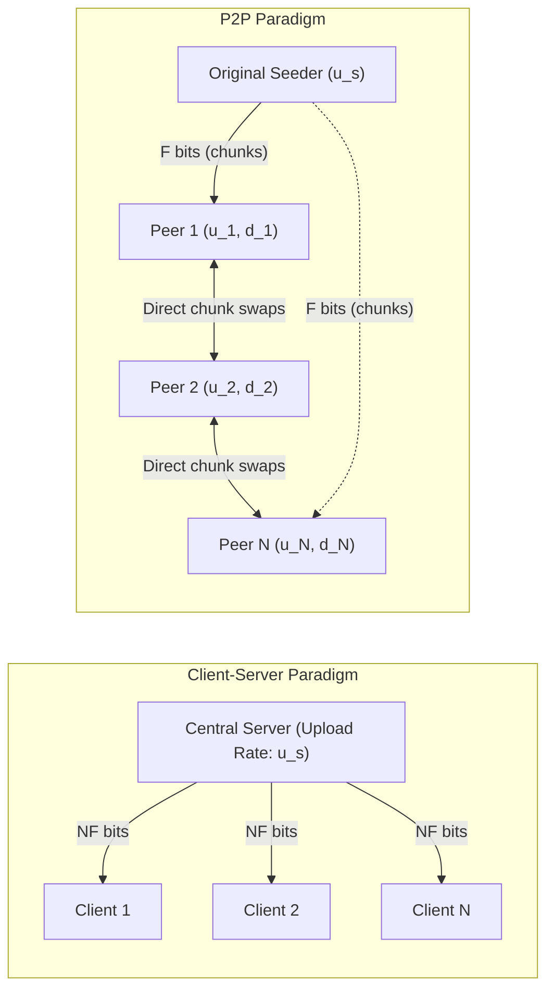
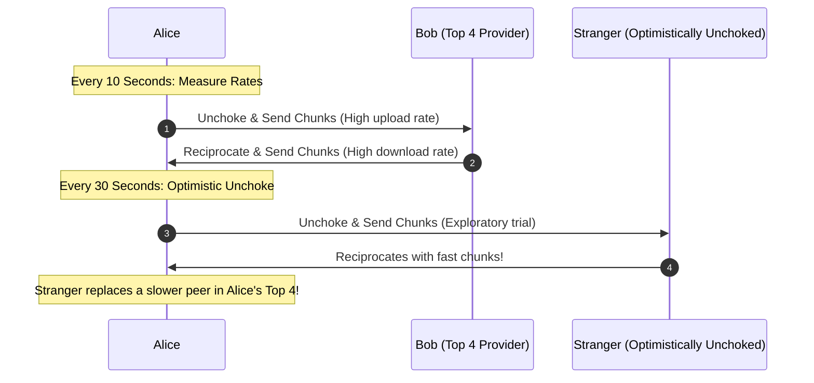

[CN Index](../README.md) / [Unit 2: Sockets & Transport](Introduction.md)

# Lecture 02: Peer-to-Peer Applications and BitTorrent

In a traditional client-server architecture, a centralized server (or server farm) must handle every incoming request. When ten thousand users simultaneously request a new 2 GB operating system update, the server must transmit $10,000 \times 2\text{ GB} = 20\text{ TB}$ of data through its upstream link.

The moment demand spikes, the server's access link becomes a crippling bottleneck.

Now here's the thing — why should end users sit idle as purely passive consumers? When Alice downloads a piece of a file, she has that data sitting on her hard drive. Why shouldn't Bob download that piece directly from Alice, instead of making the server upload it a second time?

This is the core intuition of **Peer-to-Peer (P2P)** architecture: end systems (peers) communicate directly with one another without relying on an always-on centralized server. In a P2P network, peers act as both **clients and servers** simultaneously (often called *servents*). Every new user who joins the network brings not only new download demand, but also new **upload capacity** to the collective pool.

---

## File Distribution Modeling: Client-Server versus P2P

To understand why P2P scales while client-server collapses, we can formalize the time required to distribute a file of size $F$ bits from a single source to $N$ independent peers.

Let:
- $F$ = Size of the file to be distributed (in bits).
- $N$ = Number of peers that need a copy of the file.
- $u_s$ = Server upload capacity (bits/sec).
- $d_i$ = Download capacity of peer $i$ (bits/sec).
- $u_i$ = Upload capacity of peer $i$ (bits/sec).
- $d_{\min} = \min_i(d_i)$ = Download rate of the slowest peer in the system.

We assume the network core has abundant bandwidth, meaning the bottlenecks lie strictly at the access links of the endpoints.



### Client-Server Distribution Time ($D_{\text{cs}}$)
In the client-server architecture, the server is solely responsible for replicating and sending the file to all $N$ peers.

1. **Server Constraint**: The server must send $N$ complete copies of the file into the network, representing $N \times F$ bits. Because the server's upload rate is $u_s$, the server cannot possibly finish transmitting in less than:
   $$\frac{NF}{u_s}$$
2. **Client Constraint**: The peer with the slowest internet connection has download rate $d_{\min}$. That peer must download $F$ bits, which requires at least:
   $$\frac{F}{d_{\min}}$$

Because both physical constraints must be satisfied simultaneously, the total distribution time for client-server is bounded below by the maximum of the two:

$$D_{\text{cs}} \ge \max\left\{ \frac{NF}{u_s}, \; \frac{F}{d_{\min}} \right\}$$

Notice what happens as $N$ grows large. The term $\frac{NF}{u_s}$ increases **linearly** with $N$. If distributing a file to 1,000 peers takes 1 hour, distributing it to 10,000 peers will take 10 hours. The server's access link creates an inescapable linear bottleneck:

$$\lim_{N \to \infty} D_{\text{cs}} = O(N)$$

### P2P Distribution Time ($D_{\text{p2p}}$)
In P2P, the original server only needs to inject the chunks into the network once. Once peers receive chunks, they begin uploading them to each other.

1. **Server Constraint**: The server must upload at least one complete copy of the file ($F$ bits) into the swarm, requiring at least:
   $$\frac{F}{u_s}$$
2. **Slowest Peer Constraint**: The slowest peer still must download $F$ bits, requiring at least:
   $$\frac{F}{d_{\min}}$$
3. **System Aggregate Capacity Constraint**: Across the entire swarm, $N$ peers must each receive $F$ bits, meaning the system as a whole must absorb $N \times F$ bits. The total upload bandwidth available across the entire network is the server's upload rate plus the sum of all peers' upload rates: $u_s + \sum_{i=1}^N u_i$. Therefore, the total time cannot be less than:
   $$\frac{NF}{u_s + \sum_{i=1}^N u_i}$$

Combining all three concurrent constraints yields the fundamental P2P lower bound:

$$D_{\text{p2p}} \ge \max\left\{ \frac{F}{u_s}, \; \frac{F}{d_{\min}}, \; \frac{NF}{u_s + \sum_{i=1}^N u_i} \right\}$$

### The Self-Scaling Superpower of P2P
To see why this changes everything, assume for simplicity that all peers have an identical upload rate $u_i = u$. The aggregate upload capacity term becomes:

$$\frac{NF}{u_s + Nu}$$

Now take the limit as $N$ approaches infinity:

$$\lim_{N \to \infty} \frac{NF}{u_s + Nu} = \lim_{N \to \infty} \frac{F}{\frac{u_s}{N} + u} = \frac{F}{u}$$

Notice the mathematical miracle: **$N$ vanishes from the equation!**

As the population of peers scales toward infinity, the distribution time does not explode linearly. Instead, it asymptotes toward a flat constant: $\frac{F}{u}$, the time it takes an average peer to upload the file once. Every new consumer that arrives brings exactly enough upload capacity to service its own demand.

```mermaid
flowchart LR
    subgraph CS["Client-Server Distribution: O(N) Linear Growth"]
        direction TB
        CS1["N = 10 peers: 0.5 hrs"] --> CS2["N = 500 peers: 5.0 hrs"] --> CS3["N = 1,000 peers: 10 hrs"] --> CS4["N = 10,000 peers: 100 hrs (Bottleneck!)"]
    end
    subgraph P2P["P2P BitTorrent Distribution: Self-Scaling Asymptote"]
        direction TB
        P1["N = 10 peers: 0.4 hrs"] --> P2["N = 500 peers: 0.9 hrs"] --> P3["N = 1,000 peers: 0.95 hrs"] --> P4["N = 10,000 peers: ~1.0 hr (Saturated Upload)"]
    end```

*(Above: Client-Server distribution time climbs linearly, while P2P distribution time flattens asymptotically).*

---

## Numerical Comparison: A Concrete Example

Let's plug in real-world numbers from lecture to see this dynamic in action:
- File size: $F = 1\text{ GB} = 8\text{ Gb} = 8,000\text{ Mb}$.
- Server upload rate: $u_s = 30\text{ Mbps}$.
- Peer download rate: $d_i = 2\text{ Mbps}$ for all peers ($d_{\min} = 2\text{ Mbps}$).
- Peer upload rate: $u_i = 1\text{ Mbps}$ for all peers ($u = 1\text{ Mbps}$).

Let's evaluate $D_{\text{cs}}$ and $D_{\text{p2p}}$ for $N = 10$, $N = 100$, and $N = 1,000$:

| $N$ (Peers) | Client-Server ($D_{\text{cs}}$) | P2P ($D_{\text{p2p}}$) | Ratio ($D_{\text{cs}} / D_{\text{p2p}}$) |
| :--- | :--- | :--- | :--- |
| **$N = 10$** | $\max\left\{\frac{10 \times 8000}{30}, \frac{8000}{2}\right\} = \max\{2667, 4000\} = \mathbf{4,000\text{ s}}$ | $\max\left\{\frac{8000}{30}, \frac{8000}{2}, \frac{10 \times 8000}{30 + 10(1)}\right\} = \max\{267, 4000, 2000\} = \mathbf{4,000\text{ s}}$ | $1.0\times$ |
| **$N = 100$** | $\max\left\{\frac{100 \times 8000}{30}, 4000\right\} = \max\{26667, 4000\} = \mathbf{26,667\text{ s}}$ (~7.4 hrs) | $\max\left\{267, 4000, \frac{800,000}{30 + 100}\right\} = \max\{267, 4000, 6154\} = \mathbf{6,154\text{ s}}$ (~1.7 hrs) | $4.3\times\text{ faster}$ |
| **$N = 1,000$**| $\max\left\{\frac{1000 \times 8000}{30}, 4000\right\} = \mathbf{266,667\text{ s}}$ (~74.1 hrs) | $\max\left\{267, 4000, \frac{8,000,000}{30 + 1000}\right\} = \max\{267, 4000, 7767\} = \mathbf{7,767\text{ s}}$ (~2.1 hrs) | **$34.3\times\text{ faster}$** |

When $N=10$, both systems are bounded by the 2 Mbps download speed of the clients ($4,000\text{ s}$). But by $N=1,000$, the client-server system requires **over 74 hours**, whereas P2P distributes the file to all 1,000 machines in **just 2.1 hours**.

---

## BitTorrent Architecture: Swarms, Torrents, and Trackers

While the mathematics proves P2P is superior, building an actual software protocol requires solving hard distributed problems: How do peers find each other? How is the file partitioned? How do we prevent users from acting as selfish free-riders?

BitTorrent, designed by Bram Cohen, solves these problems with an elegant set of mechanisms.

```mermaid
flowchart TD
    subgraph TrackerMesh["Torrent Coordination"]
        TorrentFile[".torrent Metadata File (Info Hash, Tracker URL, Chunk SHA-1 Hashes)"]
        Tracker["Central/Distributed Tracker"]
    end
    
    subgraph Swarm["BitTorrent Swarm"]
        Alice["Alice (Joining Peer)"]
        Bob["Bob (Leecher)"]
        Carol["Carol (Leecher)"]
        Dave["Dave (Leecher)"]
        Seeder["Frank (Seeder - 100%)"]
    end
    
    Alice -->|"1. Reads metadata"| TorrentFile
    Alice -->|"2. Registers & asks for peers"| Tracker
    Tracker -->|"3. Returns IP:Port list of ~50 peers"| Alice
    Alice <-->|"4. Direct TCP chunk swaps"| Bob
    Alice <-->|"4. Direct TCP chunk swaps"| Carol
    Alice <-->|"4. Direct TCP chunk swaps"| Dave
    Seeder -->|"Uploads rare chunks"| Alice
```

### Core Terminology
- **File Chunks**: BitTorrent slices the target file into fixed-size chunks, typically **256 KB** in size (each chunk is further divided into 16 KB sub-blocks for network transmission).
- **Torrent**: The collection of all peers participating in the distribution of a specific file.
- **Tracker**: An infrastructure node (or a Distributed Hash Table / DHT node) that maintains a dynamic list of IP addresses of all peers currently in the torrent. It does not store or transfer any file data; it only tracks membership.
- **Swarm**: The active cluster of peers exchanging chunks.
- **Seeder**: A peer that possesses the entire file ($100\%$) and remains online solely to upload chunks to others.
- **Leecher**: A peer that possesses only a partial fraction of the file and is actively downloading missing chunks while uploading acquired ones.
- **Churn**: The continuous, unpredictable arrival and departure of peers as users turn off laptops or close applications.

---

## Chunk Selection Policy: Rarest-First

When Alice connects to her neighbors, each neighbor transmits a **bitfield** indicating which chunks it owns. Alice now knows who has what. 

Which chunk should Alice ask for first?

BitTorrent enforces the **Rarest-First** policy:
1. Alice scans her neighbors' bitfields and counts how many neighbors possess each missing chunk.
2. She immediately requests the chunks that are held by the **fewest** number of neighbors in her local swarm.

Why rarest-first?
- **Prevents Chunk Extinction**: If only one peer in the swarm holds chunk 42 and that peer suddenly unplugs their computer, chunk 42 would be permanently lost to the swarm. By prioritizing rare chunks, the network quickly replicates them across multiple nodes, ensuring the file remains complete even under heavy churn.
- **Maximizes Trading Currency**: If Alice downloads a rare chunk, almost all of her neighbors will immediately want it from her. This gives Alice immediate trading leverage to upload to others and earn fast download speeds in return.

*(Exception: When a brand new peer joins with zero chunks, it uses **Random-First Chunk Selection**. Alice requests any random available chunk just to get her first complete piece as fast as possible, so she can immediately enter the trading economy).*

---

## Incentive Mechanisms: Tit-for-Tat and Optimistic Unchoking

In any P2P network, there is a risk of the **Free-Rider Problem**: selfish users who configure their clients to download at maximum speed while restricting their upload bandwidth to zero.

To defeat free-riders, BitTorrent uses a game-theoretic incentive scheme called **Tit-for-Tat (Rate Matching)**:



### The 10-Second Rate Evaluation (Top 4 Unchoked)
1. At any given moment, Alice limits her active upload bandwidth to the **top 4 peers** who are currently uploading data to her at the highest bitrates.
2. These 4 peers are said to be **unchoked** by Alice; all other connected peers are **choked** (refused data).
3. Every **10 seconds**, Alice recalculates the download rates she is receiving from all neighbors. If a previously choked peer has started sending faster than one of her current top 4, she switches: she chokes the slow peer and unchokes the faster one.

### The 30-Second Optimistic Unchoking
If Alice only ever uploads to the 4 peers who are currently uploading fastest to her, how could a new peer with zero chunks ever get started? And how would Alice ever discover a newly connected peer that has a 1 Gbps fiber connection?

To break this deadlock, BitTorrent introduces **Optimistic Unchoking**:
- Every **30 seconds**, Alice selects **one additional random peer** from her choked list and begins uploading data to them, regardless of whether that peer has sent her anything.
- This optimistic unchoke serves two critical functions:
  1. **Bootstrapping**: It gives new peers their first chunks, allowing them to become active contributors.
  2. **Partner Discovery**: If this randomly chosen peer reciprocates with high-speed uploads, it can outcompete one of Alice's existing top 4 providers at the next 10-second evaluation, permanently earning a spot among her primary trading partners.

### Endgame Mode
When Alice has downloaded $99\%$ of the file and only needs the final 2 or 3 sub-blocks, she enters **Endgame Mode**. 

Instead of waiting for a single slow peer to finish sending a final block, Alice broadcasts requests for the remaining blocks to **all** connected unchoked peers. The instant the first copy of each block arrives, Alice sends a `Cancel` message to all other peers. This prevents a single lagging connection from delaying the completion of the entire download.

---

## Key Takeaways

- Client-Server distribution scales poorly ($O(N)$) because the central server must upload $N$ distinct copies ($NF/u_s$).
- Peer-to-Peer file distribution is self-scaling: distribution time is bounded by $D_{\text{p2p}} \ge \max\left\{ \frac{F}{u_s}, \frac{F}{d_{\min}}, \frac{NF}{u_s + \sum u_i} \right\}$ and flattens asymptotically as $N \to \infty$.
- BitTorrent divides files into 256 KB chunks; trackers coordinate peer lists (swarms) without touching file data.
- The **Rarest-First** policy replicates endangered chunks across the swarm and gives downloading peers immediate trading currency.
- BitTorrent eliminates free-riders through **Tit-for-Tat**: peers reward the top 4 uploaders every 10 seconds.
- **Optimistic Unchoking** every 30 seconds bootstraps new peers and dynamically discovers faster trading partners.
- **Endgame Mode** requests final missing sub-blocks from multiple peers simultaneously to eliminate trailing latency.

---

Now that we have examined high-level application architectures—from hierarchical client-server systems like DNS to decentralized swarms like BitTorrent—a fundamental engineering question arises: how does a programmer actually write software that creates, sends, and receives these application messages across the network? To see the boundary where user code meets operating system transport protocols, we turn to [Socket Programming with UDP and TCP](L03%20-%20Socket%20Programming%20with%20UDP%20and%20TCP.md).
