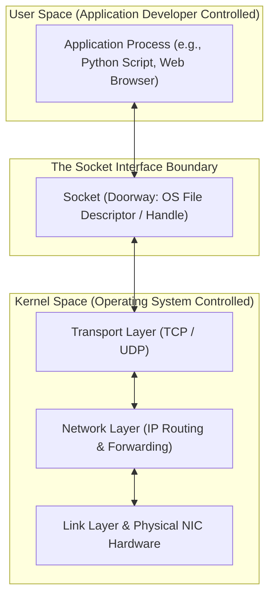
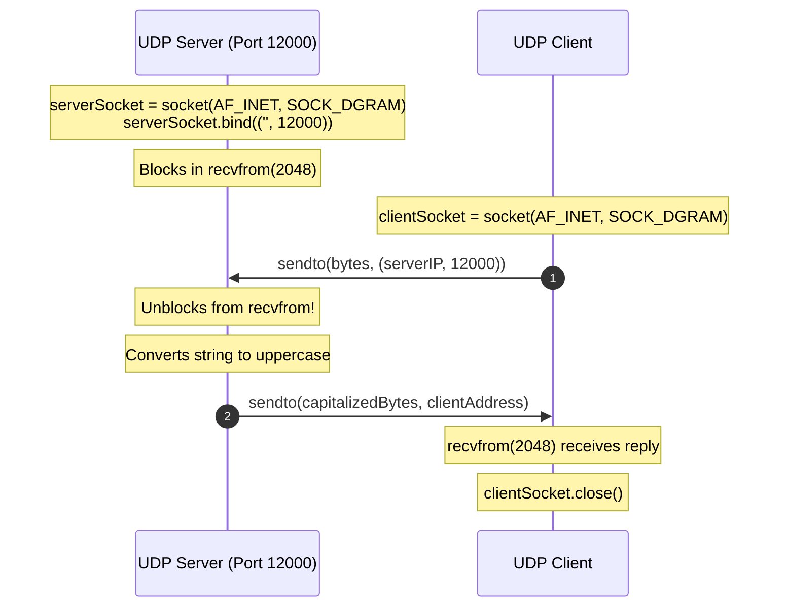
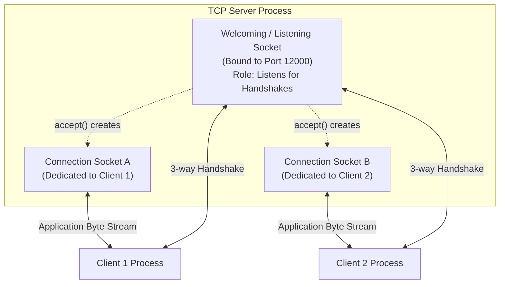
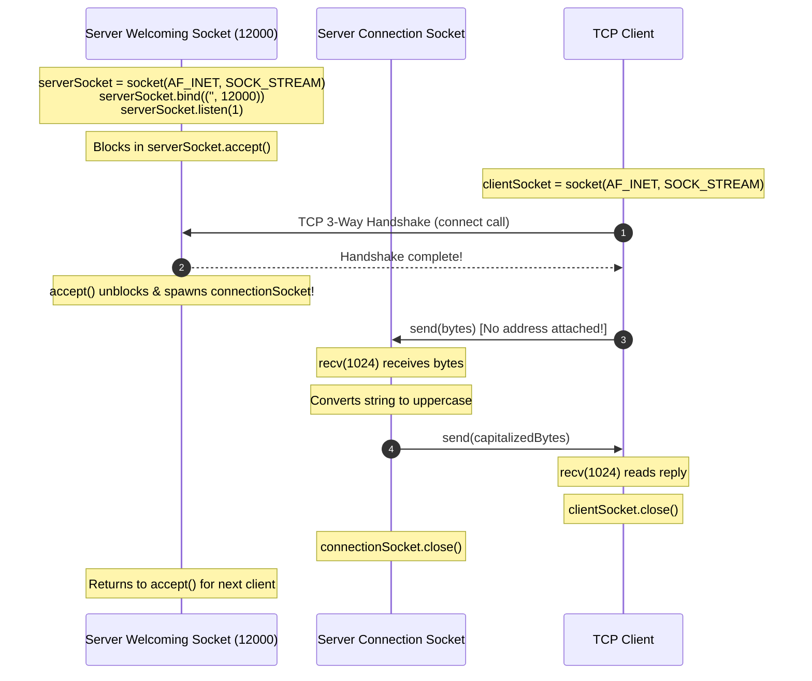

[CN Index](../README.md) / [Unit 2: Sockets & Transport](Introduction.md)

# Lecture 03: Socket Programming with UDP and TCP

Every network application we have discussed—whether a web browser, a DNS resolver, or a BitTorrent client—is ultimately an operating system user-space process. 

Routers, network interface cards (NICs), and transport protocol state machines do not run in user space; they run inside the operating system kernel or in hardware. 

How does user-space code hand a string of application data to the kernel for network transmission?

The operating system provides an abstraction called a **Socket**. A socket is the "door" through which an application process sends data to, and receives data from, the network. The developer controls everything on the application side of the door: message formatting, semantics, timing, and error handling. The operating system kernel controls everything on the transport side: segmenting data, computing checksums, scheduling retransmissions, managing flow control buffers, and driving the network interface card.



To see how transport services shape application design, we implement the exact same simple client-server application across both available socket types:
- **UDP (Datagram Sockets - `SOCK_DGRAM`)**
- **TCP (Stream Sockets - `SOCK_STREAM`)**

The application is an **Uppercase Converter**:
1. The client reads a line of lowercase text from the terminal.
2. The client sends the string across the network to the server.
3. The server converts all characters to uppercase.
4. The server transmits the uppercase string back to the client.
5. The client prints the reply and terminates.

---

## Socket Programming with UDP

User Datagram Protocol (UDP) is a connectionless, unreliable transport service. 

Before a client can send data over UDP, **no handshake occurs**. The client simply attaches the destination address (the server's IP address and port number) to the data packet, drops it into the socket, and hopes for the best. 

Because UDP does not establish a connection:
- Every datagram travels as an independent packet.
- Datagrams may arrive out of order, or get dropped entirely in transit.
- Each incoming datagram is received alongside the source address and port of whoever sent it, so the receiver knows where to send a reply.
- **Message Boundaries are Preserved**: If the sender writes 50 bytes with `sendto()`, the receiver reads exactly those 50 bytes in a single `recvfrom()`.



### Python UDP Client Walkthrough

```python
from socket import *

# Define destination endpoint
serverName = '127.0.0.1'       # Server hostname or IP
serverPort = 12000             # Server listening port

# 1. Create a UDP socket
# AF_INET indicates IPv4 addressing; SOCK_DGRAM specifies UDP datagram service
clientSocket = socket(AF_INET, SOCK_DGRAM)

# 2. Get user input
message = input('Input lowercase sentence: ')

# 3. Transmit datagram
# In Python 3, strings must be encoded to raw bytes before network transmission.
# sendto() takes two arguments: the payload bytes and the destination address tuple.
clientSocket.sendto(message.encode(), (serverName, serverPort))

# 4. Receive reply
# recvfrom() blocks until a packet arrives. 2048 is the buffer size.
# It returns a tuple: (received_bytes, sender_ip_and_port)
modifiedMessage, serverAddress = clientSocket.recvfrom(2048)

# 5. Decode bytes back to string and print
print('From Server: ', modifiedMessage.decode())

# 6. Close the socket
clientSocket.close()
```

Notice what is happening:
- At no point did `clientSocket` call `connect()`.
- The operating system automatically assigned a temporary, high-numbered **ephemeral port** (e.g., `54321`) to the client socket when `sendto()` was first executed.
- The destination `(serverName, serverPort)` had to be passed directly into `sendto()`, because the socket itself had no persistent destination associated with it.

### Python UDP Server Walkthrough

```python
from socket import *

serverPort = 12000

# 1. Create a UDP datagram socket
serverSocket = socket(AF_INET, SOCK_DGRAM)

# 2. Bind the socket to the port
# An empty string '' means bind to all available network interfaces on this host.
serverSocket.bind(('', serverPort))

print('The UDP server is ready to receive...')

# 3. Infinite event loop
while True:
    # Blocks waiting for an incoming datagram
    message, clientAddress = serverSocket.recvfrom(2048)
    
    # Process the data
    modifiedMessage = message.decode().upper()
    
    # Send reply back to the exact client address extracted from the incoming datagram
    serverSocket.sendto(modifiedMessage.encode(), clientAddress)
```

Notice the significance of `bind()`:
- The server **must** call `bind()` so that the operating system kernel knows to deliver any incoming UDP packets arriving on destination port `12000` to this specific process.
- The server uses a single socket to communicate with any number of distinct clients. When Alice and Bob send datagrams to port `12000`, both packets enter `serverSocket`, and the server distinguishes them solely by inspecting the returned `clientAddress` tuple.

---

## Socket Programming with TCP

Transmission Control Protocol (TCP) provides a completely different abstraction: a **connection-oriented, reliable, in-order byte stream**.

Before an application can exchange bytes over TCP:
1. The client and server must execute a transport-layer **three-way handshake** (`SYN`, `SYN-ACK`, `ACK`).
2. Both operating systems allocate transmission buffers, initialize sequence numbers, and maintain connection state.
3. The application treats the connection as a continuous **pipe**: bytes pushed into the pipe at the client emerge in the exact same sequence at the server.

### The Two Socket Roles on the TCP Server
Unlike UDP—where a single socket handles everything—a TCP server must manage **two entirely different socket abstractions**:



1. **The Welcoming (Listening) Socket**:
   - Created once when the server boots.
   - Bound to the well-known port (e.g., port `12000` or port `80`).
   - Its sole job is to sit at the "front desk", listen for incoming connection requests, and complete the three-way handshake.
   - **Crucial Rule**: The welcoming socket *never* reads or writes application data!
2. **The Connection Socket**:
   - The moment a client completes the three-way handshake, the operating system's `accept()` call returns a **brand new socket** dedicated exclusively to that specific client.
   - All subsequent application byte exchanges (`send()` and `recv()`) with that client occur through this new connection socket.
   - When the client disconnects, only the connection socket is closed. The welcoming socket remains open, continuing to accept new incoming clients.

This separation is what enables concurrent servers: a server can spawn a new thread or worker process for each newly returned connection socket while the main thread continues listening on the welcoming socket.



### Python TCP Client Walkthrough

```python
from socket import *

serverName = '127.0.0.1'
serverPort = 12000

# 1. Create a stream socket (SOCK_STREAM specifies TCP)
clientSocket = socket(AF_INET, SOCK_STREAM)

# 2. Initiate TCP 3-way handshake with the server
# connect() blocks until the SYN / SYN-ACK / ACK exchange completes.
clientSocket.connect((serverName, serverPort))

# 3. Read user input
sentence = input('Input lowercase sentence: ')

# 4. Transmit bytes into the established pipe
# Notice: send() takes ONLY the byte payload! No destination address is needed,
# because the socket is already permanently bound to the remote peer.
clientSocket.send(sentence.encode())

# 5. Receive bytes from the pipe
# recv() reads from the socket's incoming TCP buffer (up to 1024 bytes).
modifiedSentence = clientSocket.recv(1024)

# 6. Decode and display
print('From Server: ', modifiedSentence.decode())

# 7. Close the connection
# Closes the TCP connection, initiating the FIN handshake.
clientSocket.close()
```

### Python TCP Server Walkthrough

```python
from socket import *

serverPort = 12000

# 1. Create the welcoming socket
serverSocket = socket(AF_INET, SOCK_STREAM)

# 2. Bind welcoming socket to port 12000
serverSocket.bind(('', serverPort))

# 3. Enter listening state
# listen(1) tells the OS to start accepting connections; parameter 1 specifies
# the maximum queue size of pending unaccepted handshakes (the backlog).
serverSocket.listen(1)

print('The TCP server is ready to receive...')

while True:
    # 4. Block waiting for an incoming connection
    # accept() unblocks after a client finishes the 3-way handshake.
    # It returns a NEW socket (connectionSocket) and the client's (IP, port).
    connectionSocket, addr = serverSocket.accept()
    
    # 5. Read data from the dedicated connection socket
    sentence = connectionSocket.recv(1024).decode()
    capitalizedSentence = sentence.upper()
    
    # 6. Write reply back through the dedicated connection socket
    connectionSocket.send(capitalizedSentence.encode())
    
    # 7. Close the connection socket for this client
    # The welcoming socket (serverSocket) remains open!
    connectionSocket.close()
```

---

## UDP versus TCP Sockets: Direct Architectural Comparison

| Architectural Dimension | UDP (`SOCK_DGRAM`) | TCP (`SOCK_STREAM`) |
| :--- | :--- | :--- |
| **Connection Setup** | None. Zero handshake latency. Packets sent immediately. | Required. 3-way handshake (`SYN`, `SYN-ACK`, `ACK`) before data flows. |
| **Addressing Mechanism** | Explicit per packet: `sendto(data, (ip, port))`. | Configured once during `connect()`; `send(data)` needs no address. |
| **Server Socket Model** | Single socket handles all incoming and outgoing datagrams. | Two socket types: One welcoming socket + separate connection socket per client. |
| **Data Boundary Semantics** | **Preserves Message Boundaries**: One `sendto()` = One `recvfrom()`. | **Byte Stream (No Boundaries)**: Multiple `send()` calls can merge into one `recv()`, or one large `send()` can be split across multiple `recv()` calls. |
| **Reliability & Ordering** | Best-effort: Packets can be lost, corrupted, or reordered. | Guaranteed reliable, in-order delivery via sequence numbers and retransmissions. |
| **Traffic Control** | None: Sends as fast as application writes (subject to local NIC buffer). | Integrated Flow Control (receiver window) and Congestion Control (CWND). |

---

## Key Takeaways

- A socket is the application-to-kernel programming abstraction across which user processes communicate.
- In UDP (`SOCK_DGRAM`), there is no connection state; every datagram is explicitly addressed via `sendto()` and received alongside its sender address via `recvfrom()`.
- In TCP (`SOCK_STREAM`), communication is strictly connection-oriented; data is treated as an unstructured, reliable, in-order stream of bytes.
- A TCP server requires two distinct socket roles: a **welcoming (listening) socket** that listens on the well-known port for handshakes, and a dedicated **connection socket** returned by `accept()` for each connected client.
- The welcoming socket never handles application bytes; it serves solely to admit new clients into the server.

---

With the mechanics of socket programming established, we can now step back and examine the wider universe of standardized application-layer protocols that operate across these sockets—including [electronic mail (SMTP, POP3, IMAP), remote file transfer (FTP), and other application protocols](L04%20-%20Electronic%20Mail,%20FTP,%20and%20Other%20Application%20Protocols.md).
