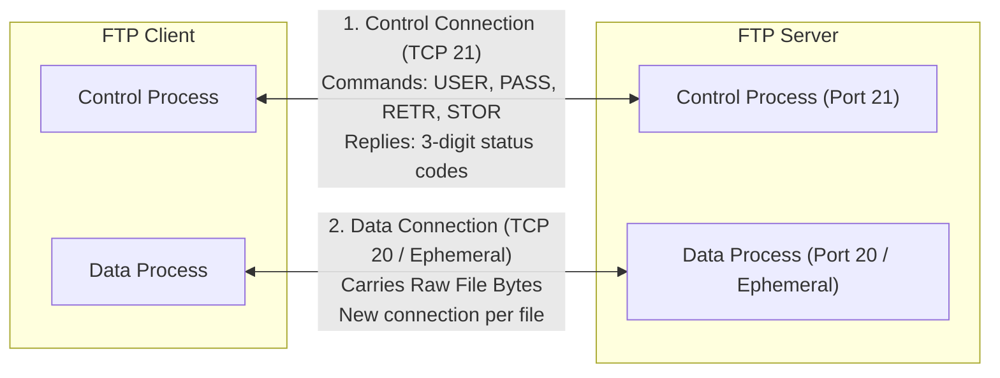
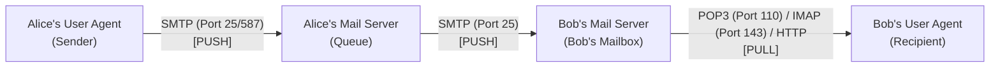
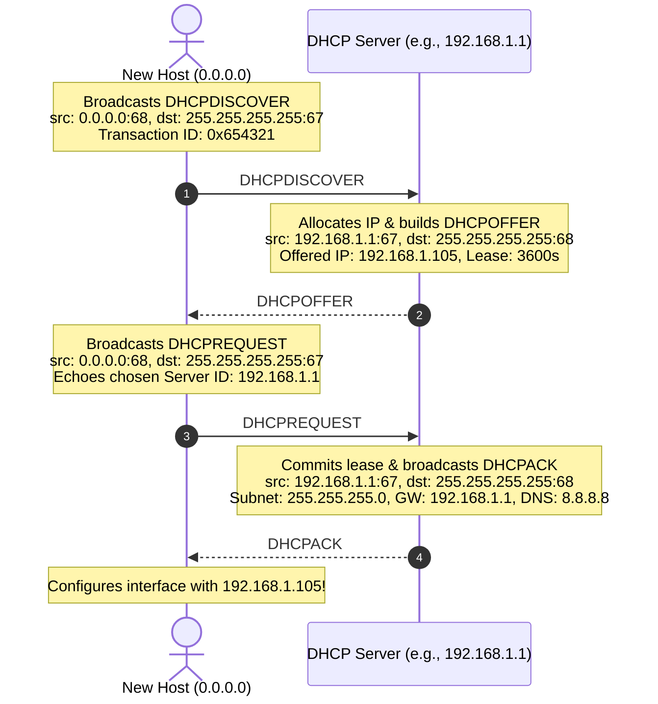
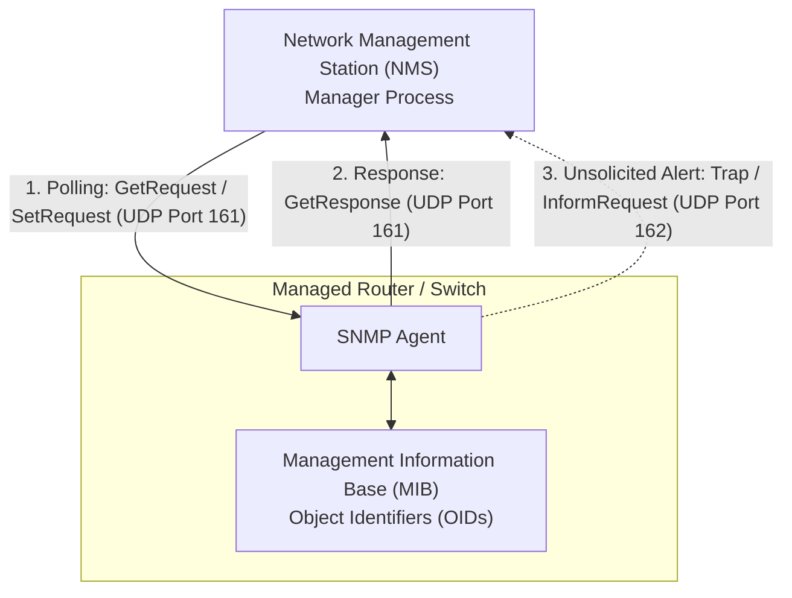
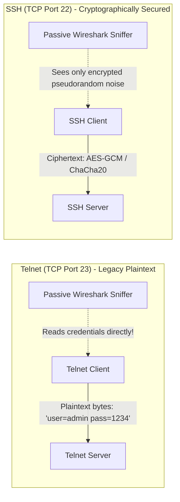

[CN Index](../README.md) / [Unit 2: Sockets & Transport](Introduction.md)

# Lecture 04: Electronic Mail, FTP, and Other Application Protocols

While HTTP and DNS dominate the majority of everyday web traffic, the application layer encompasses a diverse suite of specialized protocols that have powered the Internet for decades.

Each protocol was engineered to solve a specific distributed coordination problem:
- How do we transfer large files without choking control channels?
- How do we deliver asynchronous messages across independent administrative domains?
- How does an unconfigured device obtain network credentials upon joining a subnet?
- How do administrators monitor thousands of remote routers and switches?
- How do engineers manage remote servers without exposing root passwords to network sniffers?

Examining these protocols reveals how architectural choices—such as in-band vs. out-of-band control, push vs. pull data flows, and stateful vs. stateless server designs—shape the communication exchange.

---

## File Transfer Protocol (FTP): Out-of-Band Control

File Transfer Protocol (FTP, RFC 959) is one of the oldest application protocols on the Internet. Its primary purpose is to transfer files reliably between a local client and a remote server.

The defining architectural hallmark of FTP is its use of **two parallel TCP connections**: an **Out-of-Band** control architecture.

### In-Band versus Out-of-Band Control
In protocols like HTTP, control information (request headers like `GET /index.html` and response headers like `Content-Type: text/html`) travels across the exact same TCP connection as the requested data bytes. This is called **In-Band** control.

FTP separates control and data onto completely distinct TCP connections:
1. **The Control Connection (Server TCP Port 21)**:
   - Initiated by the client to server port 21 when the FTP session begins.
   - Remains open for the entire duration of the user session.
   - Used strictly for issuing commands (`USER`, `PASS`, `LIST`, `RETR`, `STOR`, `QUIT`) and receiving 3-digit ASCII status codes (e.g., `150 File status okay`, `226 Transfer complete`, `550 File not found`).
   - Never carries actual file content!
2. **The Data Connection (Server TCP Port 20 or Negotiated Ephemeral Port)**:
   - Created dynamically whenever a file transfer (`RETR` to download, `STOR` to upload) or directory listing (`LIST`) is requested.
   - Carries the raw file bytes.
   - The data connection is **closed immediately** once the file transfer is complete. If the client transfers five files in succession, FTP creates and tears down five separate data connections, while the single control connection remains open.

### Active Mode versus Passive Mode
FTP supports two modes for establishing the data connection:
- **Active Mode**: The client tells the server its IP address and a random client port via the `PORT` command on the control connection. The server then initiates an active TCP connection from its port 20 to the client's specified port. 
  *(Limitation: Client-side firewalls and NAT gateways typically block incoming unsolicited connection requests from external servers).*
- **Passive Mode (PASV)**: To bypass NAT and firewall blocks, the client sends `PASV` on the control connection. The server opens an ephemeral listening port and tells the client: *"Connect to my IP at port X"*. The client initiates the TCP data connection outward to the server.

### Stateful Server Design
Unlike HTTP (which is fundamentally stateless), an FTP server is **stateful**. The server maintains state about each connected user throughout their session:
- The authenticated user account.
- The Current Working Directory (`CWD`) within the server filesystem.
- The transfer mode (ASCII text conversion vs. binary image mode).

This state tracking restricts server scalability: if 10,000 clients maintain open FTP sessions, the server must keep 10,000 state blocks and 10,000 TCP control sockets active in memory.

---

## Electronic Mail: SMTP versus POP3 / IMAP

Electronic mail is an asynchronous communication medium. Unlike a web session where the user interacts directly with a live server, an email must traverse intermediate storage queues across administrative boundaries.

The email architecture comprises three primary building blocks:

1. **User Agents (UAs)**: Software that allows users to compose, read, and organize emails (e.g., Thunderbird, Apple Mail, Outlook, or webmail frontends).
2. **Mail Servers**: Always-on infrastructure nodes that maintain incoming **mailboxes** for recipients and outgoing **message queues** for pending transmissions. If Bob's server is unreachable, Alice's server holds the message in its queue and retries periodically (e.g., every 30 minutes for several days).
3. **Mail Transfer Protocols**: Standardized rules for moving messages between nodes.

### Simple Mail Transfer Protocol (SMTP, RFC 5321)
SMTP is the core push protocol of the Internet. It operates over **TCP port 25** (and submission port 587) using persistent connections.

Crucially, **SMTP is strictly a PUSH protocol**:
- Alice's User Agent pushes the message to Alice's Mail Server via SMTP.
- Alice's Mail Server inspects the destination domain (`@domain.com`), performs a DNS `MX` record lookup, and pushes the message to Bob's Mail Server via SMTP.

SMTP characteristics:
- **7-Bit ASCII Limitation**: Historically, SMTP could only transmit legacy 7-bit ASCII text. Binary attachments (PDFs, images, videos) must be encoded into printable ASCII characters using **MIME (Multipurpose Internet Mail Extensions)** with Base64 encoding.
- **Client-Server Dialogue**: SMTP commands are human-readable 4-character ASCII strings (`HELO`/`EHLO`, `MAIL FROM:`, `RCPT TO:`, `DATA`, `QUIT`), answered by 3-digit numerical reply codes (`250 OK`, `354 Start mail input`, `550 No such user`).
- **All Objects in a Single Message**: Unlike HTTP, which requests each embedded image with a separate HTTP request, an SMTP message encapsulates the body text and all MIME-encoded attachments inside a single consolidated message body terminated by a single line containing only a period: `\r\n.\r\n`.

### Mail Access Protocols: Pulling Mail from the Server
Bob cannot use SMTP to fetch emails from his mailbox on Bob's Mail Server. Why? Because SMTP is a **push protocol**; it has no command that says *"give me the messages waiting in my box"*.

To retrieve stored emails, the recipient's User Agent must use a **Mail Access Protocol (a PULL protocol)**:
- **POP3 (Post Office Protocol v3, TCP Port 110)**:
  - Extremely simple "download-and-delete" or "download-and-keep" model.
  - The client connects, authenticates, downloads all messages to the local hard drive, and disconnects.
  - **Limitation**: Mail state is tied to one physical computer. Folders created on a laptop do not sync to a phone.
- **IMAP (Internet Message Access Protocol, TCP Port 143)**:
  - Stateful and remote-folder oriented.
  - All emails and folders remain stored permanently on the central mail server. The client reads messages remotely and caches local views.
  - Changes (creating folders, marking emails as read/unread, moving messages) are synchronized across all of Bob's devices (phone, laptop, desktop).
- **HTTP / Webmail (TCP Ports 80 / 443)**:
  - Modern webmail (Gmail, Outlook.com). The user interacts with the mail server via a standard web browser over HTTPS. The webmail backend communicates with internal mail stores and relays.

---

## Dynamic Host Configuration Protocol (DHCP)

When you open your laptop at a coffee shop or plug an Ethernet cable into an office wall, your computer initially knows nothing:
- It has no IP address.
- It does not know the subnet mask.
- It does not know the IP address of the local default gateway router.
- It does not know the IP address of the local DNS server.

How can a host send a packet to ask for an IP address when it does not yet have an IP address of its own?

**Dynamic Host Configuration Protocol (DHCP, RFC 2131)** solves this "chicken-and-egg" bootstrapping problem. DHCP operates over **UDP**, using **server port 67** and **client port 68**.

The exchange follows the four-step **DORA** sequence:

1. **Discover (`DHCPDISCOVER`)**:
   - The client creates a UDP packet with source IP `0.0.0.0` (since it has none) and destination IP `255.255.255.255` (limited link-layer broadcast).
   - Because it is a link-layer broadcast, every device on the local Ethernet segment receives the packet.
2. **Offer (`DHCPOFFER`)**:
   - One or more DHCP servers on the subnet receive the discovery message. Each server reserves an available IP address from its pool and broadcasts an offer.
   - The offer contains the offered IP address, subnet mask, lease duration (e.g., 3,600 seconds / 1 hour), and the server's own IP.
3. **Request (`DHCPREQUEST`)**:
   - The client chooses one server's offer (typically the first one received) and broadcasts a request message echoing the chosen server's ID.
   - Why broadcast this request? Because multiple DHCP servers may have sent offers! By broadcasting its choice, the client confirms the lease with the winner while simultaneously notifying all other servers that their offers were declined so they can return those reserved IPs to their pools.
4. **Acknowledgment (`DHCPACK`)**:
   - The chosen DHCP server commits the lease to its database and broadcasts a final confirmation (`DHCPACK`).
   - The `DHCPACK` carries full configuration parameters: the assigned IP address, network mask, default gateway router IP, and local DNS server IPs.

The client configures its network interface. When half the lease time elapses, the client attempts to renew the lease by sending a unicast `DHCPREQUEST` directly to the server.

---

## Simple Network Management Protocol (SNMP)

As networks scale to thousands of routers, switches, access points, and servers, administrators cannot manually log into individual devices to inspect packet drops or interface temperatures.

**Simple Network Management Protocol (SNMP)** provides a standardized framework for network management.

The architecture consists of three components:
1. **Managed Device**: Any network element (router, managed switch, host) whose status needs monitoring.
2. **SNMP Agent**: A lightweight background daemon running inside the managed device's operating system.
3. **Network Management Station (NMS / Manager)**: A centralized server running management software that polls devices and displays alerts.

### The Management Information Base (MIB)
Every managed variable in a device—such as `ifInErrors` (number of incoming errored frames) or `sysUpTime` (system uptime)—is defined in a structured database called the **MIB**. 

MIB variables are organized hierarchically as an inverted tree and addressed using globally unique **Object Identifiers (OIDs)** (e.g., `1.3.6.1.2.1.2.2.1.14` for interface input errors).

### SNMP Transport and Interaction Modes
SNMP runs over UDP and uses two interaction paradigms:
- **Request-Response Polling (UDP Port 161)**: The NMS queries the agent for specific OID values using `GetRequest`, `GetNextRequest`, or `GetBulkRequest`, or changes configuration settings using `SetRequest`. The agent replies via `GetResponse`.
- **Asynchronous Traps (UDP Port 162)**: If an emergency event occurs—such as a link failure, interface down, or power supply fault—the agent does not wait to be polled. It immediately fires an unsolicited **Trap** or **InformRequest** datagram to the manager's UDP port 162.

---

## Remote Access: Telnet versus SSH

Both Telnet and SSH were designed to provide an interactive remote command-line terminal on a distant server. However, their underlying security models belong to two completely different eras:

### Telnet (TCP Port 23)
- Developed in 1969 (RFC 854).
- Transmits all keystrokes, commands, usernames, and passwords in **unencrypted plaintext**.
- Anyone running Wireshark or monitoring an intermediate router can capture root credentials in seconds. Telnet has been completely deprecated for production administration.

### Secure Shell (SSH, TCP Port 22)
- Developed to completely replace Telnet, `rlogin`, and FTP.
- Provides strong end-to-end cryptographic protection:
  1. **Server Authentication**: Uses public-key cryptography (e.g., RSA, Ed25519) to prove the server's identity and eliminate man-in-the-middle attacks.
  2. **Session Key Exchange**: Uses Diffie-Hellman key exchange to derive symmetric encryption keys.
  3. **Encrypted Tunnel**: Encrypts all subsequent terminal keystrokes, commands, and output using symmetric ciphers (such as AES or ChaCha20-Poly1305).
  4. **Data Integrity**: Cryptographic Message Authentication Codes (MACs) ensure packets cannot be tampered with in flight.

---

## Application-Protocol Port Summary Table

For exam revision and system diagnostics, know the standard default ports and underlying transport protocols:

| Protocol | Full Name | Standard Port | Underlying Transport | Key Architectural Characteristic |
| :--- | :--- | :--- | :--- | :--- |
| **FTP** | File Transfer Protocol | **TCP 21** (Control), **TCP 20** (Data) | TCP | Out-of-band control; stateful server; separate data connection per transfer. |
| **SSH** | Secure Shell | **TCP 22** | TCP | Encrypted remote terminal; public-key authentication; secure file transfer (SFTP/SCP). |
| **Telnet** | Telecommunication Network | **TCP 23** | TCP | Legacy unencrypted remote shell; plaintext credentials; deprecated. |
| **SMTP** | Simple Mail Transfer Protocol | **TCP 25** (Relay), **587** (Submission) | TCP | Push protocol; 7-bit ASCII/MIME encoding; inter-server mail routing. |
| **DNS** | Domain Name System | **UDP 53** (Queries), **TCP 53** (Zone xfer) | UDP / TCP | Hierarchical distributed naming; UDP for fast lookups; TCP for responses > 512 bytes. |
| **DHCP** | Dynamic Host Configuration Protocol| **UDP 67** (Server), **UDP 68** (Client) | UDP | Bootstrapping host IP configuration via broadcast DORA exchange. |
| **HTTP** | Hypertext Transfer Protocol | **TCP 80** | TCP | Request-response web protocol; stateless; in-band control headers. |
| **POP3** | Post Office Protocol v3 | **TCP 110** | TCP | Simple mail retrieval; download-and-delete mailbox access. |
| **NTP** | Network Time Protocol | **UDP 123** | UDP | Clock synchronization across packet-switched variable-latency networks. |
| **IMAP** | Internet Message Access Protocol | **TCP 143** | TCP | Stateful mail retrieval; server-side folder hierarchies and multi-device sync. |
| **SNMP** | Simple Network Management Protocol| **UDP 161** (Poll), **UDP 162** (Trap) | UDP | Device monitoring; MIB tree object polling; asynchronous failure traps. |
| **HTTPS** | HTTP Secure | **TCP 443** | TCP (over TLS) | HTTP wrapped in TLS cryptographic handshake and symmetric encryption. |

---

## Key Takeaways

- FTP enforces an **out-of-band** architecture: commands travel over a permanent TCP control connection on port 21, while actual file bytes travel over dynamic data connections on port 20 or negotiated ports.
- FTP servers are **stateful**, tracking client authentication and working directories across requests.
- Electronic mail relies on a **push** protocol (SMTP on TCP port 25) to move messages between user agents and intermediate mail servers, but requires a separate **pull** protocol (POP3 on port 110, IMAP on port 143, or HTTP) for the recipient to retrieve mail.
- DHCP uses a 4-step broadcast exchange (**DORA**: Discover, Offer, Request, ACK) over UDP ports 67 and 68 to dynamically assign IP addresses, subnet masks, default gateways, and DNS resolvers to unconfigured hosts.
- SNMP manages network devices via MIB tree variables, combining request-response polling on UDP port 161 with unsolicited asynchronous trap alerts on UDP port 162.
- Telnet (TCP 23) transmits passwords in plaintext and is obsolete; SSH (TCP 22) encrypts and cryptographically verifies all remote terminal traffic.

---

With this survey, we have completed our examination of the Application Layer. We understand what applications need: host translation, file delivery, messaging, and remote execution. But every single one of these protocols relies entirely on an invisible foundation: Layer 4. How does the operating system actually guarantee process-to-process delivery across an unreliable network of routers? To answer that, we cross the architectural threshold into [Transport Layer Services and Principles](L05%20-%20Transport%20Layer%20Services%20and%20Principles.md).
