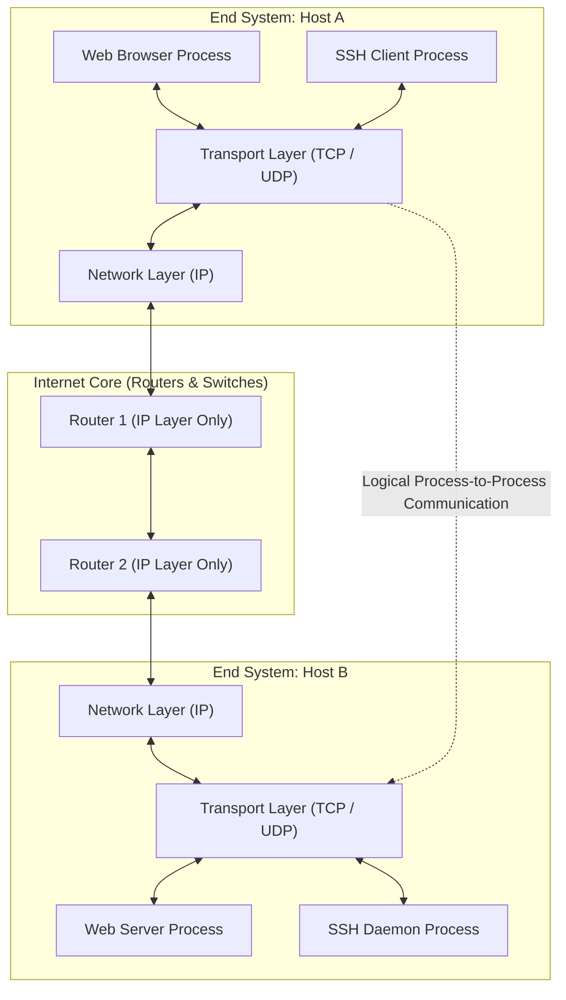
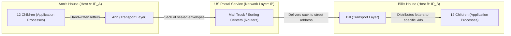
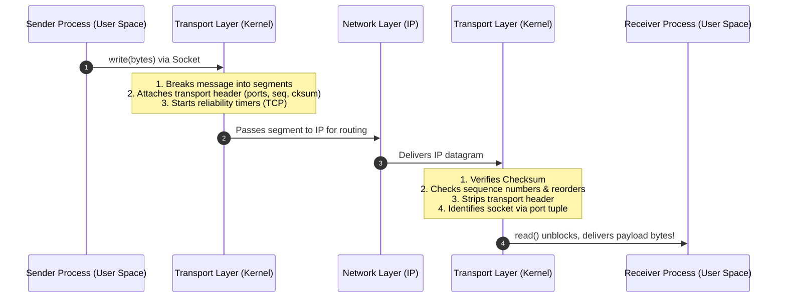
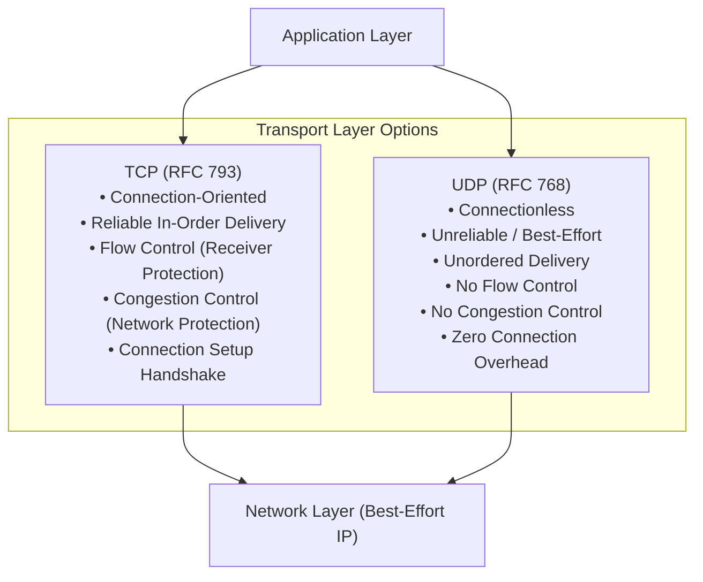

[CN Index](../README.md) / [Unit 2: Sockets & Transport](Introduction.md)

# Lecture 05: Transport Layer Services and Principles

In our journey down the Internet protocol stack, we have reached the fundamental architectural boundary between user applications and the network infrastructure: **Layer 4 — The Transport Layer**.

Up to this point, we observed application processes creating and formatting messages. We know that routers in the network core move IP datagrams across physical links. 

But IP has a fundamental limitation: **IP only delivers data between hosts**. 

An IP address identifies a network interface card on a computer. It does not identify a program. When an IP datagram arrives at your laptop, how does the operating system know whether those incoming bytes belong to your Zoom call, your Spotify stream, a background Git fetch, or a tab open to Wikipedia?

This is the job of the Transport Layer: it bridges the gap between raw **host-to-host** delivery and **process-to-process** communication.

---

## Transport Layer Scope and the "End-to-End" Principle

The transport layer provides **logical communication between application processes** running on different hosts. 

The word *logical* is decisive here: from the perspective of two running programs, it feels as if they are connected by a dedicated, direct cable. In reality, the physical path may span thousands of miles of fiber optics, satellite uplinks, and dozens of intermediate packet switches.

Notice a crucial structural fact in this architecture: **Transport layer protocols live and run exclusively on end systems (hosts)**.

Routers in the Internet core inspect and forward packets based strictly on Layer 3 (IP) headers. A core router does not know, and does not care, whether a packet belongs to a TCP three-way handshake or a UDP video stream; it merely looks at the destination IP address, checks its forwarding table, and pushes the datagram out the appropriate interface. Transport intelligence is pushed entirely to the edges of the network.

---

## The Household Analogy: Ann and Bill

To crystallize the distinction between host-to-host delivery and process-to-process delivery, Kurose and Ross introduce the classic **Household Analogy**:

Imagine two large families living on opposite sides of the country:
- **Ann's House** in Rhode Island, containing 12 children (cousins).
- **Bill's House** in Oregon, containing 12 children (cousins).

The children in Ann's house love writing letters to the children in Bill's house. Every week, dozens of letters are exchanged.

In this analogy:
- **Application Messages** = The letters inside the envelopes.
- **Application Processes** = The children writing and reading the letters.
- **End Hosts (Computers)** = The two physical houses (identified by their street addresses / IP addresses).
- **Network Layer Protocol (IP)** = The US Postal Service (trucks and sorting centers moving mail from street address to street address).
- **Transport Layer Protocols** = **Ann and Bill**.

### What Ann and Bill Actually Do
When the children in Rhode Island write letters, they don't walk to the post office. They hand their letters to Ann. Ann collects the letters, seals them in envelopes, writes the recipient child's name and the house address on each envelope, and hands the batch to the postal carrier.

When the mail truck arrives in Oregon, the postal carrier drops a sack of mail on Bill's front porch. The postal carrier's job is done: the mail has reached the correct *house*. But if Bill did not exist, the mail would sit in an undifferentiated heap on the porch. 

Bill picks up the sack, inspects the name written on each individual envelope, and hands each letter directly to the specific child for whom it was intended.

### Key Insights from the Analogy
1. **Host Delivery vs. Process Delivery**: The postal service delivers mail between *houses*, but knows nothing about individual children. Similarly, IP delivers datagrams between *hosts*, but knows nothing about individual software processes. Ann and Bill (transport protocols) provide process-level delivery.
2. **Enhancing Service over an Unreliable Substrate**: Suppose the postal service is sloppy and occasionally loses an envelope in transit. Ann and Bill can coordinate to make the service 100% reliable! Ann can keep carbon copies of every outgoing letter. Bill can mail back a postcard confirming receipt of each letter. If Ann doesn't receive a confirmation within two weeks, she re-sends the letter. 
   *A transport protocol (like TCP) can guarantee complete reliability to applications even when the underlying network protocol (IP) is lossy and unreliable!*
3. **Inherent Physical Limitations**: Can Ann and Bill guarantee that a letter written at 9:00 AM arrives at Bill's house by 9:05 AM? Absolutely not. If the postal service takes three days to drive across the country, Ann and Bill cannot change the speed of the mail truck. 
   *A transport protocol cannot offer delay or bandwidth guarantees that the underlying network layer cannot physically support.*

---

## Transport Layer versus Network Layer Service

| Dimension | Network Layer (IP) | Transport Layer (TCP / UDP) |
| :--- | :--- | :--- |
| **Communication Scope** | Host-to-Host delivery. | Process-to-Process delivery. |
| **Addressing Entity** | 32-bit (IPv4) or 128-bit (IPv6) IP Address. | 16-bit Port Number (identifying a specific socket). |
| **Physical Location** | Implemented on all end hosts AND all intermediate routers. | Implemented **strictly on end systems** (operating system kernels). |
| **Service Model** | Unreliable "best-effort" datagram delivery. | Can be best-effort (UDP) OR fully reliable, ordered, and flow-controlled (TCP). |
| **Hardware Awareness** | Must handle MTU, link routing, and physical hop topologies. | Abstracts the entire network into an end-to-end logical channel. |

Transport protocols do not merely replicate network-layer services; they **transform** them. While IP offers a best-effort, drop-prone datagram service, TCP builds a robust, lossless, byte-stream abstraction on top of it.

---

## Sender and Receiver Transport Actions

To deliver on this promise, transport layer implementations in the operating system kernel execute a symmetric pipeline of actions:

### Transport Actions at the Sending Host
1. **Message Ingestion**: Receives application data bytes pushed through a socket door by a user process.
2. **Segmentation**: If the application message exceeds the Maximum Segment Size (MSS), the transport layer slices the data into manageable chunks called **segments**.
3. **Header Encapsulation**: Prepends a transport-layer header containing:
   - Source and Destination Port Numbers (for demultiplexing).
   - Sequence and Acknowledgment Numbers (for reliability and ordering).
   - Error-detection Checksum.
   - Flow and Congestion Control window fields (in TCP).
4. **Dispatch**: Passes the encapsulated segment down to Layer 3 (IP).

### Transport Actions at the Receiving Host
1. **Segment Extraction**: Extracts the transport segment from the payload of an incoming IP datagram.
2. **Integrity Verification**: Computes the transport checksum over the segment header and payload; discards corrupted data.
3. **Protocol Logic Execution**: In TCP, checks sequence numbers, buffers out-of-order segments, acknowledges received bytes, and generates ACK segments back to the sender.
4. **Demultiplexing**: Inspects the port numbers in the header to locate the exact destination socket, stripping the transport header and delivering pure application bytes into the receiving process's buffer.

---

## The Internet Transport Protocols: TCP versus UDP

The Internet architecture offers applications two primary transport protocols:

### Transmission Control Protocol (TCP)
TCP provides a comprehensive, heavyweight service model:
- **Connection-Oriented**: Requires stateful connection establishment (three-way handshake) before any user data can be exchanged.
- **Reliable Data Transfer**: Guarantees that every transmitted byte arrives at the receiving process without loss, corruption, or duplication.
- **In-Order Delivery**: Sequences segments so that out-of-order arrivals are buffered and sorted before application delivery.
- **Flow Control**: Prevents a fast sender from overflowing the receiving application's buffer.
- **Congestion Control**: Prevents sender flows from overwhelming the intermediate switches and routers in the Internet core.

### User Datagram Protocol (UDP)
UDP is a minimalist transport service—often described as a "bare-bones" or "null" transport layer:
- It provides only two services beyond raw IP: **process-level multiplexing/demultiplexing** (via port numbers) and **lightweight error detection** (via the 16-bit checksum).
- It adds zero connection establishment latency, zero flow control, and zero rate throttling.

### What Neither Protocol Can Provide
Notice what is absent from both TCP and UDP: **neither protocol provides delay guarantees or bandwidth guarantees**.

Because the underlying IP network operates on statistical packet multiplexing with dynamic queueing, neither TCP nor UDP can guarantee that a packet will arrive within 20 milliseconds, or that an application will receive a guaranteed 10 Mbps pipe.

---

## Key Takeaways

- The transport layer provides **logical communication between application processes**, whereas the network layer provides communication between **end hosts**.
- Transport protocols run strictly on end systems; routers in the network core process only Layer 3 and below.
- In the household analogy: houses are hosts, children are processes, letters are messages, the postal service is IP, and Ann and Bill are transport protocols.
- Transport protocols can provide reliable communication even over an unreliable network layer, but cannot overcome physical propagation and transmission delay limitations.
- Sender transport actions include message segmentation, header attachment, and dispatch; receiver actions include error checking, reordering, and socket demultiplexing.
- TCP offers connection-oriented, reliable, in-order, flow-controlled, and congestion-controlled delivery; UDP provides connectionless, best-effort datagram delivery.
- Neither TCP nor UDP provides deterministic delay bounds or throughput reservations.

---

Now that we understand the scope of the transport layer, we must look closer at the receiver's front door: when dozens of segments arrive simultaneously over a host's single network interface, how does the transport layer know precisely which socket owns each incoming segment? To answer this, we turn to [Multiplexing and Demultiplexing](L06%20-%20Multiplexing%20and%20Demultiplexing.md).
