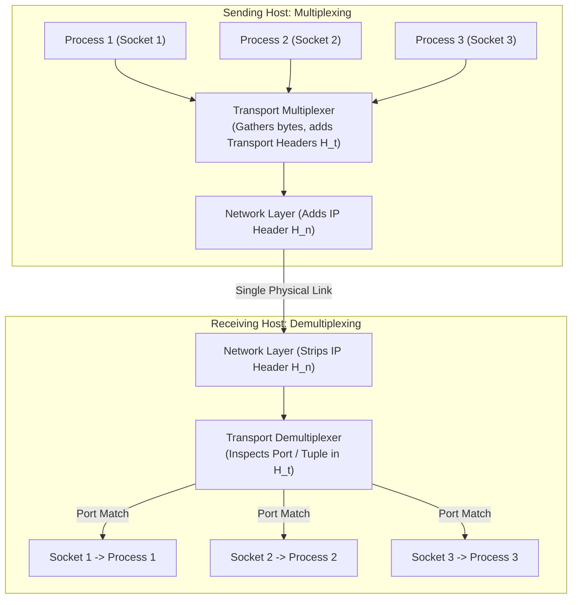
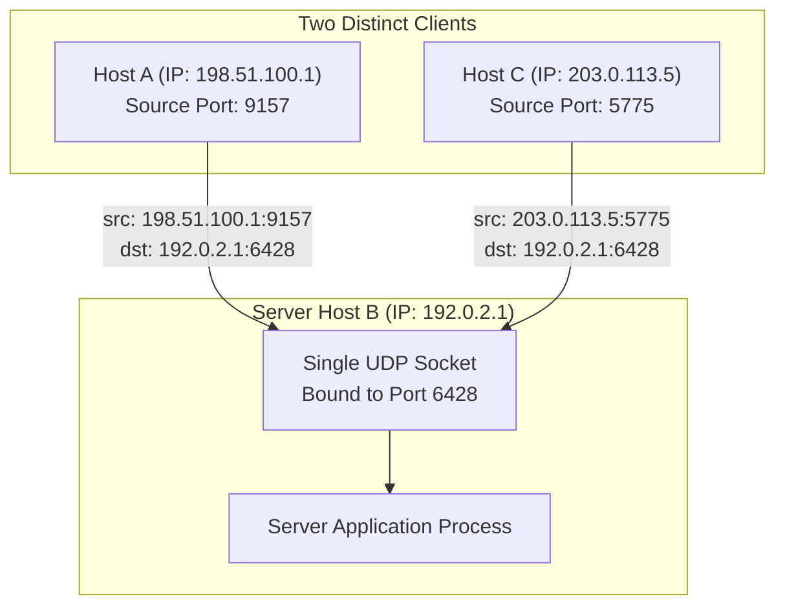
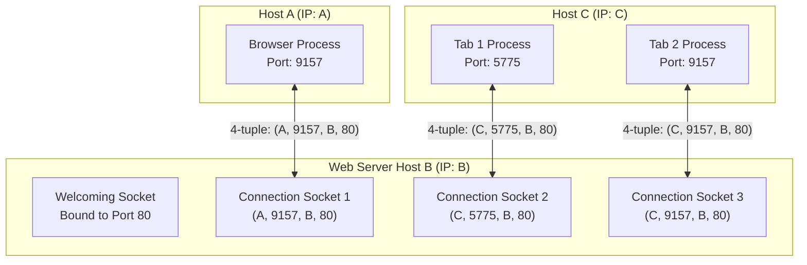

[CN Index](../README.md) / [Unit 2: Sockets & Transport](Introduction.md)

# Lecture 06: Multiplexing and Demultiplexing

When an IP datagram arrives at an end system, the network layer has successfully accomplished its mission: it brought the packet to the correct physical host interface.

Now the receiving operating system faces an immediate problem:
On this single host, there are fifty active network sockets. A user is watching a YouTube video, downloading a file via BitTorrent, listening to an audio stream, and running three terminal sessions. 

How does the transport layer take this incoming datagram, look inside its headers, and direct its payload to the exact socket owned by the YouTube process, rather than the BitTorrent process or the terminal?

This sorting operation is called **Demultiplexing**. Its inverse—gathering data from multiple application sockets at the sending host, wrapping each piece with transport headers, and passing them down to Layer 3—is called **Multiplexing**.



---

## The Header Fields Used for Demultiplexing

To make demultiplexing possible, every transport-layer protocol (both UDP and TCP) includes dedicated addressing fields in its header.

At the very top of both UDP and TCP segment headers sit two 16-bit fields:
- **Source Port Number** (16 bits)
- **Destination Port Number** (16 bits)

```
 0                   1                   2                   3
 0 1 2 3 4 5 6 7 8 9 0 1 2 3 4 5 6 7 8 9 0 1 2 3 4 5 6 7 8 9 0 1
+-+-+-+-+-+-+-+-+-+-+-+-+-+-+-+-+-+-+-+-+-+-+-+-+-+-+-+-+-+-+-+-+
|          Source Port          |       Destination Port        |
+-+-+-+-+-+-+-+-+-+-+-+-+-+-+-+-+-+-+-+-+-+-+-+-+-+-+-+-+-+-+-+-+
```

A 16-bit integer yields $2^{16} = 65,536$ possible port numbers, ranging from `0` to `65535`:
1. **Well-Known Ports (`0` to `1023`)**:
   - Standardized by the IANA (Internet Assigned Numbers Authority).
   - Reserved for ubiquitous, privileged application services (e.g., HTTP `80`, HTTPS `443`, SSH `22`, DNS `53`, SMTP `25`).
   - On Unix-like systems, binding a socket to a well-known port requires root/administrative privilege.
2. **Registered Ports (`1024` to `49151`)**:
   - Listed by IANA for specific vendor applications and databases (e.g., MySQL `3306`, PostgreSQL `5432`).
3. **Dynamic / Private / Ephemeral Ports (`49152` to `65535`)**:
   - Automatically assigned by the client operating system when an application initiates an outbound connection without explicitly binding a port number.

---

## Connectionless Demultiplexing: UDP

In UDP, there is no transport handshake, and the kernel does not maintain persistent connection state between endpoints.

Consequently, a UDP socket is identified locally on a host by only a **2-Tuple**:

$$\text{(Destination IP Address, Destination Port Number)}$$

When a UDP segment arrives at a host:
1. The operating system kernel strips the IP header and inspects the UDP header's **Destination Port Number**.
2. The kernel looks up which local user socket is bound to that destination port.
3. The kernel dumps the segment's payload directly into that socket's buffer.



### The Critical Implication of UDP Demultiplexing
Notice what happened in the diagram above:
- Host A sends a datagram from source port `9157` to Server B at port `6428`.
- Host C sends a datagram from source port `5775` to Server B at port `6428`.

Both datagrams have different source IP addresses and different source port numbers. Yet because both datagrams specify **Destination Port 6428**, the operating system delivers **both datagrams into the exact same socket**!

The server process distinguishes between Host A and Host C solely by reading the source address tuple `(client_ip, client_port)` returned by `recvfrom()`. When the server wants to reply to Host A, it extracts `198.51.100.1:9157` from the received datagram and places those values into the destination fields of its outgoing reply datagram.

---

## Connection-Oriented Demultiplexing: TCP

Now think about what would happen if a web server handling sensitive bank transactions used UDP-style 2-tuple demultiplexing. Alice and Bob would have their encrypted HTTP byte streams dumped into the exact same socket, interleaving their financial records into an unusable mess!

TCP cannot work that way. TCP provides a dedicated, reliable, in-order byte stream between two specific communicating processes.

Therefore, a TCP connection socket is identified by a **4-Tuple**:

$$\text{(Source IP, Source Port, Destination IP, Destination Port)}$$

When a TCP segment arrives at a host, the operating system kernel inspects **all four fields** simultaneously. If any one of the four fields differs, the segment is directed to a completely different socket.



### Tracing Concurrent TCP Flows
Look carefully at the three connections reaching Server B:
1. **Flow 1**: Host A (IP `A`, source port `9157`) connects to Server B port `80`. The kernel routes segments to **Connection Socket 1** mapped to `(A, 9157, B, 80)`.
2. **Flow 2**: Host C (IP `C`, source port `5775`) connects to Server B port `80`. The kernel routes segments to **Connection Socket 2** mapped to `(C, 5775, B, 80)`.
3. **Flow 3**: Host C opens a second browser tab, which is assigned source port `9157`. It connects to Server B port `80`. The kernel routes segments to **Connection Socket 3** mapped to `(C, 9157, B, 80)`.

Notice something remarkable:
- Flow 1 and Flow 3 share the **exact same source port** (`9157`) and the **exact same destination port** (`80`).
- Yet they are completely isolated into separate sockets because their source IP addresses differ (`A` vs. `C`).
- Flow 2 and Flow 3 share the **exact same source IP** (`C`) and the **exact same destination port** (`80`).
- Yet they are isolated into separate sockets because their source ports differ (`5775` vs. `9157`).

---

## The Server Scalability Myth: Can Port 80 Only Handle 65,535 Connections?

A classic exam question asks:
> *"Since port numbers are 16 bits wide (maximum 65,535), does that mean a web server can only support at most 65,535 simultaneous TCP connections on Port 80?"*

The answer is an emphatic **NO**.

The 16-bit port number limits how many unique local ports an individual host can bind. But on the web server, the server only binds port `80` **once** (on its welcoming socket).

Every incoming client connection is demultiplexed by the complete 4-tuple:

$$\text{(Client IP, Client Port, Server IP, 80)}$$

Because the Internet contains billions of unique client IP addresses, and each client IP can open thousands of ephemeral client ports, the number of theoretically possible simultaneous 4-tuples connected to `Server_IP:80` is:

$$\text{Possible 4-Tuples} \approx (\text{Unique Client IPs}) \times (65,535 - 1024)$$

A modern production web server (such as an Nginx or Apache cluster) routinely handles hundreds of thousands of concurrent TCP connections on port 80. The actual limit is never the 16-bit port space; it is dictated by **operating system resources**:
1. Available RAM to allocate send and receive socket buffers (typically a few kilobytes per connection).
2. The operating system's open file descriptor limit (`ulimit -n`).
3. CPU overhead for context-switching across active worker threads or epoll event loops.

---

## Web Servers and Multi-Threading

In modern high-performance web servers, connection sockets are rarely managed by a single monolithic loop.

Instead, when the welcoming socket's `accept()` unblocks and returns a new connection socket:
- **Thread-per-Connection Model**: The server spawns a new thread (or assigns an idle thread from a thread pool) to handle all subsequent communication with that connection socket.
- **Event-Driven Non-Blocking Model (e.g., Nginx, Node.js)**: A small pool of worker threads uses kernel notification primitives (`epoll` on Linux, `kqueue` on BSD) to monitor thousands of connection sockets simultaneously, executing callbacks only when a socket's buffer has bytes ready to read.

### Persistent versus Non-Persistent HTTP Impact on Demux
- **Non-Persistent HTTP**: For every single web object (an image, a CSS file), the client creates a new TCP connection, exchanges one request and response, and closes the socket. This causes constant socket creation, three-way handshakes, and socket teardown churn in the kernel.
- **Persistent HTTP (HTTP/1.1 and HTTP/2)**: The client and server keep the same connection socket open across dozens or hundreds of successive requests. All objects travel over the same established 4-tuple, dramatically reducing kernel demultiplexing overhead and avoiding redundant handshakes.

---

## Key Takeaways

- **Multiplexing** gathers data chunks from multiple sockets, adds transport headers, and passes segments to Layer 3; **Demultiplexing** inspects header fields to deliver received segments to the correct socket.
- Port numbers are 16-bit integers ($0$ to $65535$); $0$–$1023$ are well-known/privileged, $1024$–$49151$ are registered, and $49152$–$65535$ are dynamic/ephemeral.
- **UDP demultiplexing uses a 2-tuple**: `(Destination IP, Destination Port)`. Packets from different sources targeting the same destination port enter the same socket.
- **TCP demultiplexing uses a 4-tuple**: `(Source IP, Source Port, Destination IP, Destination Port)`. Every unique connection flow maps to a dedicated connection socket.
- Port 80 can support hundreds of thousands of concurrent connections because each connection is distinguished by its unique client IP and client port tuple. The real bottleneck is memory and file descriptors, not port numbers.

---

Now that we understand how transport headers route segments to specific process sockets, we can dissect the protocols themselves. We begin with the simplest possible transport protocol on the Internet: [User Datagram Protocol (UDP) and the mechanics of the Internet Checksum](L07%20-%20Connectionless%20Transport%20-%20UDP%20and%20Internet%20Checksum.md).
