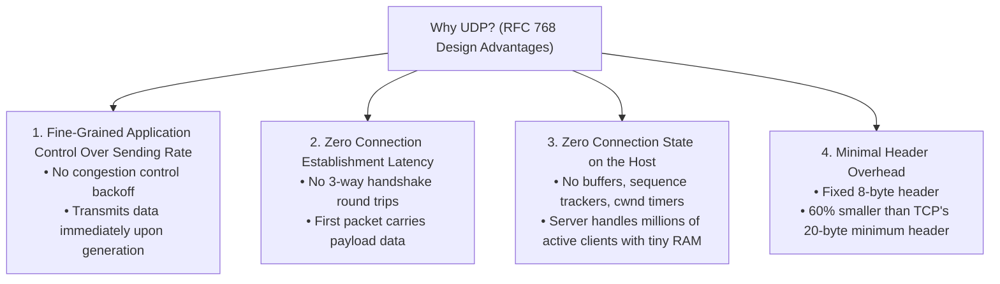
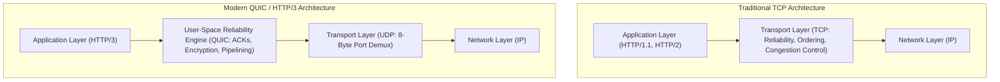
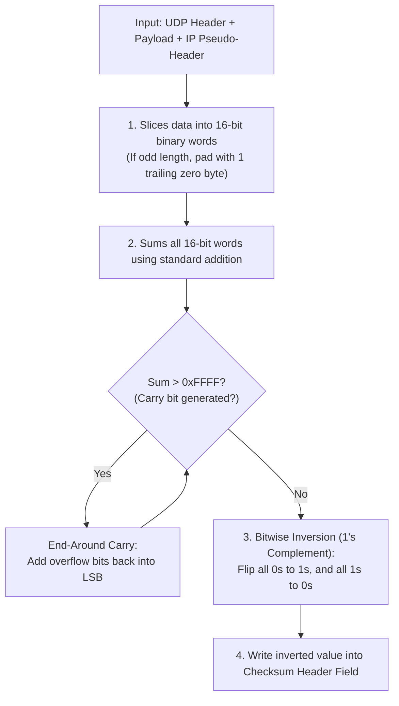

[CN Index](../README.md) / [Unit 2: Sockets & Transport](Introduction.md)

# Lecture 07: Connectionless Transport - UDP and Internet Checksum

When students first encounter the User Datagram Protocol (UDP, RFC 768), their immediate reaction is often disbelief:
UDP does not establish a connection. It does not acknowledge received packets. It does not retransmit lost data. It does not put packets back in order. It does not throttle its transmission rate when intermediate routers are on the verge of collapsing from buffer overflows.

It is, quite literally, a "no-frills", bare-bones transport protocol.

So why does UDP exist? Why didn't Internet architects mandate TCP for everything?

Because in network systems, every guarantee comes with an inescapable physical cost. When an application demands ultra-low latency, or when an exchange consists of a single request and response, TCP's heavy machinery becomes an active obstacle. UDP exists to give applications direct, unencumbered access to raw IP datagram forwarding, adding only the bare minimum required to deliver bytes to a specific process socket and check for bit corruption.

---

## Why UDP Exists: The Four Design Advantages

The design philosophy of UDP is grounded in four major operational advantages:



### 1. Fine-Grained Application Control Over What and When Data is Sent
TCP has a built-in congestion control mechanism. If the network experiences packet loss, TCP slashes its sending rate by half and forces the application to buffer data. 

For real-time applications like video conferencing (Zoom) or IP telephony, late data is useless data. If a video frame arrives 500 milliseconds late due to TCP retransmissions, the moment has passed; the user would rather drop the degraded frame and see the current live frame immediately. UDP transmits data into the network the instant the application produces it.

### 2. Zero Connection Establishment Latency
TCP requires a full three-way handshake (`SYN`, `SYN-ACK`, `ACK`) before a single byte of application data can travel across the network, adding at least one full Round-Trip Time (RTT) of dead time. 

For DNS queries, where the entire interaction consists of *"What is the IP of google.com?"*, spending 1 RTT setting up a connection and 1 RTT tearing it down just to send a 40-byte question is an unacceptable 200% latency penalty. UDP sends the query in the very first packet.

### 3. Zero Connection State
A TCP implementation must maintain substantial state for every active connection: receive and send buffers, congestion window (`cwnd`), receiver advertised window (`rwnd`), sequence numbers, acknowledgment numbers, and retransmission timers. 

A high-traffic server handling 100,000 simultaneous TCP connections must dedicate hundreds of megabytes of kernel RAM just to track state blocks. UDP maintains **zero connection state**. A DNS server running on UDP can field requests from millions of clients without allocating a single persistent tracking structure.

### 4. Minimal Header Overhead
A standard TCP segment header is at least **20 bytes** long (and often larger with options). 

A UDP segment header is strictly **8 bytes** long. For small payloads (such as network sensor telemetry or voice packets), saving 12 bytes per packet represents a massive reduction in bandwidth overhead and link congestion.

---

## Reliability Above UDP

Choosing UDP does not mean an application must surrender reliability forever.

If an application needs UDP's zero-handshake speed or specialized flow control, but still requires certain critical messages to arrive reliably, **the application developer can implement reliability mechanisms directly in user space (at the Application Layer)**.



This is precisely how modern web protocols operate. **HTTP/3** runs entirely over **QUIC**, a user-space protocol built directly on top of UDP. QUIC implements rapid connection handshakes, stream multiplexing (eliminating TCP head-of-line blocking), congestion control, and TLS 1.3 encryption, while relying on UDP solely as an operating-system multiplexer.

---

## The UDP Segment Header Format

The UDP header is defined in RFC 768. It consists of four 16-bit fields, occupying a total of **64 bits (8 bytes)**:

```
 0                   1                   2                   3
 0 1 2 3 4 5 6 7 8 9 0 1 2 3 4 5 6 7 8 9 0 1 2 3 4 5 6 7 8 9 0 1
+-+-+-+-+-+-+-+-+-+-+-+-+-+-+-+-+-+-+-+-+-+-+-+-+-+-+-+-+-+-+-+-+
|          Source Port          |       Destination Port        |
+-+-+-+-+-+-+-+-+-+-+-+-+-+-+-+-+-+-+-+-+-+-+-+-+-+-+-+-+-+-+-+-+
|            Length             |           Checksum            |
+-+-+-+-+-+-+-+-+-+-+-+-+-+-+-+-+-+-+-+-+-+-+-+-+-+-+-+-+-+-+-+-+
|                                                               |
|                       Application Data                        |
|                                                               |
+-+-+-+-+-+-+-+-+-+-+-+-+-+-+-+-+-+-+-+-+-+-+-+-+-+-+-+-+-+-+-+-+
```

1. **Source Port Number (16 bits)**: The port on the sending host. Used by the recipient to direct reply datagrams. If no reply is expected, this can be set to zero.
2. **Destination Port Number (16 bits)**: The port on the receiving host bound to the destination socket.
3. **Length (16 bits)**: The total length of the UDP segment, measured in bytes. This count **includes both the 8-byte header and the payload bytes**. (The minimum possible value is `8`, representing an empty UDP segment).
4. **Checksum (16 bits)**: Used for error detection to determine whether bits have been altered or corrupted in transit across physical links and router memory.

---

## The Internet Checksum Procedure

The Internet Checksum (used in UDP, TCP, and IPv4) provides error detection through **1's complement arithmetic**.

### Why 1's Complement?
In ordinary binary addition (2's complement), when the sum exceeds the word width, the overflow carry bit is simply truncated and discarded. 

In **1's complement addition**, the carry bit is never discarded. When an addition produces an overflow carry past the 16th bit, the carry bit is **wrapped around** and added back into the least significant bit (LSB). This ensures that every bit position contributes equally to the final verification value.

### Step-by-Step Checksum Calculation at the Sender



### The IP Pseudo-Header
Notice something surprising: when UDP computes its checksum, it does not calculate it solely over the UDP segment. It also includes an imaginary **12-byte IP Pseudo-Header**:
- Source IP Address (32 bits)
- Destination IP Address (32 bits)
- Fixed Zero Byte (8 bits)
- Protocol Field (`17` for UDP) (8 bits)
- UDP Length Field (16 bits)

Why include IP addresses in a transport checksum? 
Because if a faulty router experiences memory corruption in its forwarding table and accidentally modifies the destination IP address in the packet header, the IP layer might deliver the packet to the wrong computer! By folding the IP addresses into the UDP checksum, UDP detects misdelivered packets and silently discards them.

---

## Numerical Worked Examples

### Example 1: Checksum over Two 16-Bit Words
Suppose we have two 16-bit binary words to transmit:
- **Word 1**: `1110 0110 0110 0110` (Hex: `0xE666`)
- **Word 2**: `1101 0101 0101 0101` (Hex: `0xD555`)

**Step 1: Compute binary sum**
$$\begin{array}{r@{\quad}l}
  1110\;0110\;0110\;0110 & (0\text{xE666}) \\
+\;1101\;0101\;0101\;0101 & (0\text{xD555}) \\
\hline
 1\;1011\;1011\;1011\;1011 & (0\text{x1BBBB})
\end{array}$$

Notice the carry bit (`1`) extending past 16 bits!

**Step 2: Wrap around the carry bit (End-Around Carry)**
$$\begin{array}{r@{\quad}l}
  1011\;1011\;1011\;1011 & (0\text{xBBBB}) \\
+\;0000\;0000\;0000\;0001 & (0\text{x0001}) \\
\hline
  1011\;1011\;1011\;1100 & (0\text{xBBBC})
\end{array}$$

**Step 3: Invert all bits (1's complement)**
$$\sim(1011\;1011\;1011\;1100) = \mathbf{0100\;0100\;0100\;0011} \quad (0\text{x4443})$$

This value (`0x4443`) is placed into the UDP checksum field.

### Verification at the Receiver
The receiver takes all received words—**including the checksum itself**—and adds them together using 1's complement addition:

$$\begin{array}{r@{\quad}l}
  1110\;0110\;0110\;0110 & (\text{Word 1: } 0\text{xE666}) \\
+\;1101\;0101\;0101\;0101 & (\text{Word 2: } 0\text{xD555}) \\
+\;0100\;0100\;0100\;0011 & (\text{Checksum: } 0\text{x4443}) \\
\hline
  \text{Sum} = 0\text{xE666} + 0\text{xD555} + 0\text{x4443} = 0\text{x1FFFF}
\end{array}$$

Wrap the carry:
$$0\text{xFFFF} + 1 = 0\text{x10000} \implies 0\text{xFFFF}$$

The resulting sum is:
$$\mathbf{1111\;1111\;1111\;1111} \quad (0\text{xFFFF})$$

When the receiver inverts this final sum, it gets:
$$\sim(0\text{xFFFF}) = \mathbf{0000\;0000\;0000\;0000} \quad (0\text{x0000})$$

**The Receiver Rule**: If the 1's complement of the sum of all words (including the checksum) is all zeros, no error is detected. If even a single bit is non-zero, the segment is corrupted and must be dropped.

---

### Example 2: Checksum over Three 16-Bit Words
Let's trace a three-word example from the lecture slides:
- **Word 1**: `0110 0110 0110 0000` (Hex: `0x6660`)
- **Word 2**: `0101 0101 0101 0101` (Hex: `0x5555`)
- **Word 3**: `1000 1111 0000 1100` (Hex: `0x8F0C`)

**Step 1: Ordinary sum**
$$0\text{x6660} + 0\text{x5555} + 0\text{x8F0C} = 0\text{x14AC1}$$

**Step 2: Wrap around the carry bit**
$$0\text{x4AC1} + 1 = \mathbf{0\text{x4AC2}} \quad (0100\;1010\;1100\;0010)$$

**Step 3: Bitwise inversion**
$$\sim(0\text{x4AC2}) = \mathbf{0\text{xB53D}} \quad (1011\;0101\;0011\;1101)$$

The checksum transmitted across the wire is `0xB53D`.

---

## Why the Internet Checksum Is Weak

While the Internet Checksum is exceptionally fast to compute in software, it is **mathematically weak** compared to hardware Cyclic Redundancy Checks (CRCs).

Because addition is commutative ($A + B = B + A$), the Internet Checksum suffers from several blind spots:

1. **Undetected Word Swapping**: If two 16-bit words in the payload swap positions during memory copying, the arithmetic sum remains completely unchanged. The receiver cannot detect that the data has been reordered!
2. **Compensating Bit Errors**: Suppose bit 4 of Word 1 flips from $0 \to 1$ (increasing the numerical value by $2^4 = 16$), while bit 4 of Word 2 flips from $1 \to 0$ (decreasing the value by $16$). 
   The two bit errors cancel each other out in the addition:
   $$(+16) + (-16) = 0$$
   The resulting checksum is identical to the uncorrupted version. The receiver happily accepts completely damaged data.
3. **Zero Insertion/Deletion**: Inserting or deleting 16-bit words of all zeros (`0x0000`) produces no change in the checksum.

Why did Internet pioneers choose such a weak mechanism? 
In the 1970s, routers and end hosts had primitive CPUs. A complex polynomial division like CRC-32 would have brought packet processing to a crawl. The designers accepted a simple software sum at Layer 4, knowing that physical link layers (such as Ethernet and Wi-Fi) would enforce rigorous hardware CRC error detection at Layer 2.

---

## Key Takeaways

- UDP is a connectionless, best-effort transport protocol defined in RFC 768.
- UDP provides four primary advantages: fine-grained sending control, zero connection handshake latency, zero connection state on the server, and a tiny 8-byte header.
- Reliability can be built above UDP at the application layer (e.g., HTTP/3 running over QUIC).
- The UDP header is 8 bytes total: Source Port (16b), Destination Port (16b), Length (16b), and Checksum (16b).
- The 16-bit Internet Checksum uses **1's complement addition with end-around carry**, followed by bitwise inversion.
- The checksum includes an **IP Pseudo-Header** containing source and destination IPs to detect misdelivered datagrams.
- The Internet Checksum cannot detect swapped words or compensating bit flips; it was chosen for software efficiency, relying on Layer 2 CRCs for hardware-level integrity.

---

Now that we have analyzed what happens when a protocol provides *no* reliability, we face the fundamental engineering challenge of the transport layer: how do we build an absolutely bulletproof, reliable data transfer service over a network that drops, corrupts, and reorders packets? To answer that, we begin the step-by-step construction of [Reliable Data Transfer, from rdt 1.0 through rdt 2.2](L08%20-%20Principles%20of%20Reliable%20Data%20Transfer%20-%20rdt%201.0%20to%20rdt%202.2.md).
