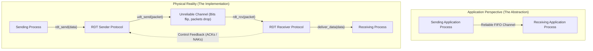
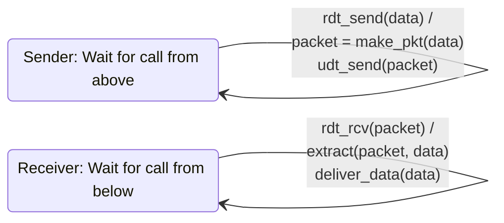
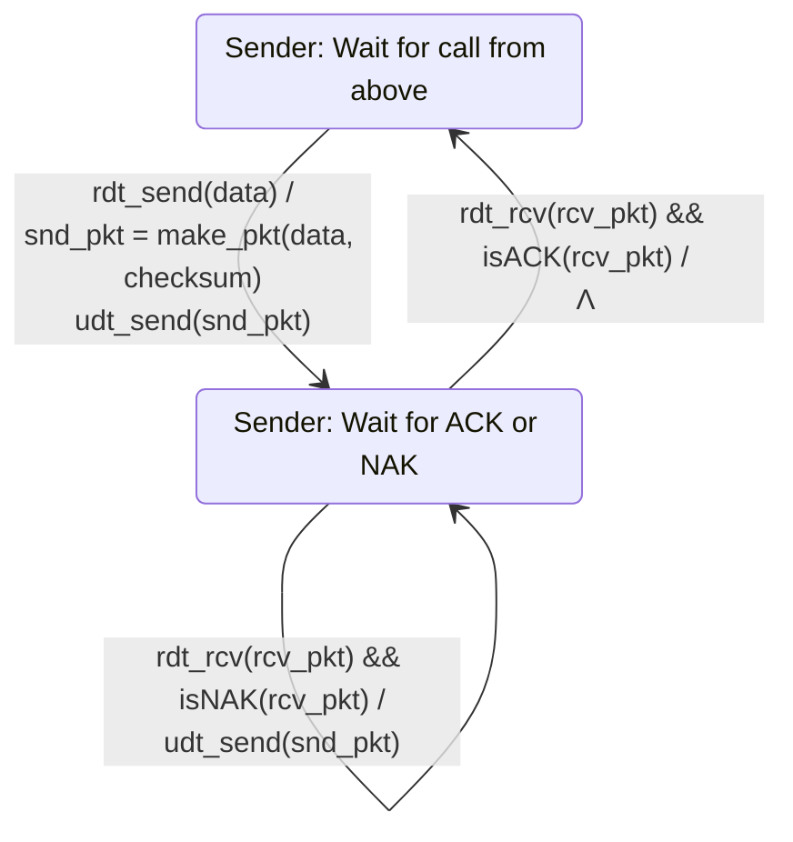
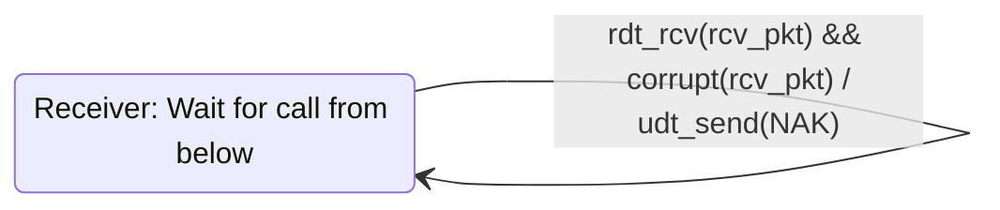
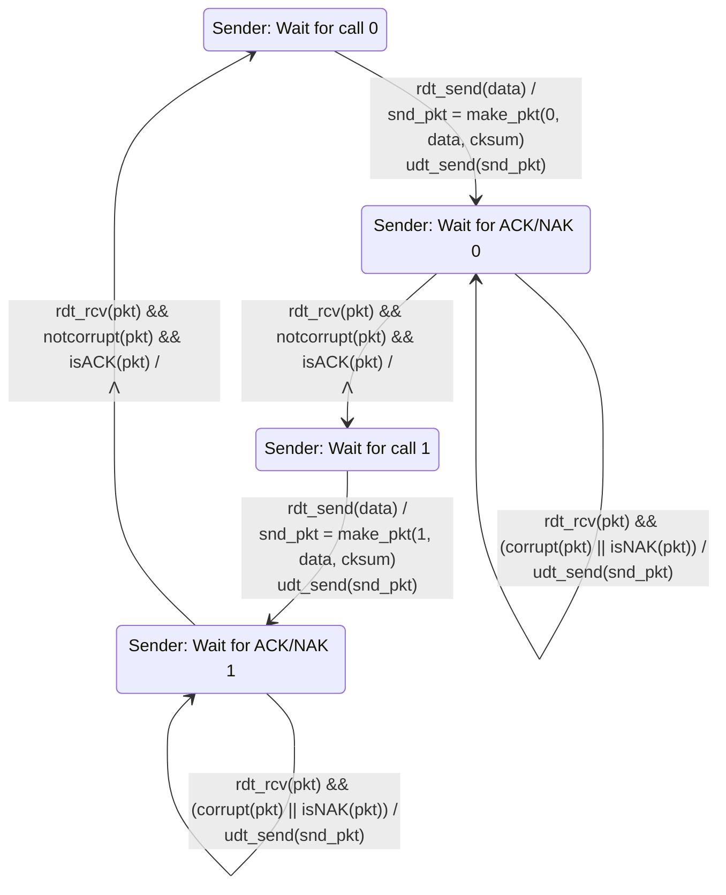
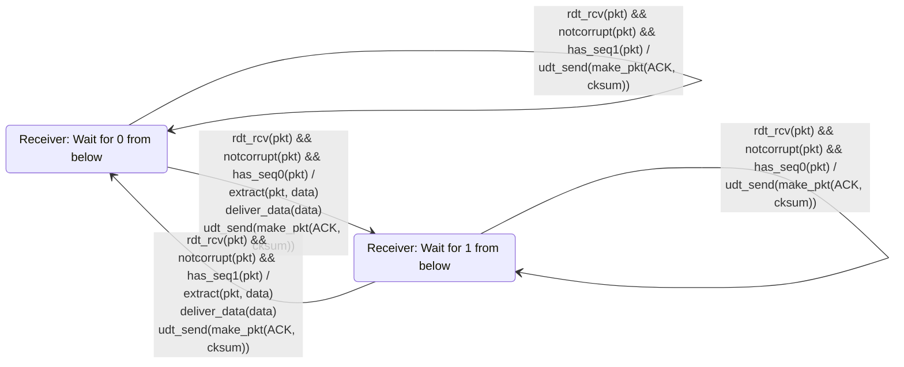
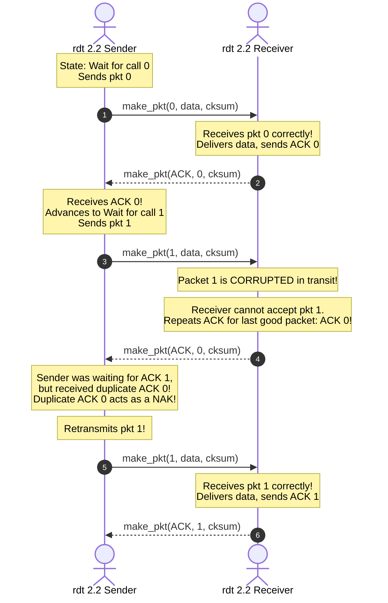

[CN Index](../README.md) / [Unit 2: Sockets & Transport](Introduction.md)

# Lecture 08: Principles of Reliable Data Transfer - rdt 1.0 to rdt 2.2

One of the great intellectual achievements of computer networking is creating the illusion of absolute reliability over an infrastructure that is inherently unreliable.

Consider what lies beneath Layer 4:
The physical network consists of copper wires subject to electromagnetic interference, fiber cables experiencing attenuation, wireless links suffering from atmospheric noise, and routers dropping packets whenever their queue buffers fill up. 

Yet when you download an executable binary or transfer a bank ledger, not a single bit can be flipped, duplicated, or dropped.

How do two software processes, running on opposite ends of an imperfect world and communicating only by sending messages back and forth, guarantee 100% flawless data delivery?

To understand how protocols like TCP achieve this, we do not simply memorize TCP's finished header. Instead, we follow the incremental pedagogical framework developed by Jim Kurose: we build **Reliable Data Transfer (rdt)** from scratch across a series of increasingly hostile channel models, using **Finite-State Machines (FSMs)** to track distributed state.

---

## The Reliable Service Abstraction and Interface

The application layer expects a **Reliable Service Abstraction**: a pristine FIFO pipe. Data bytes pushed in by the sending process emerge at the receiving process in identical order, with zero bit errors and zero missing bytes.

To formalize this interaction, we define four core procedural interfaces:

1. **Upper Layer Boundary**:
   - `rdt_send(data)`: Called by the sending application to hand application data to the RDT transport layer.
   - `deliver_data(data)`: Called by the RDT transport layer to hand verified, in-order application data to the receiving application.
2. **Lower Layer Boundary**:
   - `udt_send(packet)`: Called by the RDT layer to inject an encapsulated packet into the **Unreliable Data Transfer (UDT)** network channel.
   - `rdt_rcv(packet)`: Triggered automatically as an event when an incoming packet arrives from the physical network at the transport layer.

### Finite-State Machine (FSM) Notation
We model protocol entities as Finite-State Machines. A state captures everything the protocol entity remembers about the ongoing conversation.

Transitions between states are annotated using the standard notation:

$$\frac{\text{Triggering Event}}{\text{Actions Taken}}$$

- The horizontal line separates causes from effects.
- If an event occurs but requires no output action, we write $\Lambda$ (null action) beneath the line.
- The machine remains in its current state until a specified event occurs, executes the indicated actions, and transitions to the target state.

---

## rdt 1.0: Reliable Transfer over a Perfectly Reliable Channel

We begin with the simplest conceivable baseline: an underlying channel that is **100% reliable**.
- The channel never corrupts bits ($0 \to 1$ or $1 \to 0$).
- The channel never loses packets.
- The channel delivers every packet in exact FIFO order.

### Analysis of rdt 1.0
Because the channel never fails, the receiver does not need to send any feedback to the sender. The sender does not need to store copies of sent packets, run timers, or attach sequence numbers. 

The sender simply packages data into a packet via `make_pkt(data)` and sends it via `udt_send(packet)`. The receiver waits for `rdt_rcv(packet)`, extracts the data, and delivers it upward.

---

## rdt 2.0: Channel with Bit Errors (The ARQ Model)

Now we introduce our first real-world imperfection: **the channel can corrupt bits**. 

Electromagnetic noise or faulty memory can flip bits inside the packet header or payload. However, we still assume that **no packets are lost**; every transmitted packet arrives at the destination, but its contents may be garbled.

How do human beings handle this when speaking over a crackling telephone line?
- Speaker: *"Meet me at 4 PM at the library."*
- If the listener hears clearly, they reply: *"OK"* (**Positive Acknowledgment / ACK**).
- If static scrambles the words, the listener replies: *"Please repeat that"* (**Negative Acknowledgment / NAK**).
- When the speaker hears *"Please repeat that"*, they retransmit the exact same sentence.

In computer networking, this mechanism is called **Automatic Repeat reQuest (ARQ)**.

### The Three Required Capabilities in rdt 2.0
1. **Error Detection**: The sender must calculate and attach a checksum (`make_pkt(data, checksum)`). The receiver recomputes the checksum to detect bit corruption (`corrupt(rcv_pkt)`).
2. **Receiver Feedback**: The receiver transmits explicit control packets back to the sender:
   - `ACK` (typically a 1-byte packet indicating successful receipt).
   - `NAK` (indicating packet corruption).
3. **Retransmission**: When the sender receives a `NAK`, it re-sends the original packet.

### Stop-and-Wait Behavior
Notice something fundamental about the sender's FSM:
When the sender moves from `Wait for call from above` into `Wait for ACK or NAK`, **it cannot accept any new data from the sending application!** 

If `rdt_send()` is called while the sender is waiting for feedback, the application must be blocked. The sender sends exactly one packet and stops, waiting for the receiver to confirm receipt before sending the next packet. This protocol behavior is known as **Stop-and-Wait**.

---

## The Fatal Flaw in rdt 2.0

`rdt 2.0` appears logically sound on paper. But it contains a **catastrophic, fatal design flaw**.

Ask yourself this question:
**What happens if the ACK or NAK packet itself is corrupted on its way back to the sender?**

The underlying channel is noisy in both directions. When the sender waits for feedback, it receives a packet of scrambled, unreadable bits. Did the receiver send an ACK or a NAK? 

The sender faces an impossible dilemma:
- **Possibility A (Assume it was an ACK)**: The sender moves on and transmits the next packet. But if the receiver actually sent a NAK, the previous packet was never delivered! That data is **permanently lost**.
- **Possibility B (Assume it was a NAK and retransmit)**: The sender resends the packet. But what if the receiver had actually sent an ACK? The packet had already been received and delivered to the receiving application! 

Now look at what happens at the receiver under Possibility B:
The receiver gets a second copy of the exact same packet. But the receiver has no way of knowing whether this incoming packet is a *retransmission* of the old data or a *brand new* piece of application data that happens to contain identical content!

The receiver extracts the payload and delivers it to the application a second time. **Duplicate data corruption has occurred**, destroying the integrity of the data stream.

---

## rdt 2.1: Handling Corrupted Feedback with Sequence Numbers

To solve the duplicate data problem, we must give the receiver a mechanism to distinguish a retransmission from new data.

The solution is elegant: **attach a Sequence Number to every transmitted data packet**.

### Why 1 Bit (Sequence Numbers 0 and 1) Suffices
Because `rdt` operates as a Stop-and-Wait protocol, there is **at most one unacknowledged packet in flight at any given instant**. 

Therefore, the receiver never needs to differentiate between ten different past packets. It only needs to know:
*"Is this incoming packet the one I am currently waiting for, or is it a duplicate of the packet I just accepted and acknowledged?"*

To distinguish between "current packet" and "immediately preceding packet", an alternating 1-bit sequence number—**0 and 1**—is mathematically sufficient!

### The Sender in rdt 2.1
Notice that the sender now requires **twice as many states** (4 states instead of 2):
1. `Wait for call 0 from above`: Accepts new data, stamps it with sequence number `0`, and transitions to `Wait for ACK/NAK 0`.
2. `Wait for ACK/NAK 0`:
   - If the incoming feedback is corrupted, OR if it is a valid `NAK`: the sender retransmits packet `0` and stays in this state.
   - If the feedback is an uncorrupted `ACK`: the sender knows packet `0` was safely received. It transitions to `Wait for call 1 from above`.
3. States 3 and 4 mirror states 1 and 2 symmetrically for sequence number `1`.

### The Receiver in rdt 2.1
The receiver now has 2 states: `Wait for 0 from below` and `Wait for 1 from below`.

Look at the third transition in state `Wait for 0 from below`:
- Event: `rdt_rcv(pkt) && notcorrupt(pkt) && has_seq1(pkt)`.
- The receiver was expecting packet `0`, but received an uncorrupted packet with sequence number `1`!
- The receiver immediately recognizes: *"This is a duplicate of packet 1! The sender must have failed to receive my previous ACK 1."*
- Action: **The receiver does NOT deliver the data to the application!** Instead, it simply retransmits `ACK` to re-synchronize the sender, and remains waiting for packet `0`.

---

## rdt 2.2: Eliminating NAKs (A NAK-Free Protocol)

Look closely at `rdt 2.1`. The receiver sends two different kinds of control packets: `ACK` and `NAK`. 

Can we simplify the protocol and eliminate NAKs altogether?

Yes. Instead of sending a negative acknowledgment (`NAK`) when a packet is corrupted or unexpected, **the receiver simply re-sends an ACK for the last successfully received in-order packet**, explicitly including the sequence number in the ACK: `ACK 0` or `ACK 1`.

### The Mechanism of rdt 2.2
- If the sender is waiting in state `Wait for ACK 1` and receives an uncorrupted `ACK 1`, it successfully advances to state `Wait for call 0`.
- If the sender receives a corrupted feedback packet, OR receives a **duplicate `ACK 0`**, it immediately knows that packet 1 failed to reach the receiver intact.
- **A duplicate ACK functions as an implicit NAK!**

This NAK-free design directly mirrors production TCP, which does not possess a NAK message; TCP signals lost or corrupted segments through repeated duplicate acknowledgments.

---

## Key Takeaways

- Reliable data transfer implements a reliable channel abstraction over an unreliable physical channel using sender-receiver cooperation.
- `rdt 1.0` assumes a perfect channel with zero bit errors and zero packet loss; no feedback or tracking is required.
- `rdt 2.0` introduces bit errors and implements **Stop-and-Wait ARQ** using checksums, positive ACKs, and negative NAKs.
- The **fatal flaw in rdt 2.0** is that ACK and NAK packets can themselves be corrupted, leaving the sender unable to determine whether to advance or retransmit without causing duplicate data delivery.
- `rdt 2.1` solves corrupted feedback by adding **alternating 1-bit sequence numbers (0 and 1)** to data packets. The receiver detects duplicates by comparing the arriving sequence number against its expected state.
- `rdt 2.2` eliminates NAKs entirely by attaching sequence numbers to ACKs. A **duplicate ACK** for the previously accepted packet serves as an implicit NAK, prompting the sender to retransmit.

---

While `rdt 2.2` completely conquers bit errors and corrupted feedback, it still assumes one enormous physical luxury: that packets are never swallowed whole by the network. What happens when an intermediate router drops an entire packet or an ACK evaporates into thin air? To conquer packet loss, we must introduce timers in [`rdt 3.0` and Pipelining](L09%20-%20Principles%20of%20Reliable%20Data%20Transfer%20-%20rdt%203.0%20and%20Pipelining.md) and confront the devastating throughput bottleneck of Stop-and-Wait protocols.
