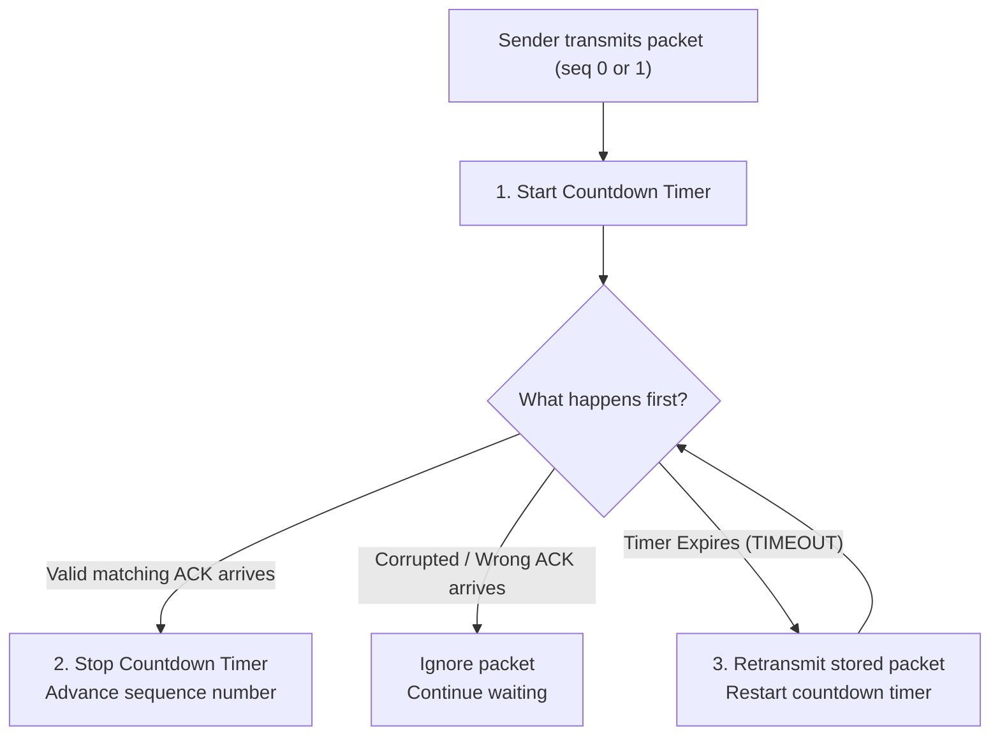
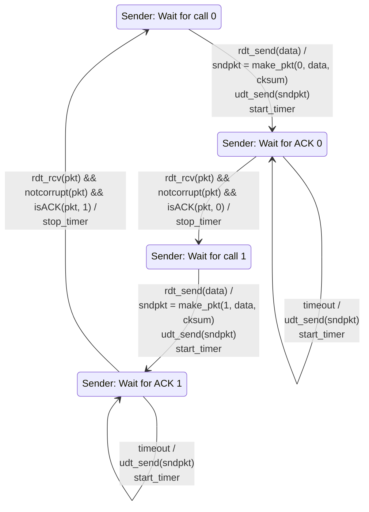
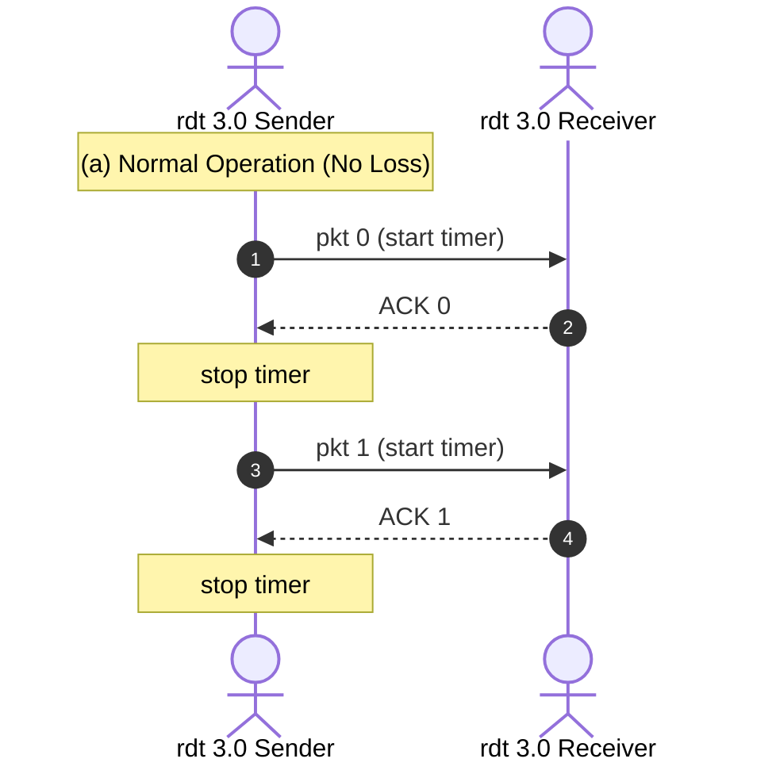
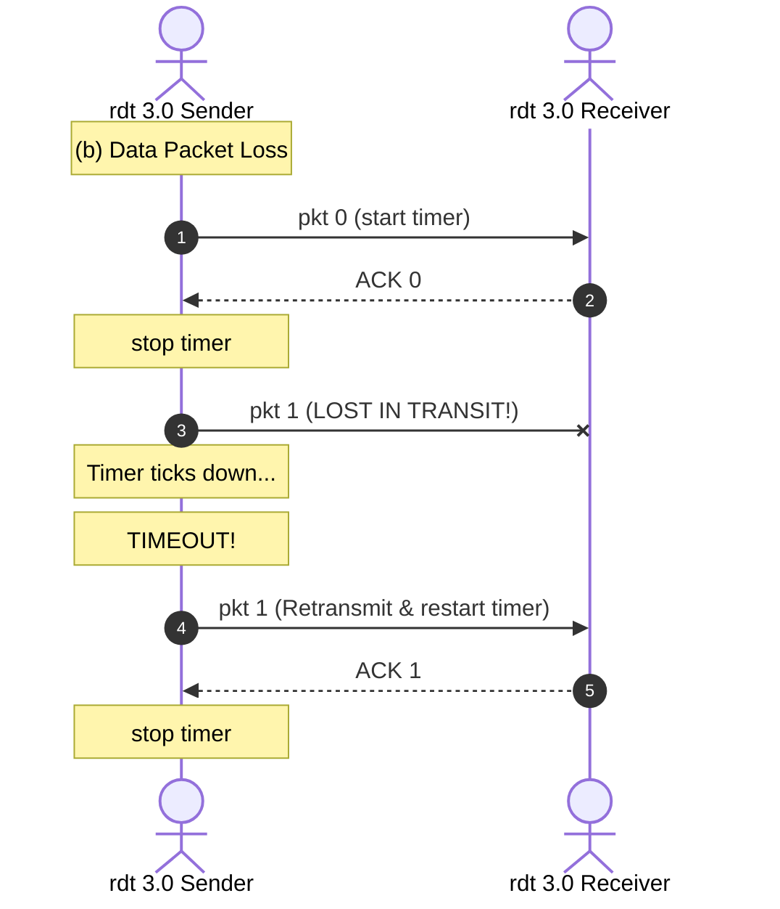
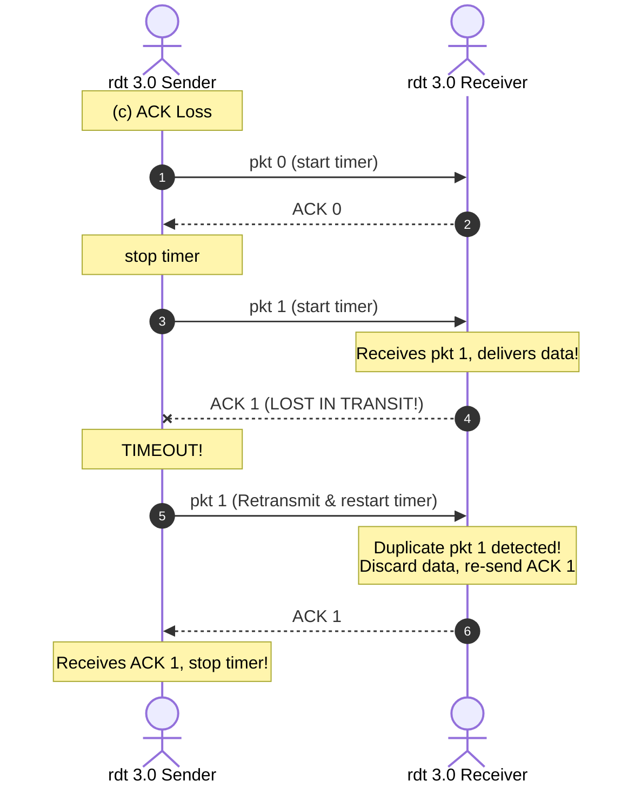
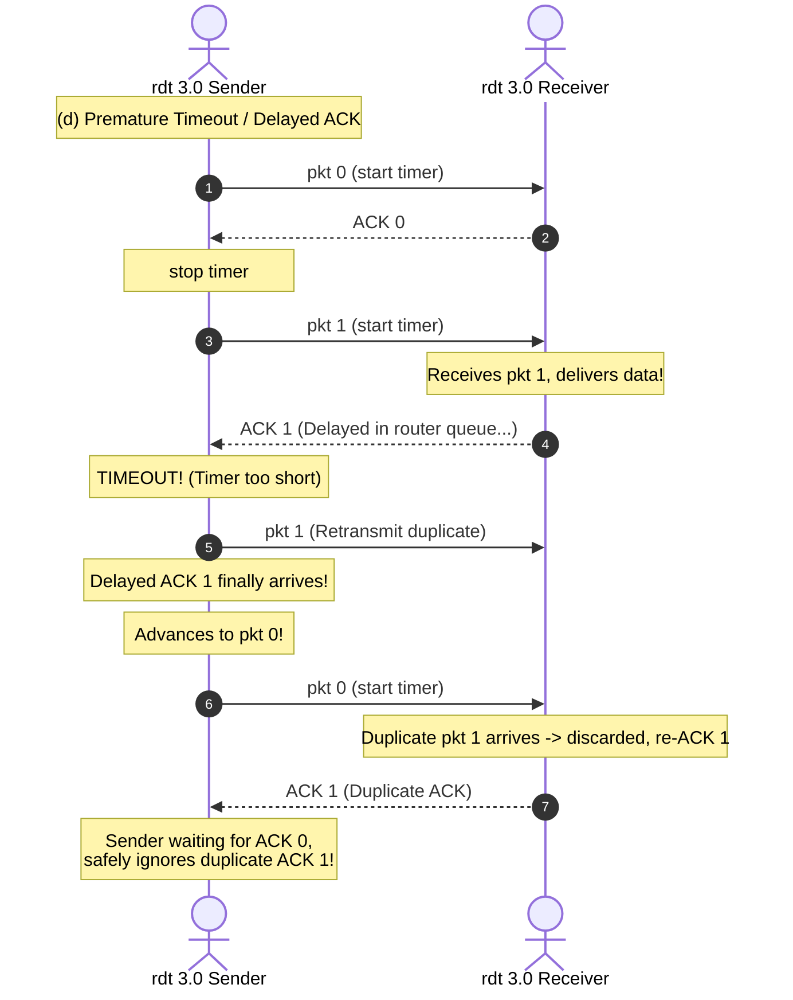
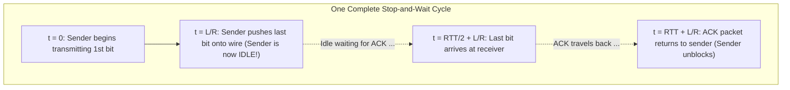
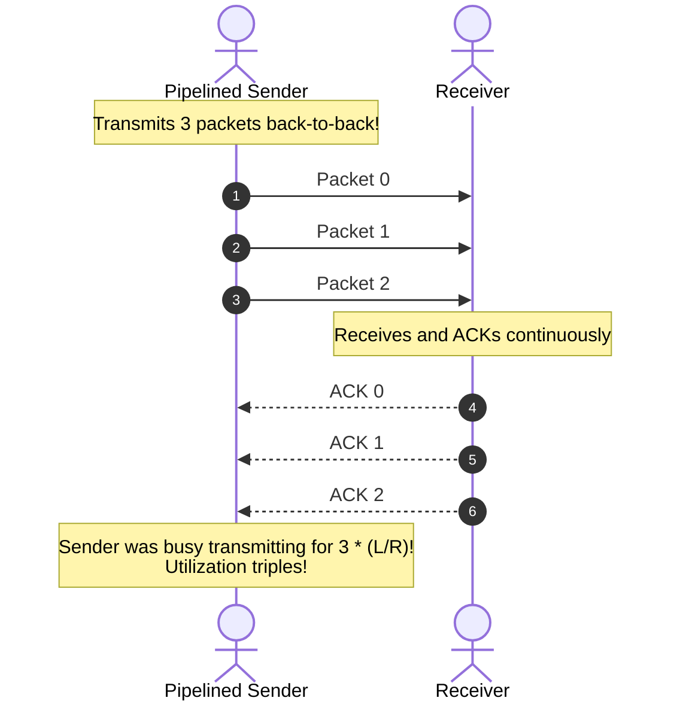
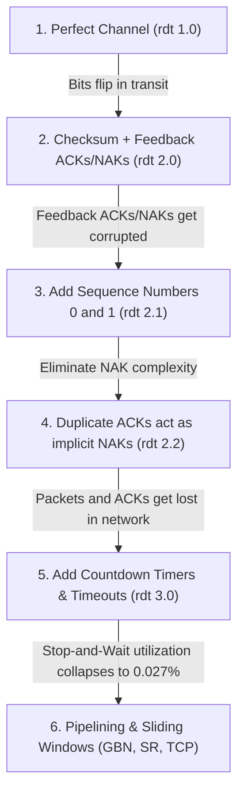

[CN Index](../README.md) / [Unit 2: Sockets & Transport](Introduction.md)

# Lecture 09: Principles of Reliable Data Transfer - rdt 3.0 and Pipelining

In `rdt 2.2`, we constructed a protocol that gracefully survives bit corruption and garbled acknowledgments. But that protocol rested upon a massive, unrealistic assumption: that every packet transmitted across the channel is guaranteed to reach the other side.

In the real Internet, intermediate router queues fill up with cross-traffic. When a queue buffer overflows, the router simply drops arriving packets on the floor. 

The packet does not arrive corrupted. **It does not arrive at all.**

The moment a packet is lost in transit, the protocol encounters a deafening problem: **Silence**.
- If a data packet disappears, the receiver never saw it, so the receiver sends no acknowledgment.
- If an ACK packet disappears, the sender never hears confirmation.

In either scenario, the sender in `rdt 2.2` sits frozen in its state machine forever, waiting for feedback that will never come. The entire communication deadlocks.

To conquer packet loss, we must add the final piece of the reliability puzzle: **time**.

---

## rdt 3.0: Adding Countdown Timers to Recover from Loss

How does a human handle silence when waiting for an expected letter or telephone call?
If you order a book online and expect it to arrive within 5 days, you do not wait 40 years in silence. You set a mental deadline. If the package does not arrive after 7 days, you declare it lost and request a replacement.

This is precisely how **rdt 3.0** operates.



### Protocol Mechanics
1. **The Countdown Timer**: Whenever the sender transmits a packet (whether an initial transmission or a retransmission), it starts a countdown timer.
2. **Timer Cancellation**: If an uncorrupted ACK with the matching sequence number arrives before the timer expires, the sender cancels the timer and transitions to the state for the next sequence number.
3. **Timeout Retransmission**: If the timer ticks down to zero without receiving the expected ACK (a **Timeout** event), the sender retransmits the exact same stored packet and restarts the countdown timer.

### What if a Packet Was Merely Delayed?
Suppose an ACK is not lost, but merely delayed in a congested router queue. The sender's timer expires prematurely, and the sender retransmits the packet. 

Now the receiver will receive a **duplicate data packet**.

Notice the elegance of the layered design: **We do not need to invent any new machinery to handle duplicate packets!** The 1-bit sequence numbers (`0` and `1`) that we introduced in `rdt 2.1` already detect and discard duplicate packets automatically. The receiver simply re-acknowledges the duplicate and drops the payload.

Because `rdt 3.0` uses alternating sequence numbers of 0 and 1, it is famously known as the **Alternating-Bit Protocol**.

---

## The Complete rdt 3.0 Sender FSM



*(Note: The receiver FSM in `rdt 3.0` is completely identical to the receiver in `rdt 2.2`. The receiver does not need a timer because the sender bears the full burden of initiating retransmissions).*

---

## Four Operational Scenarios of rdt 3.0

To see how `rdt 3.0` handles every possible channel anomaly, examine these four canonical timing traces:

````carousel

<!-- slide -->

<!-- slide -->

<!-- slide -->

````

---

## The Performance Catastrophe of Stop-and-Wait

Functionally, `rdt 3.0` is a complete success. It guarantees 100% reliable, in-order, error-free delivery over a channel that corrupts, delays, and drops packets.

Performance-wise, however, **Stop-and-Wait is an absolute disaster**.

To prove this mathematically, we calculate the **Sender Utilization ($U_{\text{sender}}$)**—the fraction of time the sender is actively placing useful data bits onto the link.

### Mathematical Formulation
Let:
- $L$ = Packet length in bits.
- $R$ = Transmission rate of the link (bandwidth) in bits per second.
- $d_{\text{trans}} = \frac{L}{R}$ = Time required to push the packet bits onto the wire.
- $d_{\text{prop}}$ = One-way physical propagation delay between sender and receiver.
- $\text{RTT} \approx 2 \times d_{\text{prop}}$ = Round-Trip Time.



The sender is busy transmitting bits only from $t = 0$ to $t = \frac{L}{R}$. 

Once the last bit leaves the network card, the sender is completely idle, frozen in place waiting for the packet to propagate across the country and the ACK to propagate back. The next packet cannot be transmitted until $t = \text{RTT} + \frac{L}{R}$.

Therefore, Sender Utilization is:

$$U_{\text{sender}} = \frac{\text{Time Busy Transmitting}}{\text{Total Elapsed Cycle Time}} = \frac{L/R}{\text{RTT} + L/R}$$

---

## A Real-World Numerical Calculation

Let's plug in the standard numbers from the university lecture deck:
- Link Bandwidth: $R = 1\text{ Gbps} = 10^9\text{ bits/second}$.
- Geographic Distance: Continental United States ($d_{\text{prop}} = 15\text{ ms} \implies \text{RTT} = 30\text{ ms} = 0.030\text{ seconds}$).
- Packet Size: $L = 1\text{ KB} = 8,000\text{ bits}$.

### Step 1: Calculate Packet Transmission Delay
$$d_{\text{trans}} = \frac{L}{R} = \frac{8,000\text{ bits}}{10^9\text{ bits/s}} = 8 \times 10^{-6}\text{ seconds} = 8\,\mu\text{s} = \mathbf{0.008\text{ ms}}$$

It takes the network interface card just **8 microseconds** to serialize the entire packet onto the fiber.

### Step 2: Calculate Total Cycle Time
$$t_{\text{cycle}} = \text{RTT} + \frac{L}{R} = 30\text{ ms} + 0.008\text{ ms} = \mathbf{30.008\text{ ms}}$$

### Step 3: Calculate Sender Utilization
$$U_{\text{sender}} = \frac{0.008\text{ ms}}{30.008\text{ ms}} \approx 0.0002666 \approx \mathbf{0.027\%}$$

### Step 4: Calculate Effective Throughput
$$\text{Effective Throughput} = U_{\text{sender}} \times R = 0.0002666 \times 1,000,000\text{ kbps} \approx \mathbf{267\text{ kbps}}$$

Look at that result:
An enterprise pays for an ultra-fast **1 Gbps** fiber connection capable of moving a billion bits per second. Yet because `rdt 3.0` stops and waits for an acknowledgment after every single packet, the effective throughput is a pathetic **267 kbps**!

The sender spends **99.973% of its life doing absolutely nothing**. Stop-and-Wait completely strangles high-speed network infrastructure.

---

## The Solution: Pipelining

The reason Stop-and-Wait performs so poorly is that the sender is restricted to having at most **one unacknowledged packet in flight**.

To break this bottleneck, we introduce **Pipelining**:
Instead of waiting for an ACK after each packet, the sender is permitted to transmit **multiple packets back-to-back** before pausing to wait for acknowledgments.



### Utilization Under Pipelining
If we allow a pipeline window of $W = 3$ packets, the sender transmits 3 packets consecutively during the initial transmission burst. The sender is now busy transmitting for $3 \times \frac{L}{R}$:

$$U_{\text{sender}} = \frac{W \times (L/R)}{\text{RTT} + L/R} = \frac{3 \times 0.008\text{ ms}}{30.008\text{ ms}} = \frac{0.024}{30.008} \approx \mathbf{0.080\%}$$

The utilization immediately **triples**!

To achieve $100\%$ line utilization ($U_{\text{sender}} \approx 1.0$), how large must the pipeline window $W$ be?

$$W \ge \frac{\text{RTT} + L/R}{L/R} = \frac{30.008\text{ ms}}{0.008\text{ ms}} \approx \mathbf{3,751\text{ packets}}$$

If the sender is allowed to keep 3,751 packets in flight simultaneously, the pipe is kept permanently full. As the first ACK returns from across the continent, the sender is just finishing packet 3,751, enabling it to transmit packet 3,752 without ever pausing!

---

## The Consequences of Pipelining

While pipelining solves the utilization crisis, it fundamentally shatters the simplicity of `rdt 3.0`:

1. **Expanding Sequence Numbers**:
   - In Stop-and-Wait, an alternating 1-bit sequence number (`0` and `1`) was sufficient.
   - In pipelining, with thousands of packets in flight simultaneously, each packet must carry a unique sequence number. Sequence numbers must be represented as multi-bit integers (e.g., 32 bits in TCP).
2. **Buffering at Endpoints**:
   - **Sender Buffering**: The sender must buffer all transmitted packets until they are positively acknowledged, because any packet in the flight window might be lost and require retransmission.
   - **Receiver Buffering**: If packets arrive out of order, the receiver must decide whether to buffer them or discard them.
3. **Two Classic Pipelined Protocol Families**:
   - **Go-Back-N (GBN)**: The sender allows up to $N$ unacknowledged packets in flight. The receiver accepts *only* strictly in-order packets, discarding any out-of-order arrivals. ACKs are **cumulative**. On timeout, the sender retransmits **all** unacknowledged packets starting from the oldest missing packet (going back $N$).
   - **Selective Repeat (SR)**: The receiver maintains a receive buffer and individually acknowledges every correctly received packet, even if out of order. The sender retransmits **only the specific individual packets** that timed out.

---

## The Grand Evolutionary Chain of Reliable Data Transfer

Before closing Unit 2, trace the entire evolutionary logic in a single breath:



Every mechanism in modern transport protocols exists because a specific physical channel failure forced it into existence.

---

## Key Takeaways

- Packet loss creates silence; neither sender nor receiver can progress without a mechanism to convert absence into an active event.
- `rdt 3.0` introduces **countdown timers**. If an ACK does not arrive before the timer expires, the sender assumes loss, retransmits, and resets the timer.
- Delayed ACKs produce duplicate data packets, which are seamlessly detected and rejected by `rdt 2.2`'s existing alternating sequence numbers (0 and 1).
- Stop-and-Wait sender utilization is governed by $U_{\text{sender}} = \frac{L/R}{\text{RTT} + L/R}$.
- On high-bandwidth, long-delay links (such as 1 Gbps across 30 ms RTT), Stop-and-Wait utilization collapses to a catastrophic **$0.027\%$**, delivering only 267 kbps of throughput.
- **Pipelining** allows multiple unacknowledged packets in flight, scaling utilization proportionally to window size $W$.
- Pipelining requires expanding sequence number ranges beyond 1 bit and introducing packet buffers at the sender and receiver, establishing the foundation for **Go-Back-N (GBN)**, **Selective Repeat (SR)**, and **TCP**.

---

With this lecture, we conclude Unit 2. We have traced network communication from the high-level distributed naming of DNS and the economics of BitTorrent, through the operating system's socket programming interface, all the way down to the mathematical foundations of reliable data transfer. In [Unit 3: Transport Congestion Control, the Network Data Plane, and IP](../Unit%203/Introduction.md), we will see how these exact reliability and pipelining principles are forged into the production engine of the global Internet: [TCP Congestion Control and Flow Control](../Unit%203/L01%20-%20TCP%20Congestion%20Control%20and%20Flow%20Control.md) and the Network Layer.
