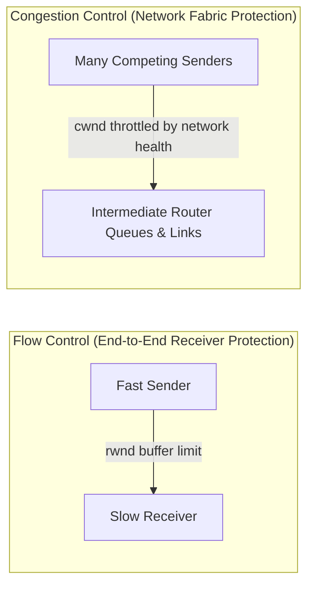
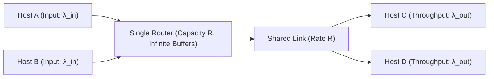
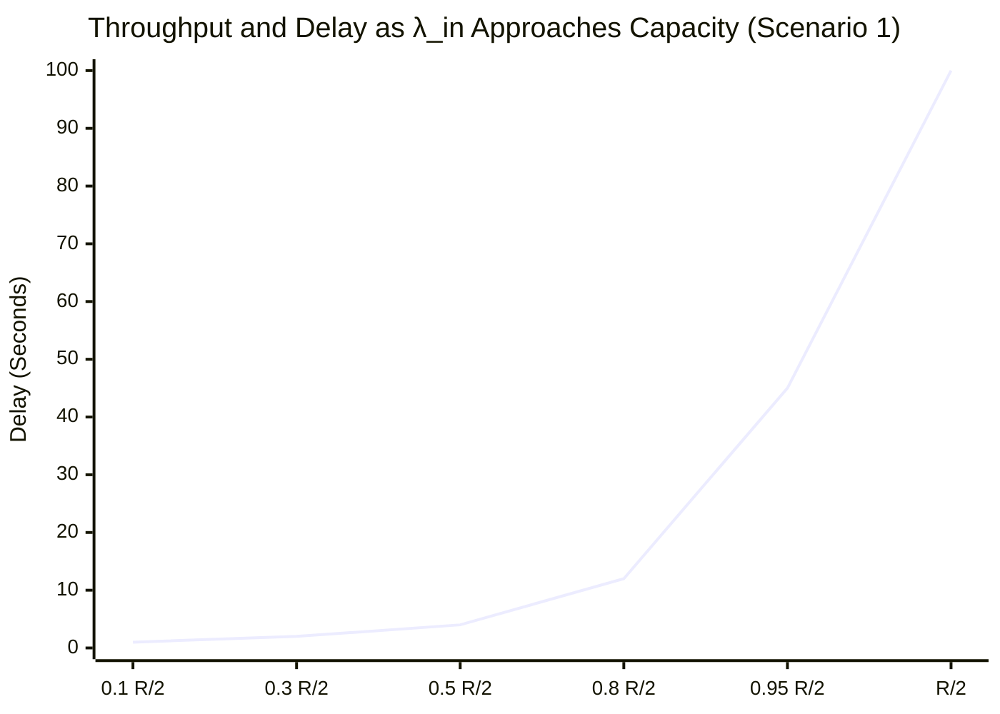
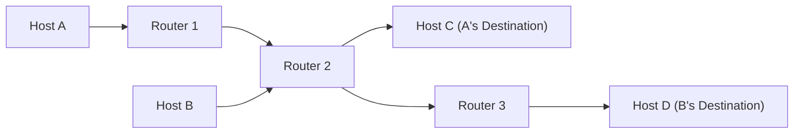
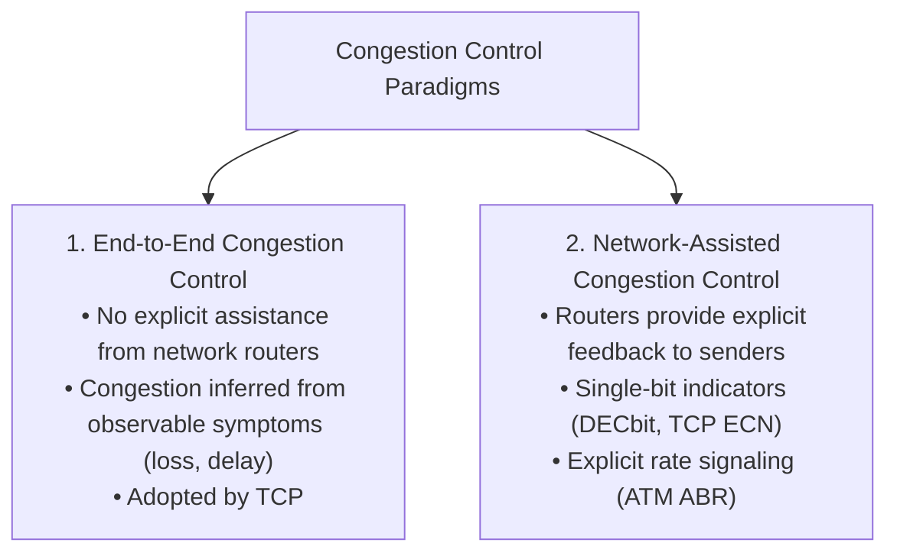
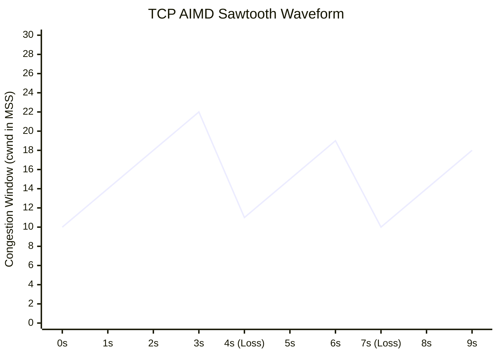
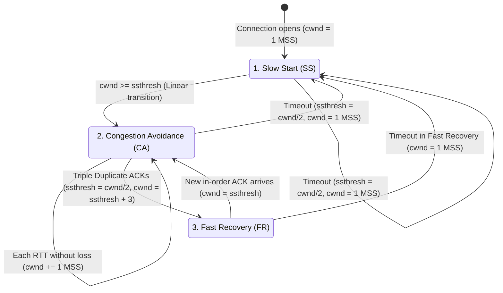
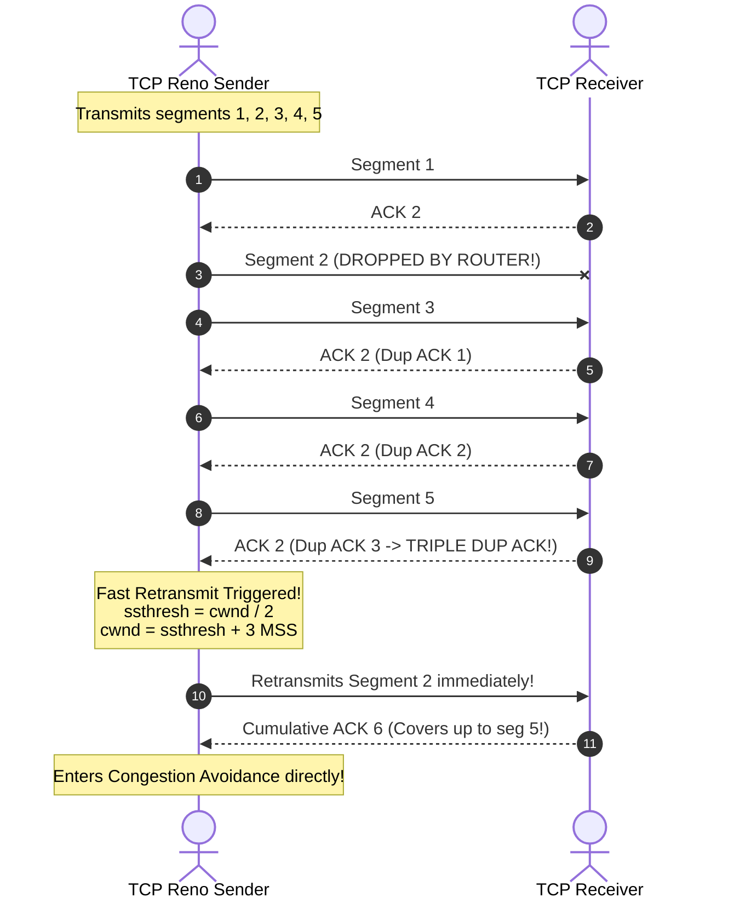

[CN Index](../README.md) / [Unit 3: Data Plane & IP](Introduction.md)

# Lecture 01: TCP Congestion Control and Flow Control

In our study of Reliable Data Transfer, we proved that pipelining is mathematically necessary to utilize high-speed links. If a sender does not keep multiple packets in flight, line utilization collapses to a fraction of a percent.

But the moment we allow senders to pump dozens of unacknowledged packets into the network, we unleash a massive systemic problem: **Network Congestion**.

Informally, congestion occurs when **too many sources send too much data too fast for the network to handle**. 

When congestion sets in, two symptoms manifest:
1. **Queuing Delays**: Router buffers fill with backlogged packets, causing packet delays to skyrocket.
2. **Buffer Overflow and Packet Loss**: When router buffers become completely full, arriving packets are simply dropped, forcing transport protocols to retransmit.

Before diving into the algorithms, we must address a crucial point of confusion: **Congestion Control is not Flow Control**.

- **Flow Control** is a speed-matching service between **one sender and one receiver**. Its sole job is to prevent a fast sender from overflowing the specific buffer of a slow receiving application. It is enforced via the `Receive Window (rwnd)` field in the TCP header.
- **Congestion Control** is a coordination service between **all senders and the entire intermediate network**. Its job is to prevent the collective aggregate traffic of millions of hosts from overwhelming the shared link bandwidth and buffer capacity of intermediate routers.

---

## The Causes and Costs of Congestion: Three Scenarios

To understand why uncontrolled sending destroys networks, Kurose and Ross formalize three classic scenarios of increasing realism.

### Scenario 1: Two Senders, One Router with Infinite Buffers
Suppose two hosts (A and B) transmit data through a single shared router with link capacity $R$. We assume the router has **infinite buffer space**, meaning packets are never dropped.

Let:
- $\lambda_{\text{in}}$ = Rate at which the application passes original data to transport (packets/sec).
- $\lambda_{\text{out}}$ = Rate at which the receiving application receives data.

Because the two senders share the link capacity $R$ equally, each sender's maximum achievable throughput is $\frac{R}{2}$.

Look at what happens as $\lambda_{\text{in}}$ approaches $\frac{R}{2}$:
- As the arrival rate nears link capacity, packets must wait behind increasingly massive queues.
- As $\lambda_{\text{in}} \to \frac{R}{2}$, the average queue length approaches infinity, and **packet delay approaches infinity**!

**Cost of Congestion 1**: Even with infinite memory where zero packets are lost, operating near capacity produces unbearable queuing delays.

---

### Scenario 2: Finite Buffers and Retransmissions
Now introduce reality: **router buffers are finite**. When the buffer fills, incoming packets are dropped.

Because packets are dropped, the transport layer must retransmit lost data. The transport layer's offered rate to the network, $\lambda'_{\text{in}}$, now includes both original data and retransmissions:

$$\lambda'_{\text{in}} \ge \lambda_{\text{in}}$$

We examine three cases of sender knowledge:
1. **Case A (Magic Knowledge)**: The sender magically knows exactly when buffer space is free and only sends when the router can store the packet. No packets are lost, no retransmissions occur ($\lambda'_{\text{in}} = \lambda_{\text{in}}$), and throughput reaches $\frac{R}{2}$. (Impossible in practice).
2. **Case B (Idealized Loss Recovery)**: The sender knows with certainty when a packet is dropped, and retransmits *only* when a packet is genuinely lost. 
   Now, to achieve an output throughput of $\lambda_{\text{out}} = \frac{R}{2}$, the sender must push $\lambda'_{\text{in}} > \frac{R}{2}$ into the link. 
   **Cost**: The link must carry retransmitted packets, consuming bandwidth that could have carried new data.
3. **Case C (Unneeded Retransmissions)**: In reality, senders rely on timers that may expire prematurely due to large queuing delays. The sender retransmits a packet that was not lost, but merely delayed. 
   Both the original packet and the duplicate packet are successfully forwarded across the link and delivered to the receiver (which discards the duplicate).
   **Cost**: The sender wastes link transmission capacity pushing redundant duplicates that provide zero application value, causing achievable application throughput to plummet far below $\frac{R}{2}$.

---

### Scenario 3: Four Senders, Multi-Hop Paths, and Congestion Collapse
In the real Internet, traffic traverses multiple router hops, competing with cross-traffic at every stage.

Suppose Host A sends traffic across Router 1 to Router 2 destined for Host C. Simultaneously, Host B sends heavy traffic into Router 2 destined for Host D.

Now watch what happens when Host B increases its transmission rate $\lambda'_{\text{in}}$:
1. Router 2's buffer overflows with packets from Host B.
2. Arriving packets from Host A at Router 2 are dropped.
3. Host A times out and retransmits, but Router 2 continues dropping them.
4. Host A's end-to-end throughput drops to **zero**!

Now notice the catastrophic waste:
Every packet from Host A that gets dropped at Router 2 had already traversed Router 1! 
Router 1 spent transmission capacity, CPU processing, and buffer space moving Host A's packets, only for those packets to be thrown in the trash at the next hop.

**Cost of Congestion 3**: When a packet is dropped downstream, **all upstream transmission capacity and buffer resources expended on that packet along previous hops are completely wasted**. Under high load, this causes **Congestion Collapse**, where the network operates at 100% link utilization while delivering near-zero useful throughput.

---

## Approaches to Congestion Control

The networking world handles congestion via two primary paradigms:

1. **End-to-End Congestion Control**:
   - Intermediate routers remain simple and passive; they do not send warning messages to hosts.
   - The transport layer at the endpoints infers congestion solely by observing end-to-end symptoms: **packet loss (timeouts, duplicate ACKs)** and **increasing RTT delay**.
   - This aligns with the Internet's end-to-end philosophy and is the mechanism used by standard TCP.
2. **Network-Assisted Congestion Control**:
   - Routers actively monitor their own queue levels. When a queue crosses a congestion threshold, the router marks bits in passing packet headers.
   - **Explicit Congestion Notification (ECN, RFC 3168)**: Routers mark two bits in the IPv4/IPv6 header (`ECT` and `CE` bits). When the receiver gets a marked packet, it echoes an `ECE` (ECN-Echo) flag in its TCP ACK, notifying the sender to throttle back *before* packet loss occurs.

---

## TCP Congestion Control Mechanics: The Congestion Window (`cwnd`)

TCP limits its transmission rate by maintaining a dynamic state variable: the **Congestion Window (`cwnd`)**.

At any instant, the amount of unacknowledged data the TCP sender is allowed to have in flight is bounded by the minimum of the receiver's flow-control window and the congestion window:

$$\text{LastByteSent} - \text{LastByteAcked} \le \min(\text{cwnd}, \; \text{rwnd})$$

Assuming the receiver has abundant buffer space ($\text{rwnd} \gg \text{cwnd}$), the sender's transmission rate is governed purely by `cwnd`.

Because the sender injects `cwnd` bytes into the network and then waits approximately one Round-Trip Time (RTT) for ACKs to return, the effective transmission rate is:

$$\text{Sending Rate} \approx \frac{\text{cwnd}}{\text{RTT}} \quad \text{bytes/second}$$

By adjusting `cwnd`, TCP directly controls its transmission rate.

---

## Bandwidth Probing and AIMD: The Sawtooth Rhythm

How does a TCP sender determine the correct value of `cwnd` when network conditions change constantly?

TCP uses **bandwidth probing**: it increases its rate until packet loss occurs, treats that loss as an implicit signal of network congestion, slashes its rate, and begins probing upward again.

This strategy is known as **Additive Increase, Multiplicative Decrease (AIMD)**:
- **Additive Increase**: The sender increases `cwnd` by **1 Maximum Segment Size (MSS)** for every RTT in which no loss occurs (ramping up linearly to discover spare bandwidth).
- **Multiplicative Decrease**: The moment a loss event occurs, the sender cuts its `cwnd` in half (drastically backing off to relieve router queues).

AIMD generates the iconic **sawtooth pattern** of TCP traffic. Mathematically, AIMD has been proven to drive competing network flows toward both **optimal efficiency** and **fair bandwidth sharing**.

---

## The Three Phases of TCP Congestion Control

The complete TCP congestion control algorithm (formalized in RFC 5681) comprises three major operational phases:

### 1. Slow Start
When a TCP connection begins, `cwnd` is initialized to a very small value, typically **1 MSS** (e.g., 1460 bytes). 

If the sender used additive increase from the beginning, climbing from 1 MSS to a 100 Mbps pipe would take minutes. To avoid this, **Slow Start is not slow at all—it grows exponentially!**

- For every ACK received, the sender increments `cwnd` by 1 MSS:
  $$\text{cwnd} \leftarrow \text{cwnd} + \text{MSS}$$
- Because every sent segment generates an ACK, transmitting 1 segment returns 1 ACK ($\text{cwnd} = 2$). Transmitting 2 segments returns 2 ACKs ($\text{cwnd} = 4$). Transmitting 4 segments returns 4 ACKs ($\text{cwnd} = 8$).
- **The congestion window doubles every RTT ($2^n$)**:
  $$1 \to 2 \to 4 \to 8 \to 16 \to 32 \dots$$

When does Slow Start stop?
Slow Start maintains a threshold variable called **`ssthresh` (Slow Start Threshold)**.
The instant `cwnd >= ssthresh`, exponential growth stops, and TCP transitions to Congestion Avoidance.

---

### 2. Congestion Avoidance
Once `cwnd` crosses `ssthresh`, the connection is operating near estimated capacity. Exponential growth would cause immediate massive buffer overflow.

In Congestion Avoidance, TCP switches to linear probing:
- It increases `cwnd` by only **1 MSS per RTT**, regardless of how many ACKs arrive.
- In implementation, each arriving ACK increments `cwnd` by a fraction:
  $$\text{cwnd} \leftarrow \text{cwnd} + \text{MSS} \times \left(\frac{\text{MSS}}{\text{cwnd}}\right)$$
- If `cwnd` is currently 10 MSS, 10 ACKs arrive during the RTT. Each adds $\frac{1}{10}\text{ MSS}$, resulting in a total increase of exactly $10 \times \frac{1}{10} = 1\text{ MSS}$ over the round trip.

---

### 3. Detecting and Reacting to Loss: Tahoe versus Reno

How TCP reacts to loss depends entirely on **how the loss was detected**.

There are two completely different loss indicators in TCP:

1. **Timeout**:
   - The sender's retransmission timer expires without receiving an ACK.
   - This represents **severe congestion**: the network is so choked that packets cannot even get through to generate feedback.
   - **Reaction**: 
     - Set $\text{ssthresh} \leftarrow \frac{\text{cwnd}}{2}$.
     - Collapse $\text{cwnd} \leftarrow 1\text{ MSS}$.
     - Restart from scratch in **Slow Start**!
2. **Triple Duplicate ACKs (Fast Retransmit)**:
   - The sender receives 3 duplicate ACKs (4 identical ACKs in total) for a single packet.
   - Why did duplicate ACKs arrive? Because the receiver got packets *after* the missing one!
   - This represents **mild congestion**: one packet was dropped, but subsequent packets are still successfully reaching the destination. The network is still moving data!

This distinction gave birth to the evolution from **TCP Tahoe** to **TCP Reno**:

| Feature | TCP Tahoe (Legacy) | TCP Reno (Modern Standard) |
| :--- | :--- | :--- |
| **Reaction to Timeout** | `ssthresh = cwnd / 2` `cwnd = 1 MSS` Enters Slow Start | `ssthresh = cwnd / 2` `cwnd = 1 MSS` Enters Slow Start |
| **Reaction to 3 Duplicate ACKs** | `ssthresh = cwnd / 2` `cwnd = 1 MSS` Collapses back to Slow Start! | **Fast Retransmit & Fast Recovery**! `ssthresh = cwnd / 2` `cwnd = ssthresh + 3 MSS` Never drops to 1 MSS! |
| **Recovery Dynamic** | Stalls transmission, ramps up exponentially from 1. | Immediately retransmits missing packet, stays in Congestion Avoidance. |

---

## Key Takeaways

- Congestion occurs when aggregate sender demand exceeds intermediate router capacity, manifesting as severe queueing delays and buffer overflow drops.
- Flow control protects the receiver buffer (`rwnd`); congestion control protects the network core (`cwnd`).
- Downstream packet drops waste all upstream transmission bandwidth and router resources previously expended on those packets, leading to congestion collapse.
- TCP relies on **end-to-end congestion control**, inferring network state from timeouts and duplicate ACKs without explicit router assistance.
- TCP enforces **Additive Increase, Multiplicative Decrease (AIMD)**, producing a characteristic sawtooth throughput curve.
- **Slow Start** doubles `cwnd` every RTT until `cwnd >= ssthresh`.
- **Congestion Avoidance** increases `cwnd` linearly by 1 MSS per RTT.
- A **Timeout** signals severe blockage: both Tahoe and Reno collapse `cwnd` to 1 MSS and restart Slow Start.
- **Triple Duplicate ACKs** signal isolated loss: **TCP Reno** executes **Fast Retransmit** and enters **Fast Recovery**, setting `cwnd = ssthresh` and continuing linear Congestion Avoidance without resetting to 1 MSS.

---

With TCP Congestion Control, our study of Layer 4 is complete. We now understand how end systems manage reliable delivery and rate throttling. But how do packets actually traverse the physical wilderness of intermediate routers, subnets, and switching fabrics to reach the destination host? To answer that, we cross into [Layer 3: Network Layer Overview — Data Plane vs Control Plane](L02%20-%20Network%20Layer%20Overview%20-%20Data%20Plane%20vs%20Control%20Plane.md).
