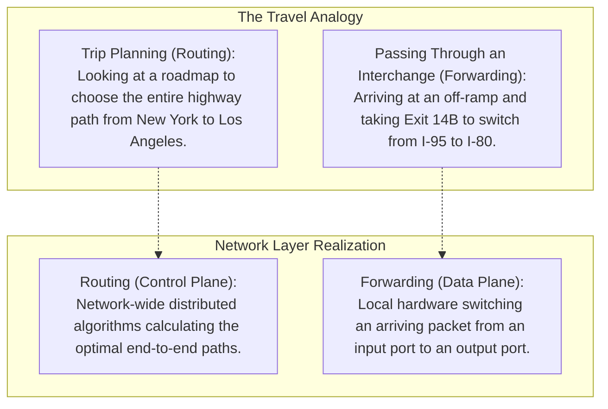
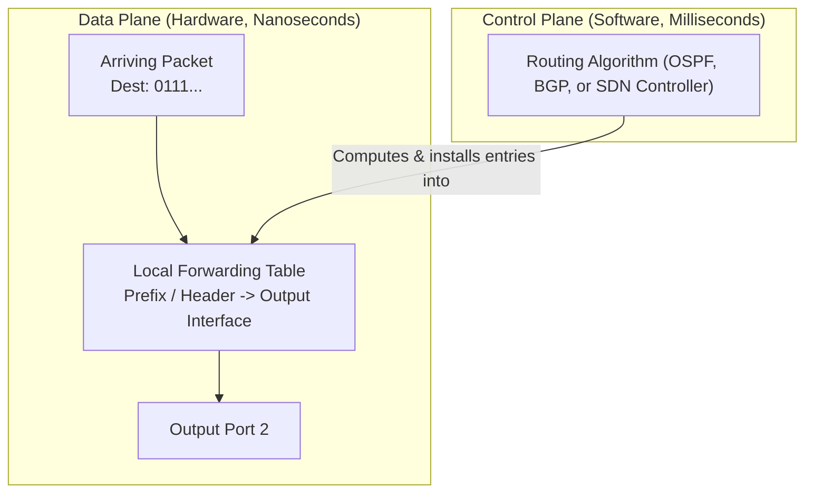
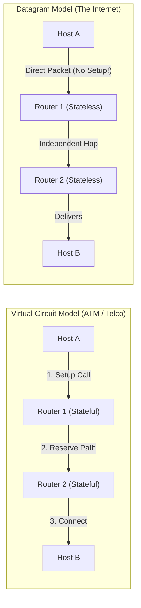

[CN Index](../README.md) / [Unit 3: Data Plane & IP](Introduction.md)

# Lecture 02: Network Layer Overview - Data Plane vs Control Plane

In the transport layer, two software processes communicated logically as if they were directly connected by a pipe. 

Now we pull back the curtain on the physical reality: that logical pipe is an illusion maintained across dozens of intermediate computing nodes called **Routers**.

This brings us to **Layer 3: The Network Layer**.

The network layer is the only layer in the entire Internet protocol stack (aside from physical framing) that must be implemented on **every single active device in the Internet**—not just on end systems (laptops, phones, servers), but on every intermediate router, switch, and gateway across the global topology.

Its primary responsibility is deceptively simple: **transporting packets from a sending host to a receiving host across an arbitrary mesh of links**.

---

## Two Core Network-Layer Functions: Forwarding versus Routing

To understand how the network layer operates, we must separate its responsibilities into two distinct operations:

### 1. Forwarding (The Data Plane)
- **Local Scope**: Forwarding refers to the router's local, physical action of transferring a packet from an incoming link interface (input port) to the appropriate outgoing link interface (output port).
- **Timescale**: Operates at **nanosecond** speeds. Because millions of packets cross a router every second, forwarding decisions cannot wait for software loops or operating system context switches; they are executed entirely in **specialized hardware** (ASICs).

### 2. Routing (The Control Plane)
- **Network-Wide Scope**: Routing refers to the global, coordinated process that determines the end-to-end path taken by packets as they journey from source to destination across multiple networks.
- **Timescale**: Operates at **millisecond to second** speeds. It is executed in **software** on general-purpose CPUs (the Routing Processor), calculating network graphs using routing protocols like OSPF, IS-IS, and BGP.

---

## The Interplay: How the Control Plane Drives the Data Plane

How do routing and forwarding work together inside a single router?

Every router maintains a critical internal lookup structure: the **Forwarding Table** (also called the Forwarding Information Base, or FIB).

1. **Path Calculation (Control Plane)**: The routing algorithm exchanges topology information with neighboring routers, solves shortest-path graphs, and determines: *"Packets destined for network prefix `0111...` should leave through link interface 2."*
2. **Table Installation**: The routing processor writes this mapping directly into the local forwarding table in hardware memory.
3. **Execution (Data Plane)**: A packet arrives at an input port. The hardware inspects the destination address in the packet header, performs an instantaneous table lookup, and pushes the packet across the internal switching fabric to Output Port 2.

The data plane does not think; it merely executes the instructions programmed into it by the control plane.

---

## Connection versus Connectionless Network Service

In Unit 2, we saw that transport protocols can be connection-oriented (TCP) or connectionless (UDP). 

Does the network layer also provide connection services?

Historically, networking saw a titanic philosophical clash between two fundamentally opposing architectural visions:
1. **Virtual Circuit (VC) Networks (e.g., ATM, Frame Relay, X.25)**:
   - Emulated the traditional telephone network.
   - Required a formal **connection setup phase** before a single data packet could flow.
   - Intermediate routers maintained active connection state (VC tables, reserved bandwidth, reserved buffers) for every ongoing call.
   - Packets carried a short Virtual Circuit Identifier (VCI) rather than a global destination address.
2. **Datagram Networks (The Internet Protocol - IP)**:
   - Built on the "dumb network, smart edge" philosophy.
   - **Zero connection setup at Layer 3**. A host simply stamps a destination IP address onto a packet and fires it into the network.
   - Intermediate routers maintain **zero per-flow state**! Routers forward packets independently based solely on destination address.
   - Two consecutive packets from the same TCP flow may take completely different physical paths through the network if routing tables update mid-session.

Notice the crucial distinction:
TCP connection setup is purely an **end-to-end agreement between two software processes on two end hosts**. The intermediate IP routers between them have no idea that a TCP connection exists!

---

## Network Layer Service Models: Why "Best Effort" Won

When architects design a network layer, what quality-of-service (QoS) guarantees should the underlying channel make?

| Architecture | Service Model | Bandwidth Guarantee? | Loss Guarantee? | Ordering Guarantee? | Timing / Delay Bound? | Congestion Feedback? |
| :--- | :--- | :---: | :---: | :---: | :---: | :---: |
| **Internet (IP)** | **Best Effort** | **None** | **No** | **No** | **No** | None (inferred at edge) |
| **ATM** | CBR (Constant Bit Rate) | Constant Rate | Yes (Zero loss) | Yes | Yes (Strict delay) | Not needed |
| **ATM** | ABR (Available Bit Rate) | Guaranteed Minimum | No | Yes | No | Congestion feedback |
| **Internet (Intserv)** | Guaranteed (RFC 1633) | Strict bound | Yes | Yes | Yes | Reservation via RSVP |
| **Internet (Diffserv)** | Differentiated (RFC 2475) | Class-based | Statistical | Statistical | Statistical | Packet priority bits |

### The Genius of the "Best-Effort" Model
On paper, ATM's Constant Bit Rate service appears vastly superior: it promises zero packet loss, guaranteed bandwidth, and deterministic delay.

Yet ATM collapsed, while the Internet's "primitive" Best-Effort model conquered the globe. Why?

1. **Hardware Simplicity and Cost**: Building a router that guarantees microsecond timing and zero loss requires complex per-flow queueing hardware, admission control, and expensive memory. Best-effort routers only need simple FIFO queues and destination lookup tables, allowing hardware to be manufactured cheaply and scale to terabit line rates.
2. **Heterogeneous Interconnection**: The Internet was designed to stitch together completely different physical networks: copper cables, fiber, satellite links, and cellular networks. Many of these links (especially wireless) are physically incapable of guaranteeing zero loss or fixed latency. A service model that demands strict guarantees cannot span diverse media.
3. **Edge Intelligence**: By pushing error recovery, ordering, flow control, and rate adaptation to the transport layer (TCP) on the end systems, the core network remains fast, resilient, and simple.

---

## Key Takeaways

- The network layer transports packets from sending host to receiving host across a multi-hop mesh; it is implemented on every host and router.
- **Forwarding** is the local, per-router action of moving a packet from an input port to an output port; it runs in **hardware at nanosecond speeds (Data Plane)**.
- **Routing** is the global, network-wide process that calculates the end-to-end paths; it runs in **software at millisecond speeds (Control Plane)**.
- The control plane computes forwarding tables and installs them into the data plane hardware.
- The Internet operates as a **Datagram Network**: no connection setup occurs at Layer 3, and intermediate routers maintain zero per-flow state.
- The Internet enforces a **Best-Effort Service Model**—offering no guarantees on throughput, loss, packet order, or latency.
- Best-effort succeeded because minimal core complexity enabled radical scalability, low hardware costs, and seamless operation over diverse physical media.

---

Now that we understand the conceptual separation between routing and forwarding, we must open the chassis of an actual router: how does an arriving electrical or optical signal get processed, looked up, and transferred to an output port at hardware wire speed? To find out, we explore [Router Architecture and Input Output Ports](L03%20-%20Router%20Architecture%20and%20Input%20Output%20Ports.md).
