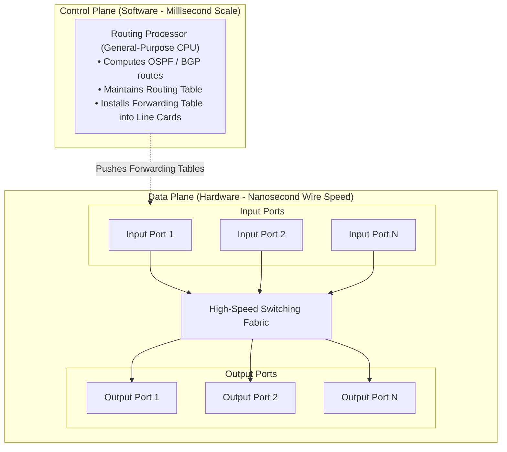
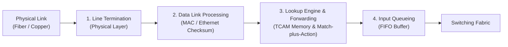
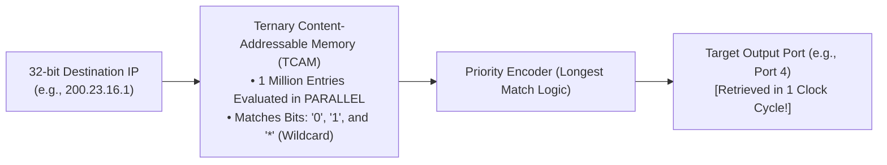

[CN Index](../README.md) / [Unit 3: Data Plane & IP](Introduction.md)

# Lecture 03: Router Architecture and Input Output Ports

When we say a router "forwards a packet," we are describing an extraordinary engineering feat.

Consider a modern core router in an Internet Exchange Point:
It has dozens of optical fiber line cards, each operating at 100 Gigabits per second. A minimum-sized 64-byte IP packet takes just **5.12 nanoseconds** to arrive. 

Within those five nanoseconds, the router must:
1. Receive the photons and convert them into bits.
2. Verify the Ethernet frame checksum and strip the link-layer header.
3. Decrement the IPv4 Time-to-Live (TTL) field and recompute the IP header checksum.
4. Search a forwarding table containing over **900,000 global routing prefixes** to find the correct outgoing interface.
5. Transfer the packet across its internal chassis to the appropriate output line card without colliding with packets arriving on other ports.

If a router relied on a traditional operating system with interrupts, kernel context switches, and CPU bus transfers, it would choke after a few thousand packets.

To survive line rates, modern routers are built as **massively parallel, distributed hardware systems**.

---

## High-Level Router Architecture

A modern router is split into four primary structural components:

1. **Routing Processor**: A general-purpose CPU running a specialized router operating system (such as Cisco IOS or Juniper Junos). It executes routing protocols (OSPF, BGP, IS-IS), manages routing tables, responds to network management requests, and compiles the forwarding table.
2. **Input Ports**: Physical line cards where incoming links terminate, frames are decapsulated, and forwarding lookups are executed.
3. **Switching Fabric**: The internal high-speed network that physically connects the input ports to the output ports inside the router chassis.
4. **Output Ports**: Line cards that buffer outgoing packets, schedule their transmission order, encapsulate them into link-layer frames, and drive electrical or optical signals onto outgoing links.

---

## Input Port Anatomy and Processing Pipeline

An input port is not merely a passive socket in the back of a machine. Each input port is an independent, self-contained computer called a **Line Card**, equipped with its own processor and dedicated high-speed memory.

The packet traverses a strict 4-stage pipeline inside the input port:

### 1. Physical Layer: Line Termination
The physical port receives analog voltages or optical pulses from the incoming transmission media and converts them into a raw stream of digital bits.

### 2. Data Link Layer Processing
The line card decapsulates the link-layer frame (e.g., Ethernet, POS). It checks the frame's Cyclic Redundancy Check (CRC) to ensure no physical bit errors occurred on the wire. If valid, it strips the link header and passes the encapsulated IP datagram to the lookup engine.

### 3. Decentralized Lookup and Forwarding
Here lies the core architectural breakthrough of modern routers: **Decentralized Switching**.

In early routers, every incoming packet had to be copied across the internal system bus to the central Routing Processor to ask: *"Where should this packet go?"* The central CPU instantly became a fatal bottleneck.

In modern routers, the central Routing Processor computes the global forwarding table and **pushes a shadow copy into local memory on every single input line card**. 

When a packet arrives at Input Port 3, Input Port 3 looks up the destination address in its **own local memory**, determines the target output port, and sends the packet directly into the switching fabric—**completely without involving the central CPU!**

### 4. Input Queueing
If packets arrive faster than the switching fabric can transfer them, packets are buffered in an input queue on the line card.

---

## Longest Prefix Matching (LPM)

How does the lookup engine actually determine which output port an arriving packet should take?

An IPv4 address is 32 bits long, meaning there are over $4.29 \times 10^9$ possible host addresses. A router cannot store a separate table entry for every single IP on Earth; a lookup table with 4 billion rows would require gigabytes of memory and take hundreds of cycles to search.

Instead, the Internet organizes addresses into contiguous blocks using **network prefixes** (e.g., `128.119.0.0/16`).

When a packet arrives with destination IP `128.119.40.12`, the router searches its forwarding table for the matching prefix. But here is the catch: **an IP address may match multiple table entries simultaneously!**

When multiple table entries match, the router enforces the universal rule of **Longest Prefix Matching (LPM)**:

> **The Longest Prefix Matching Rule**: When looking for a forwarding table entry for a given destination address, the router must choose the entry that has the **longest (most specific) matching address prefix**.

### A Concrete Binary Walkthrough

Consider a router with the following 4-entry forwarding table:

| Prefix Pattern (Binary) | Prefix Length | Outgoing Interface |
| :--- | :---: | :---: |
| `11001000 00010111 00010*** ********` | /21 | **Interface 0** |
| `11001000 00010111 00011000 ********` | /24 | **Interface 1** |
| `11001000 00010111 00011*** ********` | /21 | **Interface 2** |
| `otherwise` (Default Route: `0.0.0.0/0`) | /0 | **Interface 3** |

*(Note: Asterisks `*` represent wildcard / "don't care" bits).*

Now evaluate two arriving destination addresses:

#### Example 1: Packet Destined for `11001000 00010111 00010110 10100001`
Let's compare this address against the table:
- Look at the first 21 bits: `11001000 00010111 00010...`
- Does it match Prefix 1? **YES**.
- Does it match Prefix 2 or 3? No, because bit 19 is `0`, whereas Prefix 2 and 3 require bit 19 to be `1`.
- **Decision**: Routed to **Interface 0**.

#### Example 2: Packet Destined for `11001000 00010111 00011000 10101010`
Now compare this address:
- Compare against Prefix 3 (/21): First 21 bits are `11001000 00010111 00011...` $\implies$ **MATCH!**
- Compare against Prefix 2 (/24): First 24 bits are `11001000 00010111 00011000...` $\implies$ **MATCH!**

Notice what happened: **Both Prefix 2 and Prefix 3 match the destination address!**

Which interface does the router pick?
Prefix 3 matches 21 bits. Prefix 2 matches **24 bits**. 
Because 24 is longer than 21, **Prefix 2 wins**. 
- **Decision**: Routed to **Interface 1**.

Why does this matter?
Prefix 3 might represent an entire university campus network (`/21`), while Prefix 2 represents a specific high-priority data center located inside that campus (`/24`) that has its own dedicated link. Longest prefix matching allows specific route overrides without breaking broad network aggregations.

---

## Hardware Acceleration: Ternary Content-Addressable Memory (TCAM)

If a router must evaluate longest prefix matching across 900,000 entries within 5 nanoseconds, how is this implemented in silicon?

Traditional DRAM or SRAM memory is **address-based**: you give the memory an address (e.g., index `0x400`), and it returns the data stored at that address. Searching a table of 900,000 entries in DRAM using binary tries requires 20 to 30 sequential memory lookups, taking hundreds of nanoseconds.

To achieve wire speed, modern core routers use **Ternary Content-Addressable Memory (TCAM)**.

In a TCAM:
1. Memory is **content-based**: instead of providing an address to get data, you provide the data (the destination IP), and the TCAM returns the matching memory address!
2. It is **ternary** because each bit can be in one of three states: `0`, `1`, or `*` (wildcard/don't care). This allows CIDR subnet masks to be encoded directly into hardware cells.
3. When an IP address is presented to the TCAM, **all 1,000,000 entries are compared simultaneously in parallel in a single clock cycle**!
4. The TCAM outputs the matching port in under **2 nanoseconds**.

TCAMs are expensive, power-hungry, and generate significant heat, but they are the undisputed hardware foundation that keeps the modern Internet moving at 400 Gbps line rates.

---

## Key Takeaways

- A router consists of four primary blocks: the **Routing Processor** (control plane), the **Switching Fabric**, **Input Ports**, and **Output Ports** (data plane).
- Modern routers achieve line-rate forwarding via **decentralized switching**: each input line card maintains a local shadow copy of the forwarding table, making routing decisions without consulting the central CPU.
- Routing tables store address prefixes rather than individual host IPs to bound table sizes.
- When an IP matches multiple table entries, the router enforces **Longest Prefix Matching (LPM)**, selecting the most specific (longest) prefix.
- LPM is accelerated in hardware using **Ternary Content-Addressable Memory (TCAM)**, which evaluates up to a million prefix rules in parallel in a single clock cycle.

---

Now that an input port has extracted an IP packet and determined its destination output port via TCAM lookup, how does the packet physically travel across the chassis from Input Port 1 to Output Port 4? What prevents internal collisions when four input ports all want to reach Output Port 4 at the same time? To see how the internal core scales, we examine [Switching Fabrics and Queuing](L04%20-%20Switching%20Fabrics%20and%20Queuing.md).
