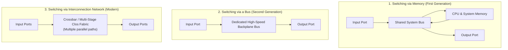
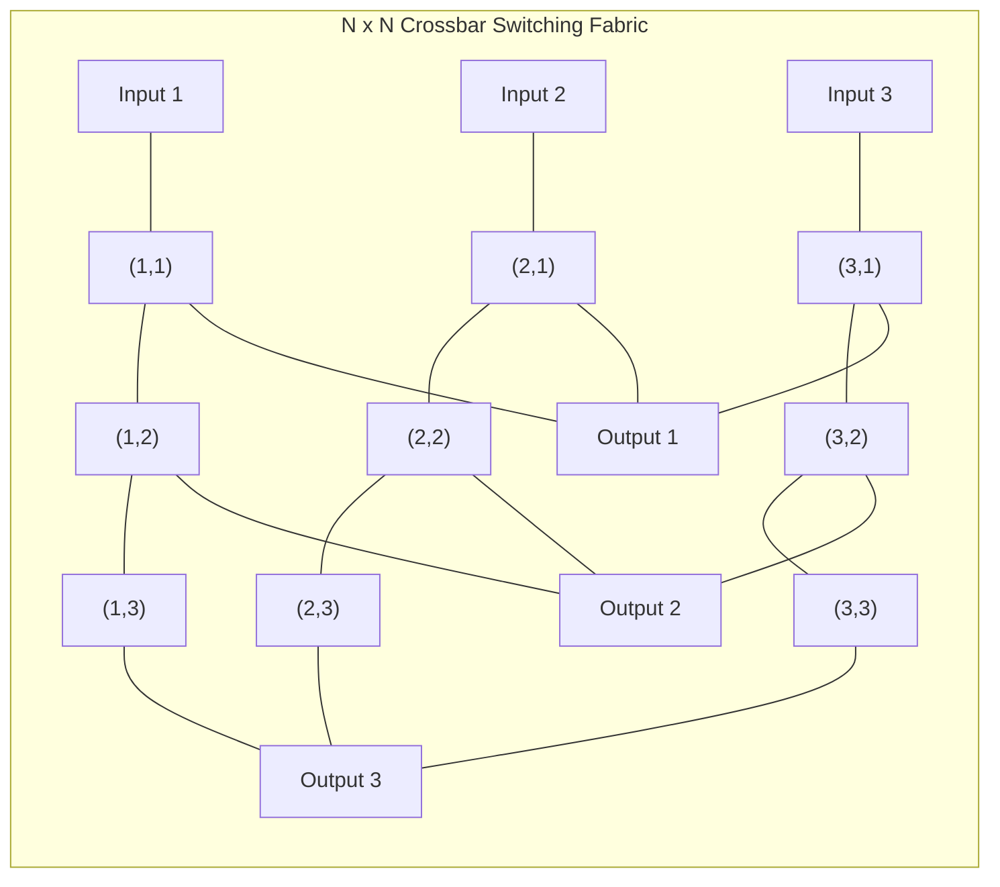
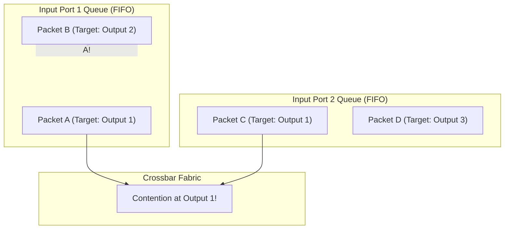
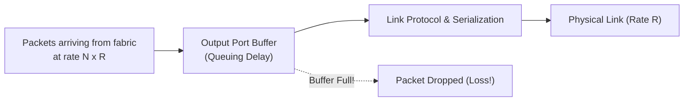
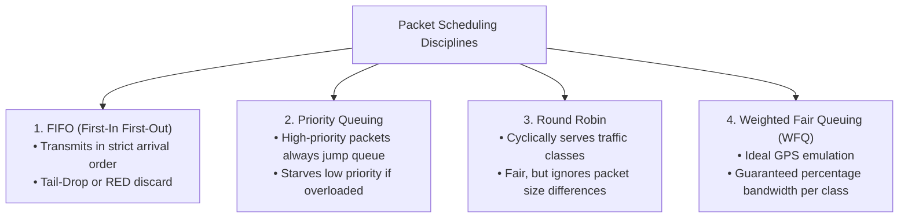

[CN Index](../README.md) / [Unit 3: Data Plane & IP](Introduction.md)

# Lecture 04: Switching Fabrics and Queuing

In our examination of router architecture, we saw how input line cards receive bits, decapsulate frames, and execute longest prefix matching in TCAM memory within a couple of nanoseconds.

Now the packet is ready to leave the input card. 

Between the input line cards on the left and the output line cards on the right lies the beating heart of the router: the **Switching Fabric**.

The switching fabric is responsible for physically transferring datagrams from an incoming port to the designated outgoing port. To prevent the internal fabric from becoming the bottleneck of the entire router, its **Switching Rate**—the aggregate speed at which packets move across the fabric—must be designed to keep up with all input links running at maximum line speed.

If a router has $N$ input ports, each operating at line rate $R$, an ideal switching fabric must achieve an aggregate switching rate of:

$$\text{Switching Rate} = N \times R$$

This allows all $N$ input ports to transmit packets simultaneously without internal contention.

---

## The Evolution of Switching Fabrics

Over the past four decades, switching fabric design has evolved through three distinct architectural generations:

### 1. Switching via Memory (First Generation)
In the 1980s and early 1990s, routers were built like standard desktop computers:
- An arriving packet triggered an interrupt on the CPU.
- The packet was copied from the input line card across the shared system bus into **main system RAM**.
- The CPU extracted the destination IP, looked up the route in software, and copied the packet across the system bus a second time to the output line card.

**The Bottleneck**: Every single datagram had to cross the system bus **twice**! 
If the memory bus bandwidth was $B$ bits/sec, the absolute maximum theoretical routing throughput was bounded by:

$$\text{Throughput} \le \frac{B}{2}$$

Furthermore, no two packets could be forwarded at the same time. This architecture could not scale beyond a few tens of Megabits per second.

---

### 2. Switching via a Shared Bus (Second Generation)
To bypass the central CPU and RAM, second-generation routers introduced a dedicated **internal backplane bus**:
- The input port performed its own lookup, attached an internal routing tag to the packet, and transmitted it directly across the backplane bus to the output port.
- The output port recognized its own tag, stripped the tag, and buffered the packet.

**The Bottleneck: Bus Contention**:
A shared bus is a broadcast medium: **only one packet can traverse the bus at any given instant**. 

If three packets arrive at different input line cards at the exact same moment, one packet takes the bus while the other two must wait in input buffers. The aggregate switching speed was strictly bounded by the physical bus clock speed (e.g., 32 Gbps in a Cisco 5600). While sufficient for enterprise access routers, a shared bus cannot service a core router with dozens of 100 Gbps links.

---

### 3. Switching via an Interconnection Network (Modern Generation)
To shatter the single-bus limit, modern high-performance routers use an **Interconnection Network**, most commonly structured as a **Crossbar Switch**:

A crossbar consists of an $N \times N$ grid of horizontal input buses intersecting vertical output buses:
- At each intersection sits an electronic crosspoint switch that can open or close dynamically in picoseconds.
- **True Parallel Switching**: Input 1 can transmit to Output 2 at the exact same time Input 2 is transmitting to Output 3! As long as packets are destined for **different output ports**, multiple transfers occur simultaneously without blocking.

### Slicing into Fixed Cells
Variable-sized IP packets (from 64 bytes to 1500 bytes) make synchronous crossbar scheduling difficult. Modern fabrics solve this by **slicing arriving IP datagrams into small, fixed-size units called cells** (typically 64 bytes). The cells are switched synchronously across the fabric in parallel and reassembled into the original IP datagram at the output line card.

### Multi-Stage Clos Networks and Multi-Plane Architecture
To scale beyond a single crossbar chip, core routers (like the Cisco CRS or Juniper PTX) arrange multiple stages of smaller crossbars into **Clos Networks**, operating across **parallel fabric planes** (e.g., 8 parallel switching planes). This architecture achieves switching capacities exceeding **hundreds of Terabits per second**.

---

## Where Queuing Occurs: Input and Output Port Dynamics

Despite multi-gigabit fabrics, packet delays and buffer overflows still happen inside routers. Where does queuing physically take place?

### 1. Input Port Queuing and Head-of-Line (HOL) Blocking
Queuing occurs at input ports when the fabric is slower than aggregate inputs, or when **multiple input ports want to send to the same output port simultaneously** (output contention).

This causes a devastating performance pathology known as **Head-of-Line (HOL) Blocking**:

Look at the diagram above:
1. Packet A (at the front of Input 1) and Packet C (at the front of Input 2) are both destined for **Output Port 1**.
2. The fabric can only send one packet to Output 1 at a time. The fabric arbiter chooses Packet A. Packet C must wait.
3. Now look behind Packet C in Input Port 2: **Packet D is destined for Output Port 3, which is completely idle!**
4. Yet because the queue operates as a simple First-In-First-Out (FIFO) line, Packet D is trapped. It cannot move forward because Packet C is stuck in front of it!

This is **Head-of-the-Line Blocking**: a packet at the front of a FIFO queue blocks subsequent packets from moving forward, even if their target output ports are completely free.

Mathematically, under uniform random traffic, HOL blocking restricts a simple FIFO crossbar switch to an aggregate throughput of only **$\approx 58.6\%$** of line rate! (Modern routers solve this by implementing **Virtual Output Queues (VOQs)**, maintaining separate queues for each output port at every input).

---

### 2. Output Port Queuing and Buffer Overflow
Even if the switching fabric is infinitely fast ($N \times R$), queuing is mathematically unavoidable at output ports.

Suppose that during a specific time slot, $N$ packets arrive across $N$ different input ports, and **all $N$ packets happen to be destined for Output Port 1**:
- The fabric transfers all $N$ packets across to Output Port 1 in a single clock cycle.
- But the outgoing physical link can only transmit **one packet at a time** at rate $R$.
- The remaining $N - 1$ packets must be placed into the **output port buffer**.

If bursts persist, the buffer fills to capacity. Subsequent arriving packets have nowhere to go and are **dropped**—this is where packet loss occurs in the Internet.

---

## How Much Buffering Does a Router Need?

For decades, network engineers relied on a classic rule-of-thumb formalized in RFC 3439:

$$\text{Buffer Size } B = \text{RTT} \times C$$

Where:
- $C$ = Outgoing link capacity (e.g., 10 Gbps).
- $\text{RTT}$ = Average Round-Trip Time of TCP flows crossing the link (typically assumed as $250\text{ ms}$).

Under this rule, a 10 Gbps core link required:
$$B = 10 \times 10^9\text{ bps} \times 0.25\text{ s} = 2.5\text{ Gigabits of buffering!}$$

Storing 2.5 Gigabits in ultra-fast, low-latency SRAM right next to the network ASIC is extraordinarily expensive, hot, and difficult to manufacture.

### The Modern Scaling Recommendation (Appenzeller et al.)
Researchers at Stanford (Appenzeller, Keslassy, and McKeown) discovered that the $RTT \times C$ rule assumes all TCP flows synchronize their sawtooth drops simultaneously. 

In reality, when a core router carries thousands ($N$) of independent TCP connections, the flows are **desynchronized**. By leveraging statistical multiplexing, the required buffer size scales inversely with $\sqrt{N}$:

$$\text{Buffer Size } B = \frac{\text{RTT} \times C}{\sqrt{N}}$$

If a link carries $N = 10,000$ active TCP flows:
$$\sqrt{N} = \sqrt{10,000} = 100$$
The required buffer size drops by a factor of 100—from 2.5 Gbits down to just **25 Megabits**! This breakthrough made single-chip terabit router ASICs possible.

### The Danger of "Bufferbloat"
Can a router have too much buffer? **Yes**.
In low-cost consumer home routers and cellular base stations, manufacturers often install cheap, massive megabyte-sized DRAM buffers. 

When a large upload begins, the buffer fills completely, adding **seconds of queuing delay** to every packet without preventing loss. This phenomenon, known as **Bufferbloat**, turns online games into unplayable slide-shows and degrades real-time voice calls.

---

## Packet Scheduling Disciplines

When multiple packets are waiting in an output buffer, which packet does the router transmit next?

1. **FIFO (First-In-First-Out)**: Packets are transmitted strictly in the order they arrived. If the buffer is full, the router typically enforces **Tail Drop** (dropping the arriving packet) or **Random Early Detection (RED)** (probabilistically dropping packets early to trigger TCP congestion throttling).
2. **Priority Queuing**: Traffic is classified into classes (e.g., VoIP voice packets vs. background BitTorrent). High-priority packets are always transmitted first. Low-priority packets are transmitted only when the high-priority queue is completely empty.
3. **Round Robin**: The scheduler cyclically alternates service among traffic classes: one packet from Class 1, one from Class 2, one from Class 3.
4. **Weighted Fair Queuing (WFQ)**: The gold standard of network QoS. Each class $i$ is assigned a weight $w_i$. Each class is guaranteed an exact fraction of link bandwidth proportional to its weight:
   $$\text{Bandwidth Share} = \frac{w_i}{\sum_j w_j}$$
   A high-priority video class might receive $60\%$ of link capacity, web traffic $30\%$, and background downloads $10\%$.

---

## Key Takeaways

- The switching fabric physically transfers datagrams from input ports to output ports; ideally, its switching rate equals $N \times R$.
- First-generation fabrics switched via **Memory** (limited by bus crossings and CPU interrupts); second-generation switched via a **Shared Bus** (limited by bus contention).
- Modern high-speed routers switch via **Interconnection Networks (Crossbars and Clos Networks)**, allowing multiple packets to cross simultaneously in parallel.
- Variable-length IP datagrams are sliced into fixed-size **cells** inside the fabric and reassembled at the output line card.
- **Head-of-Line (HOL) Blocking** occurs at input ports when a packet at the front of a FIFO queue waiting for a busy output port blocks subsequent packets destined for idle output ports.
- Output port buffering is necessary when multiple packets arrive from the fabric for the same output link simultaneously.
- Traditional buffer sizing required $B = \text{RTT} \times C$; for $N$ desynchronized flows, buffering scales down to $B = \frac{\text{RTT} \times C}{\sqrt{N}}$.
- Output packet scheduling disciplines include **FIFO**, **Priority Queuing**, **Round Robin**, and **Weighted Fair Queuing (WFQ)**.

---

Now that we understand how routers look up, switch, buffer, and schedule data at wire speed, we must inspect the packet that travels through this hardware. What information does an Internet Protocol datagram actually carry in its headers? To find out, we dissect the [IPv4 Datagram Format and Protocol Fields](L05%20-%20IPv4%20Datagram%20Format%20and%20Protocol%20Fields.md).
