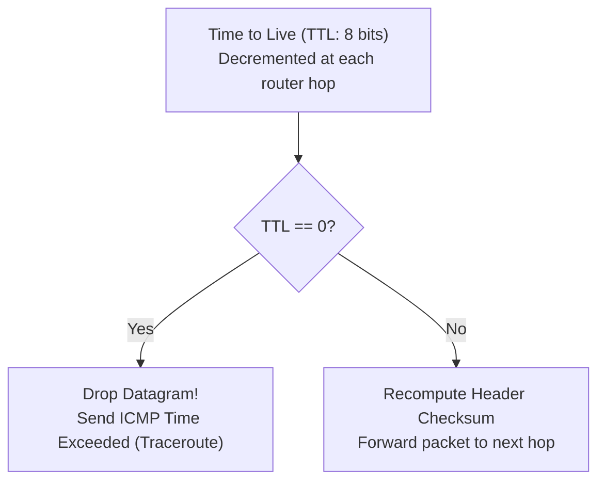

[CN Index](../README.md) / [Unit 3: Data Plane & IP](Introduction.md)

# Lecture 05: IPv4 Datagram Format and Protocol Fields

In the Internet stack, every layer adds its own distinct wrapping paper around user data.

When a transport-layer segment—whether an 8-byte UDP datagram or a 20-byte TCP segment—is passed down to Layer 3, the network layer encapsulates it inside an **Internet Protocol (IP) Datagram**.

This datagram is the fundamental currency of the global Internet. Every router between Tokyo and Toronto inspects its fields, validates its checksum, tracks its hop lifetime, and uses its destination address to steer bits across the world.

To understand how IP functions, we must inspect the wire format of the **IPv4 Header**.

---

## The IPv4 Datagram Wire Format

Without options, a standard IPv4 header consists of **20 bytes (160 bits)**, arranged in five 32-bit words:

```
 0                   1                   2                   3
 0 1 2 3 4 5 6 7 8 9 0 1 2 3 4 5 6 7 8 9 0 1 2 3 4 5 6 7 8 9 0 1
+-+-+-+-+-+-+-+-+-+-+-+-+-+-+-+-+-+-+-+-+-+-+-+-+-+-+-+-+-+-+-+-+
|Version|  IHL  |Type of Service|          Total Length         |
+-+-+-+-+-+-+-+-+-+-+-+-+-+-+-+-+-+-+-+-+-+-+-+-+-+-+-+-+-+-+-+-+
|         Identification        |Flags|      Fragment Offset    |
+-+-+-+-+-+-+-+-+-+-+-+-+-+-+-+-+-+-+-+-+-+-+-+-+-+-+-+-+-+-+-+-+
|  Time to Live |    Protocol   |        Header Checksum        |
+-+-+-+-+-+-+-+-+-+-+-+-+-+-+-+-+-+-+-+-+-+-+-+-+-+-+-+-+-+-+-+-+
|                       Source IP Address                       |
+-+-+-+-+-+-+-+-+-+-+-+-+-+-+-+-+-+-+-+-+-+-+-+-+-+-+-+-+-+-+-+-+
|                    Destination IP Address                     |
+-+-+-+-+-+-+-+-+-+-+-+-+-+-+-+-+-+-+-+-+-+-+-+-+-+-+-+-+-+-+-+-+
|                    Options (0 to 40 bytes)                    |
+-+-+-+-+-+-+-+-+-+-+-+-+-+-+-+-+-+-+-+-+-+-+-+-+-+-+-+-+-+-+-+-+
|                                                               |
|                  Payload Data (TCP / UDP Segment)             |
|                                                               |
+-+-+-+-+-+-+-+-+-+-+-+-+-+-+-+-+-+-+-+-+-+-+-+-+-+-+-+-+-+-+-+-+
```

Notice the minimum overhead calculation:
$$\text{20 bytes (IP Header)} + \text{20 bytes (TCP Header)} = \mathbf{40\text{ bytes}}$$

Every single TCP packet carries at least 40 bytes of header overhead before a single byte of application payload (such as HTTP text) is attached.

---

## Field-by-Field Breakdown

### 1. Version (`4 bits`)
Specifies the version of the IP protocol. 
For IPv4, this binary value is fixed to `0100` ($4$). This allows a router's hardware parser to inspect the first nibble of an incoming frame and instantly determine whether to route the packet using its IPv4 or IPv6 processing engine.

### 2. Internet Header Length (IHL) (`4 bits`)
Because an IPv4 header can contain optional fields, its length is variable. 
The IHL field specifies the total length of the header measured in **32-bit (4-byte) words**:
- Since the minimum header is 20 bytes, the minimum possible value of IHL is:
  $$\frac{20\text{ bytes}}{4\text{ bytes/word}} = \mathbf{5} \quad (\text{Binary: } 0101)$$
- The maximum value a 4-bit field can represent is $15$ ($1111$), meaning the maximum possible IPv4 header length is:
  $$15 \times 4\text{ bytes} = \mathbf{60\text{ bytes}}$$
  (Leaving at most $60 - 20 = 40\text{ bytes}$ for optional fields).

### 3. Type of Service (ToS) / Differentiated Services & ECN (`8 bits`)
Originally designed to allow senders to request low delay or high reliability. Today, RFC 2474 and RFC 3168 redefine these 8 bits:
- **DSCP (Differentiated Services Code Point - 6 bits)**: Classifies the packet into Quality-of-Service (QoS) forwarding classes (e.g., Expedited Forwarding for real-time voice, Assured Forwarding for web, or Best Effort).
- **ECN (Explicit Congestion Notification - 2 bits)**: Allows intermediate routers to mark passing packets to signal congestion back to TCP senders without dropping the packet.

### 4. Total Length (`16 bits`)
Specifies the total length of the entire IP datagram—**including both the IP header and the payload data**—measured in **bytes**.
- With 16 bits, the theoretical maximum size of an IPv4 datagram is:
  $$2^{16} - 1 = \mathbf{65,535\text{ bytes}}$$
- In practice, datagrams rarely exceed **1500 bytes**, which is the Maximum Transmission Unit (MTU) of standard Ethernet.

---

## Fields for Fragmentation and Reassembly

Links in the physical world have different maximum packet size limits. When a 1500-byte datagram encounters an outgoing link that can only carry 576 bytes, the datagram must be sliced into pieces. Three header fields coordinate this process:

### 5. Identification (`16 bits`)
When a sending host creates an IP datagram, it assigns a unique 16-bit integer ID. If this datagram is later fragmented by an intermediate router into multiple smaller datagrams, **every fragment retains the exact same Identification number**. This allows the destination host to identify which arriving fragments belong to the same original datagram.

### 6. Flags (`3 bits`)
- **Bit 0**: Reserved. Must be set to `0`. (Famously designated as the "Evil Bit" in the April Fools' joke RFC 3514).
- **Bit 1 - DF (Don't Fragment)**: If set to `1`, the sender explicitly forbids intermediate routers from fragmenting this packet. If the packet encounters a link with an MTU smaller than the packet size, the router **must drop the packet** and send an ICMP "Destination Unreachable: Fragmentation Needed" error back to the sender. This mechanism powers **Path MTU Discovery (PMTUD)**.
- **Bit 2 - MF (More Fragments)**: Used during fragmentation. Set to `1` for every fragment except the very last one. The final fragment has $\text{MF} = 0$, signaling to the receiver that the complete datagram has arrived.

### 7. Fragment Offset (`13 bits`)
Specifies where the payload data of this specific fragment belongs relative to the beginning of the original unfragmented datagram payload.
- Because a packet can be up to 65,535 bytes long, but 13 bits can only represent $2^{13} = 8,192$ unique numbers, the offset cannot count individual bytes.
- Instead, the Fragment Offset is measured in **8-byte (64-bit) units**!
- An offset value of `100` means this fragment's payload begins at byte $100 \times 8 = \mathbf{800}$ of the original datagram payload.

---

## Routing and Integrity Fields



### 8. Time to Live (TTL) (`8 bits`)
Designed to solve an existential danger in packet switching: **routing loops**.

If transient routing loops occur, packets could circulate between routers indefinitely, consuming bandwidth and bringing the network to a halt.
- The sender initializes TTL to an integer (typically 64, 128, or 255).
- **Every router that processes the datagram MUST decrement the TTL by at least 1**.
- If the TTL counter reaches `0`, the router drops the packet and transmits an ICMP "Time Exceeded" message back to the source host.
- *Fun Fact*: The popular network utility `traceroute` intentionally exploits this by sending packets with $\text{TTL} = 1, 2, 3 \dots$ to force each consecutive router along the path to drop the packet and reveal its own IP address!

### 9. Upper Layer Protocol (`8 bits`)
Specifies the specific transport-layer protocol to which the IP payload should be delivered upon arrival at the destination host (demultiplexing at Layer 3):
- `1` = **ICMP** (Internet Control Message Protocol)
- `2` = **IGMP** (Internet Group Management Protocol)
- `6` = **TCP** (Transmission Control Protocol)
- `17` = **UDP** (User Datagram Protocol)
- `89` = **OSPF** (Open Shortest Path First)

### 10. Header Checksum (`16 bits`)
Computes the 16-bit 1's complement sum over the **IPv4 header only** (the payload data is ignored, as TCP and UDP maintain their own end-to-end checksums).

Notice a major consequence for router processing:
Because every router decrements the TTL field by 1, **the IPv4 header changes at every single router hop!** 
Therefore, **every router along the path must verify, decrement, and recompute the IP Header Checksum** for every forwarded packet. (To accelerate hardware processing, IPv6 completely eliminated the header checksum).

### 11. Source and Destination IP Addresses (`32 bits each`)
The 32-bit global IPv4 address of the original sending interface and the final destination interface.

### 12. Options (`0 to 40 bytes`)
Rarely used in production networks due to security risks and hardware performance penalties. Options include *Record Route* (listing router IPs), *Timestamp*, and *Source Routing* (forcing packets along a pre-specified path). Most core routers drop packets containing IP options in hardware.

---

## Key Takeaways

- A standard IPv4 header is **20 bytes** long without options, creating a minimum 40-byte overhead when paired with TCP.
- `Version` is `0100` (4); `IHL` specifies header length in 32-bit (4-byte) words (minimum 5, maximum 15).
- `Total Length` is 16 bits, allowing datagrams up to 65,535 bytes (typically 1500 bytes on Ethernet).
- Fragmentation is coordinated via three fields: 16-bit `Identification`, 3-bit `Flags` (DF, MF), and 13-bit `Fragment Offset` (measured in 8-byte blocks).
- `TTL` (Time to Live) prevents infinite looping by decrementing at each hop; dropping at 0 powers `traceroute`.
- `Protocol` field demultiplexes payload to upper-layer protocols (TCP = 6, UDP = 17, ICMP = 1).
- `Header Checksum` protects only the IP header and must be recomputed at every router hop due to TTL decrements.

---

Now that we understand the anatomy of the IPv4 header and why fragmentation fields exist, what actually happens when a 4000-byte datagram arrives at a router whose outgoing interface can only transmit 1500 bytes? To trace the mathematical division of payloads, offsets, and flags, we turn to [IPv4 Fragmentation and Reassembly](L06%20-%20IPv4%20Fragmentation%20and%20Reassembly.md).
