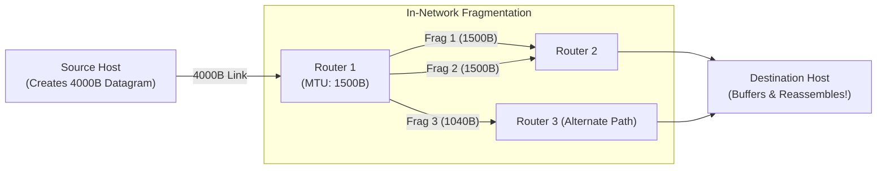
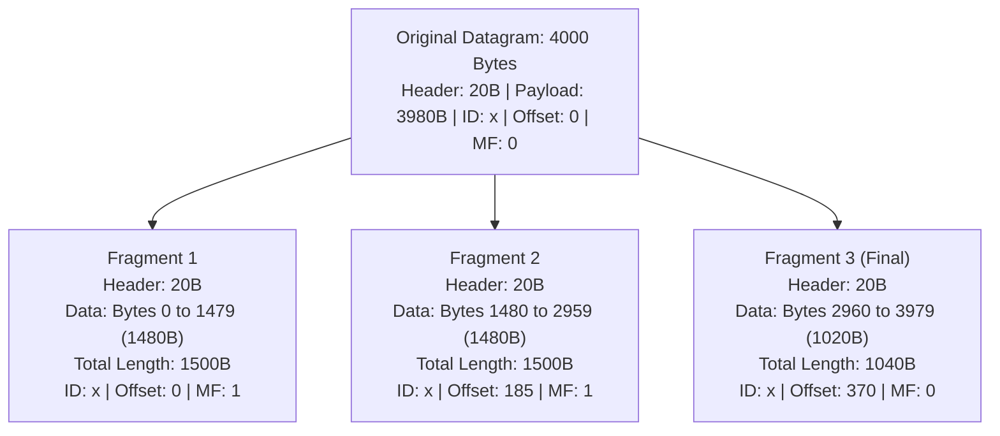

[CN Index](../README.md) / [Unit 3: Data Plane & IP](Introduction.md)

# Lecture 06: IPv4 Fragmentation and Reassembly

The Internet is not a monolithic, uniform wire. It is an arbitrary federation of thousands of distinct physical network technologies: high-speed optical Ethernet, wireless Wi-Fi, satellite connections, cellular modems, and legacy point-to-point leased lines.

Each link-layer technology has its own physical constraints on how large a single frame can be.

The maximum amount of data that a link-layer frame can physically carry across a wire is called the **Maximum Transmission Unit (MTU)**.

While modern Ethernet links typically enforce an MTU of **1500 bytes**, other links enforce different boundaries (e.g., FDDI carries up to 4352 bytes, while certain WAN tunnels or satellite links restrict MTU to 576 bytes).

Now suppose a server connected to an FDDI link transmits a 4000-byte IP datagram. Three hops later, that datagram arrives at a router whose next link is a standard Ethernet line with an MTU of 1500 bytes. 

The 4000-byte datagram physically cannot fit into a 1500-byte Ethernet frame.

The router faces a choice: drop the packet, or slice it up. In IPv4, the router performs **Fragmentation**.

---

## The Golden Rule: Reassembly Occurs ONLY at the Destination

When a router fragments a large datagram into multiple smaller datagrams, where are those pieces glued back together?

A beginner might assume that the very next router—or the router at the exit of the small-MTU link—reassembles the fragments. 

**This never happens.** In the Internet architecture, **reassembly occurs strictly at the final destination host**.

Why did Internet designers prohibit intermediate routers from reassembling fragments?
1. **Router Performance**: Reassembling datagrams would require intermediate routers to allocate massive memory buffers, track fragment arrival timers, and reconstruct byte sequences. This would bring high-speed wire forwarding to a dead crawl.
2. **Dynamic Multi-Path Routing**: In a connectionless datagram network, different fragments of the same original datagram can take completely different physical paths! Fragment 1 and 2 might travel through Router 2, while Fragment 3 travels through Router 3. An intermediate router might never see all the pieces.

Therefore, intermediate routers only fragment; the destination host alone reassembles.

---

## The Three Header Fields Governing Fragmentation

To enable the destination host to identify, order, and reconstruct fragments, IPv4 relies on three header fields:

1. **Identification (`16 bits`)**: The sending host stamps every original datagram with an ID number. When a router fragments a datagram, **it copies the exact same ID into every resulting fragment**.
2. **Flags (`3 bits`)**:
   - `DF` (Don't Fragment): If `1`, the router is forbidden from fragmenting.
   - `MF` (More Fragments): Set to `1` for every fragment except the very last one. The final fragment has $\text{MF} = 0$, telling the receiver: *"No more fragments follow; this is the end of the payload."*
3. **Fragment Offset (`13 bits`)**: Tells the receiver where this fragment's data belongs relative to the start of the original payload. 
   - **Crucial Rule**: The Fragment Offset is measured in **8-byte (64-bit) units**.
   - An offset of $K$ means the fragment payload begins at byte $K \times 8$ of the original unfragmented payload.

### The Inviolable 8-Byte Multiple Constraint
Because the Fragment Offset field is scaled in 8-byte units:
> **The data payload size in every non-final fragment MUST be an exact multiple of 8 bytes.**

If an MTU allows 1485 bytes of payload, you cannot put 1485 bytes into the fragment! You must round down to the nearest multiple of 8 ($\lfloor 1485 / 8 \rfloor \times 8 = 1480\text{ bytes}$). The only fragment permitted to have a payload size not divisible by 8 is the final fragment ($\text{MF} = 0$).

---

## Detailed Numerical Walkthrough 1: 4000-Byte Datagram over 1500-Byte MTU

Let's trace the canonical example from the lecture slides:
- Original Datagram: Total Length = $4,000\text{ bytes}$.
- IP Header Length: Standard $20\text{ bytes}$.
- Original Data Payload: $4,000 - 20 = \mathbf{3,980\text{ bytes}}$.
- Identification: Set to $x$.
- Outgoing Link MTU: $1,500\text{ bytes}$.

### Step 1: Determine Maximum Payload per Fragment
$$\text{Max Payload Space} = \text{MTU} - \text{Header} = 1500 - 20 = 1480\text{ bytes}$$

Check divisibility by 8:
$$\frac{1480}{8} = 185 \quad (\text{Exact integer! Multiple of 8 verified})$$

Each non-final fragment can carry up to 1480 bytes of payload.

### Step 2: Slice the Payload into Fragments

| Field | Original Datagram | Fragment 1 | Fragment 2 | Fragment 3 |
| :--- | :---: | :---: | :---: | :---: |
| **Total Length** | $4000$ | $1500$ | $1500$ | $1040$ |
| **Header Length** | $20$ | $20$ | $20$ | $20$ |
| **Data Payload** | $3980$ | $1480$ | $1480$ | $1020$ |
| **Payload Bytes** | $0 - 3979$ | $0 - 1479$ | $1480 - 2959$ | $2960 - 3979$ |
| **Identification** | $x$ | $x$ | $x$ | $x$ |
| **Fragment Offset** | $0$ | $\frac{0}{8} = \mathbf{0}$ | $\frac{1480}{8} = \mathbf{185}$ | $\frac{1480 + 1480}{8} = \mathbf{370}$ |
| **More Fragments (MF)** | $0$ | $\mathbf{1}$ | $\mathbf{1}$ | $\mathbf{0}$ |

Notice:
- $1480 + 1480 + 1020 = 3980\text{ bytes}$ of payload accounted for.
- Fragment 3 has Total Length $1020 + 20 = 1040\text{ bytes}$ and $\text{MF} = 0$.

---

## Detailed Numerical Walkthrough 2: Non-Trivial 8-Byte Truncation

Now consider the university exam problem from Slide 6:
> *"An IP router with an MTU of 200 bytes receives an IP packet of total size 520 bytes with a 20-byte IP header. Calculate the header fields for all fragments."*

- Total Length: $520\text{ bytes}$.
- IP Header: $20\text{ bytes}$.
- Original Data Payload: $520 - 20 = \mathbf{500\text{ bytes}}$.
- Outgoing MTU: $200\text{ bytes}$.

### Step 1: Calculate Maximum Allowed Payload per Fragment
$$\text{Raw Payload Space} = \text{MTU} - \text{Header} = 200 - 20 = 180\text{ bytes}$$

Now test for divisibility by 8:
$$\frac{180}{8} = 22.5 \quad \mathbf{(\text{NOT an integer!})}$$

We **cannot** send 180 bytes of payload, because the next fragment's offset would be a fraction! 
We must round down to the nearest multiple of 8:

$$\text{Max Valid Payload} = \lfloor 22.5 \rfloor \times 8 = 22 \times 8 = \mathbf{176\text{ bytes}}$$

Every non-final fragment can carry at most **176 bytes** of payload data.

### Step 2: Calculate Fragment Values

- **Fragment 1**:
  - Payload carried: $176\text{ bytes}$ (bytes $0$ to $175$).
  - Total Length: $176 + 20 = \mathbf{196\text{ bytes}}$.
  - $\text{Offset} = \frac{0}{8} = \mathbf{0}$.
  - $\text{MF} = \mathbf{1}$.
  - Remaining payload to send: $500 - 176 = 324\text{ bytes}$.

- **Fragment 2**:
  - Payload carried: $176\text{ bytes}$ (bytes $176$ to $351$).
  - Total Length: $176 + 20 = \mathbf{196\text{ bytes}}$.
  - $\text{Offset} = \frac{176}{8} = \mathbf{22}$.
  - $\text{MF} = \mathbf{1}$.
  - Remaining payload to send: $324 - 176 = 148\text{ bytes}$.

- **Fragment 3 (Final Fragment)**:
  - Remaining payload is $148\text{ bytes}$ (bytes $352$ to $499$).
  - Can $148$ bytes fit within the $180$-byte limit? Yes ($148 \le 180$).
  - Does the final fragment need to be divisible by 8? **NO**, because $\text{MF} = 0$!
  - Total Length: $148 + 20 = \mathbf{168\text{ bytes}}$.
  - $\text{Offset} = \frac{176 + 176}{8} = \frac{352}{8} = \mathbf{44}$.
  - $\text{MF} = \mathbf{0}$.

**Check**: $176 + 176 + 148 = 500\text{ bytes}$. The math is 100% consistent.

---

## Why Fragmentation is Harmful to Network Performance

While fragmentation solves physical heterogeneity, it introduces severe operational liabilities:

1. **Amplified Loss Penalty**:
   If an original datagram is fragmented into 4 pieces, and intermediate router queue overflow causes **just one fragment to be dropped**, what happens?
   The destination host cannot reconstruct the datagram. It holds the remaining 3 fragments in memory until a reassembly timer expires, and then throws them all in the trash.
   Because IP provides no partial retransmission, the sending host's TCP layer must retransmit the **entire original 4000-byte segment**, wasting four times the bandwidth!
2. **CPU and Header Overhead**: Every fragment adds a new 20-byte IP header, burning link capacity and forcing destination operating systems into costly memory copying.

### The Modern Evolution: PMTUD and IPv6
Because of these pathologies:
- Modern operating systems use **Path MTU Discovery (PMTUD)**: TCP sends packets with the `DF` (Don't Fragment) bit set to `1`. If a router cannot forward the packet, it drops it and returns an ICMP error containing its MTU. TCP automatically shrinks its MSS to match the smallest MTU along the path, **completely avoiding in-network fragmentation**.
- In **IPv6**, in-network fragmentation was **completely abolished**. Intermediate IPv6 routers never fragment packets; if an IPv6 packet is too large, it is simply dropped, forcing endpoints to size packets properly.

---

## Key Takeaways

- MTU (Maximum Transmission Unit) is the maximum link-layer payload size.
- Fragmentation breaks large datagrams into smaller pieces; **reassembly occurs strictly at the final destination host**.
- All fragments share the same 16-bit `Identification` number.
- `MF` (More Fragments) is `1` for all fragments except the final fragment ($\text{MF} = 0$).
- `Fragment Offset` is specified in **8-byte units**; therefore, every non-final fragment payload **must be an exact multiple of 8 bytes**.
- Dropping a single fragment ruins the entire original datagram, multiplying retransmission overhead.
- Modern networks avoid fragmentation via Path MTU Discovery (`DF = 1`), and IPv6 eliminates router fragmentation entirely.

---

Now that we understand how IP packets are formatted and fragmented, we must confront the central organizing system of the entire network layer: how are devices addressed, how are subnets partitioned, and how does Classless Inter-Domain Routing (CIDR) prevent global routing tables from collapsing? To explore this, we turn to [IPv4 Addressing, Subnetting, and CIDR](L07%20-%20IPv4%20Addressing,%20Subnetting,%20and%20CIDR.md).
