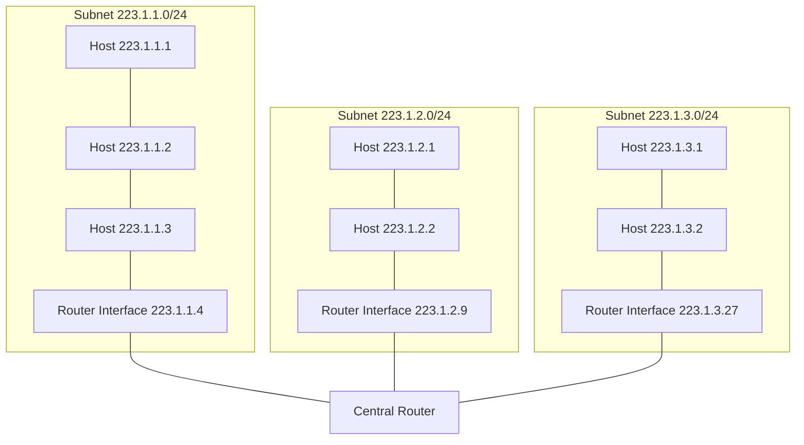
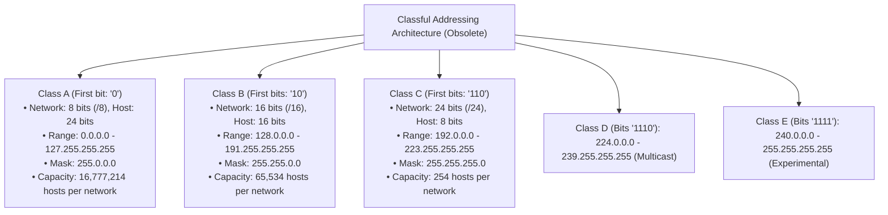
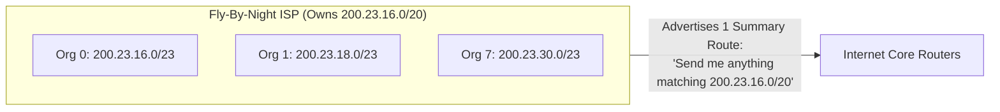

[CN Index](../README.md) / [Unit 3: Data Plane & IP](Introduction.md)

# Lecture 07: IPv4 Addressing, Subnetting, and CIDR

In the physical world, every house has a postal address, every phone has a telephone number, and every apartment has an entry code.

In the digital world of Layer 3, every device communicating on the Internet requires an **IP Address**.

An IPv4 address is a **32-bit binary number**. To make these numbers readable by humans, we break the 32 bits into four 8-bit bytes (octets), convert each octet into its decimal value ($0$ to $255$), and separate them with periods. This is **Dotted-Decimal Notation**:

$$\underbrace{11011111}_{223} \,.\, \underbrace{00000001}_{1} \,.\, \underbrace{00000001}_{1} \,.\, \underbrace{00000001}_{1} \implies \mathbf{223.1.1.1}$$

Now here's the thing — does an IP address belong to a computer?
Technically, **no**. An IP address belongs to an **Interface**.

An interface is the physical boundary between a host or router and a physical communication link. 
- A typical user laptop has two interfaces: an Ethernet NIC and an 802.11 Wi-Fi radio. Each has its own distinct IP address.
- A router has dozens of interfaces, connecting to dozens of different links. **Every single router interface has its own unique IP address.**

---

## What is a Subnet? The "Island" Recipe

An IP address is not an unstructured sequence of random numbers. It has internal hierarchy:

$$\text{IP Address} = \text{Subnet Part (Network Prefix)} + \text{Host Part}$$

All device interfaces that reside in the same local network share the exact same high-order **subnet bits**, differing only in their low-order **host bits**.

What defines a **Subnet**?
> **Formal Definition**: A subnet is a collection of device interfaces that can physically communicate with each other **directly at Layer 2 without passing through an intervening Layer 3 router**.

### The "Island Recipe" for Identifying Subnets
To identify all subnets in any network topology diagram:
1. Mentally take a pair of scissors and **snip every interface connection away from its host or router**.
2. Look at the isolated "islands" of interconnected interfaces left behind.
3. **Each isolated island is a distinct subnet.**

*(Crucial Exam Detail: Do not forget point-to-point links between routers! A single cable connecting Router A to Router B forms its own isolated island, and therefore constitutes its own distinct subnet).*

---

## The Demise of Classful Addressing

In the original ARPANET architecture (RFC 791), the Internet was partitioned into rigid, predefined address classes:

### Why Did Classful Addressing Fail?
Classful addressing suffered from catastrophic inefficiency:
- Suppose a medium-sized company had **300 employees**.
- A Class C network (/24) only provides $2^8 - 2 = 254$ usable host addresses. It was too small.
- The company had no choice but to apply for a **Class B network (/16)**, which provides $2^{16} - 2 = \mathbf{65,534\text{ addresses}}$!
- The company assigned 300 addresses, and the remaining **65,234 addresses sat completely abandoned and unusable** by anyone else on Earth!

By the early 1990s, this structural inflexibility threatened to exhaust the 32-bit IPv4 address space within years.

---

## Classless Inter-Domain Routing (CIDR)

In 1993, the IETF deployed **Classless Inter-Domain Routing (CIDR, RFC 1519)**, completely abolishing Class A, B, and C boundaries.

Under CIDR:
1. The boundary between the subnet prefix and the host portion can be set to **any arbitrary bit length $x$**:
   $$\text{CIDR Notation: } \mathbf{a.b.c.d / x}$$
   where $x$ specifies the exact number of leading bits dedicated to the network prefix.
2. The remaining $32 - x$ bits are dedicated to addressing individual host interfaces within that subnet.
3. The **Subnet Mask** is a 32-bit number containing $x$ consecutive binary `1`s followed by $32 - x$ binary `0`s.

| CIDR Prefix | Subnet Mask (Dotted-Decimal) | Total Addresses ($2^{32-x}$) | Usable Host Addresses ($2^{32-x} - 2$) | Typical Use Case |
| :---: | :---: | :---: | :---: | :--- |
| **/8** | `255.0.0.0` | $16,777,216$ | $16,777,214$ | Historical legacy mega-block (e.g., Apple, MIT) |
| **/16** | `255.255.0.0` | $65,536$ | $65,534$ | Large enterprise / university campus |
| **/24** | `255.255.255.0` | $256$ | $254$ | Standard departmental LAN / small business |
| **/27** | `255.255.255.224` | $32$ | $30$ | Branch office / server cluster |
| **/29** | `255.255.255.248` | $8$ | $6$ | Small multi-homed customer block |
| **/30** | `255.255.255.252` | $4$ | **2** | **Point-to-Point Router Links** |
| **/32** | `255.255.255.255` | $1$ | $1$ (Host route) | Single loopback / VPN interface |

---

## Hierarchical Addressing and Route Aggregation

CIDR did not merely save address space; it saved the Internet's global routing system from collapse through **Route Aggregation (Route Summarization)**.

Imagine an ISP called *Fly-By-Night Networks* that has been allocated the CIDR block `200.23.16.0/20`. 
This ISP subdivides its block into eight smaller `/23` blocks and assigns them to eight customer organizations:
- Organization 0: `200.23.16.0/23`
- Organization 1: `200.23.18.0/23`
- Organization 2: `200.23.20.0/23`
- ...
- Organization 7: `200.23.30.0/23`

Does the ISP announce eight separate routes to the global Internet? 
**No!** The ISP announces a single, aggregated route:
$$\text{“Send me anything beginning with } \mathbf{200.23.16.0/20}\text{”}$$

All routers across the global Internet need only store **one single line** in their routing tables to reach all eight organizations!

### Handling Route Exceptions via More Specific Routes
What happens if Organization 1 (`200.23.18.0/23`) decides to change providers and switch to a competitor, *ISPs-R-Us* (`199.31.0.0/16`)? Does Organization 1 have to renumber all of its thousands of servers and IP configurations?

No! *ISPs-R-Us* simply begins advertising a more specific route:
$$\text{“Send me anything matching } \mathbf{199.31.0.0/16} \text{ OR } \mathbf{200.23.18.0/23}\text{”}$$

Now, core routers encounter two routes that match traffic heading to Organization 1:
1. `200.23.16.0/20` (from Fly-By-Night ISP, 20-bit match)
2. `200.23.18.0/23` (from ISPs-R-Us, 23-bit match)

Under the rule of **Longest Prefix Matching**, core routers forward packets to the 23-bit match! Traffic automatically routes to the new provider without forcing the customer to renumber.

---

## Step-by-Step Subnet Calculations: Worked Problem Set

Every exam in Computer Networks tests your ability to decompose a CIDR block. Let's work through the canonical problems from course notes.

### Core Mathematical Rules
In any IPv4 subnet with prefix length $/x$:
1. **Host Bits ($H$)**: $H = 32 - x$.
2. **Total IP Addresses**: $N_{\text{total}} = 2^H$.
3. **Two Permanently Reserved Addresses**:
   - **Network Address**: All host bits set to `0` (e.g., `192.168.1.0`). Identifies the subnet itself; cannot be assigned to an interface.
   - **Directed Broadcast Address**: All host bits set to `1` (e.g., `192.168.1.255`). Packets sent to this IP are received by all devices on the subnet.
4. **Usable Host Addresses**: $N_{\text{usable}} = 2^H - 2$.

---

### Problem 1: Analyze `123.56.77.32/29`
- Prefix length $x = 29$.
- Host bits: $H = 32 - 29 = \mathbf{3\text{ bits}}$.
- Total addresses: $2^3 = \mathbf{8\text{ addresses}}$.
- Usable host addresses: $2^3 - 2 = \mathbf{6\text{ hosts}}$.
- Subnet mask: 29 ones followed by 3 zeros:
  $$\underbrace{11111111}_{255} . \underbrace{11111111}_{255} . \underbrace{11111111}_{255} . \underbrace{11111000}_{248} \implies \mathbf{255.255.255.248}$$
- Binary of 4th octet ($32$): `00100 000` (First 5 bits are network, last 3 are host).
  - Network Address (host bits `000`): $32 + 0 = \mathbf{123.56.77.32}$
  - Broadcast Address (host bits `111`): $32 + 7 = \mathbf{123.56.77.39}$
  - Usable Host Range: **`123.56.77.33` to `123.56.77.38`**

---

### Problem 2: Analyze `180.34.64.64/30`
- Prefix length $x = 30$.
- Host bits: $H = 32 - 30 = \mathbf{2\text{ bits}}$.
- Total addresses: $2^2 = \mathbf{4\text{ addresses}}$.
- Usable host addresses: $2^2 - 2 = \mathbf{2\text{ hosts}}$ (The classic point-to-point link mask).
- Subnet mask: 30 ones, 2 zeros $\implies$ `11111100` in last octet $\implies \mathbf{255.255.255.252}$.
- Binary of 4th octet ($64$): `010000 00`.
  - Network Address: $\mathbf{180.34.64.64}$
  - Broadcast Address: $64 + 3 = \mathbf{180.34.64.67}$
  - Usable Host Range: **`180.34.64.65` to `180.34.64.66`**

---

### Problem 3: Partitioning `175.200.0.0/16` into 4 Equal Subnets
Suppose you are given the address block `175.200.0.0/16` and tasked with creating **4 equal-sized subnets**.

1. **Calculate Borrowed Bits**:
   To create 4 subnets, we need $k$ additional subnet bits:
   $$2^k \ge 4 \implies k = 2\text{ bits}$$
2. **New Subnet Mask**:
   Original prefix was $/16$. Adding 2 borrowed bits yields a new prefix of $/18$:
   $$16 + 2 = \mathbf{/18}$$
   Subnet Mask: `11111111.11111111.11000000.00000000` $\implies \mathbf{255.255.192.0}$.
3. **Subnet Increment (Block Size)**:
   In the 3rd octet, the two borrowed bits have weights $128$ and $64$. The block step is $64$.
4. **The Four Resulting Subnets**:
   - Subnet 0: **`175.200.0.0/18`** (Range: `175.200.0.0` - `175.200.63.255`)
   - Subnet 1: **`175.200.64.0/18`** (Range: `175.200.64.0` - `175.200.127.255`)
   - Subnet 2: **`175.200.128.0/18`** (Range: `175.200.128.0` - `175.200.191.255`)
   - Subnet 3: **`175.200.192.0/18`** (Range: `175.200.192.0` - `175.200.255.255`)
5. **Capacity per Subnet**:
   Remaining host bits: $32 - 18 = 14\text{ bits}$.
   Usable hosts per subnet: $2^{14} - 2 = 16,384 - 2 = \mathbf{16,382\text{ hosts}}$.

---

## Key Takeaways

- An IP address identifies a network interface, not an entire computer.
- A **subnet** is an isolated island of interfaces that can physically communicate directly at Layer 2 without passing through a router.
- Classful addressing (Classes A, B, C) failed due to massive address wastage (e.g., assigning a 65,000-host Class B network to a 300-host organization).
- **CIDR** (Classless Inter-Domain Routing) allows arbitrary subnet mask lengths ($a.b.c.d/x$).
- Route aggregation allows ISPs to advertise a single summary prefix for thousands of customer networks, bounding global routing table sizes.
- Every subnet reserves two non-assignable addresses: the **Network Address** (all host bits 0) and the **Broadcast Address** (all host bits 1). Usable hosts = $2^{32-x} - 2$.

---

Even with CIDR and hierarchical aggregation, the mathematical reality of a 32-bit address space ($2^{32} \approx 4.3\text{ billion addresses}$) could not withstand the explosive global surge of smartphones, smart TVs, laptops, and IoT devices. How did the Internet survive running out of IPv4 addresses without crashing? To find out, we study the controversial savior of IPv4: [Network Address Translation (NAT)](L08%20-%20Network%20Address%20Translation%20%28NAT%29.md)).
