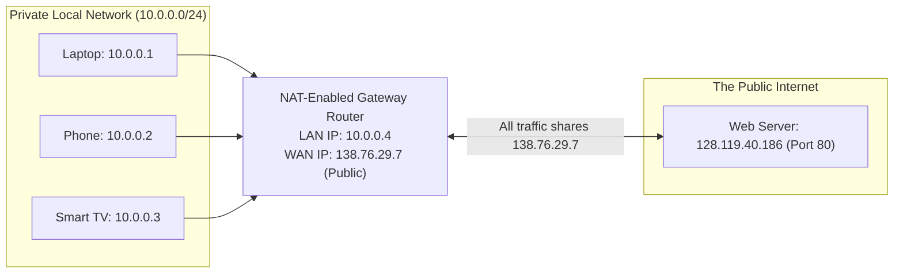
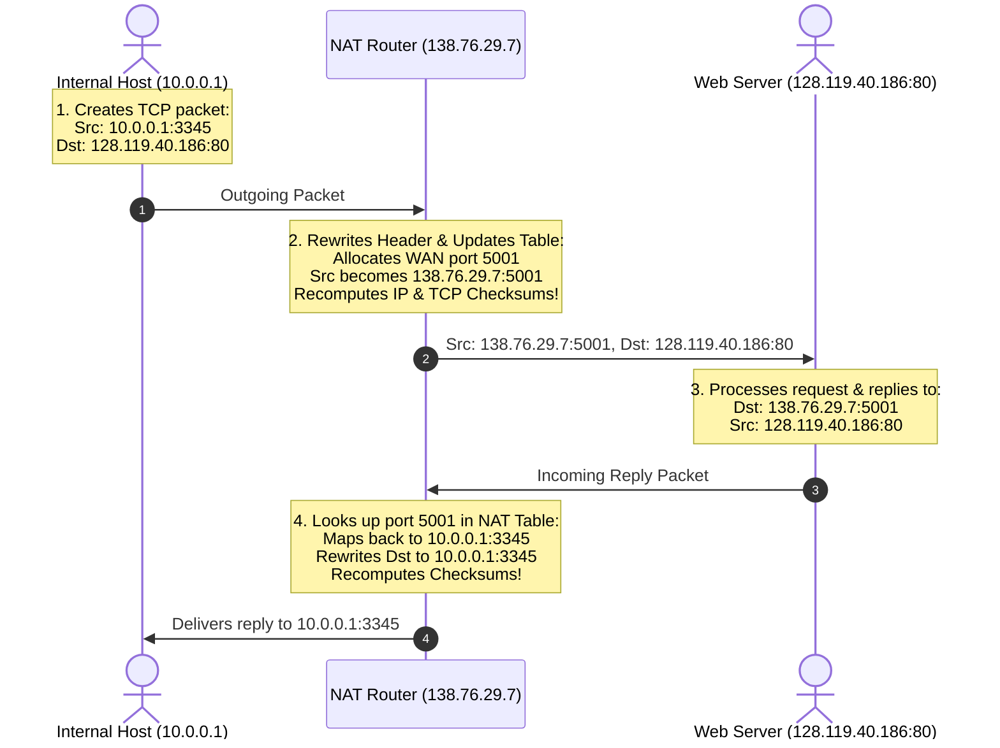
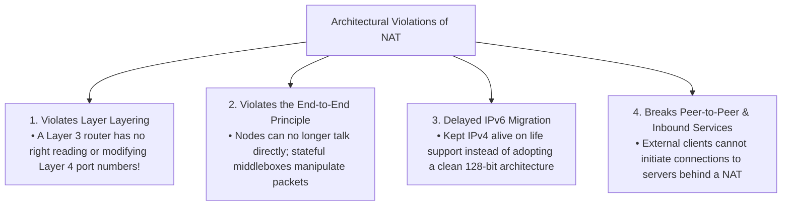

[CN Index](../README.md) / [Unit 3: Data Plane & IP](Introduction.md)

# Lecture 08: Network Address Translation (NAT)

By the mid-1990s, the explosive commercialization of the World Wide Web created an existential crisis:
The 32-bit address space of IPv4 contains at most $2^{32} \approx 4.29\text{ billion}$ possible addresses. With the rise of home PCs, universities, corporate enterprises, and eventually smartphones, the world was on track to exhaust all available IPv4 addresses by the year 2000.

The long-term engineering solution was **IPv6**, with its vast 128-bit address space. 

However, replacing every operating system, router, and switch on Earth takes decades. The Internet needed an immediate survival mechanism.

That survival mechanism was **Network Address Translation (NAT, RFC 1631 / RFC 3022)**.

NAT single-handedly kept IPv4 alive for three extra decades by decoupling private internal device addresses from the scarce public addresses of the global Internet.

---

## The Private IP Address Space (RFC 1918)

To make NAT work, the IETF reserved three blocks of IPv4 addresses specifically for **private networks**:

| Private Address Block | CIDR Prefix | Total Addresses | Typical Deployment |
| :---: | :---: | :---: | :--- |
| **`10.0.0.0` to `10.255.255.255`** | **`10.0.0.0/8`** | $16,777,216$ | Large enterprise, university campus, cellular carrier networks |
| **`172.16.0.0` to `172.31.255.255`** | **`172.16.0.0/12`** | $1,048,576$ | Medium-to-large business networks |
| **`192.168.0.0` to `192.168.255.255`** | **`192.168.0.0/16`** | $65,536$ | Residential home Wi-Fi routers, small office LANs |

### The Golden Rule of Private Addresses
Addresses in these ranges are **strictly non-routable on the public Internet**.

Every ISP and core backbone router is programmed to immediately drop any packet whose source or destination address falls within these private ranges. 

Because they never appear on the public Internet, **millions of distinct homes and companies can all use `192.168.1.1` simultaneously without any collision whatsoever!**

---

## How NAT Works: The Translation Illusion

In a home or office network running NAT, all internal devices are assigned private IP addresses (e.g., from `10.0.0.0/24`).

To the rest of the global Internet, the entire home network looks like a **single device with a single public IPv4 address**:

### The Four Operational Steps of NAT
Whenever an internal host connects to an external server, the NAT router transparently rewrites packet headers on the fly:

1. **Outbound Packet Generation**: Host `10.0.0.1` opens a client socket on port `3345` and sends an HTTP request to `128.119.40.186:80`.
2. **NAT Outbound Translation**:
   - The NAT router intercepts the packet before forwarding it to the WAN.
   - It selects an unused high-numbered port on its public interface (e.g., port `5001`).
   - It **replaces the private source IP (`10.0.0.1`) with its public WAN IP (`138.76.29.7`)**.
   - It **replaces the private source port (`3345`) with the newly allocated port (`5001`)**.
   - It records this binding in its internal **NAT Translation Table**.
   - Because the IP and transport headers were modified, it **recomputes both the IP Header Checksum and the TCP Checksum**!
3. **The Remote Server Responds**: The web server receives a packet from `138.76.29.7:5001`. The server has no idea `10.0.0.1` exists! It sends its HTTP response directly to `138.76.29.7:5001`.
4. **NAT Inbound Translation**:
   - The reply packet arrives at the NAT router.
   - The router inspects the destination port (`5001`) and searches its NAT Translation Table.
   - It finds the entry: `138.76.29.7:5001` $\leftrightarrow$ `10.0.0.1:3345`.
   - It rewrites the destination IP to `10.0.0.1` and destination port to `3345`, recomputes checksums, and pushes the packet onto the private LAN.

---

## The NAT Translation Table

How many concurrent connections can a single public IP support?

The NAT table is indexed by **Port Numbers**:

| WAN-Side Address (Public IP : Port) | LAN-Side Address (Private IP : Port) | Protocol |
| :--- | :--- | :---: |
| `138.76.29.7 : 5001` | `10.0.0.1 : 3345` | TCP |
| `138.76.29.7 : 5002` | `10.0.0.2 : 4890` | TCP |
| `138.76.29.7 : 5003` | `10.0.0.1 : 3346` | TCP |
| `138.76.29.7 : 61200`| `10.0.0.3 : 12000` | UDP |

Because the transport port field is 16 bits wide, there are over **60,000 available ephemeral ports**. A single public IP address can theoretically multiplex over **60,000 simultaneous active connections** across hundreds of internal devices!

---

## Advantages of NAT

1. **Extreme Address Conservation**: Hundreds of devices share one public IP address, delaying IPv4 exhaustion by decades.
2. **Zero-Configuration Internal Renumbering**: An organization can add, remove, or renumber thousands of internal machines without purchasing new public address space or notifying its ISP.
3. **ISP Independence**: If a business switches from Comcast to Verizon (changing its public IP), only the NAT router's WAN interface changes. None of the thousands of internal host configurations need to be touched.
4. **Inherent Inbound Security**: Because the NAT table only creates entries in response to *outbound* connections, unsolicited external port scans and automated attacks from the public Internet cannot enter the private network; they hit the router and are dropped.

---

## The Architectural Controversy: Why Purists Hate NAT

Despite its practical popularity, NAT is considered an architectural sin by computer network purists. It breaks several sacred Internet design principles:

### The Inbound Connection Dilemma (NAT Traversal)
Suppose you run a Minecraft game server or a BitTorrent node on your laptop (`10.0.0.1`) behind a home NAT router. 

A friend on the public Internet tries to connect to your game server. They send a TCP `SYN` packet to your public IP (`138.76.29.7:25565`).

What happens when the packet hits your home router?
The router checks its NAT table for destination port `25565`. 
**The table is empty!** No internal device has recently initiated an outbound connection on that port. The router has no idea whether the packet belongs to your laptop, your phone, or your smart fridge. 
**The router drops the packet.**

### Solutions for NAT Traversal
To run servers or peer-to-peer applications behind NAT, several workarounds exist:
1. **Static Port Forwarding**: The user manually logs into the router admin dashboard and configures a permanent static rule: *"Any incoming packet on WAN port 25565 must be forwarded directly to 10.0.0.1 port 25565"*.
2. **Universal Plug and Play (UPnP)**: An application uses software protocols to automatically tell the NAT router: *"Please open WAN port 25565 and point it to me"*.
3. **Relaying (e.g., Skype / TURN)**: Both peers establish outbound connections to an always-on rendezvous relay server located on the public Internet, which bounces data between them.
4. **STUN (Hole Punching)**: Used in WebRTC; peers send outbound UDP packets to discover their public-mapped ports, allowing direct peer-to-peer UDP streams.

---

## Key Takeaways

- RFC 1918 defines private IP ranges: `10.0.0.0/8`, `172.16.0.0/12`, and `192.168.0.0/16`; these are non-routable on the public Internet and reusable everywhere.
- NAT allows an entire local network of devices to share a single public IPv4 address.
- A NAT router replaces `(Private IP, Private Port)` with `(Public IP, New Port)` on outbound packets, stores the mapping in a stateful NAT table, and reverses the process for incoming replies.
- Modifying port numbers forces the router to recompute both IP and TCP/UDP checksums.
- NAT breaks the **End-to-End Principle** and **layer layering** by forcing Layer 3 routers to manipulate Layer 4 ports.
- Inbound connections are blocked by default; overcoming this requires **Port Forwarding**, **UPnP**, **STUN**, or **relays**.

---

Now that we have seen how traditional routers perform destination-based lookups and middlebox functions like NAT, we arrive at the most revolutionary architectural shift in modern networking: what if a router wasn't restricted to looking only at destination IP addresses? What if a single programmable device could act as a router, a switch, a firewall, and a NAT box simultaneously? To explore this, we enter [Generalized Forwarding and Software Defined Networking (SDN)](L09%20-%20Generalized%20Forwarding%20and%20Software%20Defined%20Networking%20%28SDN%29.md)).
