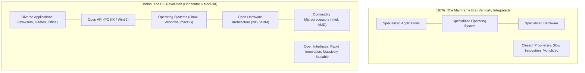
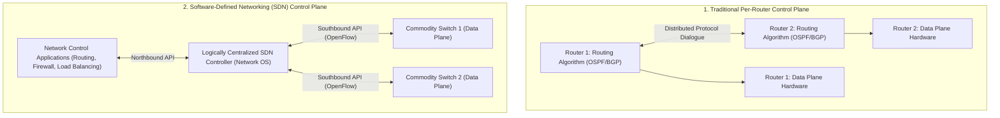
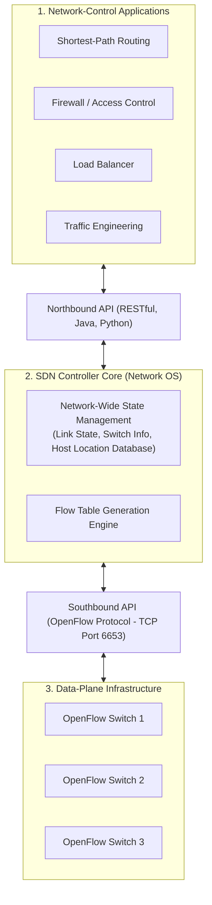
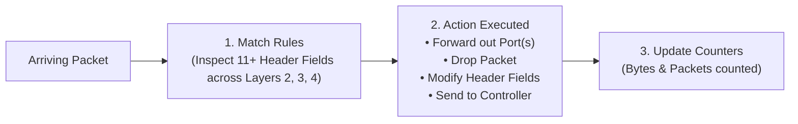
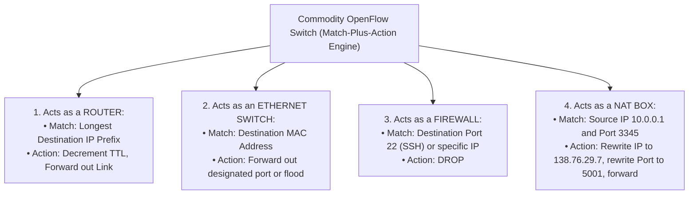

[CN Index](../README.md) / [Unit 3: Data Plane & IP](Introduction.md)

# Lecture 09: Generalized Forwarding and Software Defined Networking (SDN)

For the first thirty years of the Internet, the network layer operated under a rigid, monolithic design:
Every router was an expensive, proprietary black box manufactured by companies like Cisco or Juniper. Inside that black box, the vendor packaged proprietary switching hardware, a proprietary operating system (e.g., Cisco IOS), and proprietary implementations of routing protocols (OSPF, BGP). 

Worse yet, network functions were fractured into distinct physical "middlebox" appliances:
- If an enterprise needed packet routing, it bought a **Router**.
- If it needed local switching, it bought an **Ethernet Switch**.
- If it needed security filtering, it bought a **Firewall**.
- If it needed address translation, it bought a **NAT Box**.
- If it needed traffic distribution, it bought a **Load Balancer**.

Every device had its own CLI, its own bugs, and its own configuration syntax. Making a simple policy change across an enterprise required network engineers to manually log into dozens of individual routers and switches, creating constant misconfiguration errors.

Around 2005, researchers at Stanford and Berkeley (led by Nick McKeown and Martin Casado) proposed a radical architectural revolution: **Software-Defined Networking (SDN)**.

---

## The Computer Industry Analogy: Mainframe to PC

To understand SDN, consider the historical transformation of the computing industry:

In the 1970s, computer companies sold vertically integrated mainframes (IBM). You could not run IBM software on DEC hardware. 

The PC revolution exploded because the stack was broken into **horizontal, modular layers with open interfaces**: commodity x86 hardware at the bottom, independent operating systems in the middle, and millions of third-party software applications at the top.

**SDN does the exact same thing to computer networking**:
It strips the proprietary control brain out of the physical switch chassis, replaces expensive proprietary routers with **simple, fast, commodity hardware**, and moves network intelligence into **software running on a logically centralized controller**.

---

## Traditional Per-Router Control versus SDN

1. **Traditional Per-Router Control**:
   - The routing algorithm runs inside **each and every individual router**.
   - Control plane and data plane are tightly fused inside the same physical box.
   - Routers exchange distributed state messages (e.g., link-state advertisements) to slowly converge on a forwarding table.
2. **SDN Control Plane**:
   - **Complete Separation of Control and Data Planes**: The physical switches contain *only* the data plane. They do not run OSPF or BGP; they are simple, ultra-fast packet-forwarding engines.
   - **Logically Centralized Controller**: A centralized software platform (such as ONOS or OpenDaylight) manages the network state, computes forwarding paths, and installs forwarding rules directly into the switches via a standardized protocol.

---

## The Four Key Characteristics of SDN

1. **Generalized Flow-Based Forwarding**: Unlike traditional routers that forward solely on destination IP, SDN switches forward based on **flows**. A flow is defined by matching any combination of Layer 2, Layer 3, or Layer 4 header fields.
2. **Control and Data Plane Separation**: Data-plane switches execute simple "match-plus-action" rules in hardware flow tables. The control plane runs remotely in software.
3. **Control Logic External to Switches**: The SDN control plane software executes on commodity servers (or distributed server clusters) physically distinct from the switches.
4. **Programmable Network Applications**: The network behavior is programmed via software applications (Routing, Access Control, Traffic Engineering) interacting with the controller via APIs.

---

## The Three-Tier Architecture of an SDN Controller

An SDN controller acts as the **Network Operating System (NOS)**. It is organized into three distinct structural layers:

### 1. The Interface Layer (Northbound API)
The Northbound API allows software developers to write network control applications. Instead of worrying about low-level switch registers, an application developer calls high-level RESTful APIs: *"Route traffic from Subnet A to Subnet B along the path with the lowest latency."*

### 2. Network-Wide State-Management Layer
The controller maintains a global database of the entire network: which switches are online, which physical links are up, link capacities, traffic counters, and host MAC/IP locations.

### 3. The Communication Layer (Southbound API: OpenFlow)
The Southbound API communicates directly with the physical data-plane switches. The dominant standardized Southbound protocol is **OpenFlow**.

---

## The OpenFlow Protocol

OpenFlow (formalized by the Open Networking Foundation) defines the exact wire protocol between the controller and data-plane switches. 

It operates over **TCP using default port 6653** (optionally secured via TLS encryption).

### Three Classes of OpenFlow Messages

1. **Controller-to-Switch Messages**:
   - `features`: The controller queries the switch to discover its ports, capabilities, and buffer sizes.
   - `configure`: The controller inspects or sets switch configuration parameters.
   - `modify-state`: **The most critical message**; sent by the controller to add, delete, or modify flow entries in the switch's flow table.
   - `packet-out`: The controller sends an explicit packet out of a designated switch port.
2. **Switch-to-Controller (Asynchronous) Messages**:
   - `packet-in`: When an arriving packet does not match any rule in the flow table, the switch encapsulates the packet and sends it up to the controller: *"I don't know what to do with this packet; please tell me how to handle it."*
   - `flow-removed`: Informs the controller that a flow rule expired due to an idle timeout.
   - `port-status`: Notifies the controller that a physical link went down or an interface came up.
3. **Symmetric Messages**: Simple echo/heartbeat packets to confirm link health.

---

## Generalized Forwarding: The "Match-Plus-Action" Paradigm

In traditional networking, a router's forwarding table matches *only* the destination IPv4 address.

In generalized SDN forwarding, the forwarding table is expanded into a **Flow Table**. Each entry in a flow table consists of:

$$\mathbf{[ \, \text{Match Rules} \;\; | \;\; \text{Actions} \;\; | \;\; \text{Counters / Stats} \;\; | \;\; \text{Priority} \, ]}$$

### The 11 OpenFlow Match Fields
An OpenFlow flow rule can match against header fields spanning three protocol layers simultaneously:
- **Link Layer (Layer 2)**: Ingress Port, Source MAC, Destination MAC, Ethernet Frame Type, VLAN ID, VLAN Priority.
- **Network Layer (Layer 3)**: Source IP, Destination IP, IP Protocol (`6` for TCP, `17` for UDP), IP Type of Service (ToS).
- **Transport Layer (Layer 4)**: TCP/UDP Source Port, TCP/UDP Destination Port.

*(Every field supports exact matches or wildcard `*` masks!)*

### The Four Core Flow Actions
When an arriving packet matches a flow rule, the switch executes one or more actions:
1. **Forward**: Pushes the packet out a specific physical port (or floods it out all ports).
2. **Drop**: Silently discards the packet (implementing a firewall).
3. **Modify Fields**: Rewrites header values (e.g., rewriting IP addresses and port numbers to implement **NAT**, or modifying TTL).
4. **Send to Controller (`packet-in`)**: Sends the packet to the remote SDN controller for software analysis.

---

## Unifying Network Devices Under a Single Abstraction

The ultimate triumph of OpenFlow is that its generalized Match-Plus-Action abstraction **unifies four historically separate network appliances into a single physical switch**:

By installing different flow table rules, a single $500 commodity OpenFlow switch can function simultaneously as an enterprise router, a Layer 2 switch, a stateful firewall, and a NAT gateway!

---

## Key Takeaways

- Software-Defined Networking (SDN) mirrors the PC revolution by replacing vertically integrated, proprietary routers with commodity hardware and open interfaces.
- SDN enforces a complete separation of the **Data Plane** (commodity switches executing hardware match-plus-action rules) from the **Control Plane** (logically centralized software controllers).
- The SDN controller architecture features three layers: **Northbound APIs** (for programmable control apps), **State Management** (network graph database), and **Southbound APIs** (e.g., OpenFlow).
- **OpenFlow** operates over TCP port 6653, defining `features`, `modify-state`, `packet-out`, and `packet-in` messages.
- Generalized forwarding matches packets across 11+ header fields spanning Layer 2, Layer 3, and Layer 4 simultaneously.
- Match-plus-action unifies **Routers**, **Switches**, **Firewalls**, and **NAT gateways** into a single programmable hardware abstraction.

---

With this lecture, we conclude Unit 3. We have journeyed from the rate-throttling dynamics of TCP Congestion Control, across the internal switching fabrics of routers, through the addressing and fragmentation mechanics of IPv4, all the way to the programmable frontier of Software-Defined Networking. In [**Unit 4: Control Plane, Link Layer, LANs, and Physical/Wireless**](../Unit%204/Introduction.md), we will examine how routing algorithms actually calculate paths, explore IPv6, and descend into Layer 2 and Layer 1: Error Correction, Media Access Protocols, Ethernet, and Wireless Networks.
