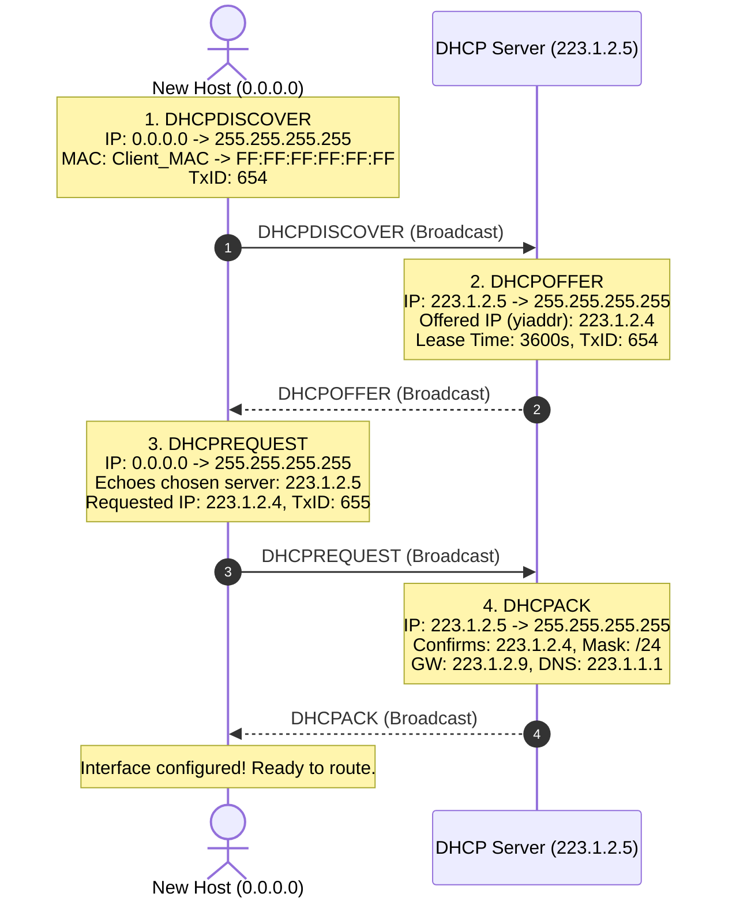
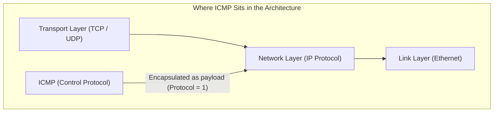
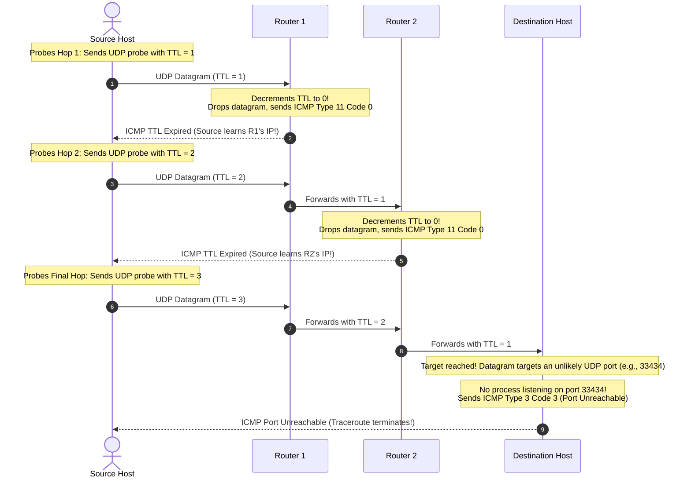

[CN Index](../README.md) / [Unit 4: Control, Link & Wireless](Introduction.md)

# Lecture 01: ICMP and DHCP in the Network Layer

A network cannot function without internal feedback.

When an intermediate router drops a datagram because its queue buffer overflowed, or because a physical link was severed, or because an IP packet was trapped in a routing loop, how does the sending host learn that an error occurred?

And when a brand new laptop joins an office Wi-Fi network, how does it configure its IP address, subnet mask, default gateway router, and DNS resolver without requiring a human administrator to manually type numbers into a settings menu?

These two operational imperatives are solved by two foundational Layer 3 control protocols:
1. **Dynamic Host Configuration Protocol (DHCP)**: The "plug-and-play" bootstrapping engine of the network edge.
2. **Internet Control Message Protocol (ICMP)**: The diagnostic and error-signaling nervous system of the Internet core.

---

## Dynamic Host Configuration Protocol (DHCP): Network Bootstrapping

When an unconfigured device connects to a physical link (whether plugging an Ethernet cable or associating with a Wi-Fi base station), it enters the network in a state of complete ignorance:
- It has no IP address.
- It does not know the network mask.
- It does not know the IP address of the first-hop default gateway router to reach the outside world.
- It does not know the IP address of the local DNS server.

**DHCP (RFC 2131)** automates this entire discovery process. It operates in a client-server architecture over **UDP**, using **server port 67** and **client port 68**.



### The 4-Step DORA Protocol Exchange
1. **DHCP Discover**:
   - The arriving client broadcasts a `DHCPDISCOVER` packet onto the local link.
   - Because the client has no IP address, its source IP is `0.0.0.0`.
   - The destination IP is `255.255.255.255` (limited local broadcast).
   - The link-layer destination MAC is `FF:FF:FF:FF:FF:FF` (all-ones broadcast).
   - The client includes a 32-bit **Transaction ID (`TxID = 654`)** to match asynchronous replies.
2. **DHCP Offer**:
   - The DHCP server (often running directly inside the local router) receives the broadcast.
   - It reserves an available IP address from its pool and broadcasts a `DHCPOFFER`.
   - It populates the **`yiaddr` ("your internet address")** field with the proposed IP (e.g., `223.1.2.4`).
   - It specifies a **Lease Lifetime** (e.g., 3600 seconds / 1 hour).
3. **DHCP Request**:
   - The client chooses one server's offer and broadcasts a `DHCPREQUEST`, echoing the chosen server's IP.
   - Why broadcast this? Because if multiple DHCP servers on the subnet made offers, this broadcast informs the chosen server that its offer was accepted, while simultaneously notifying all other servers that their offers were declined so they can release their reserved IPs back to their pools.
4. **DHCP Acknowledgment (ACK)**:
   - The chosen server commits the lease to memory and broadcasts a `DHCPACK`.

### The Four Essential Parameters Returned by DHCP
Notice that DHCP delivers far more than just an IP address. The `DHCPACK` carries the four pillars required for full Internet connectivity:
1. **Assigned Host IP Address**: (e.g., `223.1.2.4`).
2. **Subnet Mask**: (e.g., `255.255.255.0` or `/24`), allowing the host to determine whether a destination IP is local or remote.
3. **First-Hop Default Gateway Router IP**: (e.g., `223.1.2.9`), the router interface where the host must forward all off-subnet traffic.
4. **Local DNS Server IP Address**: (e.g., `223.1.1.1`), where the host must send hostname resolution queries.

---

## Internet Control Message Protocol (ICMP)

The network layer is fundamentally a best-effort, connectionless system. When something goes wrong in the network core—a router queue fills up, a route is missing, or a host is powered off—the IP protocol itself has no built-in mechanism to report failures.

**Internet Control Message Protocol (ICMP, RFC 792)** is the error-reporting and network-diagnostic mechanism of Layer 3.



### Architectural Placement
Where does ICMP live?
Architecturally, **ICMP sits just above IP**: an ICMP message is encapsulated directly inside an IP datagram with the IP `Protocol` field set to `1`. 

However, functionally, **ICMP is an integral part of Layer 3**. Routers generate ICMP messages in response to network-layer events, and host operating systems process ICMP messages inside the network stack.

---

## ICMP Message Wire Format and Error Types

Every ICMP message begins with an 8-byte header:
- **Type (8 bits)**: The broad category of the message.
- **Code (8 bits)**: The specific sub-reason for the message.
- **Checksum (16 bits)**: Error-detection checksum computed over the ICMP message.

```
 0                   1                   2                   3
 0 1 2 3 4 5 6 7 8 9 0 1 2 3 4 5 6 7 8 9 0 1 2 3 4 5 6 7 8 9 0 1
+-+-+-+-+-+-+-+-+-+-+-+-+-+-+-+-+-+-+-+-+-+-+-+-+-+-+-+-+-+-+-+-+
|     Type      |     Code      |           Checksum            |
+-+-+-+-+-+-+-+-+-+-+-+-+-+-+-+-+-+-+-+-+-+-+-+-+-+-+-+-+-+-+-+-+
|                 Contents dependent on Type/Code               |
+-+-+-+-+-+-+-+-+-+-+-+-+-+-+-+-+-+-+-+-+-+-+-+-+-+-+-+-+-+-+-+-+
|      Original IP Header + First 8 Bytes of Problem Datagram   |
+-+-+-+-+-+-+-+-+-+-+-+-+-+-+-+-+-+-+-+-+-+-+-+-+-+-+-+-+-+-+-+-+
```

### The Return-of-Context Rule
Notice the bottom row of the ICMP format:
Whenever a router generates an ICMP error message, **it attaches the entire original IPv4 header plus the first 8 bytes of the offending datagram's payload!**

Why? Because the first 8 bytes of a TCP or UDP payload contain the **Source and Destination Port Numbers**! By inspecting this returned fragment, the sending host's operating system knows exactly which socket, process, and application triggered the error!

---

## Canonical ICMP Types and Codes

| Type | Code | Description | Semantic Meaning & Trigger |
| :---: | :---: | :--- | :--- |
| **`0`** | `0` | **Echo Reply** | Response to an active `ping` request. |
| **`3`** | `0` | **Dest. Network Unreachable** | Router has no route in its forwarding table to target network. |
| **`3`** | `1` | **Dest. Host Unreachable** | Router cannot resolve destination host MAC via ARP on local subnet. |
| **`3`** | `2` | **Dest. Protocol Unreachable** | Destination host does not support the requested Layer 4 protocol. |
| **`3`** | `3` | **Dest. Port Unreachable** | UDP packet arrived at destination, but no socket was bound to that port. |
| **`3`** | `4` | **Fragmentation Needed (DF Set)**| Packet exceeds outgoing link MTU, but `DF = 1` prohibits fragmentation. |
| **`4`** | `0` | **Source Quench** | Early router congestion warning (deprecated). |
| **`8`** | `0` | **Echo Request** | Probing message sent by `ping`. |
| **`9`** | `0` | **Route Advertisement** | Router discovery message. |
| **`11`**| `0` | **TTL Expired in Transit** | Packet TTL decremented to 0; discarded to prevent looping (used in `traceroute`). |
| **`12`**| `0` | **Bad IP Header** | Parameter problem; illegal header field or invalid checksum. |

---

## Network Diagnostics: `ping` and `traceroute`

The two most famous command-line diagnostic tools in networking are built directly on top of ICMP:

### 1. `ping` (Echo Request and Echo Reply)
The `ping` command verifies physical end-to-end network reachability and measures round-trip latency:
1. The client sends an **ICMP Type 8, Code 0 (Echo Request)** message to the target host.
2. The operating system kernel of the target machine automatically generates an **ICMP Type 0, Code 0 (Echo Reply)** and sends it back.
3. The sender computes the elapsed Round-Trip Time (RTT) and reports packet loss statistics.

### 2. `traceroute` (Exploiting TTL Expiration)
`traceroute` maps the exact sequence of routers between a source and a destination. It achieves this not through special router software, but by **intentionally weaponizing the TTL field and ICMP Type 11**:



1. The source sends three UDP datagrams targeting an unlikely, unused high port (e.g., `33434`) with **`TTL = 1`**.
2. **Router 1** decrements TTL to `0`, drops the packet, and returns an **ICMP Type 11, Code 0 (TTL Expired)**. The source records the arrival time and learns Router 1's IP address.
3. The source sends three probes with **`TTL = 2`**. Router 1 decrements TTL to 1 and forwards; **Router 2** decrements TTL to 0, drops the packet, and returns an ICMP Type 11 message. The source learns Router 2's IP address.
4. When the probe reaches the **Destination Host**, the host does *not* drop the packet due to TTL. Instead, its operating system discovers that no application is listening on UDP port `33434`. It returns an **ICMP Type 3, Code 3 (Destination Port Unreachable)**.
5. Upon receiving the Type 3 error, `traceroute` knows it has reached the destination and prints the completed path!

---

## Key Takeaways

- DHCP automates network bootstrapping via a 4-step broadcast exchange (**DORA**: Discover, Offer, Request, ACK) over UDP ports 67 and 68.
- The `DHCPACK` returns four vital parameters: Assigned IP, Subnet Mask, First-Hop Default Gateway Router IP, and Local DNS Server IP.
- ICMP (RFC 792) provides error reporting and signaling; it is encapsulated inside IP (Protocol = 1), but functions as part of Layer 3.
- ICMP messages feature 8-bit `Type` and 8-bit `Code` fields; error messages return the original IP header plus the first 8 bytes of the offending payload to identify the socket.
- `ping` sends ICMP Type 8 (Echo Request) and receives Type 0 (Echo Reply).
- `traceroute` maps intermediate hops by sending probes with incrementing TTL values ($1, 2, 3 \dots$), harvesting ICMP Type 11 (TTL Expired) messages from routers, and terminating on ICMP Type 3 Code 3 (Port Unreachable) from the destination.

---

Now that we understand how IPv4 networks are bootstrapped, addressed, and diagnosed, we must confront the reality of IPv4's finite 32-bit ceiling. To understand how the Internet transitioned to an astronomical 128-bit address space with streamlined headers, we explore [IPv6 Architecture and Transition Strategies](L02%20-%20IPv6%20Architecture%20and%20Transition%20Strategies.md).
