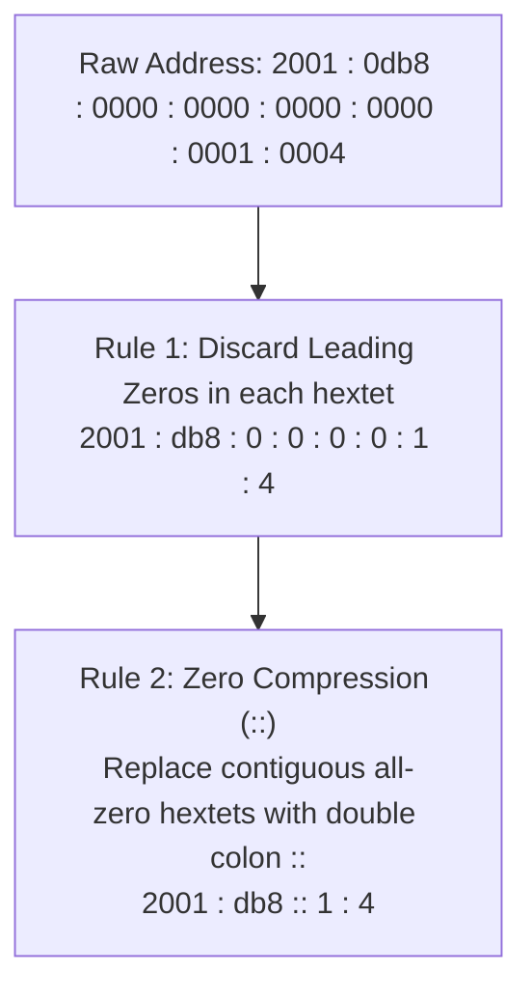
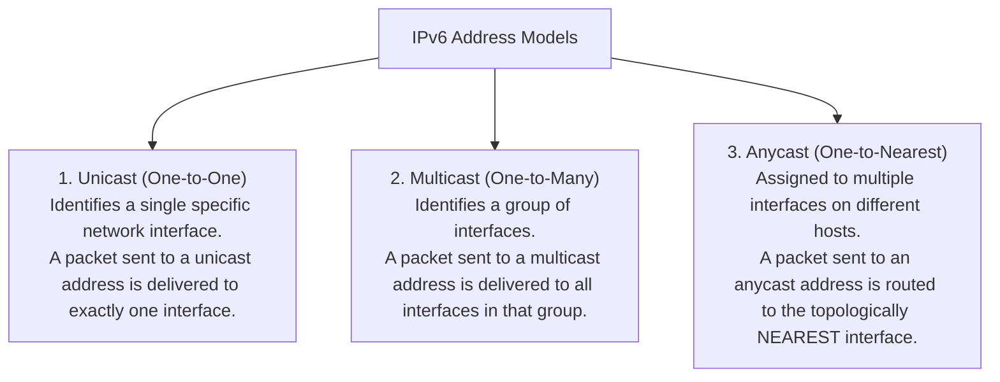
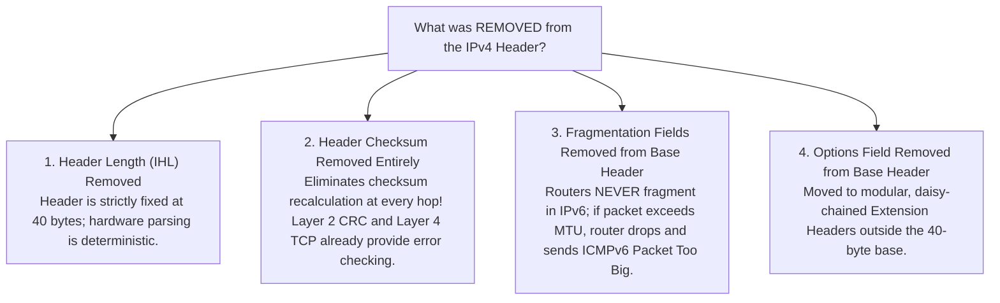
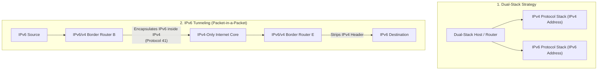

[CN Index](../README.md) / [Unit 4: Control, Link & Wireless](Introduction.md)

# Lecture 02: IPv6 Architecture and Transition Strategies

By the early 1990s, the engineering limitations of IPv4 were undeniable:
With a 32-bit address space, IPv4 can provide at most $2^{32} \approx 4.3\text{ billion}$ distinct addresses. Even with CIDR route aggregation and NAT translation, the proliferation of personal laptops, mobile phones, connected vehicles, and IoT sensors guaranteed that IPv4 address exhaustion was an absolute mathematical certainty.

Furthermore, IPv4 carried legacy design baggage from the 1970s:
- Variable-length headers forced routers into costly software branch predictions.
- Checksums forced routers to recompute arithmetic at every hop.
- In-network fragmentation caused massive buffer bloat and packet drops.

In response, the Internet Engineering Task Force (IETF) developed **IPv6 (RFC 2460 / RFC 8200)**. 

IPv6 is not merely IPv4 with longer addresses; it represents a comprehensive architectural overhaul designed to maximize hardware forwarding speed and provide an inexhaustible address space.

---

## The Scale of the 128-Bit IPv6 Address Space

An IPv6 address is **128 bits long**—four times the bit width of IPv4.

While 4 times the bits might sound like 4 times the addresses, the power of binary exponents means the address space scales as $2^{128}$:

$$2^{128} \approx \mathbf{3.4 \times 10^{38}\text{ addresses}}$$

Written out in full:
$$340,282,366,920,938,463,374,607,431,768,211,456\text{ addresses}$$

This is **340 undecillion addresses**—an address space $2^{96}$ times larger than IPv4. There are enough IPv6 addresses to assign billions of unique IP addresses to every single atom on the surface of the Earth. Address scarcity has been permanently eradicated.

---

## Colon-Hexadecimal Notation and Abbreviation Rules

Because a 128-bit number written in dotted-decimal would require 16 awkward octets, IPv6 is written in **Colon-Hexadecimal Notation**:
- The 128 bits are divided into **eight 16-bit blocks** (called *hextets*).
- Each hextet is represented as four hexadecimal digits ($0$ to $F$, representing 16 bits), separated by colons:

$$\mathbf{2001 : 0db8 : 85a3 : 0000 : 0000 : 8a2e : 0370 : 7334}$$

Writing 32 hexadecimal digits for every IP address is tedious, so IPv6 defines **two strict abbreviation rules**:



### Rule 1: Discard Leading Zeros in Each Hextet
Within each 16-bit block, leading zeros may be omitted:
- `000A` becomes `A`
- `0042` becomes `42`
- `0000` becomes `0`
*(Trailing zeros cannot be omitted, as `0400` is completely different from `4`)*.

### Rule 2: Zero Compression via the Double Colon (`::`)
Any contiguous sequence of two or more blocks of all zeros (`0000:0000...`) can be compressed into a single double colon: `::`.

> **The Inviolable Rule of the Double Colon**: The `::` symbol **can appear at most ONCE** in an entire IPv6 address! 
> If `::` appeared twice, a parser could not determine how many zero blocks were represented by each `::`, creating fatal ambiguity.

### Canonical Examples and Problem Solutions

1. **The Unspecified Address (All 128 zeros)**:
   - Unabbreviated: `0000:0000:0000:0000:0000:0000:0000:0000`
   - Compressed: **`::`**
2. **The Loopback Address (127 zeros followed by a single 1)**:
   - Unabbreviated: `0000:0000:0000:0000:0000:0000:0000:0001`
   - Compressed: **`::1`** (The IPv6 equivalent of IPv4's `127.0.0.1`).
3. **Decompressing `1111::2222`**:
   - The address has two specified hextets (`1111` and `2222`).
   - A complete address must contain 8 hextets; therefore, `::` represents $8 - 2 = 6$ blocks of zeros.
   - Unabbreviated: **`1111:0000:0000:0000:0000:0000:0000:2222`**.
4. **IPv4-Mapped IPv6 Address**:
   - Used by dual-stack devices to represent an IPv4 host (`192.168.1.1`):
   - Compressed: **`::FFFF:192.168.1.1`** (or `::FFFF:C0A8:0101`).

---

## The Three IPv6 Address Types

In IPv6, destination addresses are categorized into three distinct communication modes:



### The Elimination of Broadcast
Notice someone missing: **Broadcast is completely gone in IPv6!**

In IPv4, broadcast packets (`255.255.255.255` or subnet broadcasts) forced every single device on an Ethernet LAN to wake up, interrupt its CPU, and inspect the frame—even if the packet was meant for a single DHCP daemon.

IPv6 completely eliminated broadcast. All broadcast functions are replaced by dedicated, scoped **Multicast Groups** (e.g., `FF02::1` for all nodes on the local link, or `FF02::2` for all routers). Network cards filter out multicast traffic in hardware, eliminating broadcast CPU storms.

---

## The Streamlined 40-Byte Fixed Base Header

While the IPv6 address is four times larger than IPv4, the **IPv6 Base Header is radically simplified**:

```
 0                   1                   2                   3
 0 1 2 3 4 5 6 7 8 9 0 1 2 3 4 5 6 7 8 9 0 1 2 3 4 5 6 7 8 9 0 1
+-+-+-+-+-+-+-+-+-+-+-+-+-+-+-+-+-+-+-+-+-+-+-+-+-+-+-+-+-+-+-+-+
|Version| Traffic Class |           Flow Label                  |
+-+-+-+-+-+-+-+-+-+-+-+-+-+-+-+-+-+-+-+-+-+-+-+-+-+-+-+-+-+-+-+-+
|         Payload Length        |  Next Header  |   Hop Limit   |
+-+-+-+-+-+-+-+-+-+-+-+-+-+-+-+-+-+-+-+-+-+-+-+-+-+-+-+-+-+-+-+-+
|                                                               |
+                                                               +
|                                                               |
+                         Source Address                        +
|                           (128 bits)                          |
+                                                               +
|                                                               |
+-+-+-+-+-+-+-+-+-+-+-+-+-+-+-+-+-+-+-+-+-+-+-+-+-+-+-+-+-+-+-+-+
|                                                               |
+                                                               +
|                                                               |
+                      Destination Address                      +
|                           (128 bits)                          |
+                                                               +
|                                                               |
+-+-+-+-+-+-+-+-+-+-+-+-+-+-+-+-+-+-+-+-+-+-+-+-+-+-+-+-+-+-+-+-+
```

The IPv6 base header is strictly fixed at **40 bytes (320 bits)**.

### Field-by-Field Breakdown
1. **Version (`4 bits`)**: Fixed to `0110` ($6$).
2. **Traffic Class (`8 bits`)**: Equivalent to IPv4's DSCP and ECN; classifies packet priority for QoS.
3. **Flow Label (`20 bits`)**: Brand new to IPv6! Allows a sender to label a sequence of packets belonging to a specific non-default flow (e.g., a real-time VoIP call or 4K video stream). Routers can recognize flow labels and provide specialized forwarding without parsing transport headers.
4. **Payload Length (`16 bits`)**: The number of bytes following the 40-byte base header (includes extension headers + upper-layer TCP/UDP payload).
5. **Next Header (`8 bits`)**: Replaces IPv4's Protocol field! It specifies the protocol type of the header immediately following this base header. It can point to an upper-layer transport protocol (`6` for TCP, `17` for UDP), OR to an IPv6 **Extension Header**.
6. **Hop Limit (`8 bits`)**: Replaces IPv4's TTL. Decremented by 1 at every router hop; dropped when it reaches 0.
7. **Source and Destination Addresses (`128 bits each`)**: Global 16-byte addresses.

---

## What Was Removed from IPv4 and Why?

The true genius of IPv6 lies in what was **eliminated**:



By removing the checksum, fixing the length to 40 bytes, and eliminating router-side fragmentation, **IPv6 allows router silicon to parse and forward packets in hardware at astronomical line rates**.

---

## Transition Strategies: Moving from IPv4 to IPv6

The global Internet cannot have a "Flag Day"—we cannot turn off the global network at midnight and reboot all billions of devices on IPv6 simultaneously.

To transition incrementally, the Internet relies on two key co-existence mechanisms:



### 1. Dual-Stack Architecture
In Dual-Stack, end hosts and edge routers run **both IPv4 and IPv6 protocol stacks simultaneously**.
- A dual-stack machine has both an IPv4 address and an IPv6 address configured on its interface.
- When querying DNS, it requests both an `A` record (IPv4) and an `AAAA` record (IPv6). If the remote destination supports IPv6, it communicates via IPv6; otherwise, it falls back to IPv4.

### 2. IPv6 Tunneling (Packet-within-a-Packet)
What happens when two modern IPv6-enabled networks must communicate, but the intermediate ISP connecting them is an old, legacy IPv4-only network?

The border routers use **Tunneling**:
1. Host A (IPv6) creates an IPv6 packet destined for Host F (IPv6).
2. The packet reaches border **Router B** (Dual-Stack). Router B sees that the next hop crosses an IPv4-only network.
3. Router B **encapsulates the entire IPv6 datagram inside the payload of a standard IPv4 datagram!**
   - Outer IPv4 Header: `Source = Router B (IPv4)`, `Destination = Router E (IPv4)`, `Protocol = 41` (IPv6-in-IPv4).
4. The intermediate IPv4 routers forward the packet across the country as an ordinary IPv4 packet. They have no idea there is an IPv6 datagram hiding inside!
5. When the packet arrives at border **Router E**, Router E strips the outer IPv4 header, extracts the pristine IPv6 datagram, and forwards it to the final destination Host F.

---

## Key Takeaways

- IPv6 expands the address space to **128 bits** ($3.4 \times 10^{38}$ addresses), eradicating address exhaustion.
- IPv6 uses colon-hexadecimal notation (eight 16-bit hextets). Leading zeros may be omitted, and contiguous zero blocks can be compressed once with `::`.
- IPv6 defines **Unicast**, **Multicast**, and **Anycast**; **Broadcast has been completely eliminated**.
- The IPv6 base header is strictly fixed at **40 bytes**, accelerating hardware parsing.
- The **Header Checksum was eliminated** to avoid hop-by-hop recomputation; **router-side fragmentation was abolished** in favor of end-to-end PMTUD.
- Transition mechanisms include **Dual-Stack** (running both stacks simultaneously) and **Tunneling** (encapsulating IPv6 datagrams inside IPv4 packets across legacy cores).

---

Now that we have analyzed the data plane of both IPv4 and IPv6, we must answer the core question of the control plane: how do routers actually determine the shortest, least-cost paths across the global mesh? To explore the mathematics of graph routing, we turn to [Routing Algorithms - Link-State and Dijkstra](L03%20-%20Routing%20Algorithms%20-%20Link-State%20and%20Dijkstra.md).
