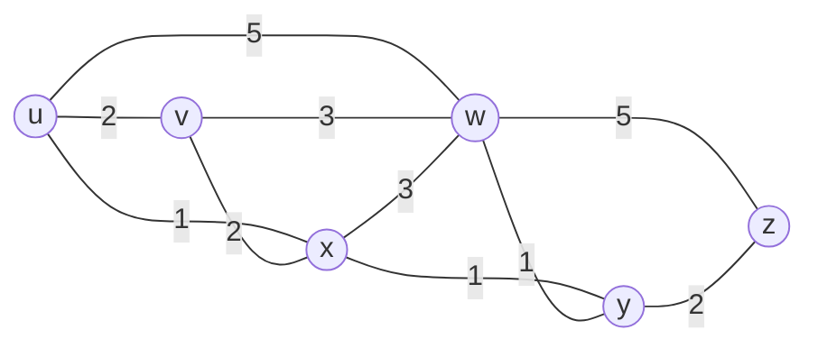
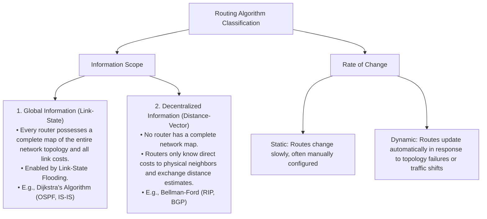
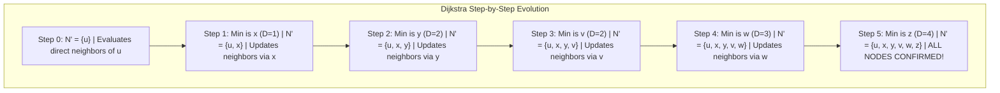
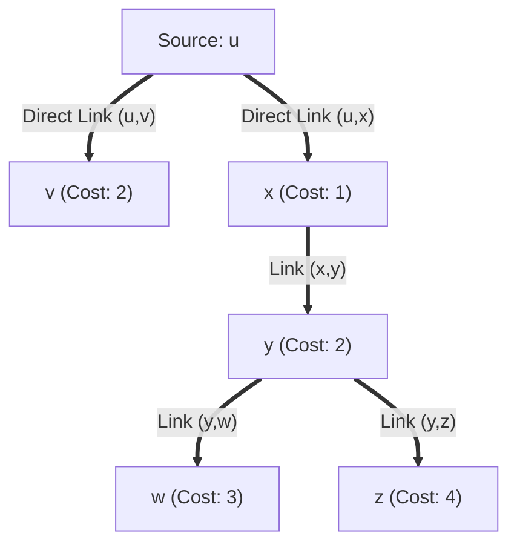
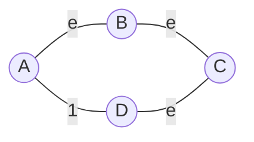

[CN Index](../README.md) / [Unit 4: Control, Link & Wireless](Introduction.md)

# Lecture 03: Routing Algorithms - Link-State and Dijkstra

In the data plane, a router's job is purely mechanical: inspect an arriving packet's destination IP, consult the local forwarding table, and push the packet out the designated port in nanoseconds.

Now we enter the **Control Plane**.

Where did that forwarding table come from? Who calculated that packets destined for Boston should leave through interface 2, while packets for Seattle should leave through interface 3?

This is the job of **Routing Algorithms**.

The goal of a routing protocol is to determine "good" end-to-end paths from sending hosts to receiving hosts across a global network of routers. A "good" path is typically defined as the path with the **least total cost**—which, depending on operator policy, may mean the fastest line rate, the minimum propagation delay, the fewest physical hops, or the lowest financial transit fee.

---

## Graph Abstraction of a Network

To reason about routing mathematically, we model a network as a weighted, undirected **Graph**:

$$G = (V, E)$$



- **$V$ (Vertices / Nodes)**: The set of routers in the network:
  $$V = \{u, v, w, x, y, z\}$$
- **$E$ (Edges / Links)**: The set of physical communication links connecting the routers:
  $$E = \{(u,v), (u,x), (u,w), (v,x), (v,w), (x,w), (x,y), (w,y), (w,z), (y,z)\}$$
- **$c(x, y)$ (Link Cost)**: The numerical cost of the direct edge between node $x$ and node $y$.
  - If $x$ and $y$ share a direct physical link, $c(x, y)$ is a positive real number (e.g., $c(u, x) = 1$).
  - If $x$ and $y$ are **not** directly connected, the direct cost is infinite:
    $$c(u, z) = \infty$$

The cost of a path $(x_1, x_2, \dots, x_k)$ is simply the sum of all individual link costs along that path:

$$\text{Path Cost} = \sum_{i=1}^{k-1} c(x_i, x_{i+1})$$

The least-cost routing problem is to find the path between any source and destination that minimizes this sum.

---

## Classification of Routing Algorithms

Routing algorithms fall into two broad taxonomic categories:



---

## Dijkstra's Link-State Routing Algorithm

In a **Link-State (LS)** protocol:
1. Every router periodically tests the status and cost of its directly attached links.
2. Every router creates a **Link-State Packet (LSP)** listing its neighbors and costs, and **broadcasts (floods)** this packet to every other router in the network.
3. Because link-state packets are flooded globally, **every router in the network constructs an identical, complete map of graph $G = (V, E)$**.
4. With the complete graph in memory, each router independently runs **Dijkstra's Shortest Path Algorithm** to compute the least-cost path from itself to all other nodes.

### Algorithm Notation
Let the source node running the algorithm be $u$:
- $c(x, y)$: Direct link cost from node $x$ to node $y$ ($=\infty$ if not direct neighbors).
- $D(v)$: Current estimate of the cost of the least-cost path from source $u$ to destination $v$.
- $p(v)$: Predecessor node immediately preceding $v$ along the current least-cost path.
- $N'$: The set of nodes whose least-cost paths from source $u$ are **definitively known**.

### Algorithm Pseudo-Code

```python
# 1. Initialization
N_prime = {u}
for all nodes v in V:
    if v is adjacent to u:
        D[v] = c(u, v)
        p[v] = u
    else:
        D[v] = infinity

# 2. Main Loop
while N_prime != V:
    # Find node w not in N_prime with minimum D[w]
    find w not in N_prime such that D[w] is minimized
    add w to N_prime
    
    # Update tentative costs for all neighbors of w still outside N_prime
    for each neighbor v of w not in N_prime:
        D[v] = min(D[v], D[w] + c(w, v))
        # If D[v] was updated, update predecessor: p[v] = w
```

Notice the update equation:
$$D(v) \leftarrow \min\Big( D(v), \; D(w) + c(w, v) \Big)$$

It asks: *"Is the path to $v$ we already knew about cheaper than taking our newly confirmed shortest path to $w$ and then walking the direct link from $w$ to $v$?"* If the path through $w$ is cheaper, we update our estimate and set $w$ as $v$'s predecessor.

---

## Step-by-Step Execution Trace

Let's execute Dijkstra's algorithm on the 6-node network graph from our slides:
- Nodes: $\{u, v, w, x, y, z\}$.
- Direct links: $c(u,v)=2, c(u,x)=1, c(u,w)=5, c(x,v)=2, c(x,w)=3, c(x,y)=1, c(w,y)=1, c(w,z)=5, c(y,z)=2$.



### The Dijkstra Execution Table

| Step | Confirmed Set $N'$ | $D(v), p(v)$ | $D(w), p(w)$ | $D(x), p(x)$ | $D(y), p(y)$ | $D(z), p(z)$ | Newly Added Node |
| :---: | :--- | :---: | :---: | :---: | :---: | :---: | :---: |
| **0** | $\{u\}$ | $2, u$ | $5, u$ | **$1, u$** | $\infty$ | $\infty$ | $x$ (min cost = 1) |
| **1** | $\{u, x\}$ | **$2, u$** | $4, x$ | — | **$2, x$** | $\infty$ | $y$ (tie with $v$, pick $y$) |
| **2** | $\{u, x, y\}$ | **$2, u$** | $3, y$ | — | — | $4, y$ | $v$ (min cost = 2) |
| **3** | $\{u, x, y, v\}$ | — | **$3, y$** | — | — | $4, y$ | $w$ (min cost = 3) |
| **4** | $\{u, x, y, v, w\}$ | — | — | — | — | **$4, y$** | $z$ (min cost = 4) |
| **5** | $\{u, x, y, v, w, z\}$| — | — | — | — | — | **Complete!** |

### Step-by-Step Explanation:
- **Step 0 (Initialization)**: $N'=\{u\}$. Neighbors of $u$ are $v$ (cost 2), $x$ (cost 1), and $w$ (cost 5). $y$ and $z$ are unreachable ($\infty$). The minimum cost node outside $N'$ is **$x$ with $D(x) = 1$**. Add $x$ to $N'$.
- **Step 1**: From $x$, we check neighbors of $x$:
  - Node $v$: $\min(2, D(x) + c(x,v)) = \min(2, 1 + 2) = 2$ (remains $2, u$).
  - Node $w$: $\min(5, D(x) + c(x,w)) = \min(5, 1 + 3) = \mathbf{4, x}$ (improved from 5!).
  - Node $y$: $\min(\infty, D(x) + c(x,y)) = \min(\infty, 1 + 1) = \mathbf{2, x}$ (improved from $\infty$!).
  - Unconfirmed nodes: $v$ (2), $y$ (2), $w$ (4), $z$ ($\infty$). Nodes $v$ and $y$ are tied at cost 2. Arbitrarily choose **$y$**; add $y$ to $N'$.
- **Step 2**: From $y$, check unconfirmed neighbors of $y$:
  - Node $w$: $\min(4, D(y) + c(y,w)) = \min(4, 2 + 1) = \mathbf{3, y}$ (improved from 4!).
  - Node $z$: $\min(\infty, D(y) + c(y,z)) = \min(\infty, 2 + 2) = \mathbf{4, y}$ (improved from $\infty$!).
  - Unconfirmed nodes: $v$ (2), $w$ (3), $z$ (4). The minimum is **$v$ with $D(v) = 2$**. Add $v$ to $N'$.
- **Step 3**: From $v$, check neighbors: node $w$: $\min(3, D(v) + c(v,w)) = \min(3, 2 + 3) = 3$ (no change). Minimum unconfirmed is **$w$ with $D(w) = 3$**. Add $w$ to $N'$.
- **Step 4**: From $w$, check neighbors: node $z$: $\min(4, D(w) + c(w,z)) = \min(4, 3 + 5) = 4$ (no change). Minimum unconfirmed is **$z$ with $D(z) = 4$**. Add $z$ to $N'$.
- **Step 5**: All nodes are in $N'$. Algorithm terminates.

---

## Constructing the Shortest-Path Tree and Forwarding Table

By tracing the predecessor pointers $p(v)$ backward from each destination to the source $u$, we construct the **Shortest-Path Tree rooted at $u$**:



### Deriving the Local Forwarding Table for Node $u$
Node $u$ inspects the first link along each path in the tree:

| Destination Node | Shortest Path from $u$ | Total Cost | Outgoing Link Interface |
| :---: | :--- | :---: | :---: |
| **$v$** | $u \to v$ | $2$ | **$(u, v)$** |
| **$x$** | $u \to x$ | $1$ | **$(u, x)$** |
| **$y$** | $u \to x \to y$ | $2$ | **$(u, x)$** |
| **$w$** | $u \to x \to y \to w$ | $3$ | **$(u, x)$** |
| **$z$** | $u \to x \to y \to z$ | $4$ | **$(u, x)$** |

Notice: Node $u$ sends traffic directly to $v$ via interface $(u, v)$. For all other nodes in the network ($x, y, w, z$), node $u$ forwards packets out interface **$(u, x)$**!

---

## Algorithm Complexity and Route Oscillations

### Computational Complexity
In a network with $|V|$ nodes:
- Step 0 searches $|V|-1$ nodes.
- Step 1 searches $|V|-2$ nodes.
- Total comparisons: $(|V|-1) + (|V|-2) + \dots + 1 = \frac{|V|(|V|-1)}{2} = \mathbf{O(|V|^2)}$.
- Using an efficient priority queue (min-heap), the complexity drops to:
  $$\mathbf{O(|E| + |V| \log |V|)}$$

### The Hazard of Route Oscillations under Traffic-Sensitive Costs
What happens if the link cost $c(x, y)$ is defined not as a static value, but as a dynamic function of **link congestion/load**?



1. Initially, path through $A \to B \to C$ carries traffic; its congestion cost increases.
2. At the next Dijkstra execution, all routers discover that $A \to D \to C$ is cheaper.
3. **All routers simultaneously shift their traffic to $A \to D \to C$!**
4. Now link $D \to C$ becomes heavily congested, while link $B \to C$ becomes idle with zero cost.
5. In the next iteration, all traffic shifts back to $B \to C$!

This produces **endless, violent route oscillations**, causing packet reordering and buffer churn.

**Solution**: Network operators never base link costs directly on dynamic load; link costs are static metrics configured inversely proportional to physical link capacity, and router update timers are randomized to prevent synchronized flooding.

---

## Key Takeaways

- Routing algorithms determine end-to-end paths across a graph $G = (V, E)$ where nodes are routers and edges are communication links.
- **Link-State algorithms are global**: every router floods link-state packets (LSPs) so that all routers possess an identical network map.
- **Dijkstra's Algorithm** is an iterative, greedy algorithm that calculates least-cost paths from a source to all destinations.
- At each step, the algorithm permanently confirms the minimum tentative-cost node outside $N'$ and updates tentative distances to its neighbors: $D(v) = \min(D(v), D(w) + c(w,v))$.
- The shortest-path tree dictates the local router's forwarding table interfaces.
- Dijkstra's complexity is $O(|V|^2)$ (or $O(|E| \log |V|)$ with heaps).
- Dynamic load-sensitive link costs cause destructive route oscillations; production protocols (like OSPF) enforce static capacity-based weights.

---

While Link-State routing is powerful, flooding full topology maps to every router becomes unwieldy when networks scale to millions of nodes. What if routers never flooded a global map, but instead communicated only by exchanging distance estimates with their immediate physical neighbors? To see how distributed dynamic programming routes packets, we turn to [Routing Algorithms - Distance-Vector and Hierarchical Routing](L04%20-%20Routing%20Algorithms%20-%20Distance-Vector%20and%20Hierarchical%20Routing.md).
