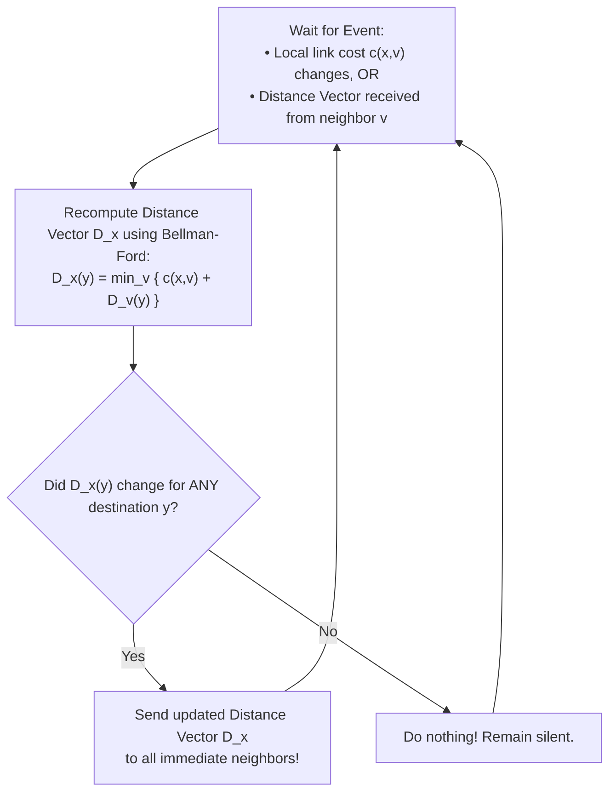
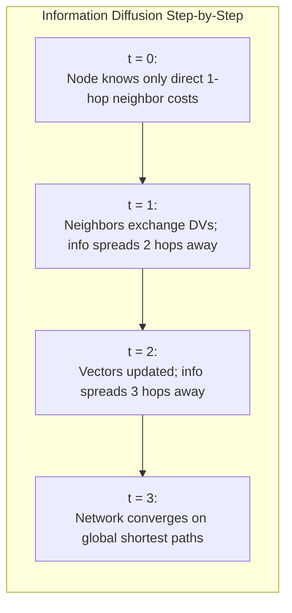
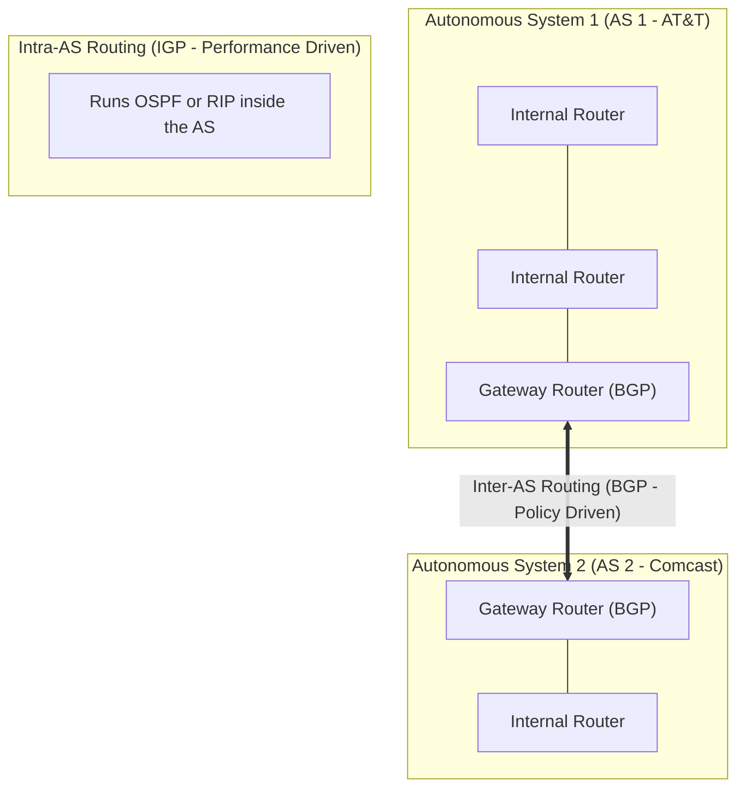

[CN Index](../README.md) / [Unit 4: Control, Link & Wireless](Introduction.md)

# Lecture 04: Routing Algorithms - Distance-Vector and Hierarchical Routing

In Link-State routing (Dijkstra), every router required a complete, global map of the entire network. To build that map, every node had to flood link-state packets across the entire Internet.

Now think about the scaling consequence:
If the global Internet contains millions of routers, flooding link updates across every router on Earth would overwhelm link bandwidth and exhaust router memory.

Can routers discover optimal paths **without ever constructing a global map**?

Yes. This is the paradigm of **Distance-Vector (DV) Routing**.

In Distance-Vector routing, a router possesses no global map of the topology. It does not know which routers exist beyond its immediate horizon. It knows only two things:
1. The direct link cost to its immediate physical neighbors.
2. The distance estimates (vectors) reported to it by those neighbors.

Through a distributed, asynchronous exchange of vectors, the network mathematically converges on the exact same least-cost shortest paths as Dijkstra.

---

## The Bellman-Ford Equation: Dynamic Programming at the Edge

Distance-Vector routing is a direct distributed implementation of the **Bellman-Ford Algorithm**, grounded in the principle of dynamic programming.

Let:
- $c(x, v)$ = Direct link cost between node $x$ and its immediate neighbor $v$.
- $D_v(y)$ = The cost of the least-cost path from neighbor $v$ to destination $y$.
- $D_x(y)$ = The cost of the least-cost path from node $x$ to destination $y$.

The **Bellman-Ford Equation** states:

$$D_x(y) = \min_{v \in \text{neighbors}(x)} \Big\{ c(x, v) + D_v(y) \Big\}$$

```mermaid
flowchart LR
    x((x)) -->|c(x, v1)| v1((v1))
    x -->|c(x, v2)| v2((v2))
    x -->|c(x, v3)| v3((v3))
    
    v1 -.->|"D_v1(y)"| y((Destination: y))
    v2 -.->|"D_v2(y)"| y
    v3 -.->|"D_v3(y)"| y
```

### The Intuition
Stand at node $x$ and look toward destination $y$:
- You cannot see $y$ directly.
- But your neighbor $v_1$ tells you: *"I can reach $y$ with cost 5"*.
- Your neighbor $v_2$ tells you: *"I can reach $y$ with cost 3"*.
- Your direct link to $v_1$ costs $2$; your direct link to $v_2$ costs $4$.

Which path is cheaper?
- Path via $v_1$: $c(x, v_1) + D_{v_1}(y) = 2 + 5 = \mathbf{7}$.
- Path via $v_2$: $c(x, v_2) + D_{v_2}(y) = 4 + 3 = \mathbf{7}$.

The neighbor $v^*$ that minimizes the Bellman-Ford equation becomes node $x$'s **Next Hop** in its forwarding table for destination $y$.

---

## Concrete Bellman-Ford Example

Consider node $u$ attempting to find the shortest path to destination $z$ in our reference network:
- Neighbors of $u$: $v$, $x$, and $w$.
- Direct costs from $u$: $c(u, v) = 2$, $c(u, x) = 1$, $c(u, w) = 5$.
- Suppose $u$'s neighbors report their current estimated distances to $z$:
  - $D_v(z) = 5$
  - $D_x(z) = 3$
  - $D_w(z) = 3$

Now apply Bellman-Ford at node $u$:

$$D_u(z) = \min \Big\{ c(u, v) + D_v(z), \; c(u, x) + D_x(z), \; c(u, w) + D_w(z) \Big\}$$
$$D_u(z) = \min \Big\{ 2 + 5, \; 1 + 3, \; 5 + 3 \Big\} = \min \{ 7, \; \mathbf{4}, \; 8 \} = \mathbf{4}$$

The minimum cost is **$4$**, achieved through neighbor **$x$**. 
Therefore, node $u$ enters into its forwarding table:
$$\text{Destination: } z \implies \text{Next Hop: } x \quad (\text{Cost: } 4)$$

---

## The Distance-Vector Algorithm Mechanics

Each node $x$ maintains a **Distance Vector**:

$$\mathbf{D}_x = \big[ D_x(y) : y \in V \big]$$

The algorithm is **iterative, asynchronous, and distributed**:



1. **Local Storage**: Node $x$ stores its own distance vector $\mathbf{D}_x$, the direct link costs $c(x, v)$ to each neighbor $v$, and the distance vectors $\mathbf{D}_v$ received from each neighbor.
2. **Triggered Execution**: A node recalculates its vector *only* when a local link cost changes or when an update arrives from a neighbor.
3. **Self-Stopping Silence**: If recalculation produces no change in node $x$'s least-cost estimates, **$x$ sends nothing**. Communication naturally ceases once all nodes converge.

---

## Information Diffusion Across Time

How does distance information spread across a multi-hop mesh?



- At $t=0$, each node only knows the costs to its directly attached physical neighbors. Distances to all other nodes are initialized to $\infty$.
- At $t=1$, nodes exchange initial vectors. Each node now learns paths to nodes **2 hops away**.
- At each successive iteration, information diffuses one hop further into the network until all shortest paths are resolved.

---

## The Link Cost Anomaly: "Good News Travels Fast, Bad News Travels Slow"

While Distance-Vector routing converges cleanly under static topologies, it exhibits an asymmetric vulnerability when link costs change:

### 1. "Good News Travels Fast"
Suppose the cost of the link between $x$ and $y$ drops from $4$ down to $1$:
- Node $y$ detects the improved cost, updates its vector, and notifies neighbor $z$.
- Node $z$ receives the update, recalculates its distance to $x$ ($c(z, y) + D_y(x) = 1 + 1 = 2$), updates its table, and notifies $y$.
- The network stabilizes in **2 iterations**. Good news propagates through the network almost instantly.

### 2. "Bad News Travels Slow": The Count-to-Infinity Problem
Now consider the reverse: the link cost between $x$ and $y$ jumps from $4$ up to **$60$** (or the link breaks entirely):

```mermaid
flowchart LR
    x((x)) ---|Cost: 60 (Broken Link!)| y((y))
    y ---|Cost: 1| z((z))
    x ---|Cost: 50| z
```

Watch the disaster unfold:
1. Node $y$ detects that its direct link to $x$ now costs $60$.
2. Node $y$ looks at its neighbor $z$. Node $z$ had previously announced: *"I can reach $x$ with cost 5"* (because $z$'s old path went through $y$ via $1 + 4 = 5$).
3. **The Fatal Illusion**: Node $y$ does not realize that $z$'s path to $x$ went through $y$ itself!
4. Node $y$ thinks: *"Aha! My direct link to $x$ is 60, but I can reach $x$ through $z$ for cost $c(y, z) + D_z(x) = 1 + 5 = \mathbf{6}$!"*
5. Node $y$ sets its cost to $x$ as $6$ and announces to $z$: *"My new cost to $x$ is 6"*.
6. Node $z$ receives $y$'s update. It recalculates: *"Since $y$ can reach $x$ with cost 6, my cost via $y$ is now $1 + 6 = \mathbf{7}$"*.
7. $z$ notifies $y$ of cost $7$. $y$ updates to $1 + 7 = \mathbf{8}$, and notifies $z$.
8. $z$ updates to $1 + 8 = \mathbf{9}$, and notifies $y$...

$y$ and $z$ enter a catastrophic feedback loop, incrementing their costs by 1 on every iteration:

$$5 \to 6 \to 7 \to 8 \to 9 \dots \to 50$$

During this entire time, packets destined for $x$ bounce back and forth between $y$ and $z$ in an infinite **routing loop**! They count up until the cost reaches $50$ (when $z$ finally realizes routing directly to $x$ via the 50-cost link is cheaper).

This pathology is the famous **Count-to-Infinity Problem**.

---

## The Solution: Poisoned Reverse

How do we break the 2-node count-to-infinity loop?

We enforce the heuristic rule of **Poisoned Reverse**:
> **The Poisoned Reverse Rule**: If node $z$ routes through node $y$ to reach destination $x$, **node $z$ explicitly advertises to $y$ that its distance to $x$ is INFINITY ($\infty$)**:
> $$D_z(x) = \infty \quad (\text{advertised only to } y)$$

By lying to $y$ and claiming its distance is $\infty$, $z$ prevents $y$ from ever attempting to route back through $z$ to reach $x$!

When the link $x-y$ jumps to 60, $y$ checks its table:
- Direct link to $x$: cost 60.
- Neighbor $z$: reported cost to $x$ is $\infty$.
- Node $y$ immediately switches its route to 60 without looping!

*(Note: Poisoned Reverse solves loops between two immediate neighbors, but does not completely eliminate loops involving three or more nodes, e.g., $A \to B \to C \to A$)*.

---

## Link-State versus Distance-Vector: Direct Comparison

| Dimension | Link-State (Dijkstra / OSPF) | Distance-Vector (Bellman-Ford / RIP) |
| :--- | :--- | :--- |
| **Message Complexity** | **High**: With $N$ nodes, flooding requires $O(N \cdot E)$ messages across the entire network. | **Low**: Nodes exchange messages **only with direct physical neighbors**. |
| **Convergence Speed** | **Fast**: $O(N^2)$ algorithm runs locally; converges quickly without loops. | **Slow**: Subject to count-to-infinity and iterative diffusion delay. |
| **Robustness & Failure Isolation** | **High**: An errant router can only broadcast bad costs for its own links; routers compute paths independently. | **Low**: A single router broadcasting a false zero cost ($\text{cost}=0$ to all nodes) poisons routing tables network-wide! |
| **Memory / CPU Overhead** | High: Must store complete global graph and run shortest-path tree searches. | Very low: Stores only 1 vector per neighbor; ideal for low-power edge devices. |

---

## Hierarchical Routing: The Scale of the Global Internet

Up to this point, we assumed all routers in the world run a single flat routing algorithm.

In the real Internet, this is impossible:
1. **Scale**: With hundreds of millions of destinations, a routing table storing every host would consume terabytes of memory, and link-state flooding would consume 100% of the world's bandwidth.
2. **Administrative Autonomy**: The Internet is a network of networks. Google, AT&T, and Harvard University do not want an external entity dictating how their internal routers forward packets.

The Internet solves scale through **Hierarchical Routing**:



The global Internet is partitioned into **Autonomous Systems (ASs)**—independently operated network domains under single administrative control.

Routing is cleanly split into two tiers:
1. **Intra-AS Routing (Interior Gateway Protocols - IGP)**:
   - Operates *inside* a single Autonomous System.
   - Designed strictly for **performance and shortest path**.
   - Common Protocols: **OSPF** (Open Shortest Path First - Link-State) and **RIP** (Routing Information Protocol - Distance-Vector).
2. **Inter-AS Routing (Exterior Gateway Protocols - EGP)**:
   - Operates *between* different Autonomous Systems across the global backbone.
   - Designed for **business policy, security, and peering agreements** (e.g., *"Do not route commercial traffic through competitor networks"*).
   - The universal protocol of the global Internet: **BGP (Border Gateway Protocol)**.

---

## Key Takeaways

- Distance-Vector routing is decentralized and asynchronous, based on the **Bellman-Ford equation**: $D_x(y) = \min_v \{ c(x,v) + D_v(y) \}$.
- Nodes know only direct neighbor costs and exchange distance vectors only with neighbors.
- Under Distance-Vector, **good news travels fast**, but **bad news travels slow**, producing the **Count-to-Infinity problem**.
- **Poisoned Reverse** solves 2-node loops by advertising an $\infty$ distance back to any neighbor used as the next hop.
- Link-State provides faster convergence and superior fault isolation at the cost of global flooding overhead; Distance-Vector requires minimal memory and local communication.
- Global Internet routing is hierarchical, dividing the world into **Autonomous Systems (ASs)** governed by **Intra-AS protocols (OSPF/RIP)** internally and **Inter-AS protocols (BGP)** externally.

---

Now that we have conquered Layer 3—from router silicon and IPv4/IPv6 data planes to the global mathematics of Dijkstra and Bellman-Ford—we take the final step downward into the physical reality of the wire. How does a router actually transmit a datagram across a single copper wire or Wi-Fi channel to the next immediate machine? To find out, we enter [Link Layer Overview, Framing, and ARP](L05%20-%20Link%20Layer%20Overview,%20Framing,%20and%20ARP.md).
