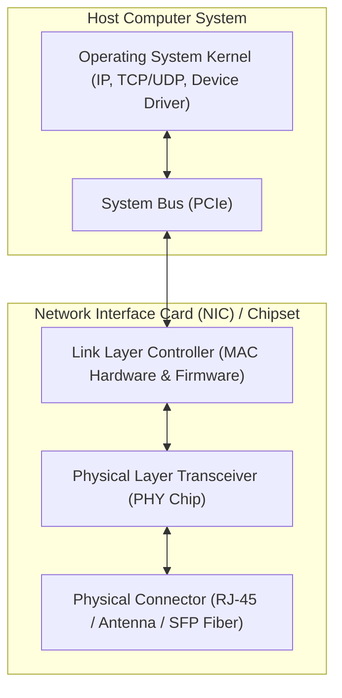
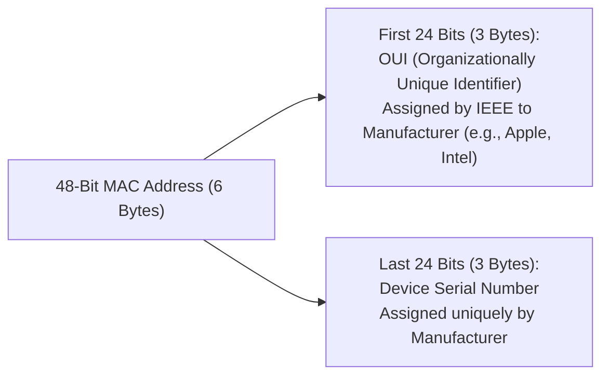
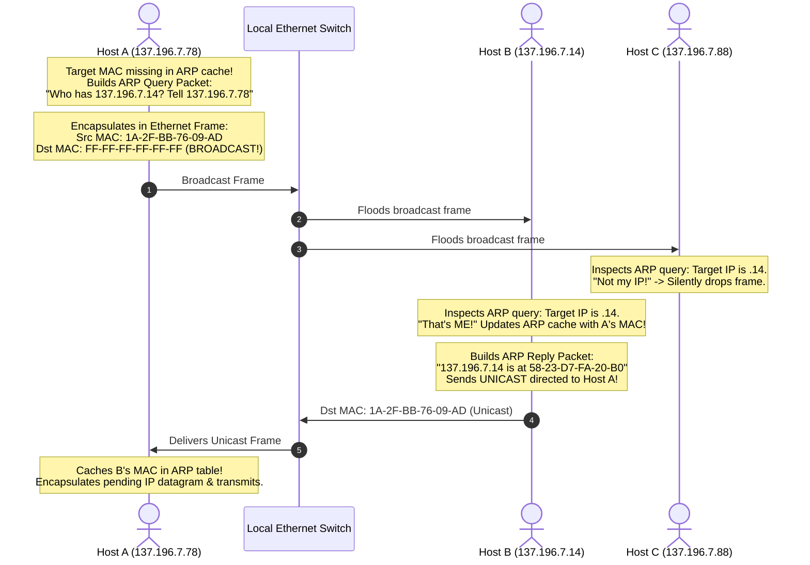
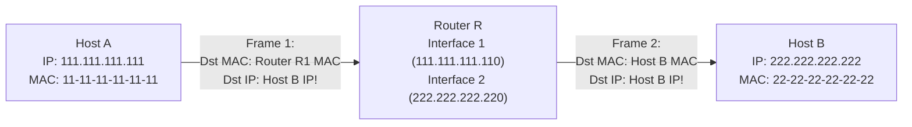

[CN Index](../README.md) / [Unit 4: Control, Link & Wireless](Introduction.md)

# Lecture 05: Link Layer Overview, Framing, and ARP

In our journey down the Internet architecture, we have reached **Layer 2: The Link Layer**.

In the network layer, routers determined global paths and forwarded IP datagrams across subnets. 

However, an IP datagram cannot physically fly across empty space or float along a copper wire on its own. To cross a physical medium—whether an optical fiber between two core routers, a twisted-pair Ethernet cable in an office, or radio frequencies over Wi-Fi—the datagram must be handed to the link layer.

The fundamental responsibility of the link layer is to **transfer a datagram from one node to a physically adjacent node over a single direct communication link**.

---

## Terminology and the Transportation Analogy

To understand where the link layer begins and ends, Kurose and Ross introduce standard terminology:
- **Nodes**: Any device that runs a link-layer protocol (hosts, routers, switches, Wi-Fi access points).
- **Links**: The physical communication channels connecting adjacent nodes along a path (copper wire, fiber optics, wireless spectrum).
- **Frames**: The Layer 2 Protocol Data Unit (PDU). The link layer encapsulates an IP datagram inside a **Frame**, prepending a link-layer header and appending a link-layer trailer.

### The Transportation Analogy
Imagine traveling from Princeton, New Jersey to Lausanne, Switzerland:
1. You take a **limousine** from Princeton to JFK Airport.
2. You board an **airplane** from JFK to Geneva.
3. You ride a **train** from Geneva to Lausanne.

In this analogy:
- **The Tourist** = The IP Datagram.
- **The Travel Agent** who booked the entire journey = The Routing Algorithm.
- **Each Individual Leg of the Trip** = A Communication Link.
- **The Transportation Mode** (Limo vs. Plane vs. Train) = The **Link-Layer Protocol** (Wi-Fi vs. SONET/SDH vs. Ethernet).

Notice a profound architectural insight:
Just as you must get off the airplane, enter the terminal, and walk onto the train platform, **an IP datagram is decapsulated and re-encapsulated into a completely different link-layer frame at every single router hop along its journey!** A packet may travel as an 802.11 Wi-Fi frame on hop 1, an Ethernet frame on hop 2, and an optical POS frame across the ocean.

---

## Services Provided by the Link Layer

Depending on the specific link technology, the link layer provides a suite of local services:

1. **Framing**: Slices the raw bitstream into discrete frames, marking the start and end of frames via special bit sequences (preambles and delimiters).
2. **Link Access & MAC Addressing**: For shared broadcast media (like Wi-Fi or coaxial cable), Medium Access Control (MAC) protocols govern which node is permitted to transmit at any given instant.
3. **Reliable Delivery**: Guarantees that every frame crosses the physical link without loss:
   - On high-bit-error links (such as **wireless Wi-Fi** or cellular), the link layer implements local ACKs and retransmissions, correcting errors locally rather than forcing expensive end-to-end TCP timeouts.
   - On low-error links (fiber optics and twisted-pair Ethernet), link-layer reliability is omitted to eliminate protocol overhead.
4. **Flow Control**: Prevents a transmitting network interface card (NIC) from sending frames faster than the receiving NIC's buffer can process.
5. **Error Detection**: Noise, electromagnetic interference, and signal attenuation flip bits on physical wires. The link layer appends an error-detection trailer (typically a CRC) to detect bit corruption.
6. **Error Correction**: Certain wireless protocols implement Forward Error Correction (FEC), allowing the receiver not only to detect bit errors, but to mathematically reconstruct and correct the flipped bits without retransmission.
7. **Half-Duplex versus Full-Duplex**:
   - **Half-Duplex**: Nodes at both ends can transmit, but **not at the same time** (like a walkie-talkie; e.g., early hub Ethernet and Wi-Fi).
   - **Full-Duplex**: Both nodes can transmit and receive simultaneously (e.g., modern switched twisted-pair Ethernet).

---

## Where Does the Link Layer Live? The Network Interface Card (NIC)

Unlike the transport and application layers (which live entirely in software inside the operating system kernel and user space), **the Link Layer lives predominantly in hardware**.

The link layer is implemented inside a **Network Interface Card (NIC)** or embedded chipset (such as an Intel Wi-Fi chip or Realtek Ethernet controller):
- The NIC contains dedicated microprocessors, transmit/receive FIFO buffers, and hardware logic for framing, CRC calculation, and channel access.
- When the host CPU wants to transmit a packet, the operating system driver writes the IP datagram to host RAM and alerts the NIC over the high-speed PCIe bus.
- The NIC autonomously reads the datagram, wraps it with Ethernet headers and CRC trailers, and serializes the bits onto the wire.

---

## Link Layer Addressing: MAC Addresses

In Layer 3, interfaces were identified by 32-bit logical IP addresses. 
In Layer 2, interfaces are identified by **MAC Addresses** (Media Access Control, also known as LAN addresses, physical addresses, or Ethernet addresses).

A MAC address is **48 bits (6 bytes) long**, expressed as twelve hexadecimal digits separated by hyphens or colons:

$$\mathbf{1A - 2F - BB - 76 - 09 - AD} \quad \text{or} \quad \mathbf{1A : 2F : BB : 76 : 09 : AD}$$

### The Difference Between IP Addresses and MAC Addresses
Why do we need two different addresses for the exact same network card?

Kurose and Ross explain this with a brilliant real-world analogy:
- **A MAC Address is like your Social Security Number / Aadhaar Card Number**: It is a flat, permanent identifier burned into the hardware ROM of your network card at the factory. It never changes, regardless of where you take your laptop.
- **An IP Address is like your Postal Mailing Address**: It is a hierarchical, location-dependent identifier. If you move from a university dorm in Boston to an apartment in Chicago, your physical identity (SSN) stays the same, but your postal address must change to match the new ZIP code.

If the Internet used flat MAC addresses for global routing, routers would have to store 4 billion completely unstructured entries in their routing tables—route aggregation would be impossible! IP addresses provide hierarchical routing across networks, while MAC addresses provide local frame delivery across a single physical link.

---

## Address Resolution Protocol (ARP): Bridging Layer 3 and Layer 2

Now consider the central dilemma of local communication:
Host A (`137.196.7.78`) wants to send an IP datagram to Host B (`137.196.7.14`) on the same local subnet. 

Host A knows Host B's IP address. But to send an Ethernet frame across the wire, Host A's network interface card must write Host B's **48-bit MAC address** into the frame's destination field!

How does a host translate an IP address into a MAC address?

This is the job of **Address Resolution Protocol (ARP, RFC 826)**.

### The ARP Table (Cache)
Every IP-enabled device (host or router) on a LAN maintains an internal cache called the **ARP Table**:

| IP Address | MAC Address | TTL (Time-To-Live) |
| :---: | :---: | :---: |
| `137.196.7.14` | `58-23-D7-FA-20-B0` | $1200\text{ s}$ ($20\text{ min}$) |
| `137.196.7.23` | `71-65-F7-2B-08-53` | $940\text{ s}$ |
| `137.196.7.88` | `0C-C4-11-6F-E3-98` | $1150\text{ s}$ |

Entries are stored with a **TTL timer** (typically 20 minutes). If an entry is not refreshed before the timer expires, it is purged to ensure stale MAC addresses do not linger when hardware is replaced.

---

## The ARP Protocol Exchange Walkthrough

What happens when Host A wants to send to Host B, but **Host B's MAC address is NOT in Host A's ARP table**?

1. **ARP Query Broadcast**:
   - Host A constructs an ARP query message: *"Who has IP 137.196.7.14? Tell 137.196.7.78."*
   - Host A wraps the ARP packet into an Ethernet frame with **Destination MAC = `FF-FF-FF-FF-FF-FF` (All-Ones Broadcast)**.
   - Every interface on the local LAN receives the frame and passes the ARP query to its operating system.
2. **Selective Processing**:
   - Host C inspects the target IP in the query, sees that it does not match its own IP, and drops the packet.
   - Host B sees its own IP! Host B caches Host A's MAC address in its own ARP table.
3. **ARP Reply Unicast**:
   - Host B formulates an ARP reply: *"137.196.7.14 is at MAC 58-23-D7-FA-20-B0."*
   - Because Host B learned Host A's MAC address from the query, **the reply is sent as a UNICAST frame** directed specifically to Host A (`1A-2F-BB-76-09-AD`).
4. **Cache and Transmit**:
   - Host A receives the unicast reply, writes Host B's MAC into its ARP table, and immediately transmits its waiting IP datagram!

---

## Routing to Another Subnet: Off-Subnet ARP

Now consider the most important exam question in link-layer addressing:
**What happens if Host A (`111.111.111.111`) wants to send an IP datagram to Host B (`222.222.222.222`) located on a COMPLETELY DIFFERENT SUBNET across Router R?**

Does Host A issue an ARP query for `222.222.222.222`?

**ABSOLUTELY NOT.** 
Host B is on a remote subnet. An ARP broadcast cannot cross a router!

### The 3-Step Walkthrough
1. **Host A Identifies Off-Subnet Destination**:
   Host A applies its local subnet mask to `222.222.222.222` and realizes Host B is remote. Host A knows that to reach any remote host, it must send the packet to its **First-Hop Default Gateway Router (`111.111.111.110`)**.
2. **Host A ARPs for the ROUTER, Not the Destination**:
   Host A checks its ARP cache for the **Router's IP address (`111.111.111.110`)**. If missing, it broadcasts an ARP query for the router.
   Host A creates an Ethernet frame with:
   - **Source MAC**: `11-11-11-11-11-11` (Host A MAC)
   - **Destination MAC**: `E6-E9-00-17-BB-4B` (Router's Interface 1 MAC)
   - **Source IP**: `111.111.111.111` (Host A IP)
   - **Destination IP**: `222.222.222.222` (Host B IP!)
3. **Router Forwards onto Subnet 2**:
   The router receives the frame, strips the Layer 2 Ethernet header, inspects the destination IP (`222.222.222.222`), and consults its forwarding table. It sees that `222.222.222.0/24` is directly attached to its Interface 2.
   The router now **ARPs on Subnet 2 for Host B's MAC address**!
   The router encapsulates the datagram into a **brand new Ethernet frame**:
   - **Source MAC**: `1A-23-F9-CD-06-9B` (Router's Interface 2 MAC)
   - **Destination MAC**: `22-22-22-22-22-22` (Host B MAC)
   - **Source IP**: `111.111.111.111` (Unchanged!)
   - **Destination IP**: `222.222.222.222` (Unchanged!)

**The Golden Rule**: As a packet traverses the Internet across multiple routers, **the Source and Destination IP addresses remain constant end-to-end, while the Source and Destination MAC addresses change on every single physical link!**

---

## Key Takeaways

- The Link Layer transfers datagrams between physically adjacent nodes across a single communication link.
- In the travel analogy: the tourist is the datagram, the links are transport segments, and link protocols are transportation modes (limo, plane, train).
- Link-layer services include framing, channel access (MAC), reliable delivery (on noisy wireless links), flow control, and error detection/correction.
- The link layer is implemented primarily in hardware on the **Network Interface Card (NIC)**.
- **MAC addresses are 48-bit flat hardware addresses** burned into NIC ROM (administered by IEEE via OUIs), analogous to an SSN. IP addresses are 32-bit hierarchical location identifiers, analogous to a postal address.
- **ARP (Address Resolution Protocol)** dynamically maps IP addresses to MAC addresses on a local subnet using broadcast queries (`FF:FF:FF:FF:FF:FF`) and unicast replies.
- For off-subnet traffic, a host ARPs for its **Default Gateway Router's MAC address**; IP addresses stay fixed end-to-end while MAC addresses change hop-by-hop.

---

Now that we understand how frames are addressed and moved between local interfaces, we must look closer at the trailer of the frame: when electrical voltages or optical pulses encounter physical noise, how does a receiving network card know with mathematical certainty whether a bit was flipped? To explore the mathematics of parity and polynomial division, we turn to [Error Detection and Correction Techniques (Parity, Checksum, CRC)](L06%20-%20Error%20Detection%20and%20Correction%20Techniques%20%28Parity,%20Checksum,%20CRC%29.md)).
