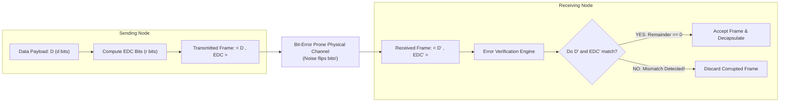
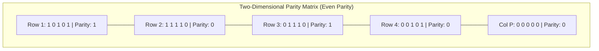

[CN Index](../README.md) / [Unit 4: Control, Link & Wireless](Introduction.md)

# Lecture 06: Error Detection and Correction Techniques (Parity, Checksum, CRC)

No physical communication medium is perfectly shielded.

When electromagnetic noise strikes a copper twisted-pair cable, when optical pulse dispersion attenuates a signal traveling down a fiber optic strand, or when atmospheric interference disrupts a Wi-Fi radio waveform, **individual bits flip in transit**:

$$0 \to 1 \quad \text{or} \quad 1 \to 0$$

If a single bit in an IP header flips, an entire packet may be misrouted into a black hole. If a bit in an executable file flips, an application crashes.

Because physical media are inherently noisy, the link layer must provide mechanisms to detect, and in some cases correct, bit-level transmission errors.

---

## The Error Control Model

At the sending node, data $D$ (comprising $d$ bits of network-layer payload and header) is protected by computing an **Error Detection and Correction (EDC)** code of $r$ redundant bits:



The sender transmits the composite frame $\langle D, \text{EDC} \rangle$. The receiver receives $\langle D', \text{EDC}' \rangle$. Even if bits inside $D$ were altered, the receiver can detect the corruption if the mathematical relationship between $D'$ and $\text{EDC}'$ is violated.

*(Note: No error-detection scheme can be 100% mathematically foolproof. There is always an astronomically small probability that an undetected error pattern transforms one valid codeword into another valid codeword. However, larger EDC fields reduce this probability to near zero).*

---

## 1. Parity Checking

The simplest conceivable form of error detection is **Parity**.

### Single-Bit Parity
In an **Even Parity** scheme, the sender appends a single parity bit chosen such that the **total number of `1`s in the entire frame is an even number**:

$$\text{Data: } \mathbf{0111000110101011} \implies \text{Count of 1s} = 9 \implies \text{Parity Bit} = \mathbf{1}$$

The frame sent is `0111000110101011 1` (Total 1s = 10, an even number).

- **Capabilities**: Detects any **odd number of bit flips** (1, 3, 5 bits flipped).
- **Fatal Flaw**: Cannot detect an **even number of bit flips**! If two bits flip simultaneously ($0 \to 1$ and $1 \to 0$), the count of 1s remains even. The receiver accepts corrupted data.
- Furthermore, single-bit parity cannot determine *which* bit flipped, making error correction impossible.

---

### Two-Dimensional Parity: Forward Error Correction (FEC)
To both detect and **correct** errors, we organize data bits into a two-dimensional grid of $i$ rows and $j$ columns, computing a parity bit for every row and every column:



Now watch what happens when a physical noise spike flips a single bit in Row 2, Column 2 ($1 \to 0$):

$$\begin{matrix}
1 & 0 & 1 & 0 & 1 & | & 1 \\
1 & \mathbf{0^*} & 1 & 1 & 0 & | & \mathbf{0} \quad \leftarrow \text{Row Parity Error!} \\
0 & 1 & 1 & 1 & 0 & | & 1 \\
0 & 0 & 1 & 0 & 1 & | & 0 \\
\hline
0 & \mathbf{0} & 0 & 0 & 0 & | & 0 \\
& \uparrow & & & & & \\
& \text{Col Parity Error!} & & & & &
\end{matrix}$$

Look at the receiver's verification:
1. When the receiver checks Row 2, the parity is odd $\implies$ **Row 2 has an error!**
2. When the receiver checks Column 2, the parity is odd $\implies$ **Column 2 has an error!**
3. The intersection of the errored row and errored column pinpoints the **exact bit that flipped**: $(Row 2, Column 2)$!

The receiving hardware simply inverts that bit back to `1`. 

This is **Forward Error Correction (FEC)**: the receiver corrects the error locally without requesting a retransmission! (Two-dimensional parity can also detect, but not correct, any 2-bit error).

---

## 2. Cyclic Redundancy Check (CRC / Polynomial Codes)

While parity and checksums are simple, modern link-layer protocols (Ethernet, Wi-Fi 802.11, HDLC, DOCSIS cable) rely almost exclusively on a mathematically superior mechanism: **Cyclic Redundancy Checks (CRC)**.

CRC codes can detect **all burst errors up to $r$ bits long**, all odd numbers of errors, and over $99.9999\%$ of arbitrary multi-bit corruption.

### The Mathematics: Modulo-2 Arithmetic
CRC is grounded in **Galois Field Modulo-2 Arithmetic**:
- Addition and subtraction are completely identical: **they are performed as bitwise XOR ($\oplus$) without carries or borrows**!

$$\begin{array}{r@{\quad}l@{\qquad}r@{\quad}l}
  1 \oplus 1 = 0 & (1 - 1 = 0) & 1 \oplus 0 = 1 & (1 - 0 = 1) \\
  0 \oplus 1 = 1 & (0 - 1 = 1) & 0 \oplus 0 = 0 & (0 - 0 = 0)
\end{array}$$

### Mathematical Formulation
Let:
- $D$ = The $d$-bit data payload to be transmitted.
- $G$ = An agreed-upon $(r + 1)$-bit binary pattern called the **Generator Polynomial**. The most significant bit of $G$ must be `1`.
- $R$ = The $r$-bit CRC remainder to be computed and appended to $D$.

We want to find $R$ such that the resulting $(d + r)$-bit codeword $\langle D, R \rangle$ is **exactly divisible by $G$ in modulo-2 arithmetic**:

$$\langle D, R \rangle = D \cdot 2^r \oplus R$$
$$\frac{D \cdot 2^r \oplus R}{G} \implies \text{Remainder } = 0$$

### The Sender's Rule:
To compute the $r$ CRC bits, the sender appends $r$ zeros to $D$ ($D \cdot 2^r$) and divides by $G$ using modulo-2 long division:

$$R = \text{remainder}\left( \frac{D \cdot 2^r}{G} \right)$$

### The Receiver's Rule:
The receiver divides the incoming bits $\langle D', R' \rangle$ by $G$ using modulo-2 long division:
- If **Remainder $== 0$**: No error detected; frame is accepted.
- If **Remainder $\ne 0$**: Bit corruption occurred; frame is dropped!

---

## Polynomial Representation of the Generator

Generators are conventionally written as algebraic polynomials where the power of $x$ represents the bit position:

$$G(x) = x^4 + x + 1$$

To convert this polynomial into a binary bit string:
- Term $x^4 \implies \text{Bit 4} = 1$
- Term $x^3 \implies \text{Bit 3} = 0$
- Term $x^2 \implies \text{Bit 2} = 0$
- Term $x^1 \implies \text{Bit 1} = 1$
- Term $x^0 (1) \implies \text{Bit 0} = 1$

The generator bit pattern is:
$$G = \mathbf{10011} \quad (\text{Length: } r+1 = 5 \implies r = 4\text{ CRC bits})$$

---

## Detailed Numerical Walkthrough 1: Standard Modulo-2 Division

Let's work through the foundational example from lecture slides:
- Data to send: $D = \mathbf{101110}$ ($d = 6\text{ bits}$).
- Generator: $G = \mathbf{1001}$ ($r + 1 = 4\text{ bits} \implies r = 3\text{ CRC bits}$).

### Step 1: Append $r = 3$ Zeros to Data
$$D \cdot 2^3 = \mathbf{101110000}$$

### Step 2: Perform Modulo-2 Long Division ($D \cdot 2^r \div G$)

```
             1 0 1 0 1 1   (Quotient)
     -------------------
1001 | 1 0 1 1 1 0 0 0 0
     ^ 1 0 0 1             (XOR: 1011 ^ 1001)
     ---------
       0 0 1 0 1           (Bring down next bit)
       ^ 0 0 0 0           (Leading bit is 0 -> XOR with 0000)
       ---------
         0 1 0 1 0         (Bring down next bit)
         ^ 1 0 0 1         (XOR: 1010 ^ 1001)
         ---------
           0 0 1 1 0       (Bring down next bit)
           ^ 0 0 0 0
           ---------
             0 1 1 0 0     (Bring down next bit)
             ^ 1 0 0 1     (XOR: 1100 ^ 1001)
             ---------
               0 1 0 1 0   (Bring down last bit)
               ^ 1 0 0 1   (XOR: 1010 ^ 1001)
               ---------
                 0 0 1 1   ===> REMAINDER R = 011
```

The remainder is $R = \mathbf{011}$ (3 bits).

### Step 3: Construct the Transmitted Codeword
$$\langle D, R \rangle = 101110 \,||\, 011 = \mathbf{101110011}$$

This 9-bit frame is transmitted onto the wire.

---

## Detailed Numerical Walkthrough 2: Error Detection at the Receiver

Consider the exam exercise from Slide 19:
> *"A bit stream `10011101` is transmitted using generator polynomial $G(x) = x^3 + 1$.*
> *1. What is the actual transmitted bit string?*
> *2. Suppose the third bit from the left is inverted during transmission. How will the receiver detect this error?"*

### Part 1: Compute Transmitted Codeword
- Data: $D = \mathbf{10011101}$ ($d = 8$).
- Generator: $G(x) = x^3 + 1 \implies G = \mathbf{1001}$ ($r = 3$).
- Append 3 zeros: $D \cdot 2^3 = \mathbf{10011101000}$.

Perform Modulo-2 Division:
```
             1 0 0 0 1 1 0 0
     -----------------------
1001 | 1 0 0 1 1 1 0 1 0 0 0
       1 0 0 1
       -------
       0 0 0 0 1 1 0 1
               1 0 0 1
               -------
               0 1 0 0 0
                 1 0 0 1
                 -------
                 0 0 0 1 0 0   ===> REMAINDER R = 100
```

The remainder is $R = \mathbf{100}$.
The transmitted codeword is:
$$\mathbf{10011101100}$$

---

### Part 2: Receiver Error Detection after a Bit Flip
During transmission, the **third bit from the left flips** ($0 \to 1$):
- Sent Codeword: `1 0 0 1 1 1 0 1 1 0 0`
- Received String: `1 0 1 1 1 1 0 1 1 0 0` (Bit 3 corrupted!)

The receiver divides the received string by $G = 1001$:

```
             1 0 1 0 1 0 0 1
     -----------------------
1001 | 1 0 1 1 1 1 0 1 1 0 0
       1 0 0 1
       -------
       0 0 1 0 1 1
           1 0 0 1
           -------
           0 0 1 0 0 1
               1 0 0 1
               -------
               0 0 0 0 1 1 0 0
                       1 0 0 1
                       -------
                       0 1 0 1  ===> REMAINDER R' = 101 != 0!
```

The division yields a **non-zero remainder ($101$)**!
Because the remainder is not zero, the receiver detects that bit corruption occurred and **immediately discards the frame**.

---

## Standardized Generator Polynomials

In production networking, generator polynomials are standardized by international bodies to guarantee maximum burst-error detection:
- **CRC-32 (IEEE 802.3 Ethernet & Wi-Fi)**:
  $$G(x) = x^{32} + x^{26} + x^{23} + x^{22} + x^{16} + x^{12} + x^{11} + x^{10} + x^8 + x^7 + x^5 + x^4 + x^2 + x + 1$$
  Appends a 32-bit (4-byte) Frame Check Sequence (FCS) trailer to every Ethernet frame. It is computed in hardware in a single clock cycle using linear feedback shift registers (LFSR).

---

## Key Takeaways

- Physical links suffer from bit flips; the link layer uses Error Detection and Correction (EDC) to verify frame integrity.
- **Single-bit parity** detects odd numbers of bit errors, but fails on 2-bit flips.
- **Two-dimensional parity** creates row and column parity bits, allowing the receiver to locate and **correct single-bit errors** (FEC) in hardware.
- **Cyclic Redundancy Checks (CRC)** treat bits as polynomials in Modulo-2 arithmetic (bitwise XOR without carry/borrow).
- The sender appends $r$ zeros to data $D$ and computes remainder $R = (D \cdot 2^r) \pmod G$.
- The receiver divides the frame $\langle D', R' \rangle$ by $G$; a non-zero remainder signals corruption.
- CRC-32 is implemented in hardware on every Ethernet and Wi-Fi network interface card.

---

Now that we understand how frames are addressed with MACs and protected with CRCs, we face a fundamental physical challenge of communication: when multiple devices share a single copper wire or radio frequency band, how do we prevent their transmissions from colliding into unintelligible electromagnetic noise? To answer this, we turn to [Multiple Access Protocols (Channel Partitioning, Random Access, Taking Turns)](L07%20-%20Multiple%20Access%20Protocols%20%28Channel%20Partitioning,%20Random%20Access,%20Taking%20Turns%29.md)).
