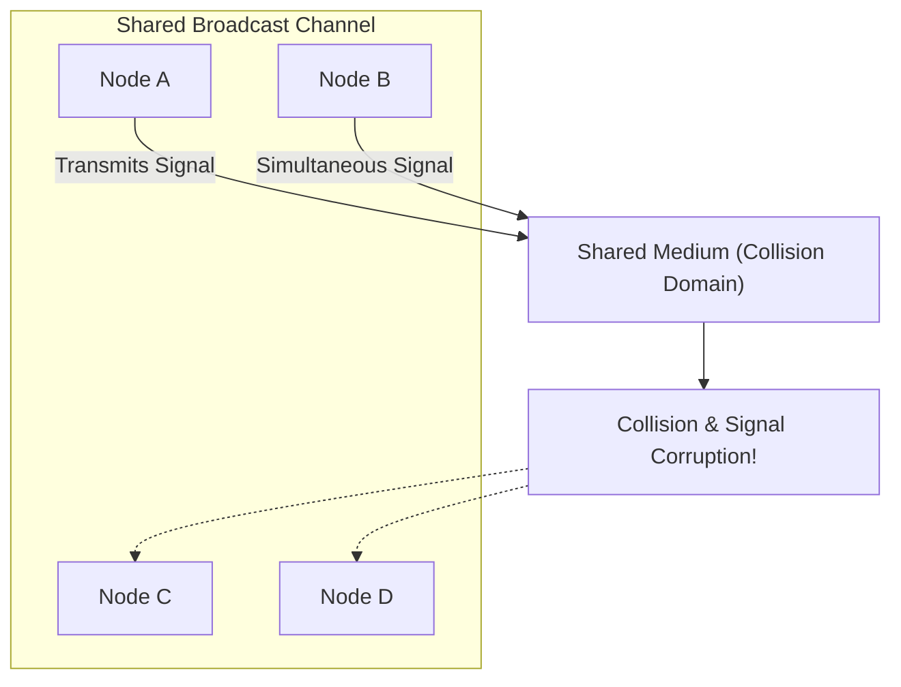
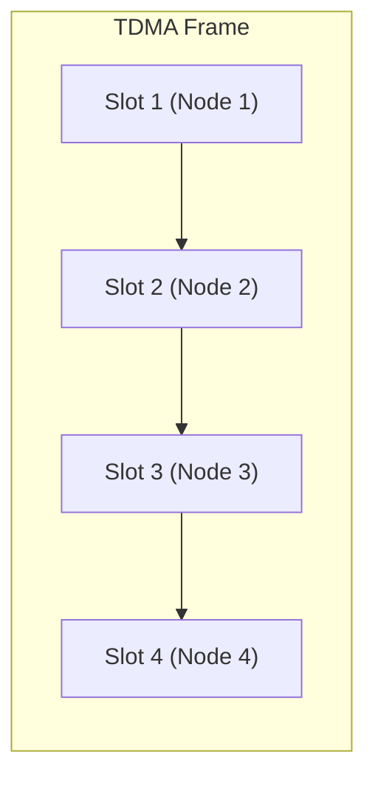
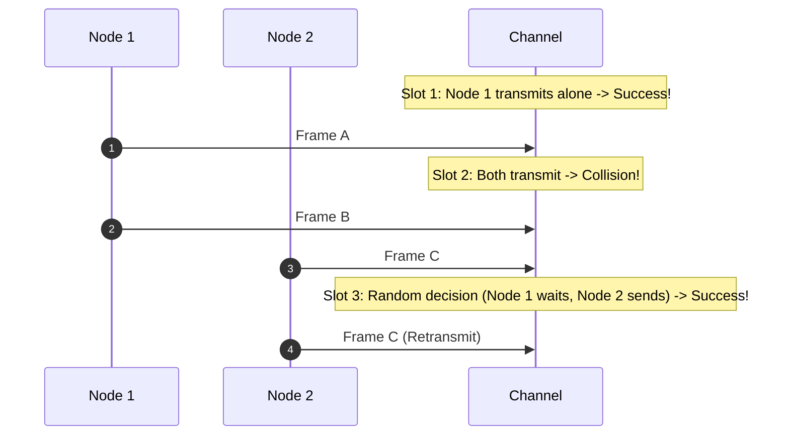
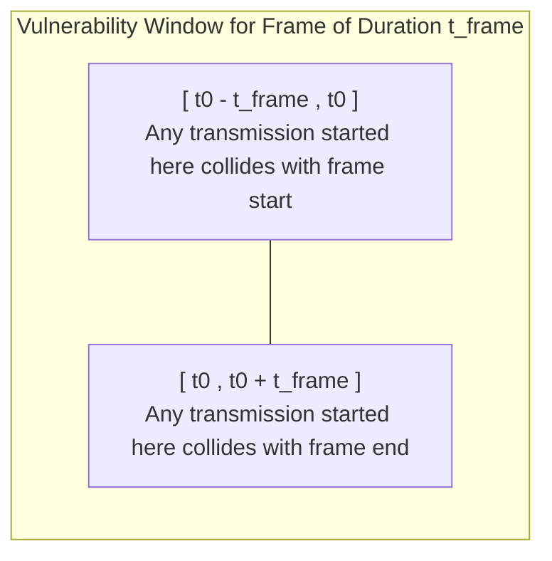
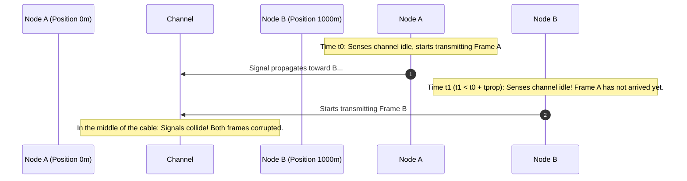
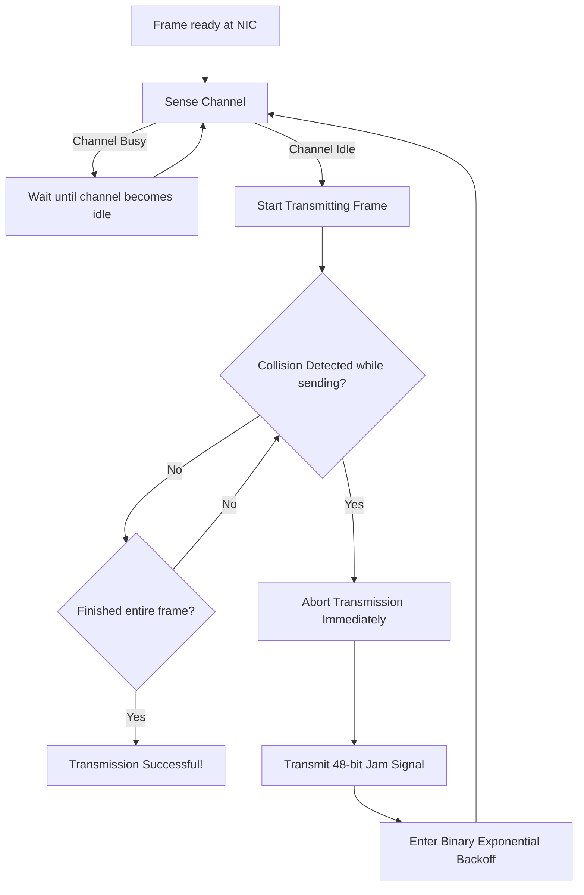
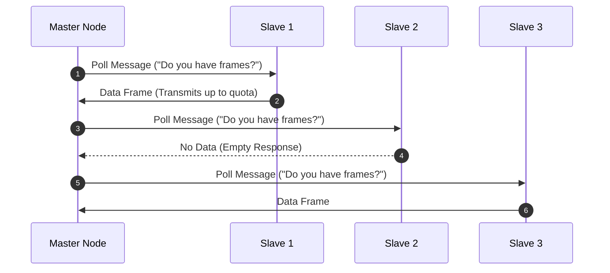
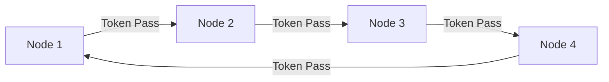

[CN Index](../README.md) / [Unit 4: Control, Link & Wireless](Introduction.md)

# Multiple Access Protocols: Channel Partitioning, Random Access, and Taking Turns

We spent the earlier lectures moving from the network layer down into the link layer, examining how frames hop across individual physical links and how bit errors are detected. But all of that assumed something very convenient: that when an adapter decides to transmit a frame, the physical medium is exclusively theirs to use. 

That assumption holds true on point-to-point links like a dedicated fiber strand or a direct Ethernet connection to a modern switch port. But the moment multiple network nodes share a single broadcast wire, coaxial cable, or slice of radio spectrum, a fundamental physics challenge arises: if two or more nodes transmit electrical or radio signals simultaneously, those signals physically collide and corrupt each other. The receiver sees only garbled electromagnetic noise.

To prevent this chaos, the link layer relies on a **Multiple Access Protocol** — a distributed algorithm running across all attached network interface cards (NICs) that coordinates who is allowed to broadcast on the shared channel, and when.

---

## The Broadcast Channel and the Ideal Multiple Access Protocol

Imagine a room full of people at a dinner party. If everyone talks at once, nobody understands anyone. Humans solve this naturally through social conventions: waiting for someone to stop talking before speaking, raising a hand, or letting a moderator designate speakers. 

In computer networks, the problem is harder because communication about how to share the channel must take place over the exact same channel being shared. There is no out-of-band wire dedicated solely to coordination.

Before looking at specific designs, what would an ideal multiple access protocol look like for a broadcast channel with a raw transmission rate of $R$ bits per second? Computer scientists evaluate protocols against four primary criteria:

1. **High Throughput at Low Load**: When only a single node has data to transmit, that node should be able to utilize the full channel capacity at rate $R$.
2. **Fair Share at High Load**: When $M$ nodes have data to transmit simultaneously, each active node should achieve an average transmission throughput of $R/M$.
3. **Fully Decentralized**: There should be no single master node coordinating transmissions whose failure could collapse the entire network, and no requirement for global clock synchronization across distant nodes.
4. **Simplicity and Low Cost**: The protocol should be lightweight enough to implement in inexpensive network hardware.

No real-world protocol satisfies all four criteria perfectly. Instead, MAC protocols fall into three distinct architectural taxonomies, each making different engineering tradeoffs:

- **Channel Partitioning Protocols**: Divide the channel's physical capacity (time, frequency, or code space) into dedicated, non-overlapping slices.
- **Random Access Protocols**: Allow nodes to transmit at full channel rate without pre-allocation, detect or accept collisions when they occur, and recover dynamically.
- **Taking-Turns Protocols**: Nodes coordinate sequentially so that only one node transmits at any given moment, often with mechanisms to grant longer turns to high-traffic nodes.

---

## Channel Partitioning: TDMA, FDMA, and CDMA

The most intuitive way to prevent collisions is to eliminate the shared nature of the medium by cutting the channel into static, isolated slices.

### Time-Division Multiple Access (TDMA)

TDMA slices time into repeating transmission frames. Each frame is further subdivided into $N$ fixed-duration time slots, with each node allocated exactly one dedicated slot per frame:

Because each node transmits only during its assigned time window, collisions are physically impossible. TDMA is fair: under heavy load where every node has data ready, each node gets an equal share of the transmission time ($R/N$).

Now notice the fatal weakness of TDMA — **bursty traffic**. If only Node 1 has packets to send while Nodes 2 through $N$ are completely idle, their allocated time slots pass across the wire empty. Node 1 is capped at an average data rate of $R/N$, even though the rest of the channel is doing nothing. Furthermore, TDMA requires tight frame and clock synchronization across all nodes, adding hardware complexity.

### Frequency-Division Multiple Access (FDMA)

Instead of slicing time, FDMA slices the channel's total bandwidth $R$ into $N$ distinct, narrower frequency bands, separated by small guard bands to prevent spectral leakage. Each node is assigned a permanent carrier frequency:

- **Advantage**: Nodes can transmit continuously without waiting for periodic time slots, and collisions are completely avoided.
- **Disadvantage**: Exactly like TDMA, FDMA handles bursty traffic poorly. A single active node transmitting at full throttle can never exceed its narrow sub-band capacity ($R/N$), while all adjacent frequency bands sit unused.

### Code Division Multiple Access (CDMA)

CDMA takes an entirely different mathematical approach: every node shares the exact same frequency band at the exact same time. Instead of separating by time or frequency, transmissions are separated by mathematical orthogonal codes.

Each node is assigned a unique, high-frequency digital pattern called a **chip sequence** or **code vector** $C_m$ consisting of $M$ bipolar chips ($\pm 1$). The codes assigned to different nodes are strictly **orthogonal**:

$$C_i \cdot C_j = 0 \quad (\text{for } i \neq j)$$
$$C_i \cdot C_i = M$$

When node $m$ wants to send a bit $d_m \in \{+1, -1\}$ (where $+1$ represents bit 1 and $-1$ represents bit 0), it multiplies the bit value by its chip vector $C_m$. The resulting signal transmitted onto the shared medium is $d_m C_m$.

When multiple nodes transmit simultaneously, their signals add linearly in the air:

$$S_{\text{total}} = \sum_{m=1}^{N} d_m C_m$$

To decode the bit transmitted by a specific node $i$, the receiver computes the normalized inner product (dot product) of the combined received signal $S_{\text{total}}$ with node $i$'s known chip sequence $C_i$:

$$\text{Decoded Bit} = \frac{1}{M} (S_{\text{total}} \cdot C_i) = \frac{1}{M} \left( \sum_{m=1}^{N} d_m (C_m \cdot C_i) \right)$$

Because all cross-terms $C_m \cdot C_i = 0$ for $m \neq i$, all interfering transmissions vanish completely:

$$\text{Decoded Bit} = \frac{1}{M} \left( d_i (C_i \cdot C_i) \right) = \frac{1}{M} (d_i \cdot M) = d_i$$

CDMA allows multiple nodes to transmit simultaneously across the entire frequency band without collision, providing robust resistance to interference and eavesdropping. This became the foundational radio access technology for 3G cellular networks (UMTS, CDMA2000).

---

## Random Access Protocols

Static partitioning works well when traffic is predictable and constant, like dedicated telephone circuits. But computer network traffic is inherently bursty: computers stay idle for seconds or minutes, then suddenly burst hundreds of kilobytes during a file transfer or web request.

Random access protocols embrace this burstiness. When a node has a frame ready, it transmits at the channel's full raw rate $R$ without waiting for permission. If two nodes transmit at the same time, their frames collide. The protocol's job is to detect that a collision occurred and determine how and when colliding nodes should retransmit so they don't simply collide again immediately.

### Slotted ALOHA

Slotted ALOHA, developed at the University of Hawaii in the early 1970s, introduced the concept of time-slotted random transmission:

- Time is divided into discrete slots, each exactly long enough to transmit one frame of length $L$ bits ($\text{slot duration} = L/R$).
- All nodes are synchronized to slot boundaries; a node may only begin transmitting at the precise start of a slot.
- If two or more nodes transmit in the same slot, a collision occurs. All nodes detect the collision before the slot ends.
- If a frame suffers a collision, the node retransmits the frame in each subsequent slot with probability $p$, until it succeeds.

Now let's analyze the mathematical efficiency of Slotted ALOHA. Suppose $N$ active nodes each attempt to transmit in a slot with independent probability $p$:

- The probability that a given node succeeds in a slot is the probability that it transmits, while all other $N-1$ nodes remain silent:

  $$P(\text{specific node succeeds}) = p(1-p)^{N-1}$$

- Since any of the $N$ nodes could be the successful transmitter, the probability that *any* node transmits successfully in a given slot is:

  $$S(p) = N p (1-p)^{N-1}$$

To find the maximum achievable channel efficiency, we differentiate $S(p)$ with respect to $p$ and set the derivative to zero:

$$\frac{dS}{dp} = N(1-p)^{N-1} - N(N-1)p(1-p)^{N-2} = 0$$
$$(1-p) - (N-1)p = 0 \implies 1 - Np = 0 \implies p^* = \frac{1}{N}$$

Substituting this optimal transmission probability $p^* = 1/N$ back into our throughput equation:

$$S_{\max} = N \left(\frac{1}{N}\right) \left(1 - \frac{1}{N}\right)^{N-1} = \left(1 - \frac{1}{N}\right)^{N-1}$$

As the number of active nodes $N$ becomes large:

$$\lim_{N \to \infty} \left(1 - \frac{1}{N}\right)^{N-1} = \frac{1}{e} \approx 0.368$$

At best, Slotted ALOHA achieves an efficiency of approximately **36.8%**. The other 63.2% of channel capacity is wasted — roughly 37% of slots sit completely empty, and 26% are destroyed by collisions.

### Pure (Unslotted) ALOHA

Slotted ALOHA requires all nodes to synchronize their clocks to discrete slot boundaries. The original Pure ALOHA discarded synchronization entirely: whenever a node has a frame ready, it transmits immediately.

Without slot boundaries, when is a frame vulnerable to collision?

Suppose a node starts transmitting a frame of duration $t_{\text{frame}}$ at time $t_0$:
- Any other node that began transmitting between $t_0 - t_{\text{frame}}$ and $t_0$ will still be on the wire when our frame begins.
- Any other node that begins transmitting between $t_0$ and $t_0 + t_{\text{frame}}$ will collide with our frame before it finishes.

The **vulnerability window** is twice the frame duration: $2 \times t_{\text{frame}}$.

Assuming frame generation follows a Poisson process with arrival rate $G$ frames per frame-time, the probability that zero other frames are generated during an interval of length $2 t_{\text{frame}}$ is $e^{-2G}$. The throughput $S$ is therefore:

$$S = G e^{-2G}$$

Taking the derivative to find the peak:

$$\frac{dS}{dG} = e^{-2G} - 2G e^{-2G} = 0 \implies 1 - 2G = 0 \implies G^* = \frac{1}{2}$$
$$S_{\max} = \frac{1}{2} e^{-1} = \frac{1}{2e} \approx 0.184$$

Pure ALOHA achieves a maximum channel efficiency of just **18.4%** — exactly half that of Slotted ALOHA. Slicing time into synchronized slots doubles throughput by halving the collision window.

---

## Carrier Sense Multiple Access (CSMA)

Both pure and slotted ALOHA suffer from a major design flaw: a node transmits completely oblivious to what is already happening on the wire. If someone else is halfway through transmitting a 1500-byte frame, an ALOHA node will blithely transmit anyway, destroying both packets.

In the physical world, polite speakers listen before speaking. This is the guiding philosophy of **Carrier Sense Multiple Access (CSMA)**:

> **Carrier Sensing**: Before transmitting, the NIC listens to the channel. If the channel is sensed busy (energy/carrier detected), the node defers its transmission. If the channel is sensed idle for a designated period, the node transmits.

### Why Collisions Still Happen Under CSMA

If every node listens before transmitting, how can collisions ever occur?

The answer lies in the finite speed of light. Electromagnetic signals do not travel instantaneously; they propagate through copper and fiber at roughly $2 \times 10^8 \text{ m/s}$ (about 5 nanoseconds per meter).

The time it takes for a signal to travel from one end of the physical cable to the other is the **propagation delay** ($t_{\text{prop}}$). During that small window of time, the channel appears completely idle to distant nodes, even though a transmission is already speeding toward them. 

The larger the physical distance between nodes (larger $t_{\text{prop}}$) relative to the time it takes to transmit a frame ($t_{\text{trans}}$), the higher the probability of collisions.

### Persistence Strategies

When a CSMA node senses that the channel is busy, how should it behave once the channel clears? Three standard persistence models exist:

| Persistence Strategy | Operational Rule | Tradeoff |
| :--- | :--- | :--- |
| **1-Persistent CSMA** | Continuously listens to the wire. The instant the channel becomes idle, transmits immediately with probability 1. | Minimizes idle channel time, but guarantees a collision if two or more nodes were waiting during an ongoing transmission. |
| **Non-Persistent CSMA** | If the channel is busy, waits a random backoff period before sensing the channel again. | Drastically reduces collisions after a busy channel clears, but introduces wasted idle time on the channel. |
| **p-Persistent CSMA** | Slices time into mini-slots. When channel becomes idle, transmits with probability $p$, and defers to next slot with probability $1-p$. | Tunable balance between collision probability and channel idle time; used in slotted networks and 802.11. |

---

## CSMA with Collision Detection (CSMA/CD)

Under standard CSMA, once a collision occurs, both nodes continue transmitting their entire frames to completion, completely wasting the wire for the full frame duration.

CSMA with Collision Detection adds one crucial rule: **listen while transmitting**.

If an adapter detects another node's signal on the wire while it is transmitting its own bits, it:
1. Immediately aborts transmission.
2. Transmits a short **Jam Signal** (48 bits in Ethernet) to ensure all other transmitting and receiving adapters unequivocally recognize that a collision occurred.
3. Enters **Binary Exponential Backoff** before attempting to retransmit.

### The Minimum Frame Size Requirement

CSMA/CD enforces a strict mathematical dependency between physical cable length, transmission speed, and minimum packet size.

Consider the worst-case scenario: Node A and Node B sit at opposite physical ends of a cable with propagation delay $t_{\text{prop}}$:
- At time $t = 0$, Node A begins transmitting.
- At time $t = t_{\text{prop}} - \epsilon$ (just a fraction of a nanosecond before Node A's first bit reaches Node B), Node B senses the channel. The wire still appears idle!
- Node B begins transmitting. Almost immediately, the collision occurs near Node B.
- Node B detects the collision instantly and aborts. But Node A will not know a collision occurred until Node B's colliding signal propagates all the way back across the cable to Node A.
- Node B's signal reaches Node A at time $t = 2 \times t_{\text{prop}}$.

Now think about what happens if Node A transmits a very tiny packet: if Node A finishes sending its entire frame before $t = 2 t_{\text{prop}}$, the collision signal will reach Node A *after* Node A has already declared success and discarded the frame from its transmit buffer! Node A will believe the packet arrived safely, leaving the upper layer to deal with lost data.

To guarantee that a transmitting adapter detects any collision before finishing transmission:

$$t_{\text{trans}} \ge 2 \times t_{\text{prop}}$$

Since transmission time $t_{\text{trans}} = \frac{L}{R}$ (where $L$ is frame length in bits and $R$ is link rate in bps):

$$\frac{L_{\min}}{R} \ge 2 \times t_{\text{prop}} \implies L_{\min} \ge 2 \cdot R \cdot t_{\text{prop}}$$

This single inequality dictated classic 10 Mbps Ethernet (10BASE5) specifications:
- Maximum round-trip propagation time across repeaters and 2.5 km of coaxial cable was approximately $51.2 \ \mu\text{s}$ (known as the **slot time**).
- At $R = 10 \text{ Mbps}$:

  $$L_{\min} = 10 \times 10^6 \text{ bps} \times 51.2 \times 10^{-6} \text{ s} = 512 \text{ bits} = \mathbf{64 \text{ bytes}}$$

This is why the IEEE 802.3 Ethernet standard requires every Ethernet frame to be at least 64 bytes long. If payload data is smaller than 46 bytes, padding bytes must be added to reach this 64-byte threshold.

### Truncated Binary Exponential Backoff

After aborting a transmission and broadcasting the jam signal, when should the adapter try again? If every colliding node retried after the exact same delay, they would collide forever.

Ethernet solves this using **Truncated Binary Exponential Backoff**:
1. After the $n$-th collision of a given frame, the adapter chooses a random integer $K$ uniformly from the set:

   $$\{0, 1, 2, \dots, 2^m - 1\} \quad \text{where } m = \min(n, 10)$$

2. The adapter waits $K \times 512$ bit times (for 10 Mbps Ethernet, 512 bit times equals $51.2 \ \mu\text{s}$), then returns to sensing the channel.
3. After 16 consecutive collisions, the adapter gives up and reports an unrecoverable transmission error to higher layers.

Notice how elegant this design is:
- On the first collision ($n=1$), $K \in \{0, 1\}$. The node flips a coin: transmit immediately or wait 1 slot time.
- On the second collision ($n=2$), $K \in \{0, 1, 2, 3\}$.
- By the 10th collision, $K \in \{0, 1, \dots, 1023\}$. 

When few nodes are competing, backoff delays are tiny, minimizing latency. When heavy congestion causes repeated collisions, the contention window expands exponentially, spreading retransmissions over a wide time horizon to clear the logjam.

### CSMA/CD Efficiency

The overall channel efficiency of CSMA/CD under heavy load is derived as:

$$\text{Efficiency} = \frac{1}{1 + 5 \frac{t_{\text{prop}}}{t_{\text{trans}}}}$$

Notice the asymptotic behavior:
- As propagation delay $t_{\text{prop}} \to 0$ (nodes are physically close together), efficiency approaches **100%**.
- As transmission time $t_{\text{trans}} \to \infty$ (packets are large), efficiency also approaches **100%**.
- CSMA/CD far outperforms both pure and slotted ALOHA because colliding packets are aborted after just $2 t_{\text{prop}}$ seconds rather than wasting the entire frame transmission time.

---

## Taking-Turns Protocols

Channel partitioning provides predictable, conflict-free sharing at high load, but wastes capacity when traffic is bursty. Random access handles bursty single-node traffic at full line rate, but degrades under heavy load due to collision overhead.

Can we get the best of both worlds? Protocols in the **taking-turns** category aim for high efficiency under both light and heavy load by ensuring only one node transmits at a time, without static slot assignments.

### Polling Protocols

Polling introduces a master-slave topology:

The master node queries each client node in a round-robin sequence:
- If a polled node has frames to send, it transmits up to a defined maximum frame limit.
- If it has nothing to send, it responds immediately with an empty notification.

**Pros**: Completely eliminates collisions and eliminates empty slot waste under heavy load. A single active node can consume almost the entire channel.

**Cons**:
1. **Polling Delay**: The master must transmit explicit poll messages back and forth across the wire, introducing latency before an active node can send.
2. **Single Point of Failure**: If the master node crashes, the entire broadcast channel freezes.

### Token-Passing Protocols

Token passing decentralizes the polling mechanism: there is no master node. Instead, a small, special control frame known as the **Token** circulates continuously around nodes in a fixed physical or logical sequence (e.g., IEEE 802.5 Token Ring, FDDI).

- When an idle token arrives at a node that has frames queued, the node captures the token and begins transmitting its data frames onto the ring.
- After transmitting up to a configured frame limit (holding timer), the node generates a new token and forwards it to the next downstream neighbor.
- If a node has no data ready, it immediately forwards the token to the next node.

**Pros**: High channel utilization under heavy load, deterministic maximum waiting times, and no collisions.

**Cons**:
1. **Token Overhead**: Even with no traffic, the token must continuously circle the ring, consuming bandwidth and processing cycles.
2. **Failure Vulnerability**: If a node crashes while holding the token, the token is destroyed and communication halts. The protocol must implement complex distributed election algorithms to detect token loss and regenerate a single valid token without accidentally creating duplicates.

---

## Multiple Access Protocol Comparison

| Protocol Category | Protocol | Collision Free? | Decentralized? | Behavior Under Light Load | Behavior Under Heavy Load |
| :--- | :--- | :--- | :--- | :--- | :--- |
| **Partitioning** | **TDMA** | Yes | Yes (requires sync) | Poor ($R/N$ max rate) | High fairness, no collisions |
| **Partitioning** | **FDMA** | Yes | Yes | Poor ($R/N$ max rate) | High fairness, no collisions |
| **Partitioning** | **CDMA** | Yes (orthogonal) | Yes | Good (full spectrum) | High complexity, high capacity |
| **Random Access** | **Slotted ALOHA** | No | Yes | Full rate $R$, low delay | Maximum 36.8% throughput |
| **Random Access** | **Pure ALOHA** | No | Yes | Full rate $R$, zero delay | Maximum 18.4% throughput |
| **Random Access** | **CSMA/CD** | Yes (detected/aborted) | Yes | Full rate $R$, minimal delay | High efficiency ($\to 100\%$ as $t_{\text{prop}} \to 0$) |
| **Taking Turns** | **Polling** | Yes | No (master node) | Polling overhead delay | High throughput, vulnerable master |
| **Taking Turns** | **Token Ring** | Yes | Yes | Token passing latency | High throughput, token loss risk |

---

## Key Takeaways

- Broadcast links require a Multiple Access Protocol to coordinate shared transmissions and prevent destructive signal collisions.
- Channel partitioning (TDMA, FDMA) divides channel capacity statically, completely preventing collisions but performing poorly with bursty computer traffic. CDMA uses orthogonal chip sequences to let nodes share time and frequency simultaneously.
- Pure ALOHA allows immediate transmission with a vulnerability window of $2 t_{\text{frame}}$ and peaks at 18.4% efficiency. Slotted ALOHA synchronizes transmissions into time slots, halving the collision window and doubling peak throughput to $1/e \approx 36.8\%$.
- CSMA listens to the carrier before transmitting. Collisions still happen due to non-zero propagation delay ($t_{\text{prop}}$).
- CSMA/CD listens while transmitting, aborts upon detecting a collision, sends a 48-bit jam signal, and enters binary exponential backoff.
- To detect collisions before completing frame transmission, CSMA/CD requires $t_{\text{trans}} \ge 2 t_{\text{prop}}$, which dictated classic Ethernet's 64-byte minimum frame size.
- Taking-turns protocols (polling and token passing) eliminate collisions deterministically, but introduce latency overhead and token/master failure vulnerabilities.

---

Now that we understand how multiple nodes share a single broadcast wire, think about what happens when modern local area networks outgrow shared cables. Modern networks replace shared coaxial cables with dedicated point-to-point links connected to intelligent link-layer switches. In the next lecture, we explore how [**Switched Local Area Networks, Ethernet, and VLANs**](L08%20-%20Switched%20Local%20Area%20Networks,%20Ethernet,%20and%20VLANs.md) isolate collision domains and build scalable campus networks.
