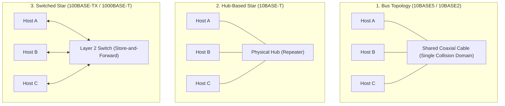
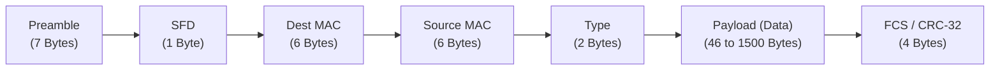
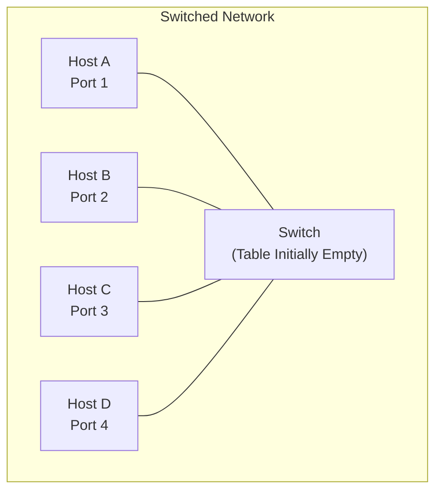
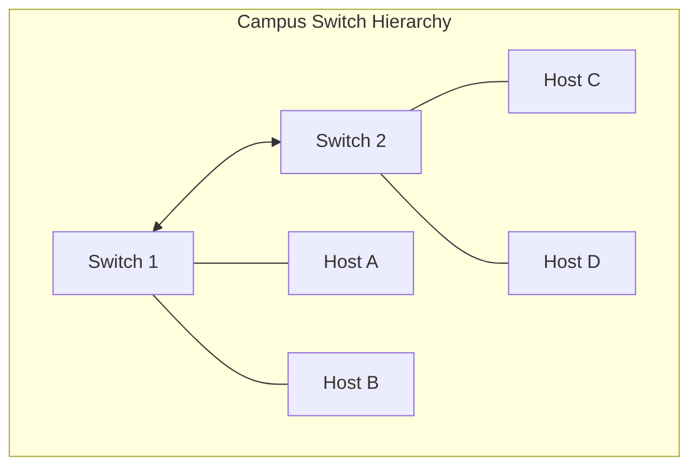
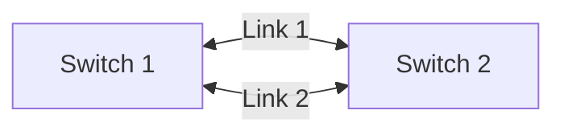
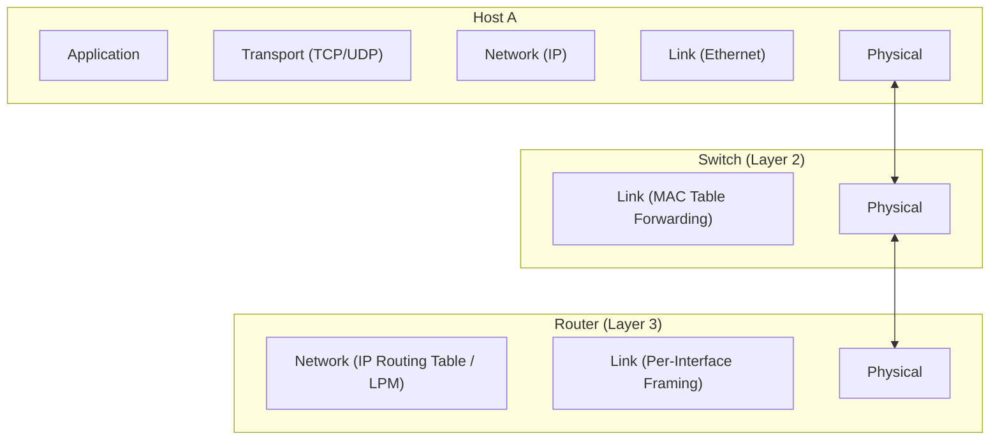
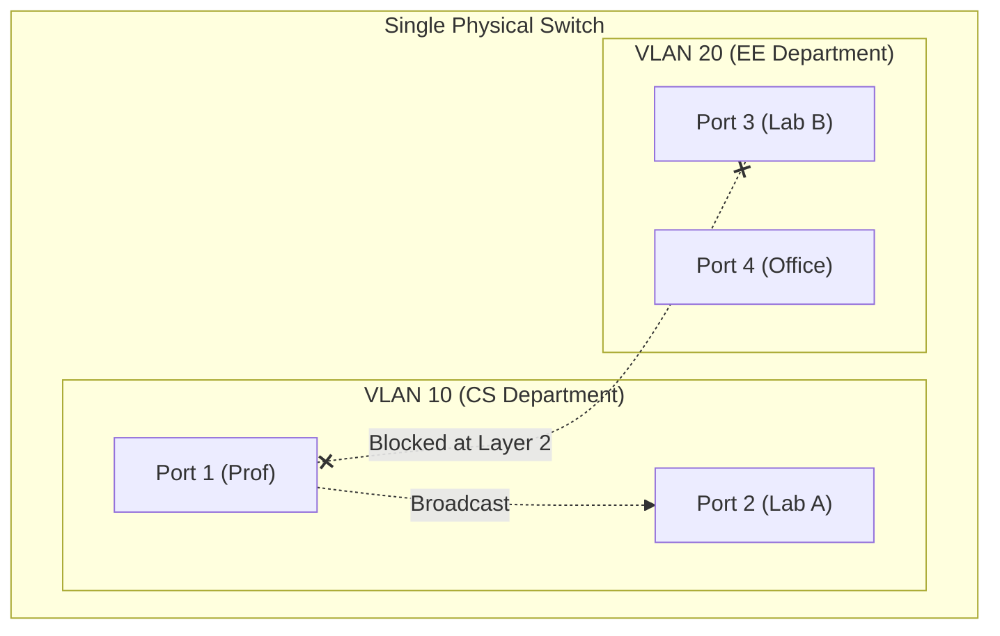
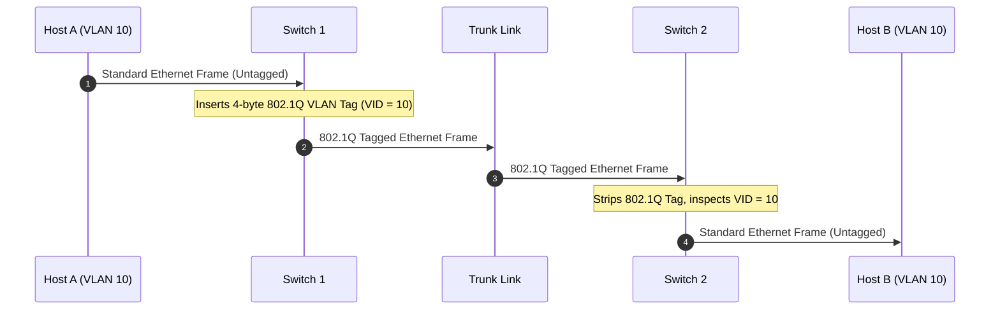
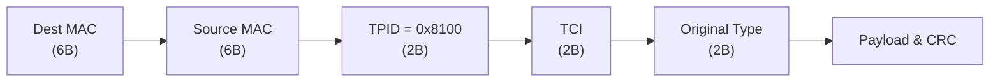

[CN Index](../README.md) / [Unit 4: Control, Link & Wireless](Introduction.md)

# Switched Local Area Networks, Ethernet, and VLANs

In the early days of local area networking, connecting computers meant attaching everyone to the exact same physical wire. If you walked into an office in the late 1980s, you would find a thick coaxial cable running through the ceiling tiles, with drop cables tapping into it at every desk. Everyone shared a single collision domain, and every bit transmitted by one host was heard by every other host.

Today, that entire shared-medium world has been replaced. When you plug an Ethernet cable into a wall port or connect to office Wi-Fi, you are communicating over a dedicated point-to-point link directly connected to an intelligent, multi-port device known as an **Ethernet Switch**.

Understanding how modern local area networks operate requires looking at the anatomy of the **Ethernet frame**, the mechanics of **switch self-learning and frame filtering**, the boundary between **switches and routers**, and how **Virtual LANs (VLANs)** slice physical hardware into isolated logical networks.

---

## The Physical Evolution of Ethernet

Ethernet's rise to dominance was shaped by a continuous physical evolution that preserved the upper-layer interface while completely transforming the physical medium.



### The Coaxial Bus (10BASE5 and 10BASE2)

Early Ethernet used thick (10BASE5, "thicknet") or thin (10BASE2, "cheapernet") coaxial cable in a physical bus topology:
- All nodes physically tapped into a single shared conductor terminated at both ends with 50-ohm resistors.
- The entire cable formed a single **collision domain**: if Node A and Node B transmitted at the same time, their electrical signals collided on the wire.
- Every node ran the full CSMA/CD protocol, backing off exponentially whenever collisions occurred.
- If the physical cable was severed anywhere, impedance mismatched, reflections destroyed all signals, and the entire network died.

### The Hub-Based Star (10BASE-T)

In the 1990s, networks transitioned to unshielded twisted-pair (UTP) copper wiring in a star topology, with each host connected via its own cable to a central **hub**:
- Although the physical wiring formed a star, the hub itself was a dumb physical-layer device (a bit-level repeater).
- When a bit arrived on one port, the hub simply amplified the electrical signal and regenerated it onto *all other ports*.
- All attached hosts still shared a single collision domain. If two hosts transmitted at once, a collision occurred inside the hub. Maximum total throughput across the entire network was still capped at 10 Mbps.

### The Switched Star Topology

The revolution came with the introduction of the **Ethernet Switch**:
- The switch is an active, intelligent **Layer 2 store-and-forward device**.
- When a frame arrives on a switch port, the switch buffers the frame, inspects its destination MAC address, and selectively forwards it *only* onto the specific physical port leading to the destination host.
- Each switch port forms its own **isolated collision domain**.
- Because modern twisted-pair and optical fiber cables have separate transmit and receive wire pairs, links operate in **full duplex**: a host can transmit and receive simultaneously at full link speed without collisions. On full-duplex switched links, CSMA/CD is completely disabled.

---

## The Ethernet Frame Structure (IEEE 802.3)

Regardless of whether an Ethernet link runs at 10 Mbps over copper or 400 Gbps over single-mode optical fiber, the fundamental framing format remains identical.



Let's dissect each field and understand why it exists:

### 1. Preamble (7 Bytes)
The preamble consists of 7 consecutive bytes of alternating ones and zeros: `10101010` (`0xAA`). 

Its purpose is purely physical synchronization. Receiving network adapters need time to lock their phase-locked loops (PLL) to the incoming signal's bit clock. The regular alternating waveform allows the receiver to synchronize its internal clock with the sender's clock before actual data arrives.

### 2. Start-of-Frame Delimiter (SFD) (1 Byte)
The 8th byte changes the pattern slightly: `10101011` (`0xAB`). The concluding two consecutive `1`s alert the receiver's MAC controller: *"The synchronization preamble is over; the very next bit begins the destination MAC address."*

### 3. Destination MAC Address (6 Bytes)
The 48-bit physical address of the receiving interface. If the destination address matches the adapter's own MAC address, or is the broadcast address (`FF:FF:FF:FF:FF:FF`), or matches a multicast group the host has joined, the NIC accepts the frame. Otherwise, the NIC hardware silently discards it without bothering the host CPU.

### 4. Source MAC Address (6 Bytes)
The 48-bit physical address of the sending network adapter. This field is critical for switches: switches inspect this field to learn where hosts are located on the network.

### 5. Type Field (2 Bytes)
The Type field (also called the EtherType) enables **multiplexing and demultiplexing** at the link layer. It tells the receiving operating system which network-layer protocol should receive the extracted payload:
- `0x0800`: IPv4 Datagram
- `0x86DD`: IPv6 Datagram
- `0x0806`: Address Resolution Protocol (ARP) Request/Reply

*(Note: In legacy 802.3 standards, this field could also represent frame length if the value was less than 1536, but modern Ethernet universally treats values $\ge 1536$ as EtherType).*

### 6. Data / Payload Field (46 to 1500 Bytes)
The encapsulated upper-layer packet (typically an IP datagram). 
- The maximum payload size is the standard Ethernet **Maximum Transmission Unit (MTU)**: **1500 bytes**.
- The minimum payload size is **46 bytes**. Why 46 bytes? Because the header and trailer total 18 bytes (6 byte Dest MAC + 6 byte Source MAC + 2 byte Type + 4 byte CRC). To satisfy the CSMA/CD minimum frame length requirement of 64 bytes:

  $$\text{Minimum Payload} = 64 \text{ bytes} - 18 \text{ bytes} = \mathbf{46 \text{ bytes}}$$

If an upper-layer packet is smaller than 46 bytes (such as a 28-byte ARP packet), the link layer must append **padding bytes** to reach 46 bytes.

### 7. Frame Check Sequence (FCS) / CRC-32 (4 Bytes)
A 32-bit Cyclic Redundancy Check calculated over all fields from the Destination MAC through the Data and Padding fields. If the receiver's hardware computes a CRC that does not match this trailer, it knows bits were corrupted in transit and drops the frame.

### Connectionless and Unreliable Service

Notice two fundamental properties of Ethernet at the link layer:
1. **Connectionless**: There is no link-layer three-way handshake between network adapters. An adapter simply encapsulates data and transmits.
2. **Unreliable**: When a receiving adapter detects a CRC error or experiences buffer overflow, it silently drops the frame. It sends no negative acknowledgment (NAK) and sends no positive acknowledgment (ACK).

Ethernet leaves the burden of end-to-end reliability to higher layers (like TCP). If an application uses UDP over Ethernet and a frame is corrupted, that data is permanently lost.

---

## Ethernet Switches: Filtering and Forwarding

A switch does not broadcast incoming frames onto every wire like a hub. Instead, it makes intelligent forwarding decisions in hardware.

The core data structure inside every switch is the **Switch Table** (also known as the Filtering Database or MAC Address Table). Each entry in the table maps three values:

$$\langle \text{Host MAC Address}, \text{Switch Port / Interface}, \text{Timestamp / Aging TTL} \rangle$$

```mermaid
flowchart TD
    F["Frame Arrives on Switch Interface x<br/>(Src MAC: S, Dst MAC: D)"] --> L["Self-Learning:<br/>Record/Update (S, x, current_time) in Switch Table"]
    L --> Lookup{"Is D in Switch Table?"}
    Lookup -->|Yes| CheckPort{"Does entry interface == x?"}
    CheckPort -->|Yes| Drop["Filter (Drop Frame):<br/>Destination already on same physical segment"]
    CheckPort -->|No (Interface y)| Fwd["Forward Frame:<br/>Transmit exclusively out interface y"]
    Lookup -->|No (Unknown Unicast) or Broadcast| Flood["Flood Frame:<br/>Transmit out all interfaces EXCEPT incoming interface x"]
```

When an Ethernet frame arrives on switch interface $x$ with Source MAC $S$ and Destination MAC $D$, the switch executes two distinct operations:

### 1. Self-Learning (Updating the Table)

The switch looks at the **Source MAC Address** $S$:
- The frame entered on interface $x$. Therefore, the host with MAC address $S$ is reachable via interface $x$!
- The switch records or refreshes the entry $(S, x, \text{timestamp})$ in its switch table.
- Entries have a time-to-live (aging timer, typically 300 seconds). If no frames arrive from MAC address $S$ before the timer expires, the entry is deleted. This allows laptops to disconnect, move to a different switch port or room, and be dynamically relearned without network reconfiguration.

### 2. Filtering and Forwarding (Dispatching the Frame)

Next, the switch looks at the **Destination MAC Address** $D$:
- **Case 1: Destination on the Same Segment**: The table indicates that destination $D$ is reachable via the exact same interface $x$ the frame just arrived on. This occurs when multiple hosts share a downstream hub or bus. The destination has already received the transmission directly. The switch **drops (filters)** the frame.
- **Case 2: Known Unicast Destination**: The table contains an entry mapping $D$ to interface $y$ (where $y \neq x$). The switch places the frame onto interface $y$'s output queue. No other ports see this frame.
- **Case 3: Unknown Unicast or Broadcast**: If destination $D$ is not found in the table, or if $D$ is the broadcast address (`FF:FF:FF:FF:FF:FF`), the switch **floods** the frame — transmitting a copy out of every single interface *except* incoming interface $x$.

### A Self-Learning Walkthrough

Let's walk through an initially empty switch connecting four hosts:



1. **Host A sends a frame to Host B**:
   - The switch inspects the source MAC: it adds `(Host A MAC, Port 1)` to its table.
   - The switch looks up Host B's MAC: it is not in the table!
   - The switch **floods** the frame out Ports 2, 3, and 4.
   - Hosts C and D inspect the destination MAC, see that it does not match their own MAC, and silently drop it. Host B recognizes its MAC and processes the frame.
2. **Host B replies to Host A**:
   - The switch inspects the source MAC: it adds `(Host B MAC, Port 2)` to its table.
   - The switch looks up Host A's MAC: found! Port 1.
   - The switch forwards the frame **exclusively out Port 1**. Ports 3 and 4 see zero traffic.
3. **Subsequent communication between A and B**:
   - Frames flow directly between Port 1 and Port 2 in full duplex. No flooding occurs.

---

## Interconnecting Switches and Spanning Tree Protocol

Self-learning scales seamlessly across interconnected hierarchies of switches.



When Host A sends a frame to Host C:
1. Switch 1 learns that Host A is on its local port. Destination C is unknown, so Switch 1 floods the frame out all ports, including the trunk link to Switch 2.
2. Switch 2 receives the frame on its trunk port. It learns: *"Host A's MAC is reachable via my port connected to Switch 1."*
3. Switch 2 floods the frame out its remaining ports; Host C receives it.
4. When Host C replies to Host A, Switch 2 looks up Host A, finds its trunk port, and forwards it to Switch 1. Switch 1 looks up Host A, finds its local port, and delivers the frame.

### The Problem of Bridging Loops: Broadcast Storms

Network administrators frequently build physical redundancy into switch topologies: connecting switches with multiple parallel links so that if one cable is cut, the network remains operational.

Now notice what happens if an unmanaged network contains a physical loop:



1. Host A sends a broadcast frame (e.g., an ARP query) to Switch 1.
2. Switch 1 floods the frame out both Link 1 and Link 2 toward Switch 2.
3. Switch 2 receives the frame on Link 1 and floods it out all other ports — including Link 2 back to Switch 1!
4. Switch 2 also receives the frame on Link 2 and floods it back out Link 1.
5. Because Ethernet frames have no TTL field (unlike IP packets), these frames multiply and circulate forever.

This catastrophe is a **Broadcast Storm**: within milliseconds, switch buffers overflow, CPU utilization hits 100%, and the entire local network crashes.

### Spanning Tree Protocol (STP - IEEE 802.1D)

To allow physical redundancy while preventing fatal loops, switches run the **Spanning Tree Protocol (STP)**:
- Switches exchange special control messages called **Bridge Protocol Data Units (BPDUs)**.
- The switches elect a single **Root Bridge** (the switch with the lowest Bridge ID).
- Each switch determines its shortest path to the Root Bridge.
- Any redundant physical links that create loops are placed into a **Blocking State** (no data frames forwarded).
- If an active link fails, STP detects the topology change and dynamically unblocks the backup link, restoring connectivity without loops.

---

## Switches vs. Routers: The Layer 2 vs. Layer 3 Divide

Students often ask: *"Both switches and routers store and forward packets. Why do we need both?"*



The fundamental difference lies in which layer header the device inspects, and how addresses are structured:

| Characteristic | Ethernet Switch (Layer 2) | Router (Layer 3) |
| :--- | :--- | :--- |
| **Operating Layer** | Data Link Layer (Layer 2) | Network Layer (Layer 3) |
| **Addressing Used** | 48-bit MAC addresses (flat, non-hierarchical) | 32-bit IPv4 / 128-bit IPv6 addresses (hierarchical) |
| **Forwarding Logic** | Exact match lookup in MAC switch table | Longest Prefix Match (LPM) on IP routing table |
| **Table Construction** | Automatic self-learning and flooding; plug-and-play | Routing algorithms (OSPF, BGP) or static configuration |
| **Header Modification** | Does not modify frame contents (transparent) | Decrements IP TTL, recomputes IP checksum, rewrites MAC headers |
| **Domain Isolation** | Isolates **Collision Domains**; passes broadcasts | Isolates both **Collision Domains** and **Broadcast Domains** |
| **Topology Constraints** | Spanning Tree forces a strict tree (wastes alternate links) | Can utilize arbitrary mesh topologies with multi-path routing |

---

## Virtual Local Area Networks (VLANs)

As institutional networks grow, connecting thousands of computers to a single switched network introduces three severe problems:

1. **Lack of Traffic Isolation**: If the Accounting department, Engineering servers, and Guest Wi-Fi users share the same switched network, any guest can run a packet sniffer and capture sensitive broadcast or ARP traffic from accounting machines.
2. **Broadcast Inefficiency**: Every ARP query, DHCP request, or discovery broadcast is flooded across all thousands of ports, consuming switch memory and host CPU cycles.
3. **Physical Rigidity**: If an employee in Marketing moves their desk into the Engineering building, re-cabling their computer to the Marketing switch requires physical rewiring.

### Port-Based VLANs

The solution is the **Virtual Local Area Network (VLAN)**. A VLAN-capable switch allows an administrator to partition a single physical switch into multiple distinct, isolated logical switches:



- In a port-based VLAN, switch ports are assigned to specific VLAN IDs (e.g., Ports 1–2 to VLAN 10; Ports 3–4 to VLAN 20).
- The switch hardware strictly enforces isolation: a broadcast frame originating on Port 1 is flooded *only* to other ports belonging to VLAN 10. Ports on VLAN 20 will never see it.
- To communicate between VLAN 10 and VLAN 20, packets must be forwarded through a **Router** (or a Layer 3 switch), allowing firewalls and access control lists (ACLs) to regulate inter-departmental traffic.

### VLAN Trunking and IEEE 802.1Q Tagging

What happens when an organization spans multiple buildings, with VLAN 10 and VLAN 20 users present in both Building 1 and Building 2?

Connecting a separate physical cable between the two switches for every single VLAN is expensive and wasteful. Instead, switches use a single shared link called a **Trunk Port**.



To multiplex traffic from different VLANs over a single physical trunk link, the sending switch modifies the Ethernet frame by inserting a **4-byte IEEE 802.1Q Tag** immediately following the Source MAC address:



The 802.1Q tag contains:
- **Tag Protocol Identifier (TPID)**: 2 bytes set to `0x8100`. Legacy network cards recognizing this value know that an 802.1Q header follows.
- **Tag Control Information (TCI)**: 2 bytes containing:
  - **Priority Code Point (PCP)**: 3 bits used for Class of Service (CoS) quality of service prioritization (voice, video, best effort).
  - **Drop Eligible Indicator (DEI)**: 1 bit indicating whether the frame may be dropped under congestion.
  - **VLAN Identifier (VID)**: **12 bits**, supporting $2^{12} = 4096$ distinct VLANs (VLAN 0 and 4095 are reserved).

When the frame reaches Switch 2, the receiving switch reads the VLAN ID, removes the 4-byte 802.1Q tag, and forwards the original untagged Ethernet frame to the destination port. End-user hosts remain completely unaware that VLAN tagging ever occurred.

---

## Key Takeaways

- Ethernet evolved from shared coaxial bus topologies running CSMA/CD to switched star topologies where dedicated full-duplex links eliminate collisions entirely.
- An Ethernet frame consists of a 7-byte preamble + 1-byte SFD, 6-byte Destination MAC, 6-byte Source MAC, 2-byte Type/Length, 46 to 1500 bytes of payload (padded to meet the 64-byte minimum), and a 4-byte CRC-32 trailer.
- Ethernet provides connectionless, unreliable link-layer service; corrupt frames are dropped without link-level ACKs or NAKs.
- Switches are transparent Layer 2 devices. They build their switch tables dynamically via **self-learning** (inspecting Source MACs) and perform selective forwarding, filtering, or flooding based on Destination MACs.
- Spanning Tree Protocol (STP) prevents fatal broadcast storms in redundant switch topologies by dynamically disabling redundant loop paths.
- Switches operate at Layer 2 using flat MAC addresses within collision/broadcast domains; routers operate at Layer 3 using hierarchical IP addresses to interconnect independent networks.
- VLANs partition physical switch hardware into logically isolated broadcast domains, containing broadcast traffic and enforcing security.
- IEEE 802.1Q trunking multiplexes multiple VLANs over a single physical link by inserting a 4-byte tag containing a 12-bit VLAN Identifier (VID).

---

We have now traveled through all four core layers of the Internet protocol stack: application protocols (HTTP, DNS), transport mechanisms (TCP, UDP), network routing and addressing (IPv4, IPv6, ICMP, DHCP, OSPF, BGP), and link-layer framing and switching (Ethernet, ARP, MAC). In the next lecture, we integrate every single one of these concepts into a grand, comprehensive synthesis: [**A Day in the Life of a Web Page Request**](L09%20-%20Synthesis%20-%20A%20Day%20in%20the%20Life%20of%20a%20Web%20Page%20Request.md).
