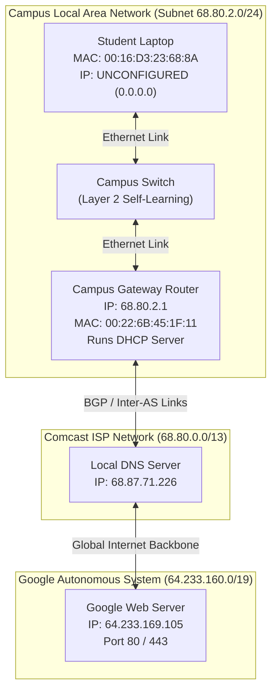
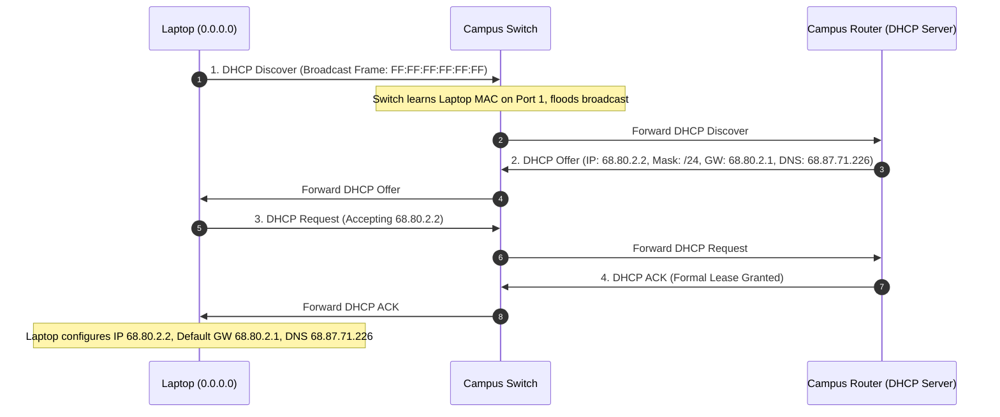
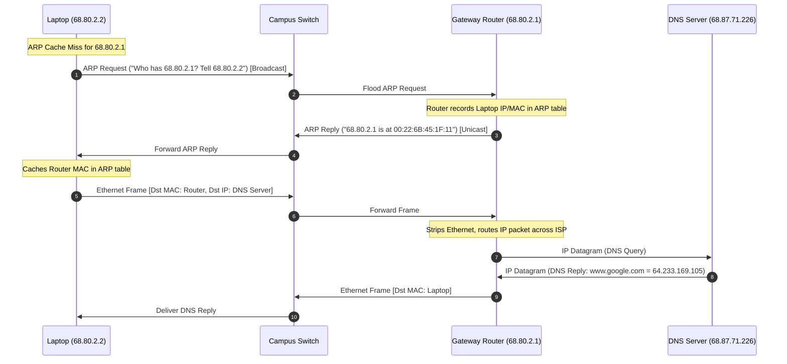
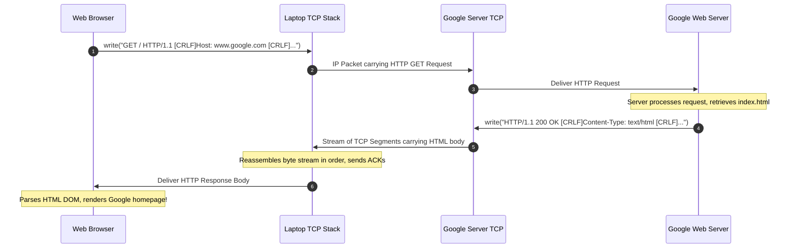

[CN Index](../README.md) / [Unit 4: Control, Link & Wireless](Introduction.md)

# Synthesis: A Day in the Life of a Web Page Request

Over the previous four units, we disassembled computer networks layer by layer. We studied how applications format requests at Layer 7, how transport protocols establish reliability and throttle congestion at Layer 4, how routers find optimal paths across global autonomous systems at Layer 3, and how link adapters encapsulate bits and resolve hardware addresses at Layer 2.

Now, it is time to bring all of these moving parts back together.

Consider a deceptively simple scenario: a student walks into a university classroom, opens their laptop, plugs an Ethernet cable into the desk port, opens a web browser, and types `www.google.com`. Seconds later, the Google homepage renders on the screen.

What actually happened inside the machine, across the copper wires, through the campus switches, and across the global Internet backbone to make that page appear? 

Tracing this complete sequence is the ultimate synthesis of networking. It proves that no protocol operates in isolation: every single byte that crosses a physical wire relies on a coordinated chain of encapsulation, address resolution, routing, and state synchronization across the entire protocol stack.

---

## The Network Topography and Initial State

Before the student plugs in the cable, let's take stock of the environment and what the laptop knows — and doesn't know.



When the laptop's network adapter powers on:
- **What it has**: A 48-bit physical MAC address burned into its NIC ROM: `00:16:D3:23:68:8A`.
- **What it does NOT have**: 
  - It has no IP address (it cannot send or receive routable IP datagrams).
  - It does not know the subnet mask of the local network.
  - It does not know the IP address or MAC address of the default gateway router leading to the Internet.
  - It does not know the IP address of any Domain Name System (DNS) server.

Without this information, the laptop cannot send a single bit toward `www.google.com`. The very first job is bootstrapping network connectivity via **DHCP**.

---

## Phase 1: Bootstrapping Network Attachment via DHCP

To obtain network configuration parameters dynamically, the laptop's operating system executes the **Dynamic Host Configuration Protocol (DHCP)** four-step exchange (DORA: Discover, Offer, Request, Acknowledge).



### Step 1: DHCP Discover

The client OS creates a `DHCP Discover` message containing a transaction ID and its hardware MAC address.

Now observe the encapsulation stack:
- **Application Layer**: DHCP message.
- **Transport Layer**: Encapsulated into a **UDP** datagram with Source Port `68` (DHCP client) and Destination Port `67` (DHCP server).
- **Network Layer**: Encapsulated into an **IPv4** datagram. Because the client has no IP address yet, Source IP is set to `0.0.0.0`. Because it does not know where the DHCP server is, Destination IP is set to the limited broadcast address `255.255.255.255`.
- **Link Layer**: Encapsulated into an **Ethernet frame**. Source MAC is the laptop's MAC (`00:16:D3:23:68:8A`), and Destination MAC is the link-layer broadcast address `FF:FF:FF:FF:FF:FF`.

The laptop transmits the frame onto the copper wire.

### Step 2: Switch Self-Learning and Flooding

The frame arrives on Port 1 of the campus Ethernet switch:
1. The switch inspects the Source MAC (`00:16:D3:23:68:8A`) and records an entry in its switch table: `(00:16:D3:23:68:8A, Port 1)`.
2. The switch inspects the Destination MAC (`FF:FF:FF:FF:FF:FF`). Because it is a broadcast address, the switch floods the frame out all other active ports.
3. The campus router receives the frame on its LAN interface.

### Step 3: Server Demultiplexing and DHCP Offer

The campus router decapsulates the incoming packet:
- Link layer verifies the frame CRC, sees the broadcast address, strips the Ethernet header, and passes the payload to IPv4.
- IPv4 accepts the broadcast `255.255.255.255`, strips the IP header, and passes the payload to UDP.
- UDP inspects destination port `67` and delivers the message to the active DHCP server process.

The DHCP server allocates an available IP address from its pool (`68.80.2.2`) and builds a `DHCP Offer` containing:
- Allocated Client IP: `68.80.2.2`
- Subnet Mask: `255.255.255.0` (`/24`)
- Default Gateway Router IP: `68.80.2.1`
- Domain Name System (DNS) Server IP: `68.87.71.226`
- IP Address Lease Time: e.g., 86,400 seconds (1 day)

The DHCP server encapsulates this in UDP (port 67 $\to$ 68), IP, and an Ethernet frame sent back to the switch. The switch consults its table, sees that the laptop's MAC is on Port 1, and selectively forwards the frame *only* to the laptop.

### Step 4: DHCP Request and DHCP ACK

The laptop receives the offer, responds with a `DHCP Request` confirming it wants that IP address, and the server replies with a `DHCP ACK`.

The moment the laptop's OS processes the DHCP ACK, its networking stack is fully initialized:
- **Local IP**: `68.80.2.2`
- **Subnet Mask**: `255.255.255.0`
- **Default Gateway**: `68.80.2.1`
- **DNS Server**: `68.87.71.226`

---

## Phase 2: Name Resolution via ARP and DNS

The student now presses Enter in their browser to load `http://www.google.com`. 

The browser knows the human-readable string `"www.google.com"`, but IP routing operates purely on numerical IP addresses. Before any TCP connection can open, the host must resolve `"www.google.com"` into an IP address using DNS.

### The Subnet Check and the Routing Decision

The browser issues a `getaddrinfo()` system call to the operating system's DNS resolver stub. The stub generates a DNS query packet asking: *"What is the IPv4 address (Type A record) for www.google.com?"*

The stub encapsulates this query into a UDP packet destined for DNS server `68.87.71.226` on port `53`.

Now, the laptop's network layer must decide how to send this IP datagram:
1. It compares the destination IP (`68.87.71.226`) with its own IP (`68.80.2.2`) using its subnet mask (`255.255.255.0`).
2. `68.80.2.2 & 255.255.255.0 = 68.80.2.0`
3. `68.87.71.226 & 255.255.255.0 = 68.87.71.0`
4. The network prefixes do not match! The DNS server is on an **outside network**.

Because the destination is non-local, the laptop cannot send the frame directly to the DNS server's MAC address. It must forward the datagram to its **first-hop default gateway router** (`68.80.2.1`).

### The Missing MAC Address: ARP to the Rescue

To send an Ethernet frame to the router, the laptop needs the router's 48-bit MAC address. The laptop checks its local **ARP Cache**:
- Entry for `68.80.2.1`: **MISS (Not Found)**.

The laptop cannot send the DNS query yet! It must first run the **Address Resolution Protocol (ARP)**.



1. **ARP Query Broadcast**: The laptop broadcasts an ARP Request frame: *"Who has IP 68.80.2.1? Tell 68.80.2.2."* Destination MAC is `FF:FF:FF:FF:FF:FF`.
2. **Switch Flooding**: The switch floods the broadcast frame out all ports.
3. **Router Response**: The gateway router inspects the ARP query, sees its own IP address, and sends a unicast **ARP Reply** directly to the laptop's MAC: *"68.80.2.1 is at 00:22:6B:45:1F:11."*
4. **Cache Update**: The laptop receives the reply and caches the mapping `68.80.2.1 -> 00:22:6B:45:1F:11` with an aging TTL.

### Transmitting the DNS Query Across the Internet

Now that the gateway router's MAC address is known, the laptop can finally transmit the DNS query:
- **Source IP**: `68.80.2.2` (Laptop)
- **Destination IP**: `68.87.71.226` (Comcast DNS Server)
- **Source MAC**: `00:16:D3:23:68:8A` (Laptop)
- **Destination MAC**: `00:22:6B:45:1F:11` (**Default Gateway Router**)

The frame hits the switch, which forwards it to the gateway router:
1. The gateway router verifies the frame CRC, removes the Ethernet header, and inspects the destination IP (`68.87.71.226`).
2. The router consults its Layer 3 forwarding table (built via intra-domain routing protocols like OSPF and inter-domain BGP).
3. The router decrements the IP TTL, recomputes the IPv4 header checksum, encapsulates the datagram into a new link-layer frame appropriate for its outbound ISP link, and transmits it into Comcast's network.
4. Intermediate ISP routers forward the datagram hop-by-hop using Longest Prefix Match until it arrives at the Comcast DNS server.

### DNS Resolution and Response

The DNS server receives the query on UDP port 53. If the record for `www.google.com` is cached locally, it returns it immediately. If not, it performs recursive/iterative resolution querying root servers, `.com` TLD servers, and Google's authoritative name servers.

The DNS server formulates a DNS Response:

$$\text{Name: } \texttt{www.google.com} \quad \longrightarrow \quad \text{IP: } \mathbf{64.233.169.105}$$

The DNS response is returned across the network back to the campus gateway router, which wraps it in an Ethernet frame destined for the laptop's MAC address. The laptop OS delivers the resolved IP address `64.233.169.105` to the browser.

---

## Phase 3: The Transport Layer Handshake (TCP)

Now that the browser has Google's IP address (`64.233.169.105`), it can initiate an HTTP transaction. But HTTP requires a reliable byte stream. 

Before transmitting a single byte of HTTP data, the client must establish a **TCP connection** via the classic **Three-Way Handshake**.

```mermaid
sequenceDiagram
    autonumber
    participant Laptop as Laptop (Client)
    participant Router as Campus Gateway
    participant Server as Google Server (64.233.169.105:80)
    Note over Laptop: Socket connect(): State SYN_SENT
    Laptop->>Router: TCP SYN [seq = client_isn]
    Router->>Server: Inter-AS Routing to Google
    Note over Server: Allocates TCB buffers; State SYN_RCVD
    Server->>Router: TCP SYN-ACK [seq = server_isn, ack = client_isn + 1]
    Router->>Laptop: Deliver SYN-ACK
    Note over Laptop: State ESTABLISHED
    Laptop->>Router: TCP ACK + HTTP GET / [ack = server_isn + 1]
    Router->>Server: Deliver to Google
    Note over Server: State ESTABLISHED
```

### 1. The TCP SYN Segment

The client OS creates a TCP socket:
- **Source Port**: Ephemeral port chosen by OS (e.g., `51234`).
- **Destination Port**: `80` (for HTTP) or `443` (for HTTPS).
- **Control Flags**: `SYN = 1`, all other flags 0.
- **Sequence Number**: Randomly generated initial sequence number (`client_isn`).
- **Options**: Advertised Maximum Segment Size (MSS = 1460 bytes), Window Scale factor, SACK permitted.

The segment is encapsulated in an IP datagram (Dst IP: `64.233.169.105`), framed in Ethernet (Dst MAC: Gateway Router MAC `00:22:6B:45:1F:11`), and transmitted.

The packet traverses the campus router, enters the regional ISP, traverses autonomous system boundaries governed by BGP peering agreements, enters Google's private global fiber network, and arrives at Google's front-end load balancer.

### 2. The TCP SYN-ACK Segment

The Google server receives the SYN:
- It allocates connection state variables, receive and transmit buffers, and a Transmission Control Block (TCB).
- It generates its own initial sequence number (`server_isn`).
- It formulates a TCP segment with flags `SYN = 1, ACK = 1`.
- Acknowledgment number: `client_isn + 1`.
- It transmits the SYN-ACK back across the Internet to the student's laptop.

### 3. The TCP ACK Segment

The laptop receives the SYN-ACK:
- Its socket transitions to the `ESTABLISHED` state.
- It prepares the final ACK of the handshake (`ACK = 1, ack = server_isn + 1`).
- To optimize network efficiency, the client does not send this ACK alone — it immediately piggybacks the first application-layer HTTP request inside this same segment!

---

## Phase 4: Application Layer Request, Response, and Page Render

The TCP connection is open. The browser can now make its application-layer request.



### 1. Sending the HTTP GET Request

The browser writes an HTTP request string into the socket:

```http
GET / HTTP/1.1
Host: www.google.com
User-Agent: Mozilla/5.0 (X11; Linux x86_64) ...
Accept: text/html,application/xhtml+xml,...
Accept-Language: en-US,en;q=0.9
Connection: keep-alive
```

- TCP places these bytes into its transmit buffer, assigns sequence numbers, and wraps them in a TCP segment.
- IP wraps the segment in an IPv4 datagram with TTL set to 64.
- Ethernet wraps the datagram with the router's MAC address and appends a 32-bit CRC.
- The physical layer modulates the bits into electrical voltages and launches them onto the twisted-pair cable.

### 2. Router Hop-by-Hop Processing

As the packet speeds across dozens of intermediate routers between the university and Google's data center, every router performs the exact same mechanistic loop:
1. **Physical Layer**: Receives analog signals, regenerates digital bit stream.
2. **Link Layer**: Checks frame CRC. If corrupted, drops frame. If valid, strips link-layer header and trailer.
3. **Network Layer**: Inspects IP destination address (`64.233.169.105`). Decrements TTL by 1 (if TTL reaches 0, drops packet and sends ICMP Time Exceeded). Recomputes IPv4 header checksum. Performs Longest Prefix Match in hardware forwarding table (TCAM). Identifies outbound interface and next-hop IP.
4. **Link Layer Re-encapsulation**: Consults outbound interface's ARP cache to find next-hop MAC address. Formats brand new link-layer frame (could be Ethernet, optical frame, or point-to-point frame). Recomputes new link CRC.
5. **Physical Layer**: Transmits signal onto outbound link.

Notice that the IP source and destination addresses remain unchanged throughout the entire journey (unless modified by NAT), while the link-layer MAC addresses change on *every single hop*.

### 3. Server Response and TCP Stream Transfer

Google's web server receives the HTTP request:
- It processes the `GET /` command and reads the HTML document for `index.html`.
- It constructs an HTTP response:

```http
HTTP/1.1 200 OK
Date: Sat, 25 Oct 2026 14:00:00 GMT
Content-Type: text/html; charset=UTF-8
Content-Length: 15420
...

<!doctype html><html ...>...</html>
```

Because the HTML document ($15,420$ bytes) exceeds the Maximum Segment Size (MSS = 1460 bytes), Google's TCP stack segments the data into multiple chunks:
- Segment 1: Bytes 1 to 1460
- Segment 2: Bytes 1461 to 2920
- ... and so on across roughly 11 TCP segments.

Google's TCP congestion control algorithm (e.g., CUBIC or BBR) releases these segments onto the network governed by its Congestion Window (`cwnd`).

### 4. Client Reassembly and DOM Rendering

The segments arrive at the student's laptop:
- The NIC verifies each frame's CRC and raises a hardware interrupt.
- The OS TCP stack inspects sequence numbers, places segments in proper order, detects any missing gaps, and transmits cumulative TCP ACKs back to Google.
- TCP delivers the reassembled byte stream up through the socket to the web browser.
- The browser engine parses the HTML syntax, constructs the Document Object Model (DOM) tree, discovers referenced resources (Google logo image, CSS style sheets, JavaScript bundles), and recursively fetches them over the existing persistent TCP connection.
- The graphics subsystem renders the Google homepage on the screen.

The loop is closed.

---

## The Complete End-to-End Protocol Matrix

| Protocol | Protocol Layer | Primary Function in the Scenario |
| :--- | :--- | :--- |
| **DHCP** | Application (UDP 67/68) | Dynamically leases local IP, subnet mask, default gateway, and DNS server to unconfigured client. |
| **ARP** | Link / Network boundary | Resolves known IPv4 addresses (`68.80.2.1`) into 48-bit hardware MAC addresses (`00:22:6B:45:1F:11`). |
| **DNS** | Application (UDP 53) | Resolves human-readable domain name (`www.google.com`) into routable IP address (`64.233.169.105`). |
| **UDP** | Transport (Layer 4) | Lightweight, connectionless transport for low-overhead DHCP and DNS transactions. |
| **TCP** | Transport (Layer 4) | Establishes reliable, ordered, flow-controlled byte stream with Google web server via 3-way handshake. |
| **IPv4** | Network (Layer 3) | Provides hierarchical end-to-end addressing and packet delivery across heterogeneous autonomous systems. |
| **OSPF / BGP** | Network Routing (Control Plane) | Populates router forwarding tables with optimal paths across intra-domain and inter-domain links. |
| **Ethernet** | Link (Layer 2) | Provides node-to-node framing, media access control, error detection (CRC-32), and hardware switching. |
| **HTTP / HTTPS** | Application (Layer 7) | Formats application request (`GET /`) and returns document payload (`200 OK + HTML DOM`). |

---

## Key Takeaways

- Loading a web page requires seamless coordination across all layers: an unconfigured host must first bootstrap IP parameters, resolve names, establish transport state, and exchange application data.
- **DHCP** runs over UDP broadcast to grant the client an IP address, subnet mask, default gateway IP, and local DNS server IP.
- Before transmitting to non-local IP addresses, the client identifies its first-hop default gateway and uses **ARP** broadcast to discover the router's physical MAC address.
- **DNS** queries resolve domain names to IP addresses over UDP port 53, routed hop-by-hop across the Internet via forwarding tables built by BGP and OSPF.
- A **TCP Three-Way Handshake** (`SYN`, `SYN-ACK`, `ACK`) establishes reliable, full-duplex communication and synchronizes initial sequence numbers before application payload can flow.
- As packets traverse intermediate routers, Layer 3 IP source and destination addresses remain unchanged, while Layer 2 MAC addresses are rewritten at every hop.
- **HTTP** transfers the requested web resource, which TCP divides into MSS-sized segments. The client reassembles the stream in order, passes it to the browser, and renders the DOM.

---

Up to this point, all our models assumed that bits magically fly through wires and airwaves without error once the link layer finishes framing them. But how are raw digital ones and zeros actually converted into physical electromagnetic phenomena? In the next lecture, we dive into the fundamental physics of the [**Physical Layer Fundamentals, Modulation, and Bandwidth Limits**](L10%20-%20Physical%20Layer%20Fundamentals,%20Modulation,%20and%20Bandwidth%20Limits.md), exploring guided and unguided media, modulation techniques, and the mathematical bandwidth limits defined by Nyquist and Shannon.
