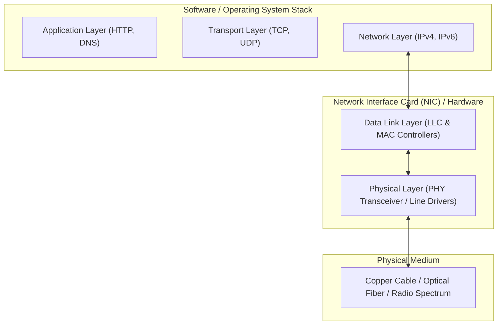
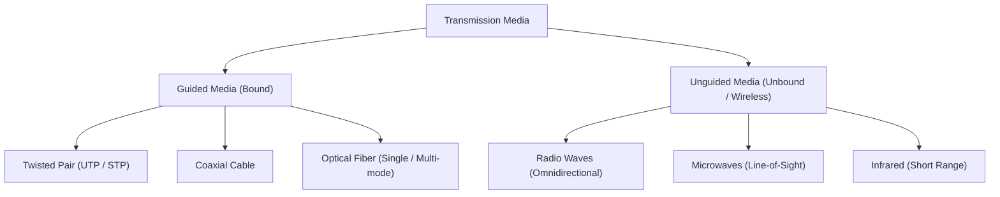
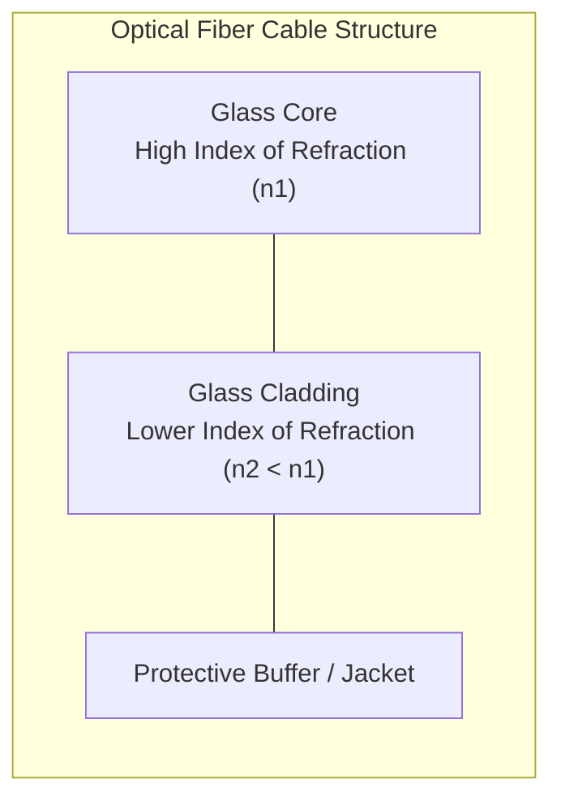
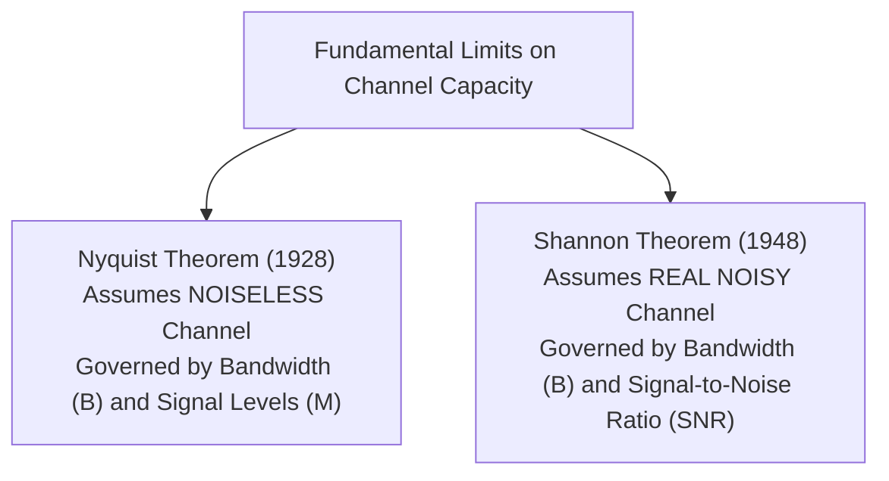
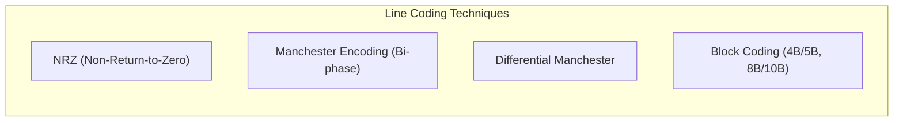
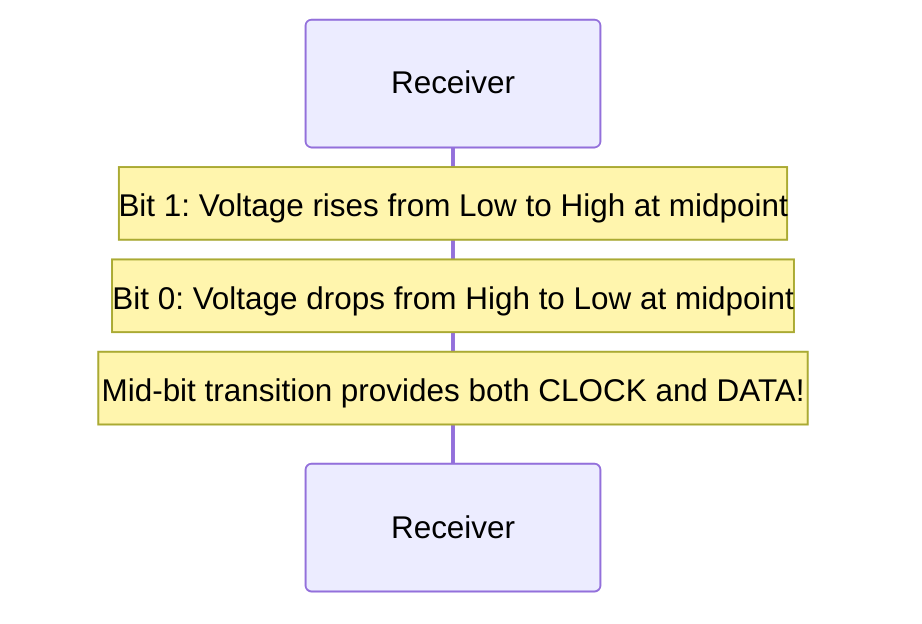
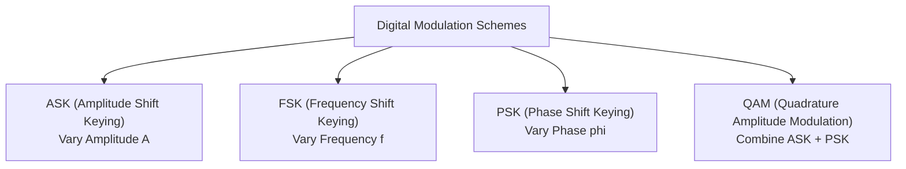

[CN Index](../README.md) / [Unit 4: Control, Link & Wireless](Introduction.md)

# Physical Layer Fundamentals, Modulation, and Bandwidth Limits

In all of our discussions of framing, addressing, and routing, we treated bits as abstract logical values: clean ones and zeros flowing reliably between network interface cards. But bits do not physically exist in nature. Nature only provides electromagnetic energy: electrical voltages moving along copper conductors, photons pulsing through glass waveguides, and radio waves radiating across open space.

The **Physical Layer (Layer 1)** is the physical foundation of the OSI and TCP/IP models. Its sole responsibility is to translate raw digital bit streams into physical electromagnetic signals, transmit those signals across a physical communication channel, and reconstruct the original bits at the receiver.

To understand why networks have bandwidth limits, why signals degrade over distance, and how high-speed gigabit links function, we must investigate the physical media, line encoding, digital modulation, and the fundamental mathematical laws established by **Harry Nyquist** and **Claude Shannon**.

---

## The Physical Layer in the Architecture

Unlike the higher layers of the protocol stack (Application, Transport, Network) which are implemented entirely in operating system software, the physical layer is implemented in dedicated hardware transceivers, network adapters, and physical cabling.

The physical layer performs three core functions:
1. **Physical Components and Connectors**: The physical hardware interfaces, mechanical connectors (RJ-45, LC/SC fiber connectors, BNC), pins, and transmission cables.
2. **Encoding (Line Coding)**: Converting a stream of binary data bits into a predefined voltage, optical, or state pattern (e.g., Manchester, NRZ).
3. **Signaling (Modulation)**: Generating the continuous-valued analog waveforms or discrete electrical pulses that physically travel across the transmission medium.

Devices operating strictly at the physical layer include **Repeaters** and **Hubs**. Because they possess no link-layer logic, they do not inspect MAC addresses, parse frame headers, or filter traffic; they simply amplify and regenerate incoming electrical bits onto outbound ports.

---

## Physical Transmission Media

Communication media fall into two fundamental categories: **guided media** (where waves are guided along a physical solid conductor) and **unguided media** (wireless transmission through the atmosphere, vacuum, or water).

### Guided Media

#### 1. Twisted Pair (UTP and STP)
The most ubiquitous transmission medium in modern local area networks is **Unshielded Twisted Pair (UTP)** (e.g., Category 5e, 6, 6a, 8 cables terminating in RJ-45 connectors).

A twisted-pair cable contains pairs of insulated copper wires twisted spirally around each other. Why twist the wires?
- When an electromagnetic interference (EMI) field crosses two parallel wires, it induces an unwanted noise voltage in both.
- If the wires are twisted, each wire alternates being closer to and further from the external noise source. The noise couples equally into both conductors.
- Network transceivers employ **differential signaling**: the receiver detects the *difference* in voltage between the two wires ($V_{\text{diff}} = V_+ - V_-$). Because external noise impacts both conductors identically, subtracting their voltages completely cancels out the induced noise ($V_{\text{noise}} - V_{\text{noise}} = 0$). Twisting also prevents adjacent pairs in the same cable bundle from interfering with each other (**cross-talk**).

#### 2. Coaxial Cable
Coaxial cable consists of a central copper conductor surrounded by a thick dielectric insulating layer, encased in a cylindrical braided metallic shield, and covered by an outer plastic jacket:
- The outer metallic shield blocks external electromagnetic radiation and prevents signal leakage.
- Coaxial cable offers significantly higher bandwidth and lower noise susceptibility than unshielded twisted pair, making it historically foundational for early bus Ethernet (10BASE5/10BASE2) and modern cable broadband access networks (DOCSIS over Hybrid Fiber-Coaxial).

#### 3. Optical Fiber
Optical fiber transmits data as pulses of light (photons) through thin strands of ultra-pure silica glass.

Light is contained within the glass core through the optical principle of **Total Internal Reflection**:
- The glass core has an index of refraction $n_1$.
- The surrounding cladding has a slightly lower index of refraction $n_2$ ($n_2 < n_1$).
- When light traveling through the core hits the cladding boundary at an angle greater than the **critical angle** $\theta_c = \arcsin(n_2 / n_1)$, 100% of the light reflects back into the core with zero refractive loss.

Optical fiber comes in two distinct types:
- **Multi-Mode Fiber (MMF)**: Possesses a relatively thick core (typically $50 \ \mu\text{m}$ or $62.5 \ \mu\text{m}$). Light rays enter at multiple different angles, creating multiple spatial propagation paths ("modes"). Because rays taking bouncing paths travel longer distances than straight rays, light pulses spread out over distance (**modal dispersion**). MMF uses inexpensive LED light sources and is limited to short runs within data centers and campus buildings (up to several hundred meters).
- **Single-Mode Fiber (SMF)**: Features an extremely narrow core (approximately $8 \ \mu\text{m}$ to $10 \ \mu\text{m}$) — roughly the wavelength of light itself. Light can only propagate in a single, straight ray mode. Modal dispersion is completely eliminated, allowing high-power semiconductor injection lasers to transmit tens of gigabits per second across distances exceeding 40 to 80 kilometers without repeaters.

---

## Physical Transmission Impairments

As an electromagnetic signal travels through any physical transmission medium, three physical phenomena degrade its quality:

1. **Attenuation**: The loss of signal energy as distance increases. In copper cables, electrical resistance converts signal energy into heat; in fiber, Rayleigh scattering and absorption attenuate light. Attenuation is measured logarithmically in **decibels (dB)**:

   $$\text{Attenuation (dB)} = 10 \log_{10}\left(\frac{P_{\text{tx}}}{P_{\text{rx}}}\right)$$

   If a signal loses 50% of its power ($P_{\text{rx}} = 0.5 P_{\text{tx}}$), it has suffered an attenuation of $10 \log_{10}(2) \approx 3 \text{ dB}$. If it loses 99% of its power, the attenuation is $20 \text{ dB}$. Amplifiers or digital repeaters must be placed periodically to restore signal amplitude.

2. **Dispersion and Distortion**: The spreading out of signal pulses as they travel. Because different frequency components of a digital square wave travel at slightly different propagation velocities through a physical medium (chromatic dispersion), crisp square pulses broaden and overlap with neighboring pulses. This blurring effect is known as **Inter-Symbol Interference (ISI)**, making it difficult for the receiver to distinguish one bit from the next.

3. **Noise**: Unwanted random electrical or electromagnetic energy added to the signal from external sources or thermal molecular agitation:
   - **Thermal Noise (Johnson-Nyquist Noise)**: The random motion of electrons present in all electronic conductors; proportional to absolute temperature and bandwidth: $N = k T B$.
   - **Cross-talk**: Inductive or capacitive coupling between adjacent wire pairs.
   - **Impulse Noise**: Sudden, high-amplitude spikes caused by lightning, power transients, or heavy electric motors.

---

## The Fundamental Limits on Data Rates

Every communication channel has a finite physical bandwidth. How fast can we push data through a channel before physical laws prevent accurate reception? 

This question is answered by two monumental theorems in information theory: the **Nyquist Bit Rate Theorem** (for noiseless channels) and the **Shannon Channel Capacity Theorem** (for noisy channels).

---

## 1. Nyquist Bit Rate (Noiseless Channel)

In 1928, Harry Nyquist proved that any analog signal with a bandwidth of $B$ Hertz can be completely reconstructed by taking $2B$ equally spaced samples per second. If you sample at any lower rate, high-frequency components wrap around into lower frequencies, creating irreversible signal distortion known as **aliasing**.

If an idealized transmission channel has an analog bandwidth of $B$ Hertz and is completely free of noise, the maximum theoretical data rate is determined solely by the sampling rate and the number of discrete signal voltage levels $M$ used to represent data:

$$\mathbf{C = 2 B \log_2(M) \quad \text{bits per second (bps)}}$$

Where:
- $B$ is the channel bandwidth in Hertz ($\text{Hz}$).
- $M$ is the number of distinct signal voltage or phase levels used by the signaling scheme.
- $\log_2(M)$ represents the number of bits encoded per discrete signal state (symbol).

### Intuition Behind Nyquist
- If we use simple binary signaling ($M = 2$ levels, e.g., $0\text{V}$ for bit 0 and $+5\text{V}$ for bit 1), each pulse carries $\log_2(2) = 1$ bit. Over a channel with bandwidth $B = 3000\text{ Hz}$, the maximum noiseless bit rate is:

  $$C = 2 \times 3000 \times \log_2(2) = 6000\text{ bps}$$

- What if we modify our transmitter to use $M = 16$ distinct voltage levels (e.g., $0\text{V}, 0.5\text{V}, 1.0\text{V}, \dots, 7.5\text{V}$)? Now each discrete pulse represents $\log_2(16) = 4$ bits. The achievable data rate jumps to:

  $$C = 2 \times 3000 \times \log_2(16) = 2 \times 3000 \times 4 = 24,000\text{ bps}$$

Nyquist's formula suggests that by increasing the number of voltage levels $M$ to hundreds or thousands, we could achieve infinite data rates over a narrow bandwidth. 

Why can't we do this in the real world? Because **noise** exists. If the voltage difference between adjacent levels is 0.01 volts and channel thermal noise introduces 0.05-volt fluctuations, the receiver cannot reliably distinguish level 4 from level 5!

---

## 2. Shannon Channel Capacity (Noisy Channel)

In 1948, Claude Shannon published *"A Mathematical Theory of Communication"*, extending Nyquist's work to real channels corrupted by thermal Gaussian white noise.

Shannon proved that regardless of how many voltage levels you use or how sophisticated your error-correction coding is, there is an absolute physical upper bound on the rate of error-free data transmission over an analog channel of bandwidth $B$ Hertz:

$$\mathbf{C = B \log_2(1 + \text{SNR}) \quad \text{bits per second (bps)}}$$

Where:
- $B$ is the channel bandwidth in Hertz.
- $\text{SNR}$ is the **Signal-to-Noise Ratio** expressed as an absolute **linear power ratio**:

  $$\text{SNR} = \frac{\text{Signal Power } S}{\text{Noise Power } N}$$

### Decibels and Signal-to-Noise Ratio

Engineers almost always measure signal-to-noise ratio logarithmically in **decibels (dB)**:

$$\text{SNR}_{\text{dB}} = 10 \log_{10}(\text{SNR})$$

To use Shannon's theorem, you must convert the decibel value back into a linear ratio:

$$\text{SNR} = 10^{\frac{\text{SNR}_{\text{dB}}}{10}}$$

| $\text{SNR}_{\text{dB}}$ (Decibels) | Linear Power Ratio ($\text{SNR} = S/N$) | Meaning |
| :--- | :--- | :--- |
| **$0\text{ dB}$** | $10^{0} = 1$ | Signal power equals noise power ($S = N$) |
| **$10\text{ dB}$** | $10^{1} = 10$ | Signal is 10 times stronger than noise |
| **$20\text{ dB}$** | $10^{2} = 100$ | Signal is 100 times stronger than noise |
| **$30\text{ dB}$** | $10^{3} = 1000$ | Signal is 1,000 times stronger than noise |

Notice the critical implications of Shannon's formula:
- As noise increases ($\text{SNR} \to 0$), capacity $C \to B \log_2(1) = 0\text{ bps}$. In infinite noise, no data can pass.
- Even if a channel had infinite signal power, capacity grows logarithmically with SNR, but linearly with bandwidth $B$. Bandwidth is the most precious resource in physical communication.

---

## Worked Numerical Examples (Nyquist and Shannon)

Exam problems frequently combine Nyquist and Shannon to test whether a proposed data rate is physically viable, or to determine the minimum number of signal levels required.

### Example 1: Classic Telephone Line Capacity

> **Problem**: A standard telephone line has an analog bandwidth of $3000\text{ Hz}$ and a signal-to-noise ratio of $35\text{ dB}$. Calculate the absolute theoretical maximum bit rate supported by this channel.

**Solution**:
1. First, convert $\text{SNR}_{\text{dB}} = 35\text{ dB}$ to linear ratio:
   $$\text{SNR} = 10^{35/10} = 10^{3.5} \approx 3162.28$$
2. Apply Shannon's capacity formula:
   $$C = B \log_2(1 + \text{SNR}) = 3000 \times \log_2(1 + 3162.28) = 3000 \times \log_2(3163.28)$$
3. Convert $\log_2$ to natural log or common log:
   $$\log_2(3163.28) = \frac{\ln(3163.28)}{\ln(2)} = \frac{8.0594}{0.6931} \approx 11.628\text{ bits/sample}$$
4. Multiply by bandwidth:
   $$C = 3000 \times 11.628 \approx \mathbf{34,884\text{ bps}} \ (\approx 34.9\text{ kbps})$$

*Pedagogical Insight*: This mathematical result is why legacy dial-up modems could not exceed roughly $33.6\text{ kbps}$ over standard analog circuits. (Later 56k V.90 modems only achieved 56 kbps by bypassing the analog-to-digital conversion at the telephone exchange).

---

### Example 2: Determining Required Signal Levels

> **Problem**: A communication channel has a bandwidth of $1\text{ MHz}$ ($10^6\text{ Hz}$) and an $\text{SNR}_{\text{dB}}$ of $30\text{ dB}$. 
> 1. Find the Shannon channel capacity.
> 2. How many discrete signal levels ($M$) must a transmitter support to achieve this maximum capacity under Nyquist's theorem?

**Solution**:
1. **Shannon Capacity**:
   $$\text{SNR} = 10^{30/10} = 10^3 = 1000$$
   $$C = B \log_2(1 + 1000) = 10^6 \times \log_2(1001)$$
   $$\log_2(1001) = \frac{\ln(1001)}{\ln(2)} \approx 9.967$$
   $$C = 10^6 \times 9.967 = \mathbf{9.967\text{ Mbps}} \approx 10\text{ Mbps}$$

2. **Nyquist Level Calculation**:
   Now equate Nyquist's formula to the Shannon bound:
   $$C_{\text{Nyquist}} = 2 B \log_2(M) \le C_{\text{Shannon}}$$
   $$2 \times (10^6) \times \log_2(M) = 9.967 \times 10^6$$
   $$\log_2(M) = \frac{9.967}{2} \approx 4.9835$$
   $$M = 2^{4.9835} \approx 31.63$$

Since signal levels must be an integer (and typically a power of 2 for binary digital circuits), the system requires at least **32 signal levels** ($M = 32$, encoding $\log_2(32) = 5$ bits per symbol) to achieve this capacity.

---

## Line Coding: Representing Bits on the Wire

How are digital bits physically mapped to electrical voltage pulses? This process is known as **Line Coding**.

### 1. Non-Return to Zero (NRZ)
- **NRZ-Level (NRZ-L)**: A constant positive voltage represents bit 1, and zero (or negative) voltage represents bit 0.
- **NRZ-Invert (NRZ-I)**: A voltage transition at the start of the bit interval represents bit 1; no transition represents bit 0.

**The Weaknesses of NRZ**:
- **Baseline Wander**: A long string of consecutive 1s or 0s creates a constant DC voltage, shifting the receiver's average reference voltage ("baseline wander").
- **Clock Drift**: Receivers need voltage transitions to keep their internal clock synchronized with the sender. If 1,000 consecutive 0s are sent under NRZ, the signal remains flat, the receiver's clock drifts, and it miscounts the number of bits received.

### 2. Manchester Encoding

To guarantee continuous clock synchronization, Manchester encoding forces a **voltage transition in the exact middle of every single bit period**:
- A transition from **Low to High** in the middle of the bit represents bit **1**.
- A transition from **High to Low** in the middle of the bit represents bit **0**.

**Advantages**:
- Self-clocking: the receiver synchronizes its clock on every single bit.
- Zero DC bias: every bit has equal parts high and low voltage.

**The Tradeoff**:
Because there are up to two signal transitions per bit, the **baud rate (signal transition rate)** is twice the bit rate ($S = 2N$). Manchester encoding requires **twice the bandwidth** of NRZ. This is why classic 10 Mbps Ethernet (10BASE-T) required a 20 MHz signal bandwidth.

---

## Digital Modulation (Bandpass Transmission)

Baseband line coding works across dedicated cables where signals can utilize frequencies starting at 0 Hz (DC). But across telephone lines, optical fiber channels, or wireless radio spectrum, signals must be shifted into specific high-frequency passbands centered on a sinusoidal carrier wave:

$$s(t) = A \sin(2\pi f t + \phi)$$

A sine wave has three adjustable parameters that can be modulated to carry data: **Amplitude ($A$)**, **Frequency ($f$)**, and **Phase ($\phi$)**.

### 1. Amplitude Shift Keying (ASK)
Binary bit 1 is represented by the presence of a carrier wave of amplitude $A$, while bit 0 is represented by amplitude 0 (On-Off Keying, OOK). ASK is simple but highly susceptible to noise and atmospheric attenuation.

### 2. Frequency Shift Keying (FSK)
Bits 1 and 0 are represented by two distinct carrier frequencies ($f_1$ and $f_2$) with constant amplitude. FSK is more resistant to noise than ASK.

### 3. Phase Shift Keying (PSK)
The carrier's phase is shifted based on incoming bits while amplitude and frequency remain constant:
- **Binary PSK (BPSK)**: Uses 2 phases ($0^\circ$ and $180^\circ$). Encodes 1 bit per symbol.
- **Quadrature PSK (QPSK)**: Uses 4 distinct phase shifts ($45^\circ, 135^\circ, 225^\circ, 315^\circ$). Each phase state encodes $\log_2(4) = \mathbf{2 \text{ bits per symbol}}$ (`00`, `01`, `10`, `11`), doubling data throughput over the same bandwidth.

### 4. Quadrature Amplitude Modulation (QAM)

To pack even more bits into each transmission symbol, modern wireless (Wi-Fi, 4G, 5G) and broadband cable systems combine amplitude modulation and phase modulation simultaneously.

In **16-QAM**, the signal can take on 16 distinct combinations of amplitude and phase:
- Each symbol carries $\log_2(16) = \mathbf{4 \text{ bits}}$ (e.g., `1011`).
- In **64-QAM**, each symbol carries $\log_2(64) = \mathbf{6 \text{ bits}}$.
- In **256-QAM** (Wi-Fi 5) and **1024-QAM** (Wi-Fi 6), each symbol carries 8 and 10 bits respectively!

Higher-order QAM dramatically increases data rates over a fixed bandwidth, but adjacent constellation points sit closer together. As a result, 1024-QAM requires an extraordinarily clean channel with high SNR; if interference occurs, the system must dynamically down-shift to QPSK or 16-QAM.

---

## Key Takeaways

- The physical layer moves raw bits across physical media by transforming digital bit streams into electromagnetic signals.
- Guided media include twisted pair (using differential signaling to cancel EMI and cross-talk), coaxial cable (shielded conductor), and optical fiber (single-mode and multi-mode utilizing total internal reflection).
- Signals suffer from attenuation (energy loss in dB), dispersion/distortion (pulse broadening causing inter-symbol interference), and noise (thermal, cross-talk, impulse).
- **Nyquist's Bit Rate Theorem** states that over a noiseless channel with bandwidth $B$ and $M$ signal levels, $C = 2 B \log_2(M)$ bps.
- **Shannon's Channel Capacity Theorem** states that over a noisy channel with bandwidth $B$ and linear signal-to-noise ratio $\text{SNR}$, $C = B \log_2(1 + \text{SNR})$ bps.
- Signal-to-noise ratio in decibels is $\text{SNR}_{\text{dB}} = 10 \log_{10}(\text{SNR})$.
- Line coding methods like Manchester encoding force mid-bit voltage transitions to maintain receiver clock synchronization and eliminate DC bias, but double the required bandwidth.
- Digital modulation schemes (ASK, FSK, PSK, QAM) modulate a carrier wave's amplitude, frequency, or phase to transmit bits through passband media. Higher-order schemes like 16-QAM pack multiple bits per symbol at the cost of requiring higher SNR.

---

With the physical mechanisms of signals, bandwidth limits, and modulation clear in our minds, we can now step into the wireless world. Unlike copper cables or glass fibers which isolate signals within a bounded guide, wireless transmissions radiate outward through shared open space. In the next lecture, we examine [**Wireless LANs, 802.11 Wi-Fi, and Mobility**](L11%20-%20Wireless%20LANs,%20802.11%20Wi-Fi,%20and%20Mobility.md), exploring the hidden terminal problem, CSMA/CA collision avoidance, and mobility.
