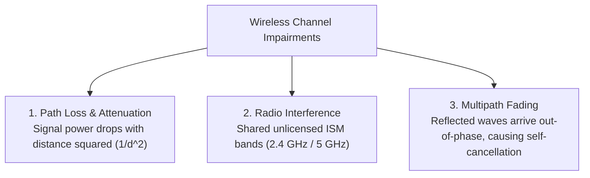
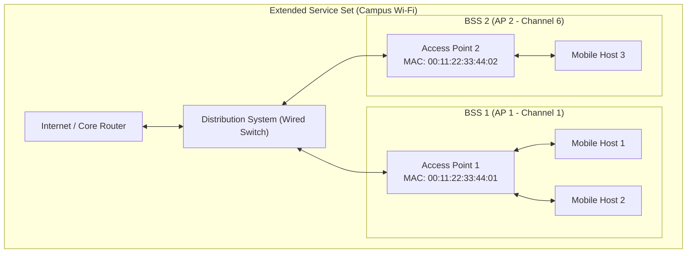
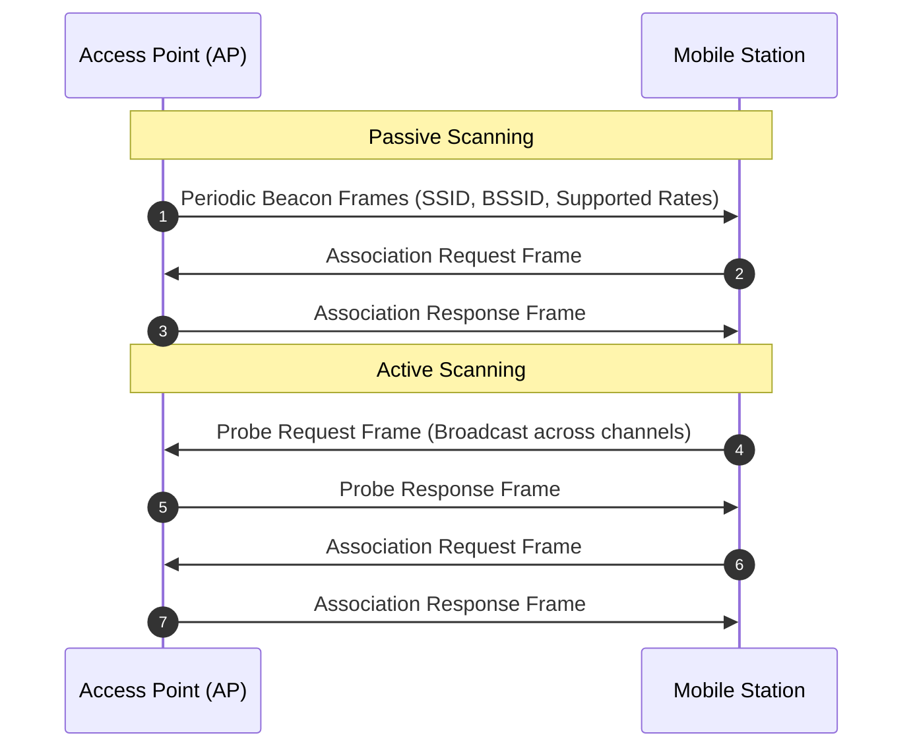
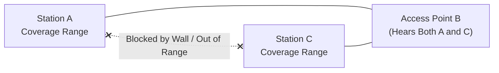
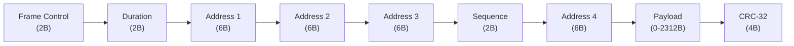
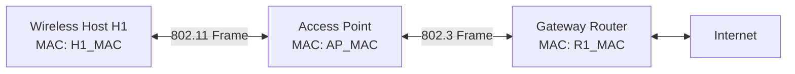

# Wireless LANs, IEEE 802.11 Wi-Fi, and Mobility

In wired networks, communication travels through bounded conduits: copper twisted pairs or glass optical fibers. The physical medium isolates electrical and optical signals from the outside world, creating clean, predictable channels where collision domains are strictly bounded by switch ports.

The wireless world is fundamentally different. In a wireless network, radio frequency (RF) energy radiates outward in all directions through shared, unguided open space. Radio signals reflect off concrete walls, absorb into human bodies, scatter across furniture, and degrade across distance according to the inverse-square law.

Furthermore, wireless users move. A smartphone connected to an access point on the third floor of an office building can be carried downstairs into the cafeteria without dropping an active video call or TCP connection.

To manage the chaotic physics of open-air radio transmission, the link layer relies on the **IEEE 802.11 standard (Wi-Fi)**. In this lecture, we examine the physics of wireless links, the 802.11 architecture, why wired CSMA/CD fails in wireless, the mechanics of **CSMA/CA collision avoidance**, the **RTS/CTS handshake**, the **four-address 802.11 frame**, and how **mobility handoffs** occur seamlessly.

---

## Wireless vs. Wired Links: The Physical Challenges

Before looking at protocols, we must understand the three severe physical channel impairments unique to wireless communication:



1. **Path Loss and Attenuation**: In free space, electromagnetic signal power diminishes rapidly as distance $d$ increases, obeying the inverse-square law:

   $$P_{\text{rx}} \propto \frac{P_{\text{tx}}}{d^2}$$

   When passing through concrete walls, glass windows, or metal doors, radio waves suffer additional severe absorption and reflection loss.
2. **Interference from Unlicensed Spectrum**: Most consumer Wi-Fi operates in the unlicensed Industrial, Scientific, and Medical (ISM) radio bands ($2.4\text{ GHz}$ and $5\text{ GHz}$). Because anyone can transmit without an FCC license, 802.11 signals share the airwaves with microwave ovens, cordless phones, Bluetooth headsets, wireless mice, baby monitors, and dozens of overlapping neighboring Wi-Fi access points (the "Wi-Fi jungle").
3. **Multipath Fading**: Radio waves do not travel along a single straight line. Signals bounce off walls, floors, ceilings, and metal desks, taking multiple paths of different lengths to reach the receiver. Because these bouncing paths arrive at slightly different fractions of a nanosecond, their sinusoidal wave peaks and troughs interfere constructively and destructively, causing rapid signal fluctuations known as **multipath fading**.

Because of these impairments, wireless bit error rates (BER) are several orders of magnitude higher than wired fiber or copper links ($10^{-5}$ in wireless vs. $10^{-12}$ in optical fiber).

---

## IEEE 802.11 Architecture: BSS, APs, and Scanning

The fundamental architectural building block of an IEEE 802.11 network is the **Basic Service Set (BSS)**.



### Infrastructure Mode vs. Ad-Hoc Mode

An 802.11 network can operate in one of two modes:
- **Infrastructure Mode**: The dominant configuration in homes, universities, and enterprises. Each BSS contains wireless client stations (laptops, phones) and a central base station called an **Access Point (AP)**. The AP connects directly to the wired network infrastructure (the **Distribution System**). All communication between wireless stations, or between a station and the Internet, *must* pass through the AP.
- **Ad-Hoc Mode (Independent BSS / IBSS)**: Stations communicate directly with each other on a peer-to-peer basis without an access point or connection to a wired distribution system (e.g., Apple AirDrop, Wi-Fi Direct).

### Channels and Association

The $2.4\text{ GHz}$ frequency spectrum is divided into 11 to 14 channels spaced 5 MHz apart. Because an 802.11 transmission requires roughly 22 MHz of channel bandwidth, adjacent channels overlap and interfere with each other. In the 2.4 GHz band, there are only **three non-overlapping channels: Channels 1, 6, and 11**. Network administrators configure adjacent access points on these three distinct channels to prevent mutual radio interference.

When a mobile device enters a BSS, it must **associate** with an access point. The AP is identified by its **Service Set Identifier (SSID)** (the human-readable network name, e.g., `"University-Guest"`) and its 48-bit **BSSID** (the AP's hardware MAC address).

Discovery occurs via one of two scanning mechanisms:



- **Passive Scanning**: The AP broadcasts **Beacon Frames** at regular intervals (typically every 100 ms) containing its SSID, MAC address, and supported data rates. The mobile host scans radio channels, listens for beacons, selects an AP, and sends an Association Request.
- **Active Scanning**: The mobile host actively broadcasts **Probe Request** frames across all available channels. Any AP within radio range replies with a **Probe Response**. The station evaluates signal strength (RSSI), chooses the best AP, and sends an Association Request.

Once associated, the station initiates DHCP over the wireless link to obtain an IP address in the AP's local subnet.

---

## Why CSMA/CD Fails in Wireless Networks

In wired Ethernet, adapters use **CSMA/CD (Carrier Sense Multiple Access with Collision Detection)**: listen before transmitting, and listen while transmitting. If a collision is detected, abort immediately.

Why can't wireless networks simply use CSMA/CD?

There are two insurmountable physical reasons:

### 1. High Dynamic Range and Self-Interference

When a wireless card transmits, it pushes radio energy into its local antenna at roughly 100 milliwatts ($100 \text{ mW}$). However, signals arriving from a distant node at the other end of the room have undergone severe path attenuation and arrive at fractions of a microwatt ($10^{-4} \text{ mW}$) or picowatts ($10^{-9} \text{ mW}$).

The transmitter's own outgoing signal is millions of times stronger than any incoming signal. The radio hardware cannot listen for a tiny whisper from another node while shouting at full lung capacity on the exact same frequency! Constructing full-duplex radios capable of subtracting out self-interference requires prohibitively bulky and expensive analog cancellation hardware.

### 2. The Hidden Terminal Problem

In wired Ethernet, everyone is tapped into the same wire; if Node A transmits, Node C hears it almost immediately. In wireless networks, physical obstacles and radio coverage ranges break this assumption.



Consider the scenario above:
- Station A can communicate with Access Point B.
- Station C can also communicate with Access Point B.
- However, Station A and Station C are physically separated by distance or a thick concrete wall: **A and C cannot hear each other**.

Now observe what happens:
1. Station A has a frame for B. A senses the medium: it hears silence. A begins transmitting to B.
2. Station C also has a frame for B. C senses the medium: it also hears silence, because A's radio signal cannot reach C!
3. Station C begins transmitting to B.
4. **Collision at the receiver**: Signals from A and C collide at Access Point B, corrupting both transmissions.

Neither A nor C ever knew a collision was occurring. This is the **Hidden Terminal Problem**: Station A is hidden from Station C, and vice versa.

### The Exposed Terminal Problem

The inverse scenario also occurs: Station B is transmitting to Station A. Station C wants to transmit to Station D (located away from A and B).

Station C senses the channel, hears Station B's transmission, and concludes the air is busy. C needlessly defers its transmission, even though a transmission from C to D would not interfere with B's transmission reaching A!

---

## CSMA with Collision Avoidance (CSMA/CA)

Because wireless stations cannot reliably detect collisions while transmitting, IEEE 802.11 abandons collision *detection* entirely. Instead, it relies on **CSMA with Collision Avoidance (CSMA/CA)**:
1. Prevent collisions before they happen using randomized backoffs and interframe spacings.
2. Require explicit **Link-Layer Positive Acknowledgments (ACKs)** for every successfully received frame.

### Interframe Spacings: DIFS and SIFS

802.11 defines strict, precise timing gaps between transmissions:
- **DIFS (Distributed Interframe Space)**: A longer waiting period that stations must observe before initiating a new transmission.
- **SIFS (Short Interframe Space)**: A very short waiting period reserved for high-priority responses, such as ACKs and CTS frames.

Because SIFS is shorter than DIFS, a responding receiver can transmit an ACK before any other waiting station's DIFS timer expires, ensuring that ACKs never suffer collisions from new transmissions!

```mermaid
sequenceDiagram
    autonumber
    participant Sender as 802.11 Sender
    participant Receiver as 802.11 Receiver
    participant Other as Other Waiting Station
    Note over Sender: Sense channel idle for DIFS
    Sender->>Receiver: DATA Frame
    Note over Receiver: Validates CRC; waits SIFS
    Receiver->>Sender: ACK Frame
    Note over Other: Must wait DIFS + Backoff timer! Cannot interrupt ACK.
```

### The CSMA/CA Sender Protocol

When an 802.11 station has a data frame ready to transmit:
1. **Sense Channel**:
   - If the channel is sensed idle for a duration equal to **DIFS**, the station transmits the entire frame immediately.
   - If the channel is sensed busy, the station defers.
2. **Contention Window and Random Backoff**:
   - The station selects a random backoff integer $K$ uniformly from the contention window $[0, CW - 1]$. (Initially, $CW = CW_{\min} = 15$ or $31$).
   - The backoff timer counts down only when the channel is sensed idle.
   - If the channel becomes busy during the countdown, the timer freezes. When the channel becomes idle again for DIFS, the timer resumes from where it paused.
3. **Transmission**:
   - When the countdown timer reaches zero, the station transmits the entire data frame.
4. **Waiting for ACK**:
   - The station waits for an ACK frame from the receiver.
   - If the ACK arrives within the timeout window, transmission was successful.
   - If no ACK is received (due to collision or channel noise), the station assumes a collision occurred. It doubles its contention window ($CW = 2 \times CW$), selects a new larger random backoff $K$, and repeats the process.

---

## Resolving Hidden Terminals: The RTS/CTS Handshake

CSMA/CA reduces collision probability, but it does not solve the hidden terminal problem. If Station A and Station C cannot hear each other, their countdown timers will both expire and their data frames will collide at the AP.

To eliminate hidden terminal collisions for large data frames, 802.11 introduces an optional reservation handshake: **Request-to-Send (RTS)** and **Clear-to-Send (CTS)**.

```mermaid
sequenceDiagram
    autonumber
    participant Station_A as Station A (Hidden from C)
    participant AP as Access Point
    participant Station_C as Station C (Hidden from A)
    Note over Station_A: Channel idle for DIFS
    Station_A->>AP: RTS (Request-to-Send: Duration = T_data + T_ack)
    Note over AP: Waits SIFS
    AP->>Station_A: CTS (Clear-to-Send: Duration = T_data + T_ack)
    AP->>Station_C: CTS Overheard by C!
    Note over Station_C: C hears CTS, sets NAV timer, remains SILENT!
    Note over Station_A: Waits SIFS
    Station_A->>AP: Large DATA Frame
    Note over AP: Validates CRC; waits SIFS
    AP->>Station_A: ACK Frame
    Note over Station_C: NAV timer expires; channel becomes available
```

### The Mechanics of RTS/CTS

1. **Station A sends RTS**: Before transmitting a large data frame, Station A sends a tiny 20-byte **RTS (Request-to-Send)** control frame to the AP. Crucially, the RTS header contains a **Duration Field** specifying the total microsecond time required to transmit the data frame, receive the ACK, and account for SIFS gaps.
2. **Access Point broadcasts CTS**: The AP waits SIFS and replies with a 14-byte **CTS (Clear-to-Send)** frame. Because the AP sits within radio range of *both* Station A and Station C, **Station C hears the CTS**.
3. **Setting the Network Allocation Vector (NAV)**: When Station C inspects the CTS frame, it reads the Duration field. Station C sets an internal countdown timer called the **Network Allocation Vector (NAV)**. As long as the NAV timer is non-zero, Station C suppresses all transmissions and remains completely silent.
4. **Collision-Free Data Transmission**: Station A transmits its large data frame knowing that all hidden terminals within range of the AP have been silenced. The AP verifies the CRC and responds with an ACK after SIFS.

Even though RTS frames can still collide with each other if two hidden stations send an RTS simultaneously, RTS frames are so small (20 bytes) that the collision window is negligible compared to colliding on a 1500-byte data payload.

---

## The IEEE 802.11 Frame Structure and Addressing

The 802.11 MAC frame is considerably more sophisticated than the simple 802.3 Ethernet frame. It must handle radio durations, fragmentation, frame types, and multi-hop bridging across access points.



### Key Fields:
- **Frame Control (2 Bytes)**: Contains protocol version, type (00 = Management, 01 = Control, 10 = Data), subtype (RTS, CTS, ACK, Beacon), and flags (`To DS`, `From DS`, `More Frag`, `Retry`, `Power Management`, `WEP/Protected`).
- **Duration (2 Bytes)**: Used to broadcast channel reservation times to update neighboring stations' NAV timers.
- **Sequence Control (2 Bytes)**: Contains a 12-bit sequence number and 4-bit fragment number, allowing the receiver to reassemble fragments and filter duplicate frames caused by lost ACKs.
- **Payload (0 to 2312 Bytes)**: Carries the upper-layer packet (typically an IP datagram).
- **CRC-32 (4 Bytes)**: Standard cyclic redundancy check.

### The Four Address Fields

Why does 802.11 define **four** 48-bit MAC address fields, whereas Ethernet only defines two?

Because an access point is an active Layer 2 bridge between a wireless station and a wired subnet. The frame needs to identify both the wireless transceiver endpoints and the original IP endpoints.



Consider Station H1 sending a frame to Router R1 through Access Point AP:

| Field | Meaning | Value when H1 sends frame to AP destined for R1 | Value when AP sends frame to H1 from R1 |
| :--- | :--- | :--- | :--- |
| **Address 1** | Immediate Receiver MAC (Wireless Interface) | **AP MAC** | **H1 MAC** |
| **Address 2** | Immediate Transmitter MAC (Wireless Interface) | **H1 MAC** | **AP MAC** |
| **Address 3** | Default Gateway / Original Source Router MAC | **R1 MAC** | **R1 MAC** |
| **Address 4** | Ad-Hoc / Mesh Bridge MAC | *(Unused in Infrastructure Mode)* | *(Unused in Infrastructure Mode)* |

When the AP receives the 802.11 frame from H1:
1. The AP extracts the payload.
2. The AP removes the 802.11 header.
3. The AP formats a standard **IEEE 802.3 Ethernet frame**:
   - Destination MAC = `R1 MAC` (taken directly from 802.11 **Address 3**).
   - Source MAC = `H1 MAC` (taken directly from 802.11 **Address 2**).
4. The AP transmits the standard Ethernet frame onto the wired campus network.

Address 4 is only populated when two wireless routers bridge frames to each other in ad-hoc or wireless mesh networking modes, requiring separate Source, Destination, Transmitter, and Receiver addresses.

---

## Mobility and Handoff Within the Same Subnet

What happens when a student walks across a campus building while on a video call, moving from the coverage area of AP 1 to AP 2?

```mermaid
sequenceDiagram
    autonumber
    participant Host as Mobile Station
    participant AP1 as Old Access Point (AP 1)
    participant AP2 as New Access Point (AP 2)
    participant Switch as Distribution Switch
    Note over Host: Signal from AP 1 weakens; detects AP 2 beacon
    Host->>AP2: Association / Reassociation Request
    AP2->>Host: Reassociation Response
    Note over Host: Host updates local link association
    AP2->>Switch: Ethernet Frame (Source MAC: Host MAC)
    Note over Switch: Switch updates MAC table: Host is now on AP 2's port!
    Note over Switch: Frames now route seamlessly to AP 2!
```

1. **Signal Degradation and Discovery**: As the station moves away from AP 1, the Received Signal Strength Indication (RSSI) falls below an acceptable threshold. The station begins scanning other channels and hears strong beacon frames from AP 2.
2. **Reassociation**: The station sends an 802.11 **Reassociation Request** frame to AP 2. AP 2 responds with a **Reassociation Response**.
3. **Updating the Wired Switch**: Both AP 1 and AP 2 are connected to the same wired Layer 2 distribution switch. The switch still has `(Host MAC, Port connected to AP 1)` stored in its switch table. To update the switch, AP 2 sends an Ethernet frame into the switch containing the mobile station's MAC as the Source MAC.
4. **Seamless Self-Learning**: The switch inspects the source MAC, updates its table to point to AP 2's port, and subsequent incoming frames for the mobile station are immediately delivered to AP 2. Because both APs share the same IP subnet, the station retains its IP address, and active TCP connections never disconnect!

---

## Key Takeaways

- Wireless links face physical impairments absent in wired media: path loss ($1/d^2$), RF interference in unlicensed ISM bands, and multipath fading.
- An 802.11 network consists of Basic Service Sets (BSS) operating in either infrastructure mode (with a central Access Point) or ad-hoc mode.
- Stations discover access points via passive scanning (listening for periodic Beacon frames) or active scanning (broadcasting Probe Requests).
- CSMA/CD is impossible in wireless due to high dynamic range (self-transmissions drown out received signals) and the **Hidden Terminal Problem** (stations cannot hear each other but interfere at the AP).
- **CSMA/CA (Collision Avoidance)** uses randomized backoff timers, interframe spacings (DIFS > SIFS), and mandatory link-layer ACKs to confirm frame delivery.
- The **RTS/CTS handshake** resolves hidden terminals by broadcasting reservation packets containing duration values that update surrounding stations' **Network Allocation Vector (NAV)** timers, keeping them silent.
- The 802.11 frame contains four address fields: Address 1 (Receiver), Address 2 (Transmitter), Address 3 (Gateway / Original Endpoint), and Address 4 (Ad-Hoc / Mesh).
- Mobility handoff between APs in the same subnet relies on reassociation and switch self-learning to redirect traffic without dropping active TCP connections or reconfiguring IP addresses.

---

This concludes our comprehensive traversal of the **Computer Networks** curriculum — from upper-layer application abstractions down through transport reliability, global network routing, link-layer switching, physical modulation, and wireless mobility.
