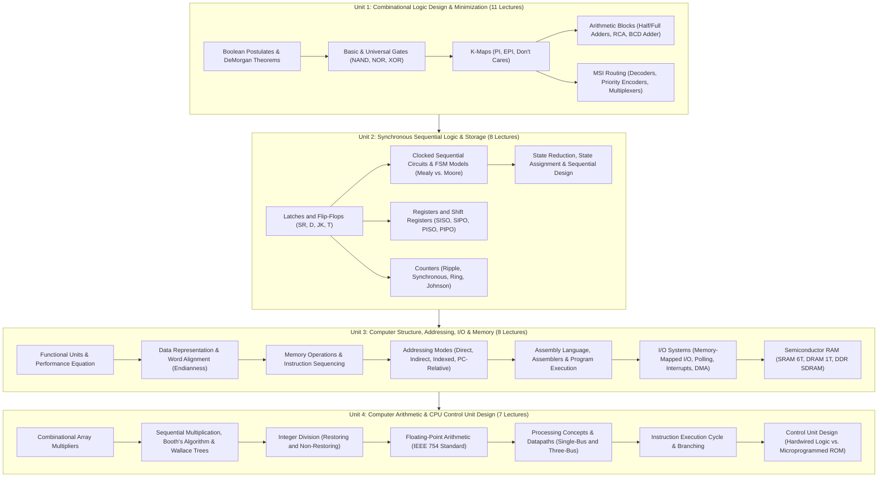

# Digital Logic and Computer Design: Complete Coursework Curriculum and Topic Index

Welcome to the comprehensive coursework study vault for **Digital Logic and Computer Design (DLCD / DDCO — Course Code: `UE25CS251A`)**.

This vault contains exhaustive, highly structured, and intuitive coursework notes synthesizing lecture decks from PES University and foundational principles from the prescribed textbooks:
- **T1: M. Morris Mano & Michael D. Ciletti**, *Digital Design: With an Introduction to the Verilog HDL* (5th Edition, Pearson).
- **T2: Carl Hamacher, Zvonko Vranesic, and Safwat Zaky**, *Computer Organization* (5th Edition, McGraw Hill).
- **R1: David Money Harris and Sarah L. Harris**, *Digital Design and Computer Architecture* (2nd Edition, Elsevier).

Every note is written in a think-out-loud, pedagogical style: explaining the physical realities, Boolean foundations, transistor circuits, state transitions, data paths, and control algorithms governing modern computing machines.

---

## Digital Logic and Computer Organization Architectural Map

The diagram below maps the four units of this curriculum (34 lectures total) to the structural hierarchy of modern digital computing hardware:

---

## Master Table of Contents

### [Unit 1: Combinational Logic Design and Gate-Level Minimization](Unit%201/Introduction.md)

- [**Unit 1 Introduction & Roadmap**](Unit%201/Introduction.md) — Foundational principles, binary abstraction, and unit curriculum goals.
- [**L01 - Introduction and Boolean Algebra**](Unit%201/L01%20-%20Introduction%20and%20Boolean%20Algebra.md) — Analog vs. digital, basic logic gates (AND, OR, NOT), Boolean postulates, duality, algebraic simplification, DeMorgan's laws, and Consensus theorem.
- [**L02 - Canonical and Standard Forms**](Unit%201/L02%20-%20Canonical%20and%20Standard%20Forms.md) — Literals, minterms ($m_i$), maxterms ($M_i$), canonical Sum of Minterms (SOP), canonical Product of Maxterms (POS), conversion algorithms, and standard two-level forms.
- [**L03 - Karnaugh Map Minimization**](Unit%201/L03%20-%20Karnaugh%20Map%20Minimization.md) — The map method, Gray code adjacency, 2-, 3-, and 4-variable K-maps, grouping rules, Prime Implicants (PI), Essential Prime Implicants (EPI), POS minimization, and Don't Care conditions ($d$).
- [**L04 - Logic Gate Implementation with Universal Gates**](Unit%201/L04%20-%20Logic%20Gate%20Implementation%20with%20Universal%20Gates.md) — Universal gates (NAND and NOR), two-level NAND-NAND and NOR-NOR synthesis, DeMorgan bubble logic conversion, and Exclusive-OR (XOR) / Exclusive-NOR (XNOR) parity circuits.
- [**L05 - Combinational Logic Analysis and Design Procedures**](Unit%201/L05%20-%20Combinational%20Logic%20Analysis%20and%20Design%20Procedures.md) — Feedback-free combinational circuits, schematic analysis procedure, systematic design procedure, BCD to Excess-3 code converters with Don't Cares, and Binary-to-Gray / Gray-to-Binary converters.
- [**L06 - Binary Adders and Subtractors**](Unit%201/L06%20-%20Binary%20Adders%20and%20Subtractors.md) — Half Adder, Full Adder synthesis from 2 HAs and OR, 4-bit Ripple Carry Adder (RCA), carry propagation delay, Carry Lookahead Adder (CLA) intuition, 4-bit 2's complement Adder-Subtractor with Mode line $M$, and signed overflow detection ($V = C_n \oplus C_{n-1}$).
- [**L07 - Decimal and BCD Adders**](Unit%201/L07%20-%20Decimal%20and%20BCD%20Adders.md) — Binary Coded Decimal (BCD 8421), invalid unassigned states ($1010_2 - 1111_2$), why add $+6$ ($0110_2$) correction, detection logic ($C_{\text{out}} = K + Z_8 Z_4 + Z_8 Z_2$), two-stage 4-bit BCD adder hardware circuit, and multi-decade cascading.
- [**L08 - Binary Multipliers and Magnitude Comparators**](Unit%201/L08%20-%20Binary%20Multipliers%20and%20Magnitude%20Comparators.md) — Partial-product generation using AND gates, 2-bit and 4-bit array multipliers, 1-bit comparator logic, 4-bit Magnitude Comparator architecture using bitwise XNOR equality, and cascading comparator circuits.
- [**L09 - Decoders and Circuit Implementation**](Unit%201/L09%20-%20Decoders%20and%20Circuit%20Implementation.md) — $n$-to-$2^n$ line decoders, active-high vs. active-low logic, Enable lines, hierarchical decoder tree expansion, and synthesizing arbitrary Boolean logic using decoders and OR/NAND gates.
- [**L10 - Encoders and Priority Encoders**](Unit%201/L10%20-%20Encoders%20and%20Priority%20Encoders.md) — Octal-to-binary encoders, all-zeros and multi-signal collision flaws, Priority Encoder architecture, 4-input priority truth tables with Don't Cares, and Valid ($V$) flag logic.
- [**L11 - Multiplexers and Demultiplexers**](Unit%201/L11%20-%20Multiplexers%20and%20Demultiplexers.md) — Multiplexers (Data Selectors), 2:1, 4:1, and 8:1 MUX internal logic, hierarchical MUX expansion trees, implementing arbitrary Boolean functions with $2^{n-1}:1$ MUXes, and Demultiplexers.

---

### [Unit 2: Synchronous Sequential Logic, Registers, and Counters](Unit%202/Introduction.md)

- [**Unit 2 Introduction & Roadmap**](Unit%202/Introduction.md) — Memory in digital systems, feedback loops, and synchronous clocking.
- [**L01 - Storage Elements - Latches and Flip-Flops**](Unit%202/L01%20-%20Storage%20Elements%20-%20Latches%20and%20Flip-Flops.md) — Bistable cross-coupled gates, NOR and NAND SR Latches, Gated SR and Gated D Latches, the transparency hazard, master-slave flip-flops, edge-triggering, setup and hold times, D, JK, and T flip-flop excitation tables and characteristic equations.
- [**L02 - Analysis of Clocked Sequential Circuits**](Unit%202/L02%20-%20Analysis%20of%20Clocked%20Sequential%20Circuits.md) — The sequential analysis pipeline: input equations, output equations, next-state equations, 1D and 2D state tables, and state diagrams.
- [**L03 - Mealy and Moore State Machine Models**](Unit%202/L03%20-%20Mealy%20and%20Moore%20State%20Machine%20Models.md) — Classical FSM architectures: Moore (outputs depend only on state) vs. Mealy (outputs depend on state and inputs), sequence detector synthesis (`101`), latency comparisons, and output glitches.
- [**L04 - State Reduction, State Assignment, and Sequential Design**](Unit%202/L04%20-%20State%20Reduction,%20State%20Assignment,%20and%20Sequential%20Design.md) — State equivalence theorems, Row Elimination method, Implication Table method, state assignment heuristics (Binary, Gray, One-Hot), and complete synthesis of sequence detectors using D and JK flip-flops.
- [**L05 - Registers and Shift Registers**](Unit%202/L05%20-%20Registers%20and%20Shift%20Registers.md) — Multi-bit storage registers, parallel load control via 2:1 multiplexers, shift registers (SISO, SIPO, PISO, PIPO), serial data transfer, and serial addition.
- [**L06 - Ripple Counters**](Unit%202/L06%20-%20Ripple%20Counters.md) — Asynchronous counters: binary ripple up-counters and down-counters using T/JK flip-flops, BCD decade ripple counters (MOD-10), cumulative ripple delay ($n \cdot t_{\text{pd}}$), and decoding spikes.
- [**L07 - Synchronous Counters**](Unit%202/L07%20-%20Synchronous%20Counters.md) — High-speed parallel counters: 4-bit binary synchronous up-counter with carry-lookahead gating, and arbitrary non-binary sequence counter design.
- [**L08 - Ring Counter and Johnson Counter**](Unit%202/L08%20-%20Ring%20Counter%20and%20Johnson%20Counter.md) — Ring counters (one-hot timing), self-starting feedback, Johnson (twisted-ring) counters with 2-input decoding, and lockout recovery.

---

### [Unit 3: Basic Computer Structure, Addressing Modes, I/O, and Memory](Unit%203/Introduction.md)

- [**Unit 3 Introduction & Roadmap**](Unit%203/Introduction.md) — Transition from circuit components to system-level computer organization.
- [**L01 - Basic Structure of Computers and Functional Units**](Unit%203/L01%20-%20Basic%20Structure%20of%20Computers%20and%20Functional%20Units.md) — The five functional units (Input, Memory, ALU, Output, Control Unit), Von Neumann vs. Harvard architectures, internal CPU registers (PC, IR, MAR, MDR), bus structures, and the processor performance equation ($T = N \times S / R$).
- [**L02 - Data Representation and Memory Organization**](Unit%203/L02%20-%20Data%20Representation%20and%20Memory%20Organization.md) — Memory byte addressability, word alignment rules, Big-Endian vs. Little-Endian byte ordering, signed integer representations (Sign-Magnitude, 1's Complement, 2's Complement), sign extension, and ASCII character encoding.
- [**L03 - Memory Operations and Instruction Sequencing**](Unit%203/L03%20-%20Memory%20Operations%20and%20Instruction%20Sequencing.md) — Memory read and write cycles (MAR, MDR), the instruction execution cycle (Fetch, Decode, Execute), condition code flags (Negative, Zero, Overflow, Carry), and instruction field formats (3-, 2-, 1-, and 0-address machines).
- [**L04 - Addressing Modes**](Unit%203/L04%20-%20Addressing%20Modes.md) — Locating operands in memory: Immediate, Register, Absolute (Direct), Register Indirect, Indexed, Base with Index, Relative (PC-Relative), Autoincrement, and Autodecrement addressing modes.
- [**L05 - Assembly Language and Program Execution**](Unit%203/L05%20-%20Assembly%20Language%20and%20Program%20Execution.md) — Assembly language statement fields, mnemonics, assembler directives (`ORIGIN`, `EQU`, `DATAWORD`, `RESERVE`, `END`), two-pass assembler translation, symbol table creation, and the loader.
- [**L06 - Input-Output Organization, Polling, and Interrupts**](Unit%203/L06%20-%20Input-Output%20Organization,%20Polling,%20and%20Interrupts.md) — The I/O interface bridge: Memory-Mapped I/O vs. Port-Mapped I/O, device controllers, status/control/data registers, programmed I/O (polling), interrupt request lines, Interrupt Service Routines (ISR), context saving, vectored interrupts, and priority arbitration via Daisy Chaining.
- [**L07 - Direct Memory Access and Standard IO Interfaces**](Unit%203/L07%20-%20Direct%20Memory%20Access%20and%20Standard%20IO%20Interfaces.md) — High-speed bulk data transfers: the DMA Controller, bus arbitration (Bus Request and Bus Grant), burst mode vs. cycle stealing, and standard interconnect bus architectures (PCI Express, USB).
- [**L08 - Semiconductor RAM Memories**](Unit%203/L08%20-%20Semiconductor%20RAM%20Memories.md) — Internal memory organization: $2^k \times m$ 2D arrays, Static RAM (SRAM 6T cell), Dynamic RAM (DRAM 1T cell), DRAM capacitive leakage and periodic refresh cycles, Synchronous and DDR SDRAM, and memory chip cascading to expand word length and address capacity.

---

### [Unit 4: Computer Arithmetic and Processing Unit / Control Unit Design](Unit%204/Introduction.md)

- [**Unit 4 Introduction & Roadmap**](Unit%204/Introduction.md) — The computational core, arithmetic algorithms, CPU data paths, and control unit synthesis.
- [**L01 - Unsigned Multiplication and Array Multipliers**](Unit%204/L01%20-%20Unsigned%20Multiplication%20and%20Array%20Multipliers.md) — Combinational array multipliers, generating partial products with AND gates, summing with Full Adders, component scaling ($n^2$ AND gates, $n(n-1)$ Full Adders), and deriving the worst-case propagation delay formula ($6(n-1)-1$).
- [**L02 - Sequential Multiplication, Booth's Algorithm, and Fast Multiplication**](Unit%204/L02%20-%20Sequential%20Multiplication,%20Booth's%20Algorithm,%20and%20Fast%20Multiplication.md) — Sequential shift-and-add data paths reusing a single adder, Booth's algorithm for signed 2's complement multiplication via runs of ones, Radix-4 bit-pair recoding to halve summands ($n \to n/2$), and Carry-Save Addition (CSA 3:2 compressors) arranged in Wallace Trees for logarithmic addition time.
- [**L03 - Integer Division - Restoring and Non-Restoring Algorithms**](Unit%204/L03%20-%20Integer%20Division%20-%20Restoring%20and%20Non-Restoring%20Algorithms.md) — Binary longhand division data path ($A, Q, M$), Restoring Division with trial subtractions and restoration additions, Non-Restoring Division eliminating restoration cycles via conditional shift-and-add, and final remainder correction.
- [**L04 - Floating-Point Numbers and IEEE 754 Standard**](Unit%204/L04%20-%20Floating-Point%20Numbers%20and%20IEEE%20754%20Standard.md) — Fixed-point limitations, IEEE 754 Single (32-bit) and Double (64-bit) precision formats: Sign bit, Biased Exponent (Excess-127 / Excess-1023), Mantissa with hidden leading 1, special values (Zero, Denormals, $\pm \infty$, NaN), and floating-point arithmetic rules.
- [**L05 - Fundamental Processing Concepts and Single-Bus Datapath**](Unit%204/L05%20-%20Fundamental%20Processing%20Concepts%20and%20Single-Bus%20Datapath.md) — Internal processor organization, single-bus CPU architecture, register gating signals ($R_{\text{in}}, R_{\text{out}}$), why temporary registers $Y$ and $Z$ are mandatory, ALU operations, and memory read/write handshakes via MAR, MDR, and WMFC.
- [**L06 - Execution of a Complete Instruction and Branching**](Unit%204/L06%20-%20Execution%20of%20a%20Complete%20Instruction%20and%20Branching.md) — The universal instruction fetch phase ($T_1 - T_3$), clock-cycle control sequences for ALU operations (`Add (R3), R1`), memory loads (`Move (R1), R2`), and conditional branching (`Branch_if_zero`), and constructing the master Control Signal Activation Table.
- [**L07 - Multiple-Bus Organization and Control Unit Design**](Unit%204/L07%20-%20Multiple-Bus%20Organization%20and%20Control%20Unit%20Design.md) — Three-Bus CPU architecture (Buses A, B, C) and multi-port register files enabling single-cycle ALU execution, complete processor structure, Hardwired Control synthesis using step counters and combinational logic matrices, and Microprogrammed Control (Maurice Wilkes) using Control Store ROMs, $\mu\text{PC}$, and horizontal vs. vertical microinstructions.

---

## Pedagogical Methodology and Study Guidelines

1. **Think-Out-Loud Voice**: Every file is written in a direct, conversational style explaining *why* a circuit is designed in a particular way before stating the formal rules.
2. **Strict Diagram Standards**: All circuit schematics, register data paths, FSM graphs, and memory layouts are rendered in Mermaid (`flowchart`, `stateDiagram-v2`, `sequenceDiagram`) with quoted labels to ensure 100% parseable graphics.
3. **Uniform Pedagogical Depth**: Every lecture—from opening Boolean postulates to microprogrammed ROM control stores—maintains identical, rigorous depth with step-by-step mathematical examples.
4. **Zero Broken Links**: All cross-references, unit roadmaps, and breadcrumbs are validated to ensure seamless navigation across the vault.
