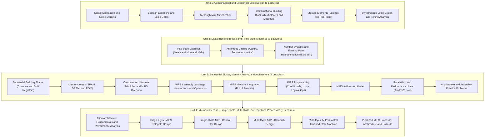

# Digital Logic and Computer Design: Complete Coursework Curriculum and Topic Index

Welcome to the comprehensive coursework study vault for **Digital Logic and Computer Design (DLCD — Course Code: `UE25CS251A`)**.

This vault contains exhaustive, highly structured, and intuitive coursework notes synthesizing lecture decks from PES University and foundational principles from the prescribed textbook:
- **David Money Harris and Sarah L. Harris**, *Digital Design and Computer Architecture* (2nd Edition, Morgan Kaufmann / Elsevier).

Every note is written in a think-out-loud, pedagogical style: explaining the physical realities, Boolean foundations, transistor circuits, state transitions, data paths, and control algorithms governing modern computing machines.

---

## Digital Logic and Computer Organization Architectural Map

The diagram below maps the four units of this curriculum (24 lectures total) to the structural hierarchy of modern digital computing hardware:

---

## Master Table of Contents

### [Unit 1: Combinational and Sequential Logic Design](Unit%201/Introduction.md)

- [**Unit 1 Introduction & Roadmap**](Unit%201/Introduction.md) — Foundational principles, binary abstraction, and unit curriculum goals.
- [**L01 - Introduction and Digital Abstraction**](Unit%201/L01%20-%20Introduction%20and%20Digital%20Abstraction.md) — Analog continuous reality vs. digital abstraction, noise margins ($NM_L, NM_H$), voltage thresholds ($V_{IL}, V_{IH}, V_{OL}, V_{OH}$), logic levels, and noise immunity.
- [**L02 - Boolean Equations and Logic Gates**](Unit%201/L02%20-%20Boolean%20Equations%20and%20Logic%20Gates.md) — Boolean algebra axioms, single-variable and multi-variable theorems, DeMorgan's laws, duality, truth tables, sum-of-products (SOP) and product-of-sums (POS), and basic gate implementations.
- [**L03 - Karnaugh Map Minimization**](Unit%201/L03%20-%20Karnaugh%20Map%20Minimization.md) — Graphical minimization, Gray code adjacency, 2-, 3-, and 4-variable K-maps, implicants, Prime Implicants (PI), Essential Prime Implicants (EPI), POS minimization, and Don't Care conditions ($X$).
- [**L04 - Combinational Building Blocks - Multiplexers and Decoders**](Unit%201/L04%20-%20Combinational%20Building%20Blocks%20-%20Multiplexers%20and%20Decoders.md) — Multiplexers (2:1, 4:1, 8:1) as data selectors and universal logic engines, Decoders ($n$-to-$2^n$) with enable lines, and synthesizing arbitrary Boolean logic using decoders and multiplexers.
- [**L05 - Storage Elements - Latches and Flip-Flops**](Unit%201/L05%20-%20Storage%20Elements%20-%20Latches%20and%20Flip-Flops.md) — Memory through feedback, bistable elements, SR latches, D latches, transparency hazard, D flip-flops, edge-triggering, master-slave intuition, enables, and synchronous/asynchronous resets.
- [**L06 - Synchronous Logic Design and Timing**](Unit%201/L06%20-%20Synchronous%20Logic%20Design%20and%20Timing.md) — Synchronous sequential circuits, dynamic discipline, setup time ($t_{\text{setup}}$), hold time ($t_{\text{hold}}$), clock-to-Q delay ($t_{pcq}, t_{ccq}$), maximum clock frequency calculation, setup time violations, and hold time violations.

---

### [Unit 2: Digital Building Blocks and Finite State Machines](Unit%202/Introduction.md)

- [**Unit 2 Introduction & Roadmap**](Unit%202/Introduction.md) — Sequential behavior, state abstraction, and datapath arithmetic foundations.
- [**L01 - Finite State Machines - Mealy and Moore Models**](Unit%202/L01%20-%20Finite%20State%20Machines%20-%20Mealy%20and%20Moore%20Models.md) — Synchronous state machines, Moore vs. Mealy FSM architectures, state transition diagrams, state tables, state encoding (binary vs. one-hot), next-state and output logic synthesis, and sequence detector design.
- [**L02 - Arithmetic Circuits**](Unit%202/L02%20-%20Arithmetic%20Circuits.md) — 1-bit Half Adder, Full Adder synthesis, $N$-bit Ripple Carry Adder (RCA), carry propagation delay, subtraction using 2's complement inversion and $+1$ carry-in, magnitude comparators, and Arithmetic Logic Unit (ALU) design.
- [**L03 - Number Systems and Floating-Point Representation**](Unit%202/L03%20-%20Number%20Systems%20and%20Floating-Point%20Representation.md) — Positional numbering (Binary, Hexadecimal, Decimal), signed representations (Sign/Magnitude, 2's Complement), sign extension, fixed-point representation, and IEEE 754 standard (Single and Double precision, bias, normalized numbers, denormals, and special values).

---

### [Unit 3: Sequential Blocks, Memory Arrays, and Architecture](Unit%203/Introduction.md)

- [**Unit 3 Introduction & Roadmap**](Unit%203/Introduction.md) — Scalable storage, instruction set architecture, and software-hardware interface.
- [**L01 - Sequential Building Blocks - Counters and Shift Registers**](Unit%203/L01%20-%20Sequential%20Building%20Blocks%20-%20Counters%20and%20Shift%20Registers.md) — Multi-bit synchronous registers with enable and clear, Shift Registers (SISO, SIPO, PISO, PIPO), Universal Shift Registers, Binary Up/Down Counters, and arbitrary sequence counters.
- [**L02 - Memory Arrays - SRAM, DRAM, and ROM**](Unit%203/L02%20-%20Memory%20Arrays%20-%20SRAM,%20DRAM,%20and%20ROM.md) — Memory organization (words, addresses, bitlines, wordlines), 2D memory arrays, Static RAM (6T SRAM cell), Dynamic RAM (1T DRAM cell with refresh), Read-Only Memory (ROM), and memory address decoders.
- [**L03 - Computer Architecture Principles and MIPS Overview**](Unit%203/L03%20-%20Computer%20Architecture%20Principles%20and%20MIPS%20Overview.md) — Von Neumann vs. Harvard architectures, stored-program concept, instructions as machine language, Reduced Instruction Set Computer (RISC) vs. CISC principles, MIPS architecture overview, and 32 architectural registers.
- [**L04 - MIPS Assembly Language - Instructions and Operands**](Unit%203/L04%20-%20MIPS%20Assembly%20Language%20-%20Instructions%20and%20Operands.md) — R-type arithmetic/logical instructions (`add`, `sub`, `and`, `or`), I-type instructions with immediate operands (`addi`, `ori`), register conventions (`$zero`, `$t0-$t9`, `$s0-$s7`), and memory transfer instructions (`lw`, `sw`).
- [**L05 - MIPS Machine Language and Instruction Formats**](Unit%203/L05%20-%20MIPS%20Machine%20Language%20and%20Instruction%20Formats.md) — 32-bit instruction encoding: R-type (`opcode`, `rs`, `rt`, `rd`, `shamt`, `funct`), I-type (`opcode`, `rs`, `rt`, `immediate`), and J-type (`opcode`, `target address`), with hex and binary field encoding examples.
- [**L06 - MIPS Programming - Conditionals, Loops, and Logical Instructions**](Unit%203/L06%20-%20MIPS%20Programming%20-%20Conditionals,%20Loops,%20and%20Logical%20Instructions.md) — Control flow in assembly: conditional branches (`beq`, `bne`), unconditional jumps (`j`), set on less than (`slt`, `slti`), synthesizing `if-else` blocks, `while` loops, `for` loops, and logical shift instructions (`sll`, `srl`).
- [**L07 - MIPS Addressing Modes**](Unit%203/L07%20-%20MIPS%20Addressing%20Modes.md) — Five fundamental MIPS addressing modes: Register addressing, Base addressing (displacement/immediate offset), Immediate addressing, PC-Relative addressing (branch target calculation), and Pseudo-direct addressing (jump target calculation).
- [**L08 - Parallelism and Performance Limits**](Unit%203/L08%20-%20Parallelism%20and%20Performance%20Limits.md) — Parallel computing dimensions: instruction-level, thread-level, data-level, Amdahl's Law derivation, speedup limits, and multi-core scalability constraints.
- [**L09 - Architecture and Assembly Practice Problems**](Unit%203/L09%20-%20Architecture%20and%20Assembly%20Practice%20Problems.md) — Comprehensive worked assembly problems: translating nested conditional statements, array traversal algorithms, string processing loops, and manual machine-code instruction encoding.

---

### [Unit 4: Microarchitecture - Single-Cycle, Multi-Cycle, and Pipelined Processors](Unit%204/Introduction.md)

- [**Unit 4 Introduction & Roadmap**](Unit%204/Introduction.md) — Microarchitecture design space, state elements, datapaths, control units, and hazard handling.
- [**L01 - Microarchitecture Fundamentals and Performance Analysis**](Unit%204/L01%20-%20Microarchitecture%20Fundamentals%20and%20Performance%20Analysis.md) — Microarchitecture vs. architecture, processor state elements, CPU execution time formula ($\text{CPU Time} = I \times \text{CPI} \times T_c$), throughput, latency, and single-cycle vs. multi-cycle vs. pipelined tradeoffs.
- [**L02 - Single-Cycle MIPS Datapath Design**](Unit%204/L02%20-%20Single-Cycle%20MIPS%20Datapath%20Design.md) — Incremental single-cycle datapath synthesis: PC logic, instruction memory, register file, ALU data paths, data memory for `lw`/`sw`, branch target generation for `beq`, and combining datapaths.
- [**L03 - Single-Cycle MIPS Control Unit Design**](Unit%204/L03%20-%20Single-Cycle%20MIPS%20Control%20Unit%20Design.md) — Control signal decoding: Main Decoder generating `RegWrite`, `RegDst`, `ALUSrc`, `Branch`, `MemWrite`, `MemtoReg`, and ALU Decoder interpreting `ALUOp` and `funct` field, with complete control truth tables.
- [**L04 - Multi-Cycle MIPS Datapath Design**](Unit%204/L04%20-%20Multi-Cycle%20MIPS%20Datapath%20Design.md) — Microarchitectural motivation for multi-cycle execution, shared resources (single memory, single ALU), internal non-architectural registers (`IR`, `MDR`, `A`, `B`, `ALUOut`), and instruction execution across discrete clock cycles.
- [**L05 - Multi-Cycle MIPS Control Unit and State Machine**](Unit%204/L05%20-%20Multi-Cycle%20MIPS%20Control%20Unit%20and%20State%20Machine.md) — Multi-Cycle Control Unit finite state machine: Instruction Fetch, Decode/Register Fetch, Execution/Memory Address Computation/Branch Completion, Memory Access/R-type Completion, and Memory Read Completion.
- [**L06 - Pipelined MIPS Processor Architecture and Hazards**](Unit%204/L06%20-%20Pipelined%20MIPS%20Processor%20Architecture%20and%20Hazards.md) — 5-stage pipeline (IF, ID, EX, MEM, WB), pipeline registers, speedup and throughput ideal limits, structural hazards, data hazards (Read-After-Write, forwarding paths, stalls/bubbles), and control hazards (branch prediction, branch delay slots).

---

## Pedagogical Methodology and Study Guidelines

1. **Think-Out-Loud Voice**: Every file is written in a direct, conversational style explaining *why* a circuit or microarchitectural structure is designed in a particular way before stating the formal equations.
2. **Strict Diagram Standards**: All circuit schematics, register data paths, FSM state diagrams, and pipeline diagrams are rendered in clean Mermaid (`flowchart`, `stateDiagram-v2`) with quoted labels to ensure 100% parseable graphics.
3. **Uniform Pedagogical Depth**: Every lecture—from opening Boolean postulates to pipelined processor hazard resolution—maintains identical, rigorous depth with step-by-step mathematical examples.
4. **Zero Broken Links**: All cross-references, unit roadmaps, and breadcrumbs are validated to ensure seamless navigation across the vault.
