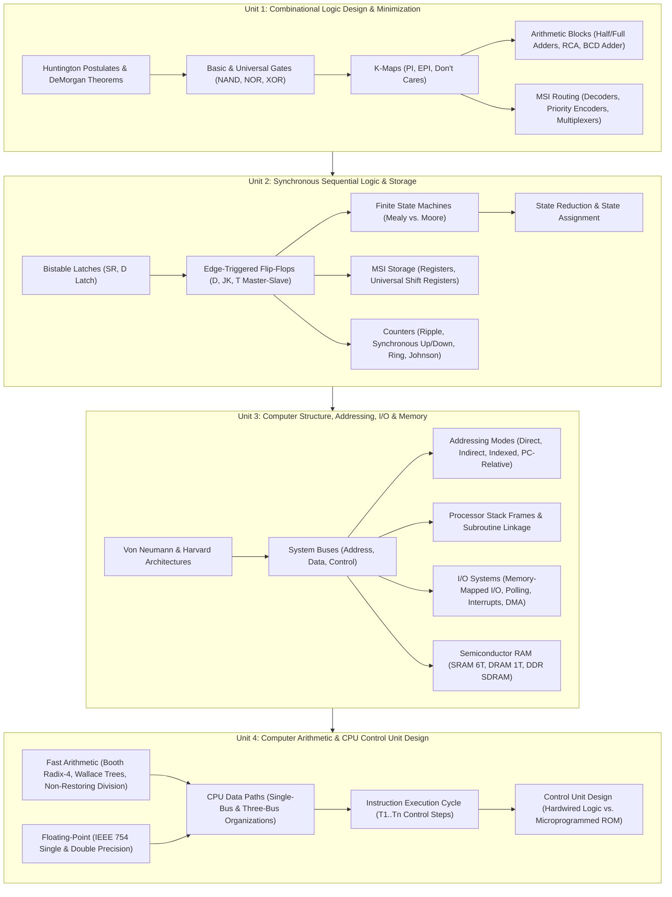

# Digital Logic and Computer Design: Complete Coursework Curriculum and Topic Index

Welcome to the comprehensive coursework study vault for **Digital Logic and Computer Design (DLCD / DDCO)**.

This vault contains exhaustive, highly structured, and intuitive coursework notes synthesizing lecture decks from PES University and foundational principles from the prescribed textbooks:
- **T1: M. Morris Mano & Michael D. Ciletti**, *Digital Design: With an Introduction to the Verilog HDL* (5th Edition, Pearson).
- **T2: Carl Hamacher, Zvonko Vranesic, and Safwat Zaky**, *Computer Organization* (5th Edition, McGraw Hill).
- **R1: David Money Harris and Sarah L. Harris**, *Digital Design and Computer Architecture* (2nd Edition, Elsevier).

Every note is written in a think-out-loud, pedagogical style: explaining the physical realities, Boolean foundations, transistor circuits, state transitions, data paths, and control algorithms governing modern computing machines.

---

## Digital Logic and Computer Organization Architectural Map

The diagram below maps the four units of this curriculum to the structural hierarchy of modern digital computing hardware:

---

## Master Table of Contents

### [Unit 1: Combinational Logic Design and Gate-Level Minimization](Unit%201/Introduction.md)

- [**Unit 1 Introduction & Roadmap**](Unit%201/Introduction.md) — Foundational principles, binary abstraction, and unit curriculum goals.
- [**L01 - Introduction and Boolean Algebra**](Unit%201/L01%20-%20Introduction%20and%20Boolean%20Algebra.md) — Analog vs. digital, noise margins, basic logic gates (AND, OR, NOT), Huntington's postulates, duality, algebraic simplification, DeMorgan's laws, and the Consensus theorem.
- [**L02 - Canonical and Standard Forms**](Unit%201/L02%20-%20Canonical%20and%20Standard%20Forms.md) — Literals, minterms ($m_i$), maxterms ($M_i$), canonical Sum of Minterms (SOP), canonical Product of Maxterms (POS), conversion algorithms, and standard two-level forms.
- [**L03 - Karnaugh Map Minimization**](Unit%201/L03%20-%20Karnaugh%20Map%20Minimization.md) — The map method, Gray code adjacency, 2-, 3-, and 4-variable K-maps, grouping rules, Prime Implicants (PI), Essential Prime Implicants (EPI), POS minimization, and Don't Care conditions ($d$).
- [**L04 - Logic Gate Implementation with Universal Gates**](Unit%201/L04%20-%20Logic%20Gate%20Implementation%20with%20Universal%20Gates.md) — Universal gates (NAND and NOR), two-level NAND-NAND and NOR-NOR synthesis, DeMorgan bubble logic conversion, AOI/OAI forms, and Exclusive-OR (XOR) / Exclusive-NOR (XNOR) parity circuits.
- [**L05 - Combinational Logic Analysis and Design Procedures**](Unit%201/L05%20-%20Combinational%20Logic%20Analysis%20and%20Design%20Procedures.md) — Feedback-free combinational circuits, schematic analysis procedure, systematic design procedure, BCD to Excess-3 code converters with Don't Cares, and Binary-to-Gray / Gray-to-Binary converters.
- [**L06 - Binary Adders and Subtractors**](Unit%201/L06%20-%20Binary%20Adders%20and%20Subtractors.md) — Half Adder, Full Adder synthesis from 2 HAs and OR, 4-bit Ripple Carry Adder (RCA), carry propagation delay, Carry Lookahead Adder (CLA) intuition, 4-bit 2's complement Adder-Subtractor with Mode line $M$, and signed overflow detection ($V = C_n \oplus C_{n-1}$).
- [**L07 - Decimal and BCD Adders**](Unit%201/L07%20-%20Decimal%20and%20BCD%20Adders.md) — Binary Coded Decimal (BCD 8421), invalid unassigned states ($1010_2 - 1111_2$), why add $+6$ ($0110_2$) correction, detection logic ($C_{\text{out}} = K + Z_8 Z_4 + Z_8 Z_2$), two-stage 4-bit BCD adder hardware circuit, and multi-decade cascading.
- [**L08 - Binary Multipliers and Magnitude Comparators**](Unit%201/L08%20-%20Binary%20Multipliers%20and%20Magnitude%20Comparators.md) — Partial-product generation using AND gates, 2-bit and 4-bit array multipliers, 1-bit comparator logic, 4-bit Magnitude Comparator architecture using bitwise XNOR equality, and cascading comparator chips (7485).
- [**L09 - Decoders and Circuit Implementation**](Unit%201/L09%20-%20Decoders%20and%20Circuit%20Implementation.md) — $n$-to-$2^n$ line decoders, active-high vs. active-low logic, Enable lines, commercial 74LS138 architecture, hierarchical decoder tree expansion, and synthesizing arbitrary Boolean logic using decoders and OR/NAND gates.
- [**L10 - Encoders and Priority Encoders**](Unit%201/L10%20-%20Encoders%20and%20Priority%20Encoders.md) — Octal-to-binary encoders, the ambiguity of all-zeros and multi-signal collision flaws, Priority Encoder architecture, 4-input priority truth tables with Don't Cares, and Valid ($V$) flag logic.
- [**L11 - Multiplexers and Demultiplexers**](Unit%201/L11%20-%20Multiplexers%20and%20Demultiplexers.md) — Multiplexers (Data Selectors), 2:1, 4:1, and 8:1 MUX internal logic, hierarchical MUX expansion trees, implementing arbitrary Boolean functions with $2^{n-1}:1$ MUXes (Mano's method), and Demultiplexers.

---

### [Unit 2: Synchronous Sequential Logic, Registers, and Counters](Unit%202/Introduction.md)

- [**Unit 2 Introduction & Roadmap**](Unit%202/Introduction.md) — Memory in digital systems, the role of feedback, and the system clock.
- [**L01 - Latches and Storage Elements**](Unit%202/L01%20-%20Latches%20and%20Storage%20Elements.md) — Bistability in cross-coupled gates, SR Latch with NOR and NAND gates, forbidden states and race hazards, Gated SR Latch, Gated D Latch, level-sensitivity, and the transparency race-around problem.
- [**L02 - Flip-Flops and Edge-Triggered Storage**](Unit%202/L02%20-%20Flip-Flops%20and%20Edge-Triggered%20Storage.md) — Edge-triggered vs. level-sensitive storage, setup and hold times, Master-Slave architecture, Edge-Triggered D, JK, and T flip-flops, characteristic tables, characteristic equations, and excitation tables.
- [**L03 - Analysis of Clocked Sequential Circuits**](Unit%202/L03%20-%20Analysis%20of%20Clocked%20Sequential%20Circuits.md) — The 5-step analysis pipeline: flip-flop input equations, output equations, next-state equations, state tables (1D and 2D formats), and visual state diagrams.
- [**L04 - Mealy and Moore State Machine Models**](Unit%202/L04%20-%20Mealy%20and%20Moore%20State%20Machine%20Models.md) — Classical FSM architectures: Moore machines (outputs depend only on state) vs. Mealy machines (outputs depend on state and inputs), sequence detector case study (`101`), latency comparisons, and glitch hazards.
- [**L05 - State Reduction and State Assignment**](Unit%202/L05%20-%20State%20Reduction%20and%20State%20Assignment.md) — State equivalence theorems, Row Elimination method, the Implication Table (Chart) method, and state assignment heuristics (Binary, Gray, One-Hot encoding).
- [**L06 - Sequential Circuit Design Procedure**](Unit%202/L06%20-%20Sequential%20Circuit%20Design%20Procedure.md) — End-to-end sequential synthesis: word specification $\to$ state diagram $\to$ state table $\to$ state reduction $\to$ state assignment $\to$ excitation table $\to$ K-map simplification $\to$ flip-flop schematic, plus self-starting lockout verification.
- [**L07 - Registers and Shift Registers**](Unit%202/L07%20-%20Registers%20and%20Shift%20Registers.md) — Multi-bit storage registers, parallel load control via 2:1 multiplexers (avoiding dangerous clock gating), shift registers (SISO, SIPO, PISO, PIPO), and the 4-bit Universal Shift Register (74194).
- [**L08 - Ripple Counters**](Unit%202/L08%20-%20Ripple%20Counters.md) — Asynchronous counters: 4-bit binary ripple up-counters, down-counters, BCD decade ripple counters (MOD-10), cumulative propagation delay ($n \cdot t_{\text{pd}}$), and decoding glitches.
- [**L09 - Synchronous Counters**](Unit%202/L09%20-%20Synchronous%20Counters.md) — High-speed parallel counters: 4-bit binary synchronous up-counter with carry-lookahead logic, synchronous up/down counters, and arbitrary non-binary sequence counter design.
- [**L10 - Other Specialized Counters**](Unit%202/L10%20-%20Other%20Specialized%20Counters.md) — Ring counters (one-hot timing), self-starting ring feedback, Johnson (twisted-ring) counters with 2-input AND decoding, and lockout recovery.

---

### [Unit 3: Basic Computer Structure, Addressing Modes, I/O, and Memory](Unit%203/Introduction.md)

- [**Unit 3 Introduction & Roadmap**](Unit%203/Introduction.md) — Transition from circuit components to system-level computer organization.
- [**L01 - Basic Structure of Computers and Functional Units**](Unit%203/L01%20-%20Basic%20Structure%20of%20Computers%20and%20Functional%20Units.md) — The five classic functional units (Input, Memory, ALU, Output, Control Unit), Von Neumann vs. Harvard architectures, internal CPU registers (PC, IR, MAR, MDR), bus structures, and the fundamental processor performance equation ($T = N \times S / R$).
- [**L02 - Data Representation and Memory Organization**](Unit%203/L02%20-%20Data%20Representation%20and%20Memory%20Organization.md) — Memory byte addressability, word alignment rules, Big-Endian vs. Little-Endian byte ordering, signed integer representations (Sign-Magnitude, 1's Complement, 2's Complement), sign extension, and ASCII/Unicode encoding.
- [**L03 - Memory Operations and Instruction Sequencing**](Unit%203/L03%20-%20Memory%20Operations%20and%20Instruction%20Sequencing.md) — Memory read and write cycles (MAR, MDR, MFC), the instruction execution cycle (Fetch, Decode, Execute), condition code flags (Negative, Zero, Overflow, Carry), and instruction field formats (3-, 2-, 1-, and 0-address machines).
- [**L04 - Addressing Modes**](Unit%203/L04%20-%20Addressing%20Modes.md) — Locating operands in memory: Immediate, Register, Absolute (Direct), Register Indirect, Memory Indirect, Indexed, Base with Index, Relative (PC-Relative), Autoincrement, and Autodecrement addressing modes.
- [**L05 - Assembly Language and Program Execution**](Unit%203/L05%20-%20Assembly%20Language%20and%20Program%20Execution.md) — Compilation pipeline, assembly statement syntax, assembler directives (`.ORIG`, `.EQU`, `.DATA`, `.TEXT`), subroutines, return address linkage, processor stack operations (Push, Pop, Call, Ret), and stack frames.
- [**L06 - Input-Output Organization and Accessing IO Devices**](Unit%203/L06%20-%20Input-Output%20Organization%20and%20Accessing%20IO%20Devices.md) — The I/O interface bridge: Memory-Mapped I/O vs. Port-Mapped (Isolated) I/O, device registers (Status, Control, Data), Programmed (Polling) I/O, and the busy-waiting bottleneck.
- [**L07 - Interrupts and Interrupt Handling**](Unit%203/L07%20-%20Interrupts%20and%20Interrupt%20Handling.md) — Asynchronous hardware interrupts, Interrupt Service Routines (ISR), interrupt latency, processor context saving/restoring, vectored interrupts, Interrupt Vector Tables (IVT), Daisy Chaining priority, and Priority Interrupt Controllers (PIC).
- [**L08 - Direct Memory Access and Standard IO Interfaces**](Unit%203/L08%20-%20Direct%20Memory%20Access%20and%20Standard%20IO%20Interfaces.md) — High-speed bulk data transfers: DMA Controller architecture, bus mastering, bus request/grant arbitration, burst mode vs. cycle stealing, and standard interconnect buses (PCIe, USB).
- [**L09 - Semiconductor RAM Memories**](Unit%203/L09%20-%20Semiconductor%20RAM%20Memories.md) — 2D memory array organization ($2^k \times m$), Static RAM (SRAM 6T cell), Dynamic RAM (DRAM 1T cell), DRAM refresh circuitry, Synchronous DRAM (SDRAM), DDR architectures, memory chip expansion (word width and address capacity), and the memory hierarchy.

---

### [Unit 4: Computer Arithmetic and Processing Unit / Control Unit Design](Unit%204/Introduction.md)

- [**Unit 4 Introduction & Roadmap**](Unit%204/Introduction.md) — The computational core, arithmetic algorithms, CPU data paths, and control unit synthesis.
- [**L01 - Multiplication of Positive Numbers**](Unit%204/L01%20-%20Multiplication%20of%20Positive%20Numbers.md) — Array multipliers vs. sequential shift-and-add hardware, registers $M, Q, A$, carry flip-flop $C$, down-counter, and step-by-step unsigned multiplication traces.
- [**L02 - Signed Multiplication and Booth's Algorithm**](Unit%204/L02%20-%20Signed%20Multiplication%20and%20Booth's%20Algorithm.md) — Signed 2's complement multiplication, the string-of-ones theorem, Booth's recoding table ($Q_i Q_{i-1}$), Arithmetic Shift Right (ASR), step-by-step traces, and Radix-4 Bit-Pair Recoding for 50% faster execution.
- [**L03 - Fast Multiplication and Carry-Save Addition**](Unit%204/L03%20-%20Fast%20Multiplication%20and%20Carry-Save%20Addition.md) — Eliminating horizontal carry propagation in multi-operand addition, Carry-Save Adder (CSA / 3:2 Compressor) blocks, the Wallace Tree reduction network, logarithmic latency ($O(\log n)$), and final Carry-Lookahead Addition.
- [**L04 - Integer Division**](Unit%204/L04%20-%20Integer%20Division.md) — Binary longhand division data path ($A, Q, M$), Restoring Division algorithm with step-by-step trace, Non-Restoring Division algorithm ($2(A-M)+M = 2A-M$), and elimination of restoration cycles.
- [**L05 - Floating-Point Numbers and IEEE 754 Standard**](Unit%204/L05%20-%20Floating-Point%20Numbers%20and%20IEEE%20754%20Standard.md) — Scientific notation in binary, IEEE 754 Single (32-bit) and Double (64-bit) Precision formats: Sign bit, Biased Exponent (Excess-127 / Excess-1023), Mantissa with hidden leading 1; Special values (Zero, Normalized, Denormalized, $\pm \infty$, NaN); Floating-point addition and multiplication.
- [**L06 - Fundamental Processing Concepts**](Unit%204/L06%20-%20Fundamental%20Processing%20Concepts.md) — Internal processor bus, register gating signals ($R_{\text{in}}, R_{\text{out}}$), tri-state drivers, why temporary registers $Y$ and $Z$ are mandatory in single-bus machines, ALU operations, and memory read/write handshakes ($\text{WMFC}$).
- [**L07 - Execution of a Complete Instruction**](Unit%204/L07%20-%20Execution%20of%20a%20Complete%20Instruction.md) — Universal instruction fetch sequence ($T_1 - T_3$), step-by-step register transfer choreographies for ALU instructions (`Add (R3), R1`), memory loads (`Move (R1), R2`), and conditional branches (`Branch_if_zero`), plus the Control Signal Activation Table.
- [**L08 - Multiple-Bus Organization**](Unit%204/L08%20-%20Multiple-Bus%20Organization.md) — Breaking single-bus bottlenecks, Three-Bus CPU architecture (Bus A, Bus B, Bus C), multi-ported register files, eliminating registers $Y$ and $Z$, single-cycle ALU execution, and dedicated PC incrementers.
- [**L09 - Hardwired Control Unit Design**](Unit%204/L09%20-%20Hardwired%20Control%20Unit%20Design.md) — Hardwired control unit architecture: step counter, opcode decoder, encoder combinational logic matrix, deriving Boolean equations for control wires ($\text{MAR}_{\text{in}}, Z_{\text{in}}, \text{End}$), and PLA implementation.
- [**L10 - Microprogrammed Control Unit Design**](Unit%204/L10%20-%20Microprogrammed%20Control%20Unit%20Design.md) — Microprogrammed control concept (Maurice Wilkes): Control Store ROM, microinstructions, microprogram counter ($\mu\text{PC}$), horizontal vs. vertical microinstructions, microprogram sequencing, and modern CISC $\mu\text{op}$ hybrid architectures.

---

## Pedagogical Methodology and Study Guidelines

1. **Think-Out-Loud Voice**: Every file is written in a direct, conversational style explaining *why* a circuit is designed in a particular way before stating the formal rules.
2. **Strict Diagram Standards**: All circuit schematics, register data paths, FSM graphs, and memory layouts are rendered in Mermaid (`flowchart`, `stateDiagram-v2`, `sequenceDiagram`) with quoted labels to ensure 100% parseable graphics.
3. **Uniform Pedagogical Depth**: Every lecture—from opening Boolean postulates to microprogrammed ROM control stores—maintains identical, rigorous depth with step-by-step mathematical examples.
4. **Zero Broken Links**: All cross-references, unit roadmaps, and breadcrumbs are validated to ensure seamless navigation across the vault.
