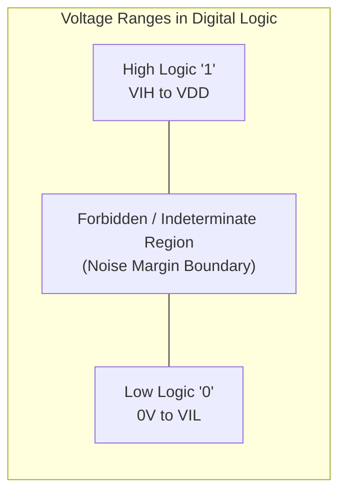
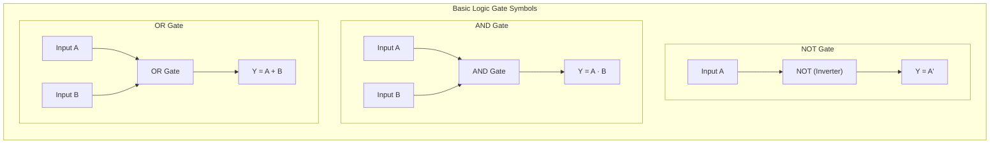

[DLCD Index](../README.md) / [Unit 1: Combinational Logic](Introduction.md)

# Introduction to Digital Systems and Boolean Algebra

At the macroscopic physical level, our universe is analog. Sound waves, temperature, light intensity, and the electrical charge moving across copper wires are continuous quantities capable of taking on an infinite number of values within any given range. 

Yet, if you try to build a complex calculating machine using continuous analog voltages—say, letting $3.72$ volts represent the number $3.72$—you immediately run into an insurmountable physical wall: **noise**. Electrical resistance warms the conductors, magnetic fields from power lines induce stray currents, and manufacturing variations cause voltages to drift. In an analog system, every stage of processing adds a tiny amount of noise that accumulates until the original data is completely corrupted.

Digital systems solve this physical dilemma by doing something radical: they discard the infinite precision of continuous voltages and enforce a strict **binary abstraction**. By dividing continuous voltages into two discrete, non-overlapping bands—a Low range representing logical `0` and a High range representing logical `1`—digital circuits achieve near-perfect noise immunity.

To design circuits that manipulate these binary signals, we rely on a specialized mathematical framework developed by George Boole in 1854 and adapted to switching circuits by Claude Shannon in 1938: **Boolean Algebra**.

---

## Analog vs. Digital Signals and the Binary Abstraction

In a digital electronic circuit, transistors act as electronic switches that pull output nodes toward a power supply voltage ($V_{DD}$, typically $1.8\text{V}$, $3.3\text{V}$, or $5\text{V}$) or toward ground ($0\text{V}$).

Instead of requiring an exact voltage, digital standards define threshold boundaries:
- **Logical 1 (High)**: Any voltage between the minimum input high voltage ($V_{IH}$) and supply voltage ($V_{DD}$).
- **Logical 0 (Low)**: Any voltage between $0\text{V}$ and the maximum input low voltage ($V_{IL}$).
- **Forbidden Region**: The voltage band between $V_{IL}$ and $V_{IH}$. Circuits are engineered so that signals transition through this band rapidly. The separation between output drive levels ($V_{OH}, V_{OL}$) and input thresholds ($V_{IH}, V_{IL}$) creates **noise margins**, ensuring that electrical noise does not flip a `0` into a `1` or vice versa.

Because variables in this system take on only two values, $x \in \{0, 1\}$, all arithmetic and decision-making operations reduce to binary logic.

---

## Basic Logic Operations and Truth Tables

Binary logic deals with variables that take on two discrete values and operations that assume logical meaning. The three fundamental building blocks of all digital computation are **NOT (Inversion)**, **AND (Logical Conjunction)**, and **OR (Logical Disjunction)**.

### 1. The NOT Gate (Inverter)
The NOT operation changes a binary state to its complement. If the input is $1$, the output is $0$; if the input is $0$, the output is $1$. Mathematically, it is denoted as $Y = A'$ or $Y = \overline{A}$.

| Input $A$ | Output $Y = A'$ |
| :---: | :---: |
| $0$ | $1$ |
| $1$ | $0$ |

### 2. The AND Gate
The AND operation yields a $1$ if and only if **all** of its inputs are $1$. If any input is $0$, the output is $0$. It is denoted algebraically by a dot ($Y = A \cdot B$) or simply by writing variables adjacent to each other ($Y = AB$).

| $A$ | $B$ | Output $Y = A \cdot B$ |
| :---: | :---: | :---: |
| $0$ | $0$ | $0$ |
| $0$ | $1$ | $0$ |
| $1$ | $0$ | $0$ |
| $1$ | $1$ | $1$ |

### 3. The OR Gate
The OR operation yields a $1$ if **at least one** of its inputs is $1$. The output is $0$ only when all inputs are $0$. It is denoted algebraically by the plus sign ($Y = A + B$). 

*Notice something critical here*: In Boolean algebra, the plus symbol denotes logical disjunction, not ordinary arithmetic addition. $1 + 1 = 1$, not $2$.

| $A$ | $B$ | Output $Y = A + B$ |
| :---: | :---: | :---: |
| $0$ | $0$ | $0$ |
| $0$ | $1$ | $1$ |
| $1$ | $0$ | $1$ |
| $1$ | $1$ | $1$ |

---

## Postulates and Basic Properties of Boolean Algebra

Boolean algebra is defined over a two-element set $B = \{0, 1\}$, two binary operators $+$ (logical OR) and $\cdot$ (logical AND), and a unary operator $'$ (logical NOT). Just as standard arithmetic follows basic arithmetic rules, Boolean algebra is governed by a core set of operational postulates:

1. **Closure**:
   - For all $x, y \in B$, $x + y \in B$ (the result is always a valid binary bit).
   - For all $x, y \in B$, $x \cdot y \in B$.
2. **Identity Elements**:
   - $0$ is the identity element for OR: $x + 0 = x$.
   - $1$ is the identity element for AND: $x \cdot 1 = x$.
3. **Commutative Laws**:
   - $x + y = y + x$
   - $x \cdot y = y \cdot x$
4. **Distributive Laws**:
   - AND distributes over OR: $x \cdot (y + z) = (x \cdot y) + (x \cdot z)$
   - OR distributes over AND: 

     $$x + (y \cdot z) = (x + y) \cdot (x + z)$$

   Notice this second distributive property. In ordinary decimal algebra, addition does not distribute over multiplication ($2 + (3 \times 4) \neq (2 + 3) \times (2 + 4)$). But in Boolean algebra, it strictly holds true and serves as a powerful algebraic simplification tool.
5. **Complement Laws**:
   - For every binary variable $x$, there exists an inverse $x'$ such that:
     $$x + x' = 1$$
     $$x \cdot x' = 0$$

---

## The Principle of Duality

One of the most powerful properties of Boolean algebra is the **Principle of Duality**. 

> **Duality Theorem**: Any Boolean relation or algebraic identity remains valid if the operators $+$ and $\cdot$ are interchanged, and the identity elements $0$ and $1$ are interchanged, while leaving the variable names unchanged.

For example, take the identity $x + 0 = x$:
- Replace $+$ with $\cdot$
- Replace $0$ with $1$
- Result: $x \cdot 1 = x$ (the dual identity is automatically true!).

This means we never have to prove theorems twice. Every proof of a theorem immediately proves its dual counterpart.

---

## Fundamental Theorems of Boolean Algebra

From Huntington's basic postulates, we derive the foundational algebraic laws used to manipulate and minimize digital logic circuits.

### 1. Idempotence
An element operated with itself yields itself:
- $x + x = x$
- $x \cdot x = x$

*Proof for $x + x = x$*:
$$x + x = (x + x) \cdot 1 = (x + x)(x + x') = x + (x \cdot x') = x + 0 = x$$

### 2. Boundedness (Dominance)
Operating with an identity absorbing element:
- $x + 1 = 1$
- $x \cdot 0 = 0$

*Proof for $x + 1 = 1$*:
$$x + 1 = (x + 1) \cdot 1 = (x + 1)(x + x') = x + (1 \cdot x') = x + x' = 1$$

### 3. Involution (Double Negation)
Inverting a complemented variable restores the original value:
- $(x')' = x$

### 4. Associativity
Grouping does not affect the outcome of identical consecutive operations:
- $x + (y + z) = (x + y) + z$
- $x \cdot (y \cdot z) = (x \cdot y) \cdot z$

### 5. DeMorgan's Theorems
DeMorgan's laws define how to distribute inversion across compound expressions. They are the single most frequently used theorems in hardware design:

1. The complement of an OR is the AND of the complements:
   $$(x + y)' = x' \cdot y'$$
2. The complement of an AND is the OR of the complements:
   $$(x \cdot y)' = x' + y'$$

For $n$ variables, DeMorgan's theorem generalizes directly:
$$(x_1 + x_2 + \dots + x_n)' = x_1' \cdot x_2' \cdot \dots \cdot x_n'$$
$$(x_1 \cdot x_2 \cdot \dots \cdot x_n)' = x_1' + x_2' + \dots + x_n'$$

### 6. Absorption Theorems
Absorption allows redundant terms to be completely eliminated from expressions:

- **Form 1**: $x + xy = x$
  *Proof*: $x + xy = x \cdot 1 + xy = x(1 + y) = x(1) = x$.
- **Form 2 (Dual)**: $x(x + y) = x$
  *Proof*: $x \cdot x + xy = x + xy = x$.
- **Form 3 (Negated Form)**: $x + x'y = x + y$
  *Proof*: By distributivity, $x + x'y = (x + x')(x + y) = (1)(x + y) = x + y$.
- **Form 4 (Dual of Negated Form)**: $x(x' + y) = xy$
  *Proof*: $xx' + xy = 0 + xy = xy$.

### 7. The Consensus Theorem
The consensus theorem eliminates a redundant third product term formed by two terms with complementary variables:

$$xy + x'z + yz = xy + x'z$$

Now, why does $yz$ disappear? Think about it mechanically:
- If $x = 1$, the first term is $y$, and the expression becomes $y + 0 + yz = y$. The $yz$ term is completely redundant!
- If $x = 0$, the second term is $z$, and the expression becomes $0 + z + yz = z$. The $yz$ term is again redundant!
- In all possible universes, $yz$ has no effect on the output.

*Formal Proof*:
$$xy + x'z + yz = xy + x'z + yz(1) = xy + x'z + yz(x + x')$$
$$= xy + x'z + xyz + x'yz = xy(1 + z) + x'z(1 + y) = xy(1) + x'z(1) = xy + x'z$$

The dual of the consensus theorem:
$$(x + y)(x' + z)(y + z) = (x + y)(x' + z)$$

---

## Summary of Boolean Algebra Postulates and Theorems

| Theorem / Postulate | OR Form ($+$) | AND Form ($\cdot$) |
| :--- | :--- | :--- |
| **Identity** | $x + 0 = x$ | $x \cdot 1 = x$ |
| **Complement** | $x + x' = 1$ | $x \cdot x' = 0$ |
| **Commutative** | $x + y = y + x$ | $xy = yx$ |
| **Distributive** | $x + yz = (x + y)(x + z)$ | $x(y + z) = xy + xz$ |
| **Idempotence** | $x + x = x$ | $x \cdot x = x$ |
| **Boundedness** | $x + 1 = 1$ | $x \cdot 0 = 0$ |
| **Involution** | $(x')' = x$ | — |
| **Associative** | $x + (y + z) = (x + y) + z$ | $x(yz) = (xy)z$ |
| **DeMorgan's** | $(x + y)' = x'y'$ | $(xy)' = x' + y'$ |
| **Absorption 1** | $x + xy = x$ | $x(x + y) = x$ |
| **Absorption 2** | $x + x'y = x + y$ | $x(x' + y) = xy$ |
| **Consensus** | $xy + x'z + yz = xy + x'z$ | $(x + y)(x' + z)(y + z) = (x + y)(x' + z)$ |

---

## Worked Examples: Algebraic Simplification

When building hardware, fewer gates mean less silicon area, lower power consumption, and faster clock speeds. We simplify Boolean expressions to reduce gate counts and input fan-in.

### Example 1: Eliminating Redundancies via Distributivity and Complements

> **Problem**: Simplify $F = AB + A(B + C) + B(B + C)$.

**Solution**:
1. Expand the terms:
   $$F = AB + AB + AC + BB + BC$$
2. Apply Idempotence ($AB + AB = AB$ and $BB = B$):
   $$F = AB + AC + B + BC$$
3. Reorder and group terms containing $B$:
   $$F = B + AB + BC + AC$$
4. Apply Absorption ($B + AB = B$ and $B + BC = B$):
   $$F = B + AC$$

A circuit that originally required five AND/OR gates is reduced to just one AND gate and one OR gate!

---

### Example 2: Applying DeMorgan's and Negated Absorption

> **Problem**: Simplify $F = (A' + B)(A + B)$.

**Solution**:
1. Use the dual distributive law $x + yz = (x + y)(x + z)$, where $x = B, y = A', z = A$:
   $$F = B + (A' \cdot A)$$
2. Since $A'A = 0$:
   $$F = B + 0 = \mathbf{B}$$

Alternatively, expanding directly:
$$F = A'A + A'B + BA + BB = 0 + A'B + AB + B = B(A' + A + 1) = B(1) = \mathbf{B}$$

---

### Example 3: Applying the Consensus Theorem

> **Problem**: Simplify $F = A'B'C + A'BC + AB'C + ABC + ABC'$.

**Solution**:
1. Group the first four terms that share $C$:
   $$F = C(A'B' + A'B + AB' + AB) + ABC'$$
2. Group inside the parentheses:
   $$A'B' + A'B = A'(B' + B) = A'(1) = A'$$
   $$AB' + AB = A(B' + B) = A(1) = A$$
   $$A' + A = 1$$
3. The expression becomes:
   $$F = C(1) + ABC' = C + ABC'$$
4. Apply Negated Absorption ($x + x'y = x + y$ with $x = C, x' = C', y = AB$):
   $$F = \mathbf{C + AB}$$

---

## Key Takeaways

- Digital systems enforce a discrete binary abstraction ($0$ and $1$) to provide noise immunity that continuous analog circuits cannot achieve.
- The fundamental operations are **NOT** (inversion, $A'$), **AND** (conjunction, $AB$), and **OR** (disjunction, $A + B$).
- **Huntington's Postulates** define Boolean algebra axiomatically, including the dual distributive law $x + yz = (x + y)(x + z)$.
- The **Principle of Duality** states that swapping $+$ and $\cdot$, and $0$ and $1$, transforms any valid Boolean equality into another valid equality.
- **DeMorgan's Laws** ($(x+y)' = x'y'$ and $(xy)' = x' + y'$) allow negation to be distributed across compound logical expressions.
- The **Consensus Theorem** ($xy + x'z + yz = xy + x'z$) eliminates redundant terms across complementary variables.
- Algebraic simplification reduces gate counts, silicon area, propagation delay, and power dissipation.

---

Algebraic simplification is elegant, but manipulating complex expressions by hand relies on recognizing obscure identities and factoring patterns. What happens when an expression has four or five variables, and missing a single absorption step leads to an unnecessarily bloated circuit? To systematically represent and optimize Boolean expressions without guesswork, we need standard representations. In the next lecture, we explore [**Canonical and Standard Forms**](L02%20-%20Canonical%20and%20Standard%20Forms.md), examining **Minterms**, **Maxterms**, **Sum of Products (SOP)**, and **Product of Sums (POS)**.
