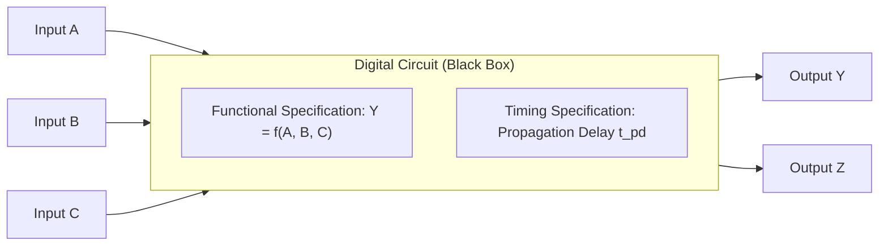
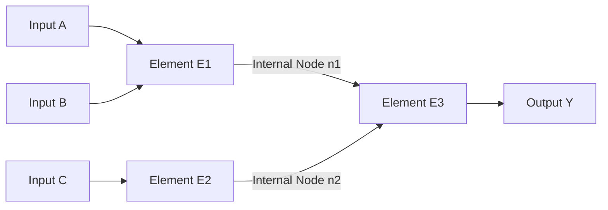
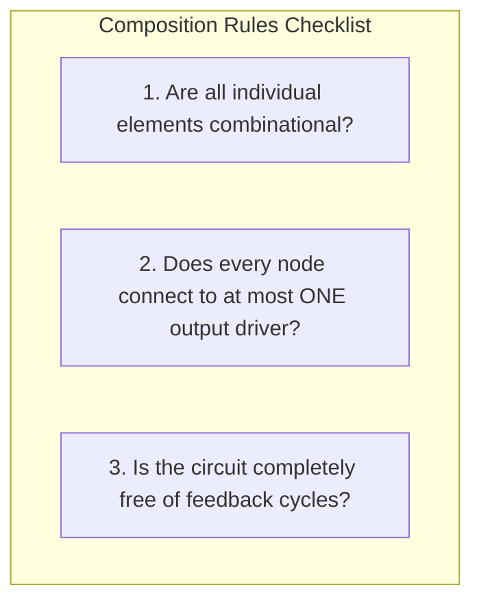
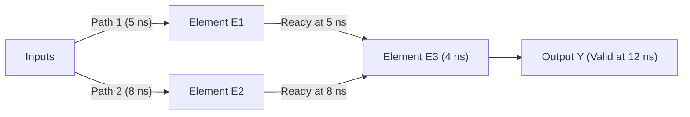

[DLCD Index](../README.md) / [Unit 1: Combinational and Sequential Logic Design](Introduction.md)

# L01 - Introduction and Digital Abstraction

Digital systems process discrete-valued variables. But the physical world is fundamentally continuous: voltages across copper wires and silicon channels vary smoothly across an infinite range of analog values. Before we can build microprocessors or write a single line of machine code, we have to bridge this gap.

The solution is the digital abstraction: a deliberate constraint where we agree to treat a continuous physical quantity—typically voltage—as representing one of two discrete Boolean states: $0$ (False / Low) or $1$ (True / High). By imposing noise margins and threshold boundaries, digital circuits reject physical noise and restore degraded signals, allowing us to compose billions of transistors into reliable computers.

---

## What is a Digital Circuit?

In digital electronics, a circuit is a network that processes discrete-valued variables. Rather than analyzing every transistor at the quantum or device-physics level, we treat a circuit as a modular black box defined by four operational properties.

Every digital circuit possesses:
- **One or more discrete-valued input terminals**: Signals fed into the circuit from the external environment or preceding stages.
- **One or more discrete-valued output terminals**: Signals produced by the circuit and delivered to external loads or subsequent stages.
- **A functional specification**: A formal description of the mathematical relationship between the inputs and outputs (e.g., a truth table, Boolean equation, or state transition graph).
- **A timing specification**: A description of the delay between an input changing and the corresponding output responding and stabilizing to a valid digital level.

Notice something important about this definition: function and timing are strictly separated. If we replace a sub-block inside a circuit with a faster, optimized equivalent, the functional specification remains completely unchanged even though the timing specification improves significantly.

---

## Circuit Anatomy: Elements and Nodes

To look inside the black box, we must define the physical constituents of a circuit schematic: circuit elements and circuit nodes.

A **circuit element** is itself a discrete component or a smaller black box circuit that has its own inputs, outputs, functional specification, and timing specification.

A **circuit node** is a wire or an equipotential electrical connection whose entire extent is at the same voltage. In any valid circuit diagram, we classify nodes into three distinct roles:
- **Input nodes**: Nodes that receive signals exclusively from outside the circuit (e.g., inputs $A$, $B$, $C$).
- **Output nodes**: Nodes that deliver the circuit's final computed results to the outside world (e.g., outputs $Y$, $Z$).
- **Internal nodes**: Nodes that connect an output terminal of one internal circuit element to the input terminals of other internal circuit elements (e.g., node $n1$).

Every point along the wire labeled $n1$ has the exact same potential at any instant in steady state. It connects the output pin of element $E_1$ to the top input pin of element $E_3$.

---

## Classifying Digital Logic: Combinational vs. Sequential

All digital circuits are divided into two broad classes based on whether they possess memory.

### Combinational Logic
A combinational circuit is completely memoryless. Its outputs at any given moment depend solely on the current values applied to its inputs.

If you apply a specific pattern of $0$s and $1$s to the inputs of an adder, the sum appears at the output after a brief physical propagation delay. If you change the inputs, the sum changes. If you return to the earlier inputs, the original output returns immediately. The circuit has no recollection of past events. Classic combinational building blocks include:
- Adders and subtractors
- Multiplexers and demultiplexers
- Encoders and decoders
- Magnitude comparators and arithmetic logic units (ALUs)

### Sequential Logic
A sequential circuit contains memory. Its outputs depend not only on the current values of its inputs, but also on the history of previous inputs—represented internally as the system's "state".

Even if two identical sets of inputs are presented to a sequential circuit at two different times, the outputs can be entirely different because past inputs modified the internal storage. Sequential circuits form the backbone of stateful computation:
- Latches and flip-flops
- Registers and register files
- Counters and shift registers
- Random-access memories (SRAM, DRAM) and finite state machine controllers

---

## Rules of Combinational Composition

We want to build large, complex combinational systems by connecting smaller combinational building blocks together. But can we connect combinational gates in any arbitrary fashion and still guarantee that the resulting system is combinational?

The answer is no. If we connect two outputs directly together, they can fight each other. If we connect an output back to an earlier input in a loop, the circuit may oscillate wildly or remember previous values.

To ensure that an interconnected network of components remains strictly combinational, it must adhere to the **Rules of Combinational Composition**:
1. **Every circuit element is itself combinational**: Every individual sub-block inside the network must be a verified combinational circuit.
2. **Every node is properly driven**: Every node in the circuit is either designated as an input to the overall circuit, or connects to *exactly one* output terminal of an internal circuit element.
3. **No cyclic paths**: The circuit contains no loops or feedback paths. Every directed path through the circuit visits each circuit node at most once.

Let's examine why rules 2 and 3 are vital from a physical standpoint.

If a node connects to the output terminals of two different gates (a violation of Rule 2), one gate may attempt to drive the wire to $V_{DD}$ ($1$) while the other gate attempts to drive it to ground ($0$). This creates a low-resistance short circuit, drawing destructive currents and producing an indeterminate, invalid intermediate voltage.

If a signal wire loops back onto itself (a violation of Rule 3), the circuit now has feedback. Depending on the inversion along the loop, it will either oscillate infinitely like an astable multivibrator, or latch into a bistable state—both of which violate memoryless combinational behavior.

---

## Analyzing Composition Examples

Let's test these three rules against classic circuit configurations to see how to diagnose valid and invalid topologies.

### Valid Feed-Forward Cascade
Consider three gates where inputs $A$ and $B$ feed gate $E_1$, input $C$ feeds gate $E_2$, and the outputs of $E_1$ and $E_2$ feed gate $E_3$ to produce output $Y$.
- Every element ($E_1, E_2, E_3$) is combinational.
- Input nodes ($A, B, C$) are external inputs. Internal nodes ($n1, n2$) connect to exactly one gate output each ($E_1$ and $E_2$).
- Signals flow strictly from left to right; no cyclic paths exist.
- **Verdict**: Valid combinational circuit.

### Cyclic Path Violation (Feedback Loop)
Suppose the output of gate $E_2$ feeds into an XOR gate whose output loops directly back into an input of $E_2$.
- Although all elements may be combinational, trace the signal path: starting at the input of $E_2$, the signal passes through $E_2$, into the XOR gate, and loops straight back to $E_2$.
- The path visits the same node twice, forming a cycle.
- **Verdict**: Not combinational. It is an asynchronous sequential circuit with potentially unpredictable latching or oscillating behavior.

### Multiple Driver Contention (Short Circuit)
Suppose an internal node $n_6$ connects simultaneously to the output terminal of an inverter $I_3$ and the output terminal of a NAND gate $I_4$.
- Node $n_6$ connects to two output terminals at the same time.
- If $I_3$ outputs $1$ and $I_4$ outputs $0$, power and ground are shorted together through the output transistors.
- **Verdict**: Not combinational and electrically illegal.

---

## Timing and Propagation Delay in Combinational Paths

Every physical gate takes a non-zero time to charge or discharge parasitic wire capacitance. In a combinational network with multiple parallel paths, how do we determine the total delay from inputs to final output?

Consider a circuit where:
- Element $E_1$ has a propagation delay of $\text{Delay}(E_1) = 5\text{ ns}$.
- Element $E_2$ has a propagation delay of $\text{Delay}(E_2) = 8\text{ ns}$.
- Both elements compute concurrently from initial inputs.
- Element $E_3$ receives the outputs of both $E_1$ and $E_2$, having a delay of $\text{Delay}(E_3) = 4\text{ ns}$.

The downstream element $E_3$ cannot produce a trustworthy final output until *both* of its inputs have settled to valid logic levels. Therefore, $E_3$ must wait for the slowest preceding path:

$$t_{\text{wait}} = \max(\text{Delay}(E_1), \text{Delay}(E_2)) = \max(5\text{ ns}, 8\text{ ns}) = 8\text{ ns}$$

Once both inputs are stable at $8\text{ ns}$, element $E_3$ takes another $4\text{ ns}$ to perform its own evaluation. The worst-case propagation delay (critical path delay) through the entire circuit is:

$$t_{\text{pd, total}} = \max(5\text{ ns}, 8\text{ ns}) + 4\text{ ns} = 8\text{ ns} + 4\text{ ns} = 12\text{ ns}$$

The path through $E_2 \to E_3$ is the **critical path**: it dictates the absolute speed limit of the system. Faster paths ($E_1 \to E_3$) simply arrive early and wait at the input of $E_3$.

---

## Key Takeaways

- The digital abstraction maps continuous analog voltages into discrete binary values ($0$ and $1$), using noise margins to prevent signal degradation across large networks.
- A digital circuit is a black box defined by discrete input terminals, discrete output terminals, a functional specification (what it computes), and a timing specification (how fast it responds).
- Combinational logic is memoryless; its outputs depend only on the current inputs. Sequential logic has internal memory; its outputs depend on current and past inputs.
- The three Rules of Combinational Composition guarantee that an interconnected circuit remains combinational: (1) every sub-element is combinational, (2) every node is driven by at most one output terminal, and (3) no cyclic feedback paths exist.
- Multiple drivers connected to a single node cause electrical contention, while feedback loops turn memoryless circuits into sequential or oscillating elements.
- The worst-case delay of a combinational network is determined by its critical path—the longest delay among all parallel input-to-output paths.

---

Now that we understand how combinational circuits are defined and composed, how do we formally express and manipulate their functional specifications? In the next lecture, [L02 - Boolean Equations and Logic Gates](L02%20-%20Boolean%20Equations%20and%20Logic%20Gates.md), we explore Boolean algebra, canonical Sum-of-Products and Product-of-Sums forms, and algebraic minimization theorems.
