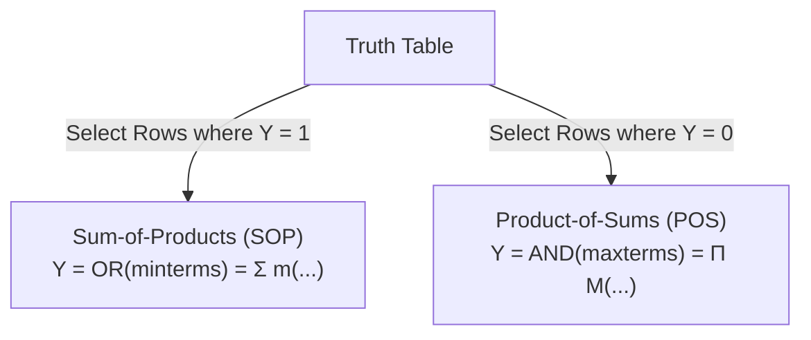
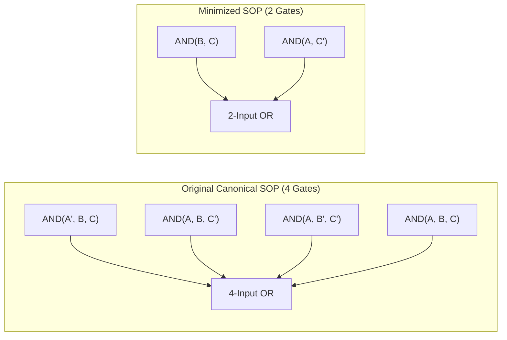
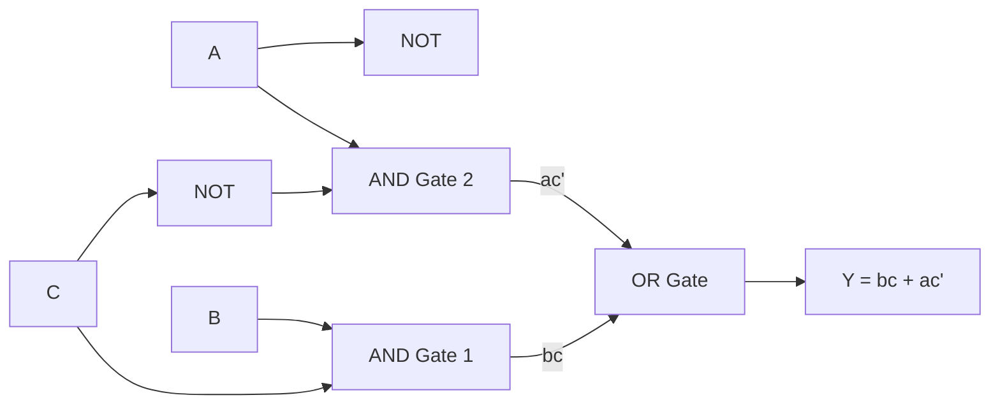

[DLCD Index](../README.md) / [Unit 1: Combinational and Sequential Logic Design](Introduction.md)

# L02 - Boolean Equations and Logic Gates

In the previous lecture, we established that a combinational circuit is governed by a functional specification. But how do we write down that specification mathematically, and how do we translate that mathematical formula directly into physical logic gates?

Boolean algebra is the mathematics of digital systems. It provides the formal language to describe, manipulate, and minimize digital logic circuits. By expressing truth tables as Boolean equations, we can systematically optimize our designs to use the fewest possible gates and transistors.

---

## Boolean Formula Terminology

To analyze Boolean logic with precision, we must establish standard terminology for the building blocks of an expression.

- **Variable**: A symbol representing a binary quantity that can take on the value $0$ or $1$ (e.g., $A, B, C$).
- **Complement**: The inverse of a variable, denoted by an overbar or a prime symbol ($\overline{A}$ or $A'$). If $A = 0$, then $\overline{A} = 1$; if $A = 1$, then $\overline{A} = 0$.
- **Literal**: A variable or its complement (e.g., $A, \overline{A}, B, \overline{B}, C, \overline{C}$). An $N$-variable function has $2N$ possible literals.
- **Product (or Implicant)**: The logical AND of one or more literals (e.g., $AB$, $\overline{A}C$, $B\overline{C}$). An implicant evaluates to $1$ only when all of its constituent literals are simultaneously $1$.
- **Sum**: The logical OR of one or more literals (e.g., $A + B$, $\overline{A} + C$). A sum evaluates to $1$ if at least one of its literals is $1$.
- **Minterm ($m_i$)**: A product term that includes *every* input variable of the function exactly once in either true or complemented form. A minterm evaluates to $1$ for exactly one row of the truth table.
- **Maxterm ($M_i$)**: A sum term that includes *every* input variable of the function exactly once in either true or complemented form. A maxterm evaluates to $0$ for exactly one row of the truth table.

---

## Canonical Representations: Minterms and Maxterms

For any system with $N$ binary input variables, there are exactly $2^N$ possible input combinations, corresponding to $2^N$ rows in a truth table. Each row has an associated minterm and maxterm.

Let us examine the complete set of minterms and maxterms for a three-variable system ($A, B, C$):

| Row ($i$) | $A$ | $B$ | $C$ | Minterm ($m_i$) | Minterm Value | Maxterm ($M_i$) | Maxterm Value |
|:---:|:---:|:---:|:---:|:---:|:---:|:---:|:---:|
| 0 | 0 | 0 | 0 | $\overline{A}\ \overline{B}\ \overline{C}$ | $m_0 = 1$ only when $000$ | $A + B + C$ | $M_0 = 0$ only when $000$ |
| 1 | 0 | 0 | 1 | $\overline{A}\ \overline{B}C$ | $m_1 = 1$ only when $001$ | $A + B + \overline{C}$ | $M_1 = 0$ only when $001$ |
| 2 | 0 | 1 | 0 | $\overline{A}B\overline{C}$ | $m_2 = 1$ only when $010$ | $A + \overline{B} + C$ | $M_2 = 0$ only when $010$ |
| 3 | 0 | 1 | 1 | $\overline{A}BC$ | $m_3 = 1$ only when $011$ | $A + \overline{B} + \overline{C}$ | $M_3 = 0$ only when $011$ |
| 4 | 1 | 0 | 0 | $A\overline{B}\ \overline{C}$ | $m_4 = 1$ only when $100$ | $\overline{A} + B + C$ | $M_4 = 0$ only when $100$ |
| 5 | 1 | 0 | 1 | $A\overline{B}C$ | $m_5 = 1$ only when $101$ | $\overline{A} + B + \overline{C}$ | $M_5 = 0$ only when $101$ |
| 6 | 1 | 1 | 0 | $AB\overline{C}$ | $m_6 = 1$ only when $110$ | $\overline{A} + \overline{B} + C$ | $M_6 = 0$ only when $110$ |
| 7 | 1 | 1 | 1 | $ABC$ | $m_7 = 1$ only when $111$ | $\overline{A} + \overline{B} + \overline{C}$ | $M_7 = 0$ only when $111$ |

Notice the duality:
- For minterms, a variable is complemented if the row bit is $0$, and uncomplemented if the row bit is $1$. The AND gate detects this exact input combination and outputs $1$.
- For maxterms, a variable is uncomplemented if the row bit is $0$, and complemented if the row bit is $1$. The OR gate outputs $0$ for this exact row and $1$ for all other seven rows.
- In fact, by DeMorgan's laws: $\overline{m_i} = M_i$. The complement of minterm $i$ is maxterm $i$.

---

## Canonical Forms: Sum-of-Products (SOP) and Product-of-Sums (POS)

Given an arbitrary truth table, we can mechanically construct a valid Boolean formula using one of two canonical architectures.

### Sum-of-Products (SOP) Form
To express a function in canonical SOP form:
1. Identify every row in the truth table where the desired output is $1$.
2. Write down the minterm corresponding to each of those rows.
3. Logical-OR (sum) all those minterms together.

In mathematical shorthand, we use the sigma ($\Sigma$) notation:

$$Y = \sum m(\text{row indices where } Y = 1)$$

### Product-of-Sums (POS) Form
To express a function in canonical POS form:
1. Identify every row in the truth table where the desired output is $0$.
2. Write down the maxterm corresponding to each of those rows.
3. Logical-AND (product) all those maxterms together.

In mathematical shorthand, we use the pi ($\Pi$) notation:

$$Y = \prod M(\text{row indices where } Y = 0)$$

---

## Step-by-Step Translation: Classic Engineering Examples

Let's solidify these canonical forms with real-world design scenarios.

### Example 1: Ben Bitdiddle's Picnic
Ben Bitdiddle is planning a picnic. He will enjoy the picnic ($E = 1$) only if it does not rain and there are no ants.
- Let input $A = 1$ if there are ants, and $A = 0$ if there are no ants.
- Let input $R = 1$ if it rains, and $R = 0$ if it is clear.
- Output $E = 1$ only when $A = 0$ and $R = 0$.

| Row | $A$ | $R$ | $E$ | Minterm | Maxterm |
|:---:|:---:|:---:|:---:|:---:|:---:|
| 0 | 0 | 0 | 1 | $\overline{A}\ \overline{R}$ | $A + R$ |
| 1 | 0 | 1 | 0 | $\overline{A}R$ | $A + \overline{R}$ |
| 2 | 1 | 0 | 0 | $A\overline{R}$ | $\overline{A} + R$ |
| 3 | 1 | 1 | 0 | $AR$ | $\overline{A} + \overline{R}$ |

Writing the canonical SOP expression:
$$E = \overline{A}\ \overline{R} = \sum m(0)$$

Writing the canonical POS expression:
$$E = (A + \overline{R})(\overline{A} + R)(\overline{A} + \overline{R}) = \prod M(1, 2, 3)$$

Both representations specify the exact same Boolean function, but SOP requires only a single 2-input AND gate (with inverted inputs), while canonical POS requires three OR gates feeding an AND gate.

### Example 2: The Cafeteria Lunch Problem
You are going to the campus cafeteria for lunch. You will eat lunch ($E = 1$) unless the cafeteria is closed ($O = 0$) or they only serve corndogs ($C = 1$).
- Input $O$: $1$ if open, $0$ if closed.
- Input $C$: $1$ if serving corndogs, $0$ if serving regular food.
- You eat lunch only when it is open ($O = 1$) and NOT serving corndogs ($C = 0$).

| Row | $O$ | $C$ | $E$ | Minterm | Maxterm |
|:---:|:---:|:---:|:---:|:---:|:---:|
| 0 | 0 | 0 | 0 | $\overline{O}\ \overline{C}$ | $O + C$ |
| 1 | 0 | 1 | 0 | $\overline{O}C$ | $O + \overline{C}$ |
| 2 | 1 | 0 | 1 | $O\overline{C}$ | $\overline{O} + C$ |
| 3 | 1 | 1 | 0 | $OC$ | $\overline{O} + \overline{C}$ |

From the truth table:
- **Canonical SOP**: Output is $1$ only at row 2:
  $$E = O\overline{C} = \sum m(2)$$
- **Canonical POS**: Output is $0$ at rows 0, 1, and 3:
  $$E = (O + C)(O + \overline{C})(\overline{O} + \overline{C}) = \prod M(0, 1, 3)$$

---

## Boolean Algebra Axioms and Theorems

Canonical equations are rarely optimal. They implement the function using an exhaustive brute-force sum of all active minterms. To reduce the gate count, silicon area, and delay, we simplify expressions using the foundational axioms and theorems of Boolean algebra.

### Axioms of Boolean Algebra
Boolean algebra is defined over a set $B = \{0, 1\}$ with two binary operations ($+$ for OR, $\cdot$ for AND) and one unary operation ($'$ or overbar for NOT):
1. **Closure**: For all $A, B \in B$, $A + B \in B$ and $A \cdot B \in B$.
2. **Identity**: $A + 0 = A$ and $A \cdot 1 = A$.
3. **Commutativity**: $A + B = B + A$ and $A \cdot B = B \cdot A$.
4. **Distributivity**:
   - $A \cdot (B + C) = (A \cdot B) + (A \cdot C)$
   - $A + (B \cdot C) = (A + B) \cdot (A + C)$ *(Note that OR distributes over AND in Boolean algebra, unlike ordinary arithmetic!)*
5. **Complement**: $A + \overline{A} = 1$ and $A \cdot \overline{A} = 0$.

### Essential Single-Variable and Multi-Variable Theorems

| Law Name | Dual Formulation (AND Form) | Dual Formulation (OR Form) |
|:---|:---|:---|
| **Identity Law** | $A \cdot 1 = A$ | $A + 0 = A$ |
| **Null Element (Dominance)** | $A \cdot 0 = 0$ | $A + 1 = 1$ |
| **Idempotence Law** | $A \cdot A = A$ | $A + A = A$ |
| **Involution Law** | $\overline{\overline{A}} = A$ | $\overline{\overline{A}} = A$ |
| **Complement Law** | $A \cdot \overline{A} = 0$ | $A + \overline{A} = 1$ |
| **Associative Law** | $(A \cdot B) \cdot C = A \cdot (B \cdot C)$ | $(A + B) + C = A + (B + C)$ |
| **Absorption Law** | $A \cdot (A + B) = A$ | $A + (A \cdot B) = A$ |
| **DeMorgan's Laws** | $\overline{A \cdot B} = \overline{A} + \overline{B}$ | $\overline{A + B} = \overline{A} \cdot \overline{B}$ |
| **Consensus Theorem** | $AB + \overline{A}C + BC = AB + \overline{A}C$ | $(A+B)(\overline{A}+C)(B+C) = (A+B)(\overline{A}+C)$ |

The **Principle of Duality** states that any valid Boolean equation remains valid if all AND operations are swapped with OR operations, and all $0$s are swapped with $1$s.

---

## Logic Minimization Walkthroughs

Let's walk through the algebraic reduction of Boolean formulas step by step, identifying which rule justifies every single transformation.

### Walkthrough 1: Four-Minterm Algebraic Simplification
Consider the Boolean function:
$$Y = \overline{A}BC + AB\overline{C} + A\overline{B}\ \overline{C} + ABC$$

Notice something here: minterms $\overline{A}BC$ and $ABC$ share the common product $BC$. Meanwhile, minterms $AB\overline{C}$ and $A\overline{B}\ \overline{C}$ share the common product $A\overline{C}$.

Let's group these terms using the Commutative and Distributive laws:
$$Y = (\overline{A}BC + ABC) + (A\overline{B}\ \overline{C} + AB\overline{C})$$

Factor out the common literals:
$$Y = BC(\overline{A} + A) + A\overline{C}(\overline{B} + B)$$

Apply the Complement law ($\overline{X} + X = 1$):
$$Y = BC(1) + A\overline{C}(1)$$

Apply the Identity law ($X \cdot 1 = X$):
$$Y = BC + A\overline{C}$$

Look at the dramatic hardware reduction: we went from four 3-input AND gates and a 4-input OR gate down to two 2-input AND gates and a single 2-input OR gate.

### Walkthrough 2: Proving the Consensus Theorem
The Consensus Theorem states:
$$AB + \overline{A}C + BC = AB + \overline{A}C$$

The term $BC$ is the "consensus term"—it is redundant because whenever $B = 1$ and $C = 1$, the function evaluates to $1$ regardless of $A$. Let's prove this algebraically:

1. Multiply the consensus term $BC$ by $(A + \overline{A})$, which equals $1$ (Identity and Complement laws):
   $$AB + \overline{A}C + BC(A + \overline{A})$$
2. Distribute $BC$:
   $$AB + \overline{A}C + ABC + \overline{A}BC$$
3. Reorder terms to group adjacent pairs:
   $$(AB + ABC) + (\overline{A}C + \overline{A}BC)$$
4. Factor out $AB$ and $\overline{A}C$:
   $$AB(1 + C) + \overline{A}C(1 + B)$$
5. Apply the Null/Dominance law ($1 + X = 1$):
   $$AB(1) + \overline{A}C(1) = AB + \overline{A}C$$

The redundant term $BC$ vanishes completely.

### Walkthrough 3: Product-of-Sums Algebraic Minimization
Minimize the POS expression:
$$Y = (A + B + C)(A + B + \overline{C})(A + \overline{B} + C)(\overline{A} + B + C)$$

Group terms in pairs:
- Pair 1: $(A + B + C)(A + B + \overline{C})$
  Using the distributive law $X + YZ = (X+Y)(X+Z)$ with $X = (A+B)$:
  $$(A + B) + (C \cdot \overline{C}) = (A + B) + 0 = A + B$$
- Pair 2: $(A + \overline{B} + C)(\overline{A} + B + C)$
  Notice both terms share $(B + C)$ and $A$ variations. Alternatively, distribute terms with respect to $(A + C)$:
  $$(A + C) + B$$ and $$(A + B + C)(\overline{A} + B + C) = (B + C) + (A \cdot \overline{A}) = B + C$$.

Combining our reduced terms:
$$Y = (A + B)(B + C)$$

Factoring out $B$ via distributivity:
$$Y = B + AC$$

---

## Synthesizing Logic Gates: Two-Level Logic

Any equation expressed in Sum-of-Products form can be directly mapped to a physical circuit using a **two-level AND-OR structure**:
- **Level 1**: A bank of AND gates, where each gate generates one product (implicant) from the input literals.
- **Level 2**: A single OR gate that sums the outputs of all Level 1 AND gates.

Similarly, any Product-of-Sums equation maps to a two-level **OR-AND structure**:
- **Level 1**: A bank of OR gates, where each gate produces one sum (maxterm) term.
- **Level 2**: A single AND gate that combines all Level 1 OR gate outputs.

By applying DeMorgan's laws, an AND-OR circuit can be transformed directly into an all-NAND circuit with identical topology, and an OR-AND circuit into an all-NOR circuit.

---

## Key Takeaways

- A literal is a variable or its complement ($A, \overline{A}$). An implicant is a product of literals.
- A minterm $m_i$ is a product of all input variables that evaluates to $1$ for exactly row $i$. A maxterm $M_i$ is a sum of all input variables that evaluates to $0$ for exactly row $i$.
- Sum-of-Products (SOP) is formed by ORing the minterms of all rows where the output is $1$ ($\sum m$). It maps to a two-level AND-OR logic circuit.
- Product-of-Sums (POS) is formed by ANDing the maxterms of all rows where the output is $0$ ($\prod M$). It maps to a two-level OR-AND logic circuit.
- Boolean algebra theorems—particularly distributivity, complementation, and consensus—allow us to cancel redundant literals and reduce physical gate count.
- DeMorgan's laws ($\overline{A \cdot B} = \overline{A} + \overline{B}$ and $\overline{A + B} = \overline{A} \cdot \overline{B}$) bridge AND and OR logic, enabling universal NAND and NOR implementations.

---

Algebraic simplification is powerful, but it relies on human ingenuity to spot groupings and apply the right theorems in the right order. Is there a visual, deterministic method that guarantees finding the minimum number of gates? In the next lecture, [L03 - Karnaugh Map Minimization](L03%20-%20Karnaugh%20Map%20Minimization.md), we explore Karnaugh maps and systematic logic minimization.
