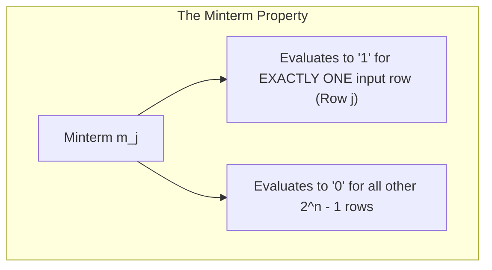
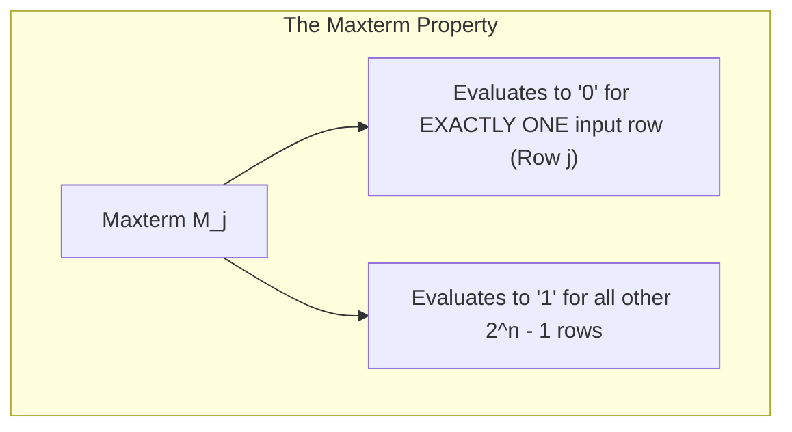
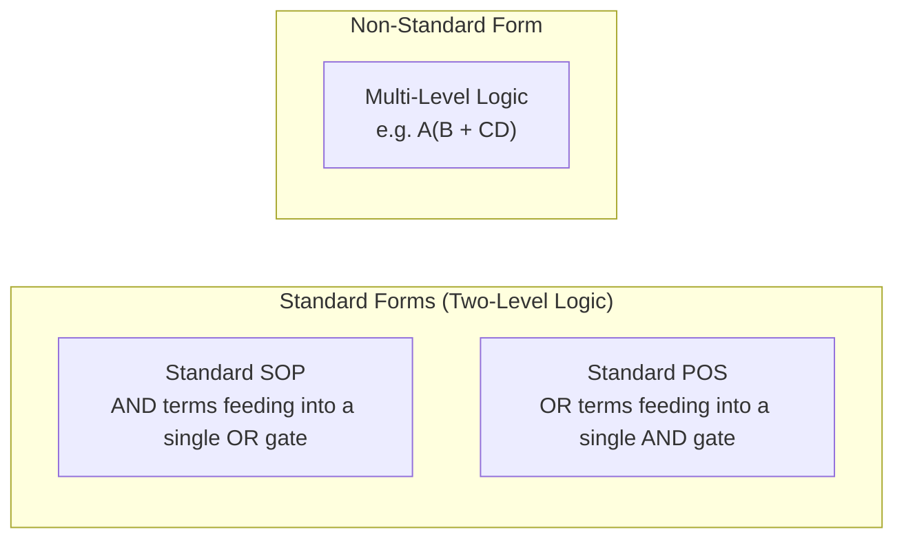

[DLCD Index](../README.md) / [Unit 1: Combinational Logic](Introduction.md)

# Canonical and Standard Forms: Minterms, Maxterms, SOP, and POS

In the previous lecture, we used Boolean algebra identities to simplify logic expressions. But notice a fundamental problem: a single logic function can be written in dozens of different algebraic forms. 

For example, $F = AB + C$, $F = (A + C)(B + C)$, and $F = ABC + ABC' + A'B'C + A'BC + AB'C$ all describe the exact same underlying logic. If two engineers write two different equations for the same circuit specification, how can they prove they are equivalent without laboriously expanding both?

To eliminate this ambiguity, digital logic relies on **Canonical Forms**. A canonical representation is a unique, standardized algebraic description where every term contains every single system variable. 

Once we express a function in its canonical **Sum of Minterms** or **Product of Maxterms**, comparing two logic equations becomes trivial: if their canonical index sets match, the circuits are mathematically identical.

---

## Literals, Product Terms, and Sum Terms

Before defining canonical forms, let's establish the fundamental vocabulary of logic expressions:

- **Literal**: A single variable occurring in uncomplemented form ($A$) or complemented form ($A'$). A function of three variables $A, B, C$ has six possible literals: $A, A', B, B', C, C'$.
- **Product Term**: An AND combination of one or more literals (e.g., $A$, $AB$, $A'BC'$). A product term evaluates to $1$ only when every literal in the term is $1$.
- **Sum Term**: An OR combination of one or more literals (e.g., $A + B$, $A' + B + C'$). A sum term evaluates to $0$ only when every literal in the term is $0$.

---

## Minterms (Standard Product Terms)

Consider a digital system with $n$ input variables. If we combine all $n$ variables using an AND operator, assigning each variable either its uncomplemented or complemented literal, we can form exactly $2^n$ distinct combinations. 

Each of these $2^n$ unique product terms is called a **Minterm** (or standard product), denoted by a lowercase $m_j$:

> **Definition of a Minterm**: A product term containing all $n$ system variables, where each variable appears exactly once (either complemented or uncomplemented). A variable is complemented if its binary value is `0`, and uncomplemented if its binary value is `1`.

Let's examine the complete set of $2^3 = 8$ minterms for a three-variable system ($x, y, z$):

| Decimal Index ($j$) | $x$ | $y$ | $z$ | Minterm Term | Minterm Designation |
| :---: | :---: | :---: | :---: | :---: | :---: |
| $0$ | $0$ | $0$ | $0$ | $x'y'z'$ | $m_0$ |
| $1$ | $0$ | $0$ | $1$ | $x'y'z$ | $m_1$ |
| $2$ | $0$ | $1$ | $0$ | $x'yz'$ | $m_2$ |
| $3$ | $0$ | $1$ | $1$ | $x'yz$ | $m_3$ |
| $4$ | $1$ | $0$ | $0$ | $xy'z'$ | $m_4$ |
| $5$ | $1$ | $0$ | $1$ | $xy'z$ | $m_5$ |
| $6$ | $1$ | $1$ | $0$ | $xyz'$ | $m_6$ |
| $7$ | $1$ | $1$ | $1$ | $xyz$ | $m_7$ |

Notice how the designation matches the binary value: row $5$ is $101_2$, which corresponds to $x$ uncomplemented ($1$), $y$ complemented ($0$), and $z$ uncomplemented ($1$): $m_5 = xy'z$.

---

## Maxterms (Standard Sum Terms)

The dual of a minterm is a **Maxterm** (or standard sum), denoted by an uppercase $M_j$:

> **Definition of a Maxterm**: A sum term containing all $n$ system variables, where each variable appears exactly once. A variable is uncomplemented if its binary value is `0`, and complemented if its binary value is `1`.

Notice that the complementing convention for maxterms is the exact **opposite** of minterms:

| Decimal Index ($j$) | $x$ | $y$ | $z$ | Maxterm Term | Maxterm Designation |
| :---: | :---: | :---: | :---: | :---: | :---: |
| $0$ | $0$ | $0$ | $0$ | $x + y + z$ | $M_0$ |
| $1$ | $0$ | $0$ | $1$ | $x + y + z'$ | $M_1$ |
| $2$ | $0$ | $1$ | $0$ | $x + y' + z$ | $M_2$ |
| $3$ | $0$ | $1$ | $1$ | $x + y' + z'$ | $M_3$ |
| $4$ | $1$ | $0$ | $0$ | $x' + y + z$ | $M_4$ |
| $5$ | $1$ | $0$ | $1$ | $x' + y + z'$ | $M_5$ |
| $6$ | $1$ | $1$ | $0$ | $x' + y' + z$ | $M_6$ |
| $7$ | $1$ | $1$ | $1$ | $x' + y' + z'$ | $M_7$ |

### The Algebraic Relationship Between Minterms and Maxterms

By applying DeMorgan's laws, we see an elegant relationship between minterms and maxterms: each maxterm is the exact algebraic complement of its corresponding minterm:

$$M_j = (m_j)' \quad \text{and} \quad m_j = (M_j)'$$

Take row $5$ ($j = 5 = 101_2$):
$$m_5 = xy'z \implies (m_5)' = (xy'z)' = x' + (y')' + z' = x' + y + z' = M_5$$

---

## Canonical Sum of Minterms (SOP Form)

Any Boolean function can be expressed as a logical sum (OR) of those minterms that yield a value of `1` in its truth table. This is known as the **Canonical Sum of Minterms** or **Canonical Sum of Products (SOP)**.

Consider an arbitrary three-variable function $F(A, B, C)$ defined by the truth table below:

| Row | $A$ | $B$ | $C$ | $F$ | Minterm |
| :---: | :---: | :---: | :---: | :---: | :---: |
| $0$ | $0$ | $0$ | $0$ | $0$ | — |
| $1$ | $0$ | $0$ | $1$ | $\mathbf{1}$ | $m_1 = A'B'C$ |
| $2$ | $0$ | $1$ | $0$ | $0$ | — |
| $3$ | $0$ | $1$ | $1$ | $0$ | — |
| $4$ | $1$ | $0$ | $0$ | $\mathbf{1}$ | $m_4 = AB'C'$ |
| $5$ | $1$ | $0$ | $1$ | $\mathbf{1}$ | $m_5 = AB'C$ |
| $6$ | $1$ | $1$ | $0$ | $0$ | — |
| $7$ | $1$ | $1$ | $1$ | $\mathbf{1}$ | $m_7 = ABC$ |

$F$ is `1` for rows $1, 4, 5, 7$. Therefore, $F$ can be expressed as:

$$F(A, B, C) = m_1 + m_4 + m_5 + m_7 = A'B'C + AB'C' + AB'C + ABC$$

Engineers use a compact shorthand summation notation:

$$F(A, B, C) = \sum m(1, 4, 5, 7)$$

### Expanding an Expression to Canonical SOP Form

What if you are given a non-canonical Boolean expression like $F = AB + C'$, and you need its canonical sum of minterms?

You can expand any product term missing a variable by ANDing it with $(x + x') = 1$:

1. $AB$ is missing variable $C$:
   $$AB = AB(C + C') = ABC + ABC'$$
2. $C'$ is missing variables $A$ and $B$:
   $$C' = C'(A + A') = AC' + A'C'$$
   $$AC'(B + B') = ABC' + AB'C'$$
   $$A'C'(B + B') = A'BC' + A'B'C'$$
3. Combine all expanded terms and eliminate duplicates ($x + x = x$):
   $$F = (ABC + ABC') + (ABC' + AB'C' + A'BC' + A'B'C')$$
   $$F = ABC + ABC' + AB'C' + A'BC' + A'B'C'$$
4. Convert to decimal index notation:
   $$F = m_7 + m_6 + m_4 + m_2 + m_0 = \sum m(0, 2, 4, 6, 7)$$

---

## Canonical Product of Maxterms (POS Form)

Instead of focusing on where a function is `1`, we can focus on where it is `0`. 

If $F$ evaluates to `0` for certain input combinations, its complement $F'$ must evaluate to `1` for those exact combinations. If we take the complement of $F'$, we arrive at the **Canonical Product of Maxterms** or **Canonical Product of Sums (POS)**.

Using the exact same truth table from above, where is $F = 0$? At rows $0, 2, 3, 6$:

| Row | $A$ | $B$ | $C$ | $F$ | Maxterm |
| :---: | :---: | :---: | :---: | :---: | :---: |
| $0$ | $0$ | $0$ | $0$ | $\mathbf{0}$ | $M_0 = A + B + C$ |
| $2$ | $0$ | $1$ | $0$ | $\mathbf{0}$ | $M_2 = A + B' + C$ |
| $3$ | $0$ | $1$ | $1$ | $\mathbf{0}$ | $M_3 = A + B' + C'$ |
| $6$ | $1$ | $1$ | $0$ | $\mathbf{0}$ | $M_6 = A' + B' + C$ |

Multiplying these maxterms together gives the canonical POS expression:

$$F(A, B, C) = M_0 \cdot M_2 \cdot M_3 \cdot M_6 = (A + B + C)(A + B' + C)(A + B' + C')(A' + B' + C)$$

In shorthand product notation:

$$F(A, B, C) = \prod M(0, 2, 3, 6)$$

---

## Conversion Between Canonical Forms

Notice the relationship between our two canonical shorthand representations for $F$:

$$\text{Canonical SOP: } F(A, B, C) = \sum m(\mathbf{1, 4, 5, 7})$$
$$\text{Canonical POS: } F(A, B, C) = \prod M(\mathbf{0, 2, 3, 6})$$

Look at the indices:
- The minterm index set is $\{1, 4, 5, 7\}$.
- The maxterm index set is $\{0, 2, 3, 6\}$.
- Together, they form the complete set of all possible binary combinations: $\{0, 1, 2, 3, 4, 5, 6, 7\}$.

> **Conversion Rule**: To convert between canonical SOP and canonical POS forms, simply list the indices missing from the original specification.
> 
> $$\sum m(\text{list}) = \prod M(\text{missing})$$
> $$\prod M(\text{list}) = \sum m(\text{missing})$$

### Mathematical Proof of Conversion
The complement of $F$ is the sum of minterms where $F = 0$:
$$F' = \sum m(0, 2, 3, 6) = m_0 + m_2 + m_3 + m_6$$

Taking the complement of both sides:
$$F = (F')' = (m_0 + m_2 + m_3 + m_6)'$$

Applying DeMorgan's Theorem:
$$F = (m_0)' \cdot (m_2)' \cdot (m_3)' \cdot (m_6)'$$

Since $M_j = (m_j)'$:
$$F = M_0 \cdot M_2 \cdot M_3 \cdot M_6 = \prod M(0, 2, 3, 6)$$

---

## Standard Forms vs. Non-Standard Forms

While canonical forms are mathematically unique, they are rarely implemented directly in silicon because including every variable in every gate creates needlessly large circuits. Real digital hardware is implemented in **Standard Forms**.

A **Standard Form** contains terms with varying numbers of literals (from $1$ to $n$), but restricts the circuit to a two-level gate structure.

### 1. Standard Sum of Products (SOP)
An expression formed by ORing two or more product terms, where each product term can contain any number of literals:

$$F = AB + A'C + BC'$$

This directly corresponds to a **two-level AND-OR circuit**: the first level consists of parallel AND gates, and the second level consists of a single OR gate combining their outputs.

### 2. Standard Product of Sums (POS)
An expression formed by ANDing two or more sum terms, where each sum term can contain any number of literals:

$$F = (A + B)(A' + C)(B' + C)$$

This directly corresponds to a **two-level OR-AND circuit**: the first level consists of parallel OR gates, and the second level consists of a single AND gate.

### 3. Non-Standard Forms
Any expression that requires three or more levels of gating. For instance:

$$F = AB + C(D + E)$$

To implement this expression directly, $D$ and $E$ must pass through an OR gate (Level 1), the result is ANDed with $C$ (Level 2), and that output is ORed with $AB$ (Level 3). To convert a non-standard expression to standard SOP, simply distribute products over sums:

$$F = AB + CD + CE \quad (\text{Standard SOP: 2-level AND-OR})$$

---

## Key Takeaways

- A **literal** is an uncomplemented or complemented variable. A **product term** is an AND combination; a **sum term** is an OR combination.
- A **Minterm ($m_j$)** is a product term containing all $n$ variables, evaluating to $1$ for exactly one input combination ($j$).
- A **Maxterm ($M_j$)** is a sum term containing all $n$ variables, evaluating to $0$ for exactly one input combination ($j$).
- Minterms and Maxterms are exact algebraic complements: $M_j = (m_j)'$.
- Any Boolean function can be expressed as a unique **Canonical Sum of Minterms** ($F = \sum m$) by identifying the rows where $F=1$, or as a **Canonical Product of Maxterms** ($F = \prod M$) by identifying the rows where $F=0$.
- To convert between canonical SOP and POS, simply exchange the operator symbol and select the **missing indices** from the $2^n$ universe.
- **Standard Forms** (SOP and POS) allow terms with varying numbers of literals, translating directly into two-level logic circuits with minimal propagation delay.

---

Canonical SOP expressions give us an unambiguous formula for any truth table. But a canonical expression is physically massive: if an equation has ten minterms, building it requires ten wide AND gates and a ten-input OR gate. How do we take a canonical equation and reduce it to its absolute minimum number of gates and literals without doing pages of algebraic factoring? In the next lecture, we master the visual optimization tool used by digital designers for decades: [**Karnaugh Map Minimization**](L03%20-%20Karnaugh%20Map%20Minimization.md).
