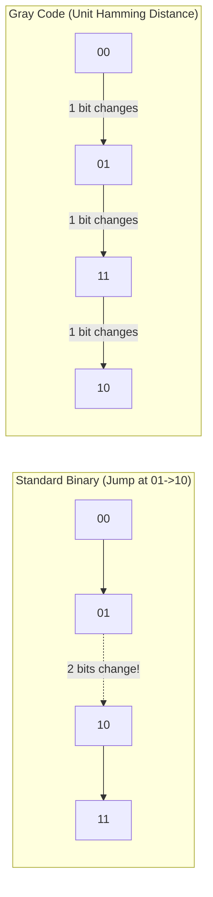
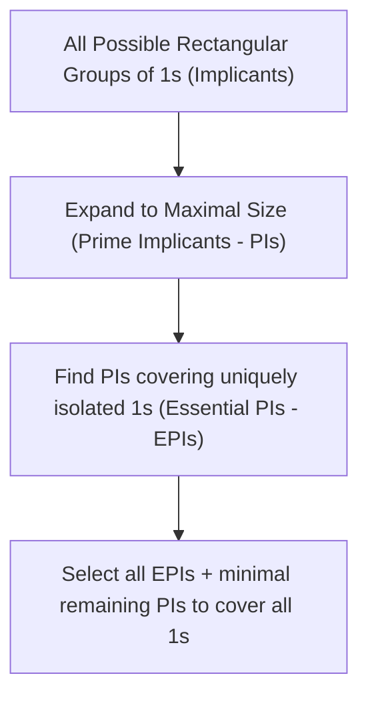
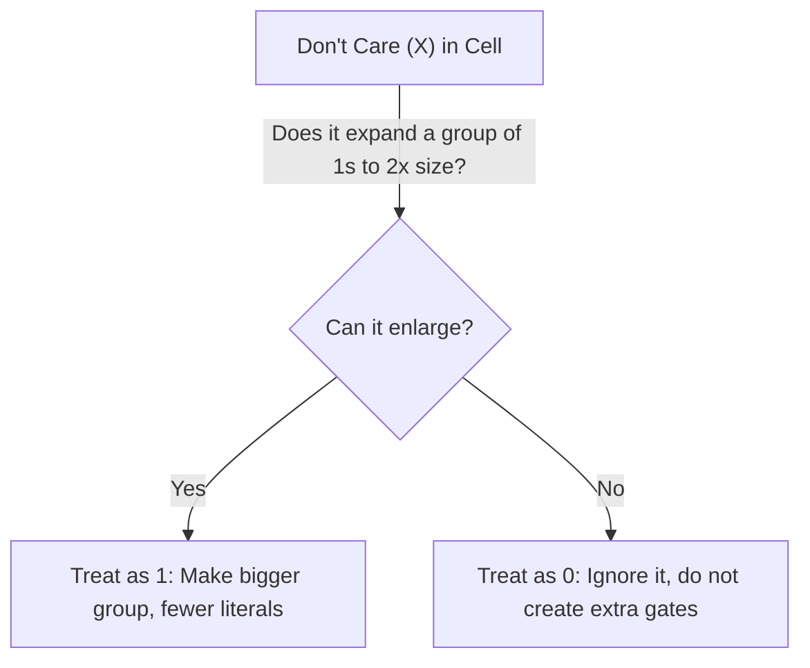

[DLCD Index](../README.md) / [Unit 1: Combinational and Sequential Logic Design](Introduction.md)

# L03 - Karnaugh Map Minimization

In the previous lecture, we simplified Boolean equations using algebraic axioms and theorems. While algebraic reduction is mathematically rigorous, it quickly becomes unwieldy for practical systems. It requires human trial-and-error, spotting unintuitive factoring steps, and multiplying by terms like $(C + \overline{C})$ to reveal consensus redundancies.

To eliminate guesswork, Maurice Karnaugh in 1953 developed a systematic, visual method known as the **Karnaugh Map (K-map)**. By rearranging the truth table so that minterms differing in only a single literal are physically adjacent on a grid, Karnaugh maps exploit human spatial recognition to find the absolute minimum two-level Sum-of-Products (SOP) or Product-of-Sums (POS) expression.

---

## The Core Principle: Gray Code Adjacency

The fundamental algebraic identity driving logic reduction is the complement law:

$$A B + A \overline{B} = A(B + \overline{B}) = A(1) = A$$

Whenever two minterms differ in exactly one variable—where one contains the true literal and the other contains the complemented literal—the varying variable drops out completely.

In a standard truth table, rows are arranged in numeric binary order: $00, 01, 10, 11$. But notice the jump between row 1 ($01$) and row 2 ($10$): *both* bits change simultaneously. They are not physically adjacent in Hamming distance.

A Karnaugh map solves this by indexing its rows and columns using **Gray code**:

$$00 \longrightarrow 01 \longrightarrow 11 \longrightarrow 10$$

In this sequence, every adjacent index differs by exactly **one bit**. When we map truth table entries into a grid arranged with Gray code coordinates, any two geometrically adjacent cells automatically differ by only a single literal.

---

## K-Map Structures: 2-, 3-, and 4-Variable Grids

A K-map contains $2^N$ squares for an $N$-variable function, with each cell corresponding to exactly one minterm $m_i$.

### 2-Variable K-Map (4 Cells)
For variables $A$ and $B$, the grid has 2 rows and 2 columns:

| $A \backslash B$ | $0$ | $1$ |
|:---:|:---:|:---:|
| **$0$** | $m_0$ ($\overline{A}\ \overline{B}$) | $m_1$ ($\overline{A}B$) |
| **$1$** | $m_2$ ($A\overline{B}$) | $m_3$ ($AB$) |

### 3-Variable K-Map (8 Cells)
For variables $A, B, C$, let variable $A$ select the row, while $BC$ select the column:

| $A \backslash BC$ | $00$ | $01$ | $11$ | $10$ |
|:---:|:---:|:---:|:---:|:---:|
| **$0$** | $m_0$ ($\overline{A}\ \overline{B}\ \overline{C}$) | $m_1$ ($\overline{A}\ \overline{B}C$) | $m_3$ ($\overline{A}BC$) | $m_2$ ($\overline{A}B\overline{C}$) |
| **$1$** | $m_4$ ($A\overline{B}\ \overline{C}$) | $m_5$ ($A\overline{B}C$) | $m_7$ ($ABC$) | $m_6$ ($AB\overline{C}$) |

Notice the column order: columns 2 and 3 are swapped ($11$ comes before $10$). Consequently, minterm $m_3$ appears before $m_2$, and $m_7$ appears before $m_6$.

### 4-Variable K-Map (16 Cells)
For variables $A, B, C, D$, let $AB$ index the rows and $CD$ index the columns:

| $AB \backslash CD$ | $00$ | $01$ | $11$ | $10$ |
|:---:|:---:|:---:|:---:|:---:|
| **$00$** | $m_0$ | $m_1$ | $m_3$ | $m_2$ |
| **$01$** | $m_4$ | $m_5$ | $m_7$ | $m_6$ |
| **$11$** | $m_{12}$ | $m_{13}$ | $m_{15}$ | $m_{14}$ |
| **$10$** | $m_8$ | $m_9$ | $m_{11}$ | $m_{10}$ |

Here, row 3 is indexed by $11$ ($m_{12}, m_{13}, m_{15}, m_{14}$) and row 4 is indexed by $10$ ($m_8, m_9, m_{11}, m_{10}$).

### The Principle of Wrap-Around
Because the sequence $00, 01, 11, 10$ loops back from $10$ to $00$ with only a 1-bit difference, the far-left and far-right columns are geometrically adjacent! In mathematical terms, the map is not a flat sheet, but a torus (doughnut).

In a 4-variable map:
- The leftmost column ($CD = 00$) is adjacent to the rightmost column ($CD = 10$).
- The topmost row ($AB = 00$) is adjacent to the bottommost row ($AB = 10$).
- The four extreme outer corners—$m_0, m_2, m_8, m_{10}$—are all adjacent to each other and form a single group of four!

---

## Implicants, Prime Implicants, and Essential Prime Implicants

To minimize a logic function systematically, we define three crucial concepts:

- **Implicant**: Any rectangular or square group of adjacent cells containing $1$s whose size is an integer power of two ($1, 2, 4, 8, 16$). Every doubling in group size eliminates one variable from the resulting product term.
  - A group of 1 cell represents an implicant with all $N$ literals.
  - A group of 2 cells eliminates 1 variable ($N-1$ literals).
  - A group of 4 cells eliminates 2 variables ($N-2$ literals).
  - A group of 8 cells eliminates 3 variables ($N-3$ literals).
- **Prime Implicant (PI)**: An implicant that cannot be combined with any adjacent group to form a larger group. In other words, it is a maximal group of $1$s.
- **Essential Prime Implicant (EPI)**: A prime implicant that covers at least one minterm ($1$) that is not covered by any other prime implicant. Essential prime implicants *must* be included in every valid minimal sum of products.

### Systematic K-Map Minimization Algorithm
1. Plot all $1$s from the truth table into the K-map grid (all other cells are $0$).
2. Identify all Prime Implicants by grouping adjacent $1$s into the largest possible rectangular blocks of $2^k$ cells, remembering wrap-around.
3. Identify all Essential Prime Implicants by locating any $1$ that belongs to only a single prime implicant. Circle and include every EPI in your equation.
4. If any $1$s remain uncovered, select the minimum number of remaining prime implicants that cover all residual $1$s.

---

## Step-by-Step 3-Variable Minimization Walkthroughs

### Walkthrough 1: Standard 3-Variable Reduction
Given the truth table for $Y = f(A, B, C) = \sum m(3, 4, 6, 7)$:

Let us populate the K-map:

| $A \backslash BC$ | $00$ | $01$ | $11$ | $10$ |
|:---:|:---:|:---:|:---:|:---:|
| **$0$** | 0 | 0 | **1** ($m_3$) | 0 |
| **$1$** | **1** ($m_4$) | 0 | **1** ($m_7$) | **1** ($m_6$) |

Let's identify the prime implicants:
- Group 1: $m_3$ and $m_7$ are adjacent vertically (column $BC = 11$, row $A$ changes from $0$ to $1$). The literal $A$ drops out, leaving the product term **$BC$**.
- Group 2: $m_4$ and $m_6$ are adjacent across the horizontal wrap-around (row $A = 1$, column $00$ and $10$). In columns $00$ and $10$, variable $B$ is $0$ in both, while $C$ changes from $0$ to $1$. Thus $C$ drops out, leaving the product term **$A\overline{C}$**.
- Group 3: Notice $m_7$ and $m_6$ are also adjacent horizontally in row $1$, giving $AB$.

Now let's find the Essential Prime Implicants:
- Minterm $m_3$ is covered *only* by Group 1 ($BC$). Therefore, $BC$ is an **Essential Prime Implicant**.
- Minterm $m_4$ is covered *only* by Group 2 ($A\overline{C}$). Therefore, $A\overline{C}$ is an **Essential Prime Implicant**.
- What about Group 3 ($AB$)? Minterm $m_7$ is already covered by $BC$, and minterm $m_6$ is already covered by $A\overline{C}$. Group 3 is completely redundant!

The minimal Boolean formula is:

$$Y = BC + A\overline{C}$$

### Walkthrough 2: Overlapping Quads
Given $Y = f(A, B, C) = \sum m(1, 3, 4, 5, 6, 7)$:

| $A \backslash BC$ | $00$ | $01$ | $11$ | $10$ |
|:---:|:---:|:---:|:---:|:---:|
| **$0$** | 0 | **1** ($m_1$) | **1** ($m_3$) | 0 |
| **$1$** | **1** ($m_4$) | **1** ($m_5$) | **1** ($m_7$) | **1** ($m_6$) |

Let's find the largest possible groupings:
- Group 1 (Quad of 4): The entire bottom row ($A = 1$) contains four $1$s ($m_4, m_5, m_7, m_6$). Since it spans all four columns, both $B$ and $C$ vary over all possibilities and drop out. This quad evaluates simply to **$A$**.
- Group 2 (Quad of 4): Notice cells $m_1, m_3, m_5, m_7$ form a $2 \times 2$ square across columns $01$ and $11$. Here, $A$ varies ($0$ and $1$), $B$ varies ($0$ and $1$), but $C$ remains constantly $1$. This quad evaluates to **$C$**.

Are there any uncovered $1$s? All six $1$s are completely covered by these two essential quads. The minimal formula is:

$$Y = A + C$$

---

## 4-Variable Minimization and the Four Corners

Let's analyze a 4-variable function:
$$Y = f(A, B, C, D) = \sum m(0, 2, 5, 7, 8, 10, 13, 15)$$

Populate the 16-cell grid:

| $AB \backslash CD$ | $00$ | $01$ | $11$ | $10$ |
|:---:|:---:|:---:|:---:|:---:|
| **$00$** | **1** ($m_0$) | 0 | 0 | **1** ($m_2$) |
| **$01$** | 0 | **1** ($m_5$) | **1** ($m_7$) | 0 |
| **$11$** | 0 | **1** ($m_{13}$) | **1** ($m_{15}$) | 0 |
| **$10$** | **1** ($m_8$) | 0 | 0 | **1** ($m_{10}$) |

Notice the two distinct geometric structures:

1. **The Center Quad**: Cells $m_5, m_7, m_{13}, m_{15}$ form a $2 \times 2$ block in the center.
   - For rows $01$ and $11$, $A$ changes from $0$ to $1$, while $B = 1$.
   - For columns $01$ and $11$, $C$ changes from $0$ to $1$, while $D = 1$.
   - The resulting implicant is **$BD$**.

2. **The Four Corners**: Cells $m_0, m_2, m_8, m_{10}$ occupy the four extreme corners of the map.
   - Wrap-around horizontally connects column $00$ and column $10$: $C$ varies, while $D = 0$ ($\overline{D}$).
   - Wrap-around vertically connects row $00$ and row $10$: $A$ varies, while $B = 0$ ($\overline{B}$).
   - The four corners combine into a single quad of 4 cells, yielding **$\overline{B}\ \overline{D}$**.

Both quads are essential. The resulting minimal Boolean expression is:

$$Y = BD + \overline{B}\ \overline{D}$$

Notice that this is the XNOR function: $Y = B \odot D$.

---

## Don't Care Conditions ($X$)

In practical digital systems, certain input combinations can never physically occur, or their resulting outputs are completely irrelevant to system operation.

For example, a Binary Coded Decimal (BCD) decoder receives a 4-bit input representing decimal digits $0$ through $9$ ($0000_2$ to $1001_2$). The bit patterns $1010_2$ through $1111_2$ (decimal $10$ to $15$) are invalid in BCD. Since they will never appear at the inputs, we **do not care** what output the circuit produces for those combinations.

We denote these unspecified outputs by **$X$** (Don't Care).

### The Golden Rule of Don't Cares
When minimizing with K-maps:
- Treat an $X$ as a **$1$** if doing so allows you to form a larger group (reducing gate literals).
- Treat an $X$ as a **$0$** if including it does not help enlarge any group (avoiding redundant gates).
- You are **never required** to cover an $X$. Only true $1$s must be covered.

### Example: 7-Segment Display Decoder
A 7-segment display decoder converts a 4-bit BCD code $D_3 D_2 D_1 D_0$ into segment drivers $S_a$ through $S_g$. The inputs $10$ through $15$ are marked as Don't Cares ($X$).

For segment $S_a$ (top horizontal bar), the segment is illuminated for digits $0, 2, 3, 5, 6, 7, 8, 9$:

$$S_a = \sum m(0, 2, 3, 5, 6, 7, 8, 9) + \sum d(10, 11, 12, 13, 14, 15)$$

Plotting into a 4-variable K-map with $D_3 D_2$ on rows and $D_1 D_0$ on columns:
- Row $11$ ($12, 13, 15, 14$) is all $X$.
- Row $10$ contains $m_8=1, m_9=1, m_{11}=X, m_{10}=X$.
- By treating $X_{10}, X_{11}, X_{14}, X_{15}$ as $1$s, we form an octet of 8 cells with row $10$ and row $11$, giving term **$D_3$**.
- By combining corner cells and adjacent Don't Cares, we cover all remaining active segments with large quads:
  $$S_a = D_3 + D_2 D_0 + \overline{D_2}\ \overline{D_0} + D_1$$

Without the Don't Cares, the designer would have needed complex 4-literal terms for each isolated digit!

---

## Product-of-Sums (POS) Minimization on K-Maps

Sometimes a function has far fewer $0$s than $1$s. In such cases, designing in Product-of-Sums (POS) form yields a significantly smaller circuit.

To perform POS minimization directly on a K-map:
1. Instead of grouping $1$s, group the **$0$s** of the function into maximal rectangular blocks of $2^k$ cells.
2. This grouping produces the minimal SOP expression for the inverted function, $\overline{Y}$.
3. Apply DeMorgan's theorem to both sides ($\overline{\overline{Y}} = Y$) to transform the AND-OR equation into its minimal OR-AND (POS) form.

Alternatively, read the maxterm sum directly from each group of $0$s: for any variable that remains constant across the group, write it uncomplemented if it is $0$, and complemented if it is $1$.

---

## Key Takeaways

- Karnaugh maps arrange minterms using Gray code order ($00, 01, 11, 10$) so that geometrically adjacent cells differ by exactly one variable.
- K-maps wrap around in all directions: left is adjacent to right, top is adjacent to bottom, and the four corners form an adjacent group of 4.
- An Implicant is any power-of-two group of $1$s ($1, 2, 4, 8, 16$). Doubling the group size eliminates one literal.
- A Prime Implicant cannot be enlarged further. An Essential Prime Implicant covers at least one $1$ that no other prime implicant covers.
- A minimal SOP expression consists of all Essential Prime Implicants plus the minimum set of prime implicants needed to cover any remaining $1$s.
- Don't Cares ($X$) represent impossible or irrelevant input combinations. Set them to $1$ only when they expand a group to a larger power of two; otherwise leave them as $0$.
- POS minimization is achieved by grouping $0$s instead of $1$s and applying DeMorgan's laws.

---

Now that we master two-level gate minimization, how do digital designers construct complex systems without manually wiring millions of individual logic gates? In the next lecture, [L04 - Combinational Building Blocks - Multiplexers and Decoders](L04%20-%20Combinational%20Building%20Blocks%20-%20Multiplexers%20and%20Decoders.md), we scale up to higher-level modular building blocks: multiplexers, decoders, priority encoders, and tri-state buses.
