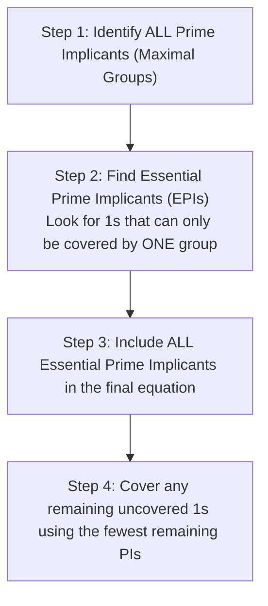
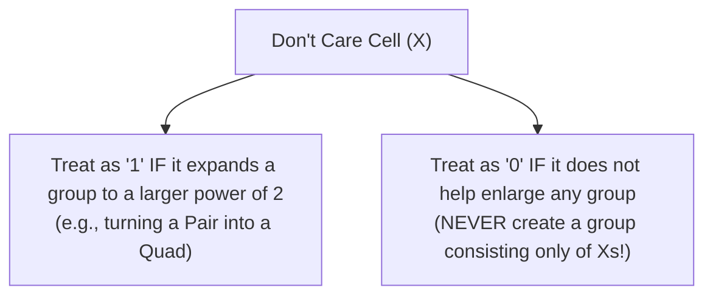

[DLCD Index](../README.md) / [Unit 1: Combinational Logic](Introduction.md)

# Karnaugh Map Minimization: The Map Method, Prime Implicants, and Don't Cares

In the previous lecture, we saw that any truth table can be translated into a canonical Sum of Minterms. But canonical equations are physically wasteful: a 4-variable function might contain eight 4-literal minterms, demanding eight 4-input AND gates and an 8-input OR gate.

While algebraic identities like the consensus theorem or absorption can reduce these equations, doing algebra on 4-variable or 5-variable expressions is an error-prone guessing game. You can stare at an equation for an hour, factor out three terms, and still not know whether the resulting circuit is the absolute minimal hardware implementation.

In 1953, Maurice Karnaugh developed an ingenious graphical method that transforms Boolean minimization into visual pattern recognition: the **Karnaugh Map (K-Map)**. 

By arranging the cells of a truth table in an $n$-dimensional grid where adjacent cells differ by exactly **one binary bit**, the fundamental Boolean identity $xy + xy' = x(y + y') = x$ becomes visually obvious. Grouping adjacent cells of 1s allows variables to be systematically eliminated without guessing.

---

## Gray Code Adjacency: Why Normal Binary Fails on a Map

The secret behind the K-map is how its rows and columns are indexed.

If you index a table using standard binary counting (`00, 01, 10, 11`), look at what happens between step 2 and step 3:

```
Binary Sequence:
00 -> 01  (1 bit changes: fine)
01 -> 10  (TWO bits change simultaneously! 0->1 and 1->0)
```

Because both bits change between `01` and `10`, the cells are not physically adjacent in logical space. You cannot apply $xy + xy' = x$ between `01` and `10`.

To force adjacent cells to differ by only a single variable, Karnaugh indexed the map using **Gray Code**:

$$\mathbf{00, \ 01, \ 11, \ 10}$$

```mermaid
flowchart LR
    C0["00"] <-->|1 bit changes (LSB)| C1["01"]
    C1 <-->|1 bit changes (MSB)| C2["11"]
    C2 <-->|1 bit changes (LSB)| C3["10"]
    C3 <-.->|1 bit changes (MSB)| C0
```

Notice two critical properties of this sequence:
1. Every adjacent pair of numbers differs by **exactly one bit**.
2. **Toroidal Wrapping**: The very last value (`10`) and the very first value (`00`) also differ by exactly one bit! The left and right edges of the map wrap around and touch each other, and the top and bottom edges wrap around and touch each other. A K-map is not a flat sheet of paper—it is a geometric **torus (donut)**.

---

## K-Map Geometries

A K-map for $n$ variables contains exactly $2^n$ cells, with each cell corresponding to one unique minterm $m_j$.

### 1. Two-Variable K-Map (4 Cells)

For variables $A$ and $B$:

| $A \backslash B$ | $0$ ($B'$) | $1$ ($B$) |
| :---: | :---: | :---: |
| **$0$ ($A'$)** | $m_0$ (`00`) | $m_1$ (`01`) |
| **$1$ ($A$)** | $m_2$ (`10`) | $m_3$ (`11`) |

### 2. Three-Variable K-Map (8 Cells)

For variables $A, B, C$, let $A$ define the rows ($0, 1$) and $BC$ define the columns ($00, 01, 11, 10$):

| $A \backslash BC$ | $00$ ($B'C'$) | $01$ ($B'C$) | $11$ ($BC$) | $10$ ($BC'$) |
| :---: | :---: | :---: | :---: | :---: |
| **$0$ ($A'$)** | $m_0$ (`000`) | $m_1$ (`001`) | $m_3$ (`011`) | $m_2$ (`010`) |
| **$1$ ($A$)** | $m_4$ (`100`) | $m_5$ (`101`) | $m_7$ (`111`) | $m_6$ (`110`) |

*Pay close attention to the column order*: Notice that the third column is $m_3$ (`011`) and the fourth is $m_2$ (`010`). Reversing this order is the most common beginner mistake.

### 3. Four-Variable K-Map (16 Cells)

For variables $A, B, C, D$, rows are defined by $AB$ ($00, 01, 11, 10$) and columns by $CD$ ($00, 01, 11, 10$):

| $AB \backslash CD$ | $00$ ($C'D'$) | $01$ ($C'D$) | $11$ ($CD$) | $10$ ($CD'$) |
| :---: | :---: | :---: | :---: | :---: |
| **$00$ ($A'B'$)** | $m_0$ | $m_1$ | $m_3$ | $m_2$ |
| **$01$ ($A'B$)** | $m_4$ | $m_5$ | $m_7$ | $m_6$ |
| **$11$ ($AB$)** | $m_{12}$ | $m_{13}$ | $m_{15}$ | $m_{14}$ |
| **$10$ ($AB'$)** | $m_8$ | $m_9$ | $m_{11}$ | $m_{10}$ |

*Notice the row ordering as well*: Row 0 is `00` ($m_0..m_2$), Row 1 is `01` ($m_4..m_6$), Row 2 is `11` ($m_{12}..m_{14}$), and Row 3 is `10` ($m_8..m_{10}$).

---

## Grouping Rules: Power-of-Two Rectangles

To minimize a function in Sum of Products (SOP) form, we plot a `1` in every cell corresponding to a minterm where $F = 1$, and group adjacent 1s into rectangular blocks.

The rules for valid grouping are mathematically strict:
1. **Group Size Must Be a Power of Two**: You may only create groups containing $1, 2, 4, 8,$ or $16$ cells ($2^k$). You can **never** group 3, 5, or 6 cells!
2. **Groups Must Be Rectangular**: Groups can be $1 \times 1, 1 \times 2, 2 \times 1, 2 \times 2, 1 \times 4, 4 \times 1, 2 \times 4, 4 \times 2,$ or $4 \times 4$. L-shaped, T-shaped, or diagonal groups are strictly illegal.
3. **Make Groups as Large as Possible**: A larger group eliminates more variables and produces a simpler product term with fewer literals:
   - Group of $1$ ($2^0$): eliminates $0$ variables $\to$ **$4$ literals** (in a 4-var map).
   - Group of $2$ ($2^1$, **Pair**): eliminates $1$ variable $\to$ **$3$ literals**.
   - Group of $4$ ($2^2$, **Quad**): eliminates $2$ variables $\to$ **$2$ literals**.
   - Group of $8$ ($2^3$, **Octet**): eliminates $3$ variables $\to$ **$1$ literal**.
   - Group of $16$ ($2^4$): eliminates all $4$ variables $\to$ output is constant **$1$**.
4. **Wrap-Around Adjacency**: Cells on the outer edges are adjacent:
   - Column `00` is adjacent to Column `10`.
   - Row `00` is adjacent to Row `10`.
   - **The Four Corners**: Cells $m_0, m_2, m_8, m_{10}$ form a valid **Quad of 4 cells**!
5. **Overlapping is Allowed**: A cell containing a `1` may be included in multiple different groups if doing so helps enlarge other groups.
6. **Every `1` Must Be Covered**: Every single cell containing a `1` must belong to at least one group. Use the fewest total groups possible to cover all 1s.

---

## Prime Implicants and Essential Prime Implicants

In university exams and automated synthesis tools, guessing which groups to keep leads to non-minimal solutions. We formalize minimization through **Prime Implicant theory**:

- **Implicant**: Any product term corresponding to a rectangle of 1s in the K-map.
- **Prime Implicant (PI)**: A rectangle of 1s (of size $2^k$) that **cannot be merged** into any larger rectangle of power of two. In other words, it is a maximal group.
- **Essential Prime Implicant (EPI)**: A Prime Implicant that contains **at least one minterm (`1`) that is covered by NO other prime implicant**.



> **The Golden Minimization Algorithm**:
> 1. Plot all 1s on the map.
> 2. Identify every single Prime Implicant (all possible maximal pairs, quads, octets).
> 3. Search for any `1` that has only **one** possible PI covering it. That PI is an **Essential Prime Implicant (EPI)**. Circle all EPIs.
> 4. If all 1s on the map are covered by the EPIs, you are done! The minimal SOP is simply the sum of all EPIs.
> 5. If some 1s remain uncovered, choose the minimal number of remaining non-essential PIs that cover them with the lowest literal count.

---

## Don't Care Conditions ($d$ or $X$)

In many real-world systems, certain input combinations **can never physically occur**.

For instance, consider a Binary Coded Decimal (BCD) decoder. BCD uses 4 bits ($A, B, C, D$) to represent decimal digits $0$ through $9$ ($0000_2$ to $1001_2$). The binary combinations $1010_2$ through $1111_2$ ($10$ through $15$) are invalid in BCD; the input circuitry guarantees they will never be presented.

What should the output of our circuit be if an impossible input combination is presented? **It doesn't matter.** The output can be `0` or `1` without affecting system behavior.

We mark these combinations on the K-map with an **$X$** (or $d$), denoting a **Don't Care condition**:

$$F(A, B, C, D) = \sum m(1, 3, 7, 11, 15) + \sum d(0, 2, 5)$$



- If grouping an $X$ with existing 1s allows you to form a larger group (say, turning a 2-cell Pair into a 4-cell Quad), **treat the $X$ as a `1`**. This eliminates an extra variable from your product term!
- If an $X$ does not help enlarge any existing group of 1s, **leave it alone (treat it as a `0`)**. You are never required to cover an $X$.

---

## Product of Sums (POS) Minimization on K-Maps

What if a specification asks for the minimal **Product of Sums (POS)** instead of SOP?

Instead of grouping the 1s, we use the K-map to group the **0s**:
1. Group the 0s and Don't Cares using the exact same power-of-two rules.
2. Reading the resulting groups gives the minimal SOP equation for the **complement** function: $F'$.
3. Apply DeMorgan's Theorem to both sides: $(F')' = F$. Every AND becomes an OR, and every literal is inverted.
4. The result is the absolute minimal POS expression!

---

## Worked Examples

### Example 1: 4-Variable SOP with Corner Quad and EPIs

> **Problem**: Find the minimal SOP expression for $F(A, B, C, D) = \sum m(0, 2, 5, 7, 8, 10, 14, 15)$.

**Step 1: Populate the 4-Variable K-Map**:

| $AB \backslash CD$ | $00$ | $01$ | $11$ | $10$ |
| :---: | :---: | :---: | :---: | :---: |
| **$00$** | **1** ($m_0$) | 0 | 0 | **1** ($m_2$) |
| **$01$** | 0 | **1** ($m_5$) | **1** ($m_7$) | 0 |
| **$11$** | 0 | 0 | **1** ($m_{15}$) | **1** ($m_{14}$) |
| **$10$** | **1** ($m_8$) | 0 | 0 | **1** ($m_{10}$) |

**Step 2: Identify Prime Implicants**:
1. Look at the four corners: cells $m_0, m_2, m_8, m_{10}$. They wrap around both horizontally and vertically to form a **Quad of 4 cells**!
   - Rows involved: Row 0 (`00`) and Row 3 (`10`) $\implies$ $A$ changes ($0 \to 1$), $B=0$ remains constant $\implies B'$.
   - Columns involved: Col 0 (`00`) and Col 3 (`10`) $\implies$ $C$ changes ($0 \to 1$), $D=0$ remains constant $\implies D'$.
   - Resulting term: **$B'D'$**.
2. Look at cells $m_5$ and $m_7$: they form a horizontal **Pair** in Row 1 (`01`, $A'B$).
   - Columns: Col 1 (`01`) and Col 3 (`11`) $\implies$ $C$ changes, $D=1$ remains $\implies D$.
   - Resulting term: **$A'BD$**.
3. Look at cells $m_{14}$ and $m_{15}$: they form a horizontal **Pair** in Row 2 (`11`, $AB$).
   - Columns: Col 2 (`11`) and Col 3 (`10`) $\implies$ $D$ changes, $C=1$ remains $\implies C$.
   - Resulting term: **$ABC$**.
4. Can $m_7$ and $m_{15}$ form a vertical Pair? Yes: Row 1 (`01`) and Row 2 (`11`) share $B=1$ and Col 2 ($CD$) $\implies BCD$.

**Step 3: Identify Essential Prime Implicants (EPIs)**:
- $m_0, m_2, m_8, m_{10}$ are ONLY covered by the corner quad. Thus, **$B'D'$ is an EPI**.
- $m_5$ is ONLY covered by pair $(m_5, m_7)$. Thus, **$A'BD$ is an EPI**.
- $m_{14}$ is ONLY covered by pair $(m_{14}, m_{15})$. Thus, **$ABC$ is an EPI**.

All 1s are now covered by these three EPIs! Term $BCD$ is completely redundant.

$$\mathbf{F = B'D' + A'BD + ABC}$$

---

### Example 2: Minimization with Don't Care Conditions (SOP vs. POS)

> **Problem**: Minimize $F(A, B, C, D) = \sum m(1, 3, 7, 11, 15) + \sum d(0, 2, 5)$ in both SOP and POS forms.

**Step 1: Populate K-Map with 1s and Xs**:

| $AB \backslash CD$ | $00$ | $01$ | $11$ | $10$ |
| :---: | :---: | :---: | :---: | :---: |
| **$00$** | **X** ($m_0$) | **1** ($m_1$) | **1** ($m_3$) | **X** ($m_2$) |
| **$01$** | 0 | **X** ($m_5$) | **1** ($m_7$) | 0 |
| **$11$** | 0 | 0 | **1** ($m_{15}$) | 0 |
| **$10$** | 0 | 0 | **1** ($m_{11}$) | 0 |

**Step 2: Minimal SOP (Grouping 1s and useful Xs)**:
1. Column 2 ($CD = 11$) contains four 1s: $m_3, m_7, m_{15}, m_{11}$. This forms an **Octet or Quad**? It's a vertical column of four cells $\implies$ **Quad of 4 cells**.
   - Spans all four rows ($A$ and $B$ both change).
   - Column is $CD \implies$ **$CD$**.
2. Look at row 0 ($AB = 00$): it contains $X, 1, 1, X$ (cells $m_0, m_1, m_3, m_2$).
   - If we treat $m_0$ and $m_2$ as 1s, the entire top row becomes a **Quad of 4 cells**!
   - Spans all four columns ($C$ and $D$ both change).
   - Row is $A'B' \implies$ **$A'B'$**.
3. Every `1` is now covered. Notice we completely ignored $m_5$ (treating it as $0$) because all 1s were already covered.

$$\mathbf{F_{\text{SOP}} = CD + A'B'}$$

**Step 3: Minimal POS (Grouping 0s)**:
To find POS, look at where 0s reside:
- Row 2 (`11`) has 0s at $m_{12}, m_{13}, m_{14}$.
- Row 3 (`10`) has 0s at $m_8, m_9, m_{10}$.
- Rows 2 and 3 together form a bottom block: cells $m_{12}, m_{13}, m_{14}, m_8, m_9, m_{10}$ plus unused 0s in Row 1 ($m_4, m_6$).
- Grouping the 0s to form $F'$:
  - Cells in rows with $A=1$ ($m_8, m_9, m_{10}, m_{12}, m_{13}, m_{14}$) and columns with $D=0$ combine to give:
  $$F' = A + C'D$$
- Inverting via DeMorgan's:
  $$F = (F')' = (A + C'D)' = \mathbf{A'(C + D')}$$

---

## Key Takeaways

- The Karnaugh Map organizes minterms in a Gray-code grid where adjacent cells differ by exactly **one binary literal**, visually implementing the identity $xy + xy' = x$.
- K-maps wrap around toroidally: the left edge connects to the right edge, the top connects to the bottom, and the four corners form a valid 4-cell quad ($B'D'$ in a 4-variable map).
- Group sizes must strictly be a **power of two** ($1, 2, 4, 8, 16$). Larger groups eliminate more variables and produce simpler gates.
- A **Prime Implicant (PI)** is a maximal group. An **Essential Prime Implicant (EPI)** covers at least one `1` that no other PI can cover; all EPIs must appear in the minimal SOP equation.
- **Don't Care ($X$)** conditions represent impossible or irrelevant input states. Treat an $X$ as a `1` only if it expands a group; otherwise, treat it as `0`.
- To find minimal POS, group the **0s** to find $F'$, then apply DeMorgan's Theorem to obtain $F$.

---

Now that we have minimized our expressions into clean two-level AND-OR or OR-AND equations, we encounter a practical manufacturing reality: commercial chip fabrication facilities rarely manufacture separate AND, OR, and NOT gates. Instead, silicon foundries fabricate vast arrays of a single, highly optimized gate type: **Universal Gates**. In the next lecture, we explore [**Logic Gate Implementation with Universal Gates**](L04%20-%20Logic%20Gate%20Implementation%20with%20Universal%20Gates.md), examining **NAND-NAND** logic, **NOR-NOR** logic, **bubble logic**, and **XOR/XNOR** parity circuits.
